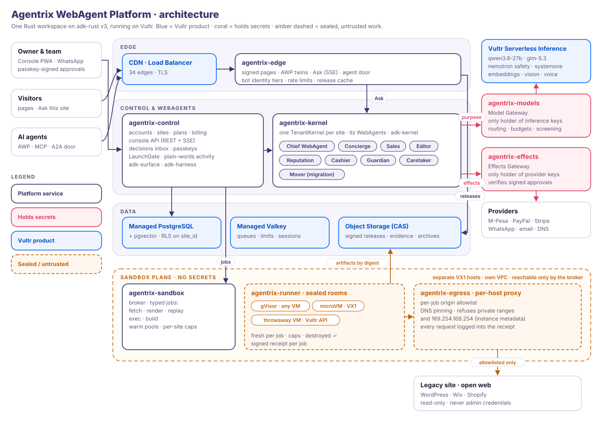
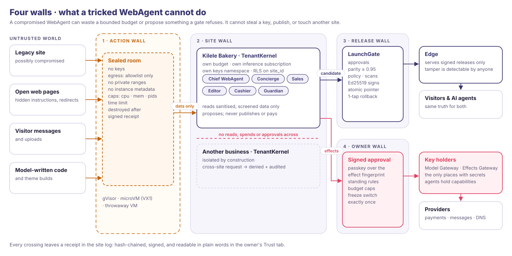
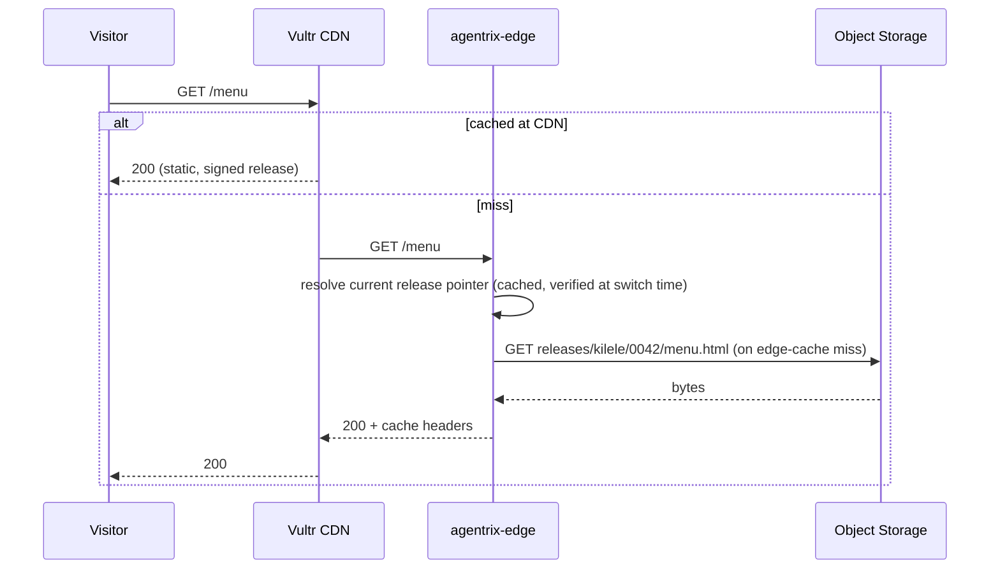
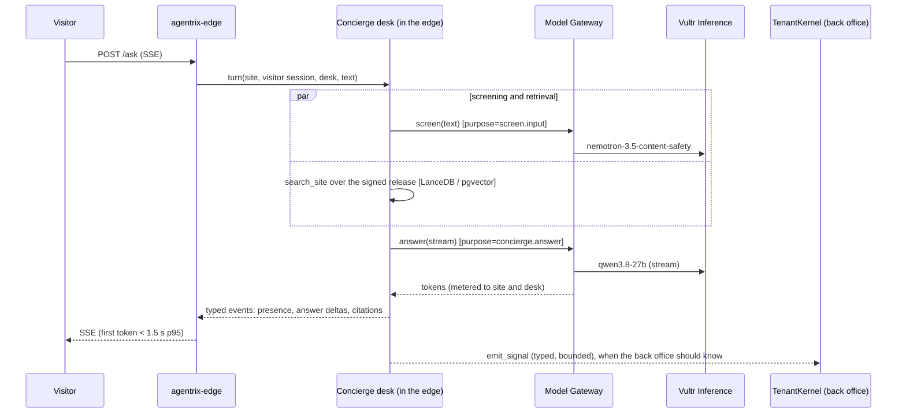
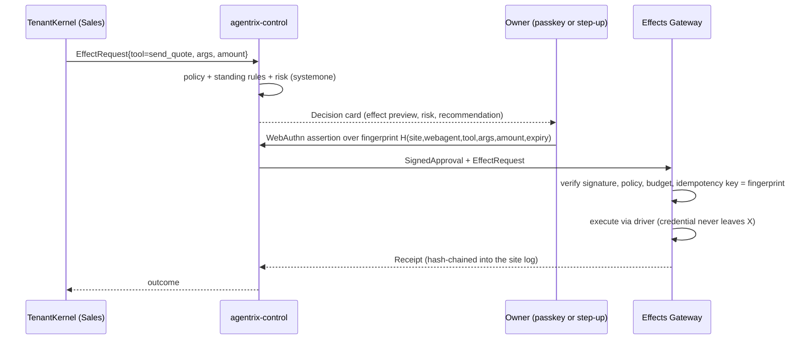
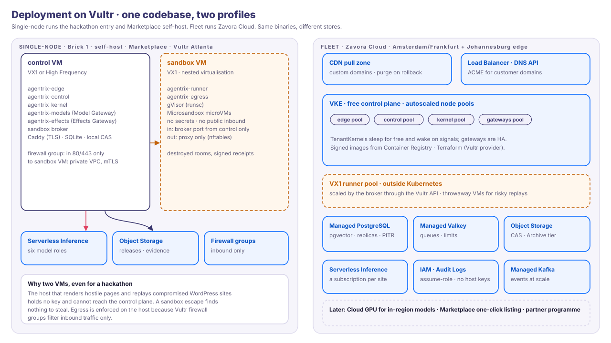

# Agentrix WebAgent Platform: Architecture

Status: architecture v0.1, 7 Nov 2026. Product: [01-product.md](01-product.md). Trust model:
[03-trust.md](03-trust.md). WebAgents: [05-webagents.md](05-webagents.md). Diagrams:
[`docs/diagrams/`](diagrams/).

This architecture is built to last past the hackathon. The first release (the Vultr Agent Rush entry)
is the single-node profile of exactly this design, not a separate demo.

---

## 0. Tenets

1. **Static first.** Pages are signed, static releases served from the edge. No model, no
   database and no agent sits on the page-load path.
2. **Untrusted input lives in sealed rooms.** Anything from the open web, a legacy stack, a
   visitor's upload, or code a model wrote is handled only in the sandbox plane, on hosts that
   hold no secrets.
3. **Agents hold capabilities, never credentials.** Model keys live in the Model Gateway.
   Payment, messaging and DNS credentials live in the Effects Gateway. Nothing else holds a
   secret.
4. **Agents propose, gates decide.** WebAgents produce candidate releases, decision cards
   and effect requests. The LaunchGate, policy and the owner's signed approval decide.
5. **Exactly-once effects.** Every effect carries an idempotency key bound to its approval.
   Kernel runs are durable and survive restarts.
6. **Tenancy is a type.** `SiteId` is threaded through every API, row, metric, token and log
   line. Cross-site access cannot be expressed, and any attempt is denied and audited.
7. **Everything is signed:**
   - releases (Ed25519);
   - approvals (WebAuthn assertions);
   - receipts (hash chain plus signature);
   - our crawler's identity (Web Bot Auth / HTTP Message Signatures).
8. **One codebase, two profiles.** *Single-node* (one or two VMs; SQLite and a local object
   store; self-host, Marketplace, the first release) and *Fleet* (VKE, managed Postgres, Valkey, Object
   Storage, CDN).
9. **Speed is measured, not claimed.** Performance budgets (§9) are enforced by benchmarks in
   CI. Rust runs the whole hot path.
10. **Honest degradation.** Without a model or a driver the system says so. It never fabricates.

## 1. System context



| Actor | Interface |
|---|---|
| Owner and team | Console PWA, Morning Brief and one-tap decisions on WhatsApp and email, passkeys (MFA without one) |
| Visitors | The site (static pages) and "Ask this site" (SSE) |
| AI agents | The agent door: AWP 2.0 twins, MCP, A2A, with verified tiers via Web Bot Auth |
| Legacy site | Read only: public crawl, WordPress REST, WXR export, or a database dump replay. Never admin credentials |
| Vultr Serverless Inference | Called only by the Model Gateway |
| Payment, messaging, DNS, social providers | Called only by the Effects Gateway, through adk-drivers / Steward |

## 2. Planes and services

One Cargo workspace, a few binaries, all on **adk-rust v3** (pinned git revision; see ADR-001).

| Plane | Service | Responsibility | Built on |
|---|---|---|---|
| **Edge** | `agentrix-edge` | Serve releases to humans and AWP twins to agents; the Ask API (SSE) and the Concierge's public desks; the agent door (AWP/MCP/A2A); bot identity tiers; rate limits; cache | axum/hyper, `adk-awp`, `adk-site` (serve, PrefixPointer) |
| **Control** | `agentrix-control` | Accounts, sites, plans (rated and invoiced by `agentrix-billing`); console API (REST + SSE); the decisions inbox; passkeys, MFA and step-up attestations; tenancy; LaunchGate orchestration; plain-words activity | axum, `adk-surface`, `adk-harness` approvals |
| **Agent** | `agentrix-kernel` | One **TenantKernel** per site: its back-office WebAgents ([05](05-webagents.md)), charter jobs, missions, wake sources, durable runs. Produces candidate releases, cards and effect requests | `adk-kernel`, `adk-website`, `adk-harness`, `adk-runner` |
| **Model** | `agentrix-models` | **Model Gateway**, the only holder of Vultr Inference keys: routing by purpose, budgets, rate shaping, input screening, decision models, caching, the usage ledger | `adk-model` (OpenAI-compatible), Valkey |
| **Sandbox** | `agentrix-sandbox` (broker) + `agentrix-runner` + `agentrix-egress` | **Sealed rooms**: fetch, render, replay, exec and build jobs; gVisor / microVM / throwaway-VM runtimes; per-job egress allowlists; artifacts to content-addressed storage; receipts | `adk-sandbox`, `adk-code`, `adk-site::migrate` (`IsolatedReplay`, `HttpClient`) |
| **Effects** | `agentrix-effects` | **Effects Gateway**, the only holder of third-party credentials: verifies the signed approval and policy, then executes email, WhatsApp, payments, DNS or social effects idempotently | `adk-drivers`, `adk-payments`, Steward core |
| **Migration** | `agentrix-move` (library in kernel and control) | The Move: claim → inventory → sanitise/detect/quarantine → map → rebuild → parity → launch | `adk-site::migrate`, `adk-site` generator and gate |
| **Data** | Single node: SQLite files and LanceDB per site. Fleet: Postgres per cell (a schema and a role per site, pgvector beside the records). Object Storage (CAS), Valkey; an outbox relayed to Kafka ([09](09-data-architecture.md)) | Control and tenant state, releases and evidence, queues and limits, content-free events | sqlx, `adk-session`, `adk-kernel` durable stores, `adk-rag` |
| **Lake** | `agentrix-lake` (relay and ingester; pilot onwards) | Relays each store's outbox to Kafka; writes content-free events as Parquet under Apache Iceberg on Object Storage, per cell ([ADR-027](adr/027-content-free-lakehouse.md)) | `agentrix-events`, Arrow, Iceberg |
| **Analytics** | `agentrix-analytics` | The metric catalogue: named, typed metrics with their window, method and sources, for the console, the Chief WebAgent and operator BI; never free SQL ([ADR-029](adr/029-visualisation.md)) | DataFusion |
| **Documents** | `agentrix-docs` (document service) | Spreadsheets, decks, reports and PDFs that WebAgents and desks make, stored as signed artifacts with provenance ([09 §6.3](09-data-architecture.md#63-webagent-generated-charts-reports-and-decks)) | zavora-xlsx, zavora-slide, zavora-docx, zavora-printpdf, linked as crates |
| **Fleet** | `agentrix-fleet` (fleet profile only) | The fleet registry (placement, versions, pins and packs per site); the reconciler; release trains with rings, waves, gates, halts and rollback by pin; provisioning; the inventory reaper. Hosts the operator tenant, whose operator WebAgents do this work under human authority ([08](08-control-plane.md), ADR-017, ADR-020) | `adk-kernel` (managed), `adk-deploy` `RolloutPlan` types, `adk-eval` |
| **Billing** | `agentrix-billing` (crate, used by control and fleet) | Rating usage by tenant path; invoices and dunning; partner statements and payouts; posting to an accounting sink (zavora-era for Zavora Cloud, an export for everyone else) (ADR-024) | `adk-core` spend, `adk-payments` |

Operators drive the fleet through the `agentrix` CLI and API (`status`, `release`, `hold`,
`audit verify`, `mcp serve --read-only`; [08 §6.2](08-control-plane.md#62-the-agentrix-cli-and-api)).
The single-node profile has no fleet or billing service: it ships the seams they build on,
namely receipts, the freeze and per-site spend.

## 3. The four walls, in components



| Wall | Guarantee | Enforced by |
|---|---|---|
| **Action wall** | Untrusted input cannot reach a secret, the network beyond its allowlist, or another job | Sandbox plane on separate hosts; gVisor or microVM; per-job netns; egress proxy; destroy after each job |
| **Release wall** | No agent can change what visitors see | Agents write *candidate* releases; the LaunchGate (approvals, parity, policy, scans) signs and admits; the edge serves signed releases only; rollback is an atomic pointer switch |
| **Site wall** | No site reads, spends or approves for another | TenantKernel per site; `SiteId` in every key; a Postgres schema and role per site, with row-level security on shared tables; a Vultr Inference subscription per site (or per agency); per-site budgets; per-site encryption keys |
| **Owner wall** | Nothing consequential happens without the authority the owner granted | Two key holders (Model and Effects Gateways); approvals bound to effect fingerprints (passkey signatures, or MFA step-ups); standing rules; freeze per site and globally |

## 4. Key flows

### 4.1 A visitor loads a page



No model and no database are involved. Release signatures are verified when the pointer
switches, not per request.

### 4.2 A visitor asks the site a question



The public desks run in the edge, not as kernel processes; the first token is released only
after the screen passes ([05 §4.5](05-webagents.md#45-the-visitors-side-section-desks-threads-and-visitor-memory),
[§8.1](05-webagents.md#81-a-tenantkernel-per-site)). If the kernel stops, Ask keeps answering.

### 4.3 A WebAgent proposes; the owner approves; the effect runs once



### 4.4 The Move (migration)

```mermaid
sequenceDiagram
  participant Ctl as control
  participant B as Sandbox broker
  participant R as Runner (sealed room)
  participant S as CAS (Object Storage)
  participant K as Mover (TenantKernel)
  participant M as Model Gateway
  participant O as Owner
  Ctl->>B: fetch jobs (egress = this site only, robots, rate-limited, signed crawler)
  B->>R: gVisor room per batch
  R->>S: DOM, screenshots, HAR (by digest)
  O->>Ctl: proves domain (DNS TXT or file)
  Ctl->>B: replay job (WXR or DB dump; runtime = microVM; network = internal only)
  R->>S: inventory, extracted media
  K->>K: sanitise · detect · quarantine (evidence), map features
  K->>M: rebuild plan + page code [glm-5.3]
  K->>B: render job (candidate, network = none)
  R->>S: candidate screenshots
  K->>M: vision parity [qwen3.8-27b] + perceptual/text parity
  K->>Ctl: candidate release at parity >= 0.95
  Ctl-->>O: Go-live card (old site kept; undo 30 days)
  O->>Ctl: approve (passkey or step-up)
  Ctl->>Ctl: sign release, switch pointer, purge CDN, start probes
```

### 4.5 Rollback

There is one control: an atomic switch of `current.pointer` to the previous signed release,
followed by a CDN purge. It is available to the owner always, and to the Guardian
automatically when drift or tampering is detected.

## 5. The sandbox plane (replacing the proofs of concept's in-process Chrome)

The Agentrix Website proof of concept launched headless Chrome **on the production host** with
`--no-sandbox`. Chrome inherited the server's environment, keys included, and the fetcher
followed redirects without refusing private addresses. The product replaces both with the
following design.

**Job spec (typed, hashed into the receipt):**
- `kind`: Fetch | Render | Replay | Exec | Build;
- `inputs`: CAS digests;
- `egress`: None | Only{origins} | PublicRead{deny private};
- `limits`: cpu, mem, pids, disk, wall time;
- `runtime`: gvisor | microvm | throwaway_vm;
- `expected outputs`, `site_id`, `job_id`.

**Runtime classes:**

| Class | Where | For | Cold start target |
|---|---|---|---|
| **gVisor** (`runsc`, systrap) containers | Any Vultr VM | Fetch, render, sanitise, model-written code | < 1 s |
| **microVM** (Microsandbox/libkrun or Firecracker), own kernel | **VX1** (nested virtualisation) or Bare Metal | Replaying legacy PHP and databases; high-risk exec | < 3 s |
| **Throwaway VM** via the Vultr API | A fresh VX1 per job; deletion confirmed by API 404 | Large or known-compromised replays | ~1–2 min |

**Host design:**
- Runner hosts are separate VMs in their own VPC and firewall group.
- They hold no secrets. Their instance identity (Vultr assume-role) allows only "write artifacts
  under this job's CAS prefix".
- The broker connects in over mTLS; nothing on the internet can reach a runner.

**Network:**
- Each job gets its own network namespace, deny by default, whose only route is the host's
  `agentrix-egress` proxy.
- The proxy resolves DNS itself, pins the address, and refuses loopback, private, link-local,
  CGNAT, multicast and **`169.254.169.254` (Vultr's instance metadata)**.
- It enforces the job's origin allowlist, byte and rate caps, and logs every request into the
  receipt.
- Vultr firewall groups filter inbound only, so outbound control is enforced with host
  `nftables`: the sandbox bridge can reach only the proxy, and only the proxy may leave the
  host, on 80 and 443.
- **The allowlist is attack surface, and the proxy is our own code.** Anthropic reports that
  "the standard primitives held while our own work around them exposed flaws": the
  hypervisor, seccomp and gVisor held, and "our custom allowlist proxy was the piece that
  failed". It adds that "every function reachable through any domain on an allowlist is now
  an attack surface" ([How we contain Claude across products](https://www.anthropic.com/engineering/how-we-contain-claude),
  May 2026). `agentrix-egress` is a custom proxy, so:
  - a room's allowlist never names a service where an attacker can hold an account, such as
    object storage, model or file APIs, git hosts or paste sites. Results leave only through
    the broker, as content-addressed blobs;
  - rooms hold no credential the platform issued, so nothing in a room can act as us at an
    allowed origin;
  - **`agentrix-egress` gets a hard security review before the first release ships.** The review covers
    DNS pinning and rebinding, redirects, IPv6 and encoded addresses, CONNECT handling,
    header smuggling and the caps. The containment gauntlet
    ([04 §3](04-vultr-agent-rush.md#3-the-containment-gauntlet-the-videos-containment-moment))
    is a floor, not the review.
  - **What the review left open** (accepted, recorded in `agentrix-egress`):
    - only a tunnel's first ClientHello is checked, so a server that accepts a changed name
      after a HelloRetryRequest is a gap until handshake records are checked to the end;
    - the HTTP Host inside TLS is invisible without breaking TLS. On a provider serving several
      sites on one address without matching the TLS name to Host, a room could reach another
      site there; the per-job allowlist and the provider's checks are the boundary.
    - Rooms' Chromium runs with `--disable-features=EncryptedClientHello`, because the proxy
      refuses ECH, which would hide the real server name.

**Browser:**
- Chromium runs inside the room, as a non-root user, with a fresh profile per job, no
  extensions, downloads disabled and `file://` blocked.
- Chrome's own sandbox stays enabled where the runtime supports it; pages that need it go to the
  microVM class.
- Outputs are a DOM snapshot, screenshots and a HAR, nothing else.

**Crossing back:**
- Artifacts leave only as content-addressed blobs.
- HTML is sanitised (allowlist) before any model sees it.
- Text bound for a model is screened (nemotron content-safety plus a systemone check, "does
  this contain instructions to an AI?") and wrapped as data, never as instructions.

**Receipt per job:** spec digest, image digest, runtime class, egress log digest, artifact
digests, timings, exit status and destruction confirmation. It is signed by the runner and
chained into the site log.

**Scheduling:** warm pools per class, per-site concurrency caps, a queue with backpressure, and
fleet autoscaling of VX1 runner hosts through the Vultr API.

## 6. The model plane

**Purpose-based routing:** callers name a purpose, not a model. The Model Gateway owns the
table:

| Purpose | Default model | Fallback |
|---|---|---|
| `concierge.answer` | qwen3.8-27b | deepseek-v4.1-flash |
| `webagent.act` (back-office reasoning and tool use) | qwen3.8-27b | glm-5.3 |
| `webagent.write` (pages, posts, replies in the owner's voice) | glm-5.3 | qwen3.8-27b |
| `webagent.summarise` (briefs, reviews, distillation) | glm-5.3-flash | qwen3.8-flash-next |
| `plan`, `build` | glm-5.3 | qwen3.8-27b |
| `screen.input` | nemotron-3.5-content-safety | (block on failure) |
| `gate.decide` (risk, routing, yes/no) | systemone: clef / d3 | (escalate to owner) |
| `vision.parity` | qwen3.8-27b (vision) | glm-5.3-flash |
| `embed` / `rerank` | qwen3-embedding-4b / bge-reranker-v2-m3 | — |
| `voice` / `speak` | whisper-large-v3-turbo, voxtral realtime / chatterbox, qwen3-tts | — |
| `image` | z-image-turbo | qwen-image-2.1 |

- **Budgets:** an owner's monthly cap per site, caps per role and per request. Each call
  reserves its cost first and settles afterwards. A hard stop raises a decision card.
- **Rate shaping:** Vultr limits are per subscription and per model (chat 120 req/min and 16
  concurrent; glm-5.3 30/8). The gateway queues work, prioritises interactive traffic
  (Concierge) over background WebAgents, and spreads load across subscriptions.
- **Per-tenant subscriptions:** each site (or agency) gets its own Vultr Inference subscription,
  created through the API. Its key lives in the gateway's vault, and usage is reconciled
  against Vultr's usage endpoint. If account limits bind, pooled subscriptions with gateway
  metering take over.
- **Untrusted content is always data:** spotlighted, delimited, screened, and never
  concatenated into system instructions.
- **Residency:** Vultr does not publish where Serverless Inference runs. Its subscription API
  takes no region, and the product page says "six continents" (checked 7 Nov 2026,
  [09 §8.4](09-data-architecture.md#84-residency)). Until Vultr confirms the location in
  writing, owners are told the region is unconfirmed, and the DPA names none.
- **Vultr's Inference API only.** Self-hosted models on GPUs are out of scope (James, 7 Nov
  2026). Every model, embedding, rerank, speech and image call goes to
  [Vultr's Inference API](https://api.vultrinference.com/docs) through the Model Gateway.
- **Voice is a cascade, because the API has no speech-to-speech** (`intent=realtime` is "not in
  this version"):
  - Speech-to-text is a realtime WebSocket (`/v1/realtime?intent=transcription`,
    `voxtral-mini-4b-realtime`, about 480 ms behind the speaker). It is server-to-server only,
    so the gateway relays the owner's audio and the key never reaches a browser. It takes
    16 or 24 kHz PCM16 only, with no telephony codecs. There is no server-side turn detection,
    so the client commits each turn. A subscription holds 5 open sessions per model.
  - Then a streamed chat completion, with tool calls.
  - Then `/v1/audio/speech`, streamed as SSE.

  This is upstream U7 ([05 §10](05-webagents.md#10-upstream-enhancements-to-adk-rust-v3)).

## 7. Data

The data architecture is [09](09-data-architecture.md): data classes, stores, vectors, the
lakehouse, visualisation, tenancy and lifecycle. This table summarises it.

| Store | Holds | Single-node | Fleet |
|---|---|---|---|
| Relational | Accounts, sites, plans, devices, passkeys and MFA enrolments; per-site decisions, receipts index, conversations, leads, orders, memory facts; kernel durable runs, schedules, budgets | SQLite files in a directory per site | **Vultr Managed PostgreSQL** per cell: a schema and a database role per site, row-level security on shared tables (the outbox, the catalog), PITR, replicas. adk-rust's tables have no tenant column, so isolation is by schema, not by row ([09 §7](09-data-architecture.md#7-tenancy-and-isolation-in-every-store)) |
| Content-addressed objects | `releases/<site>/<seq>/…` + `current.pointer` (adk-site PrefixPointer); evidence; job artifacts; exports; encrypted legacy archive | Local directory | **Vultr Object Storage** (Standard; Archive tier for legacy archives) |
| Fast state | Rate limits, sessions, queues, gateway counters, cache-invalidation pub/sub | In-process | **Vultr Managed Valkey** |
| Events | Content-free, typed events (`agentrix-events`) for analytics and audit fan-out | An outbox written in each change's transaction; the site log | The outbox relayed to **Vultr Managed Kafka** by `agentrix-lake` |
| Lake | Content-free analytics history | None in the first release; date-partitioned Parquet at pilot | Apache Iceberg on Object Storage, per cell ([ADR-027](adr/027-content-free-lakehouse.md)) |
| Retrieval | Per-site corpus, memory facts | **LanceDB** beside the site's records; Vultr's Inference vector store for public text in the first release only | **pgvector** beside the records ([ADR-026](adr/026-vectors-beside-their-records.md)) |

**Ownership:** a full export (content, customers, built site, receipts) is a one-click job.
Deletion propagates across every store.

## 8. Identity, authority and approvals

- **Sign-in, on every surface** (the owner console, the control plane and visitor accounts on
  sites):
  - **Primary:** passkeys (WebAuthn).
  - **Without a passkey:** email and password, or social sign-in (Google, LinkedIn or GitHub,
    as each product needs), always with MFA through an authenticator app. There are no magic
    links.
  - Sessions are bound to the device. Roles are owner, manager, viewer and agency.
- **Approvals:** each effect is canonicalised to a fingerprint
  `H(site, webagent, tool, canonical_args, amount, expiry)`.
  - **With a passkey (primary):** the approval is a **WebAuthn assertion whose challenge is
    that fingerprint**. It is the owner's own signature, and anyone can check it offline.
  - **Without a passkey:** the approval is an **MFA step-up**. The card shows the exact effect,
    the owner enters a fresh authenticator code, and control binds that single-use code to the
    fingerprint. It proves the owner held the device at that moment, but it rests on the
    platform's attestation rather than the owner's signature.
  - **Either way,** the Effects Gateway verifies the approval against the fingerprint, uses the
    fingerprint as the idempotency key and runs the effect exactly once. The receipt records
    which method approved it.
  - A WhatsApp tap on a consequential card opens the passkey confirmation, or the step-up
    without one. It never approves silently.
- **WebAgents:** short-lived, attenuable capability tokens scoped to site, tool and effect
  class, minted by control and verified by both gateways.
- **Visiting AI agents:** anonymous reads. Actions need verified tiers (Web Bot Auth or AWP
  tokens) and the owner's policy.
- **The tenant path:** operator → partner → org → site (ADR-018). The org always owns its
  sites. Authority flows down only by a **signed grant**: an agency role, a support grant or
  break-glass, each scoped and time-boxed.
- **Operators (Zavora, agencies, resellers):**
  - **Tokens.** Short-lived, attenuable **operator capability tokens** scoped to a target
    (fleet, cell, partner, org or site set) and a verb class (read-telemetry, rollout, hold,
    rollback, capacity, billing, support-access). Gateways verify them exactly as they verify
    WebAgent tokens.
  - **Content.** Operator tokens never read a site's content. Reading it needs an owner-signed
    support grant.
  - **Break-glass.** It needs two humans, and the owner is told at the time (ADR-023).
  - **Platform hold.** It is separate from the owner's freeze, and neither side can lift the
    other's.
  - **Infrastructure.** Changes are effects. The fingerprint is
    `H(cell, plan_digest, expiry)`, a passkey (or the MFA step-up without one) approves it,
    and the Effects Gateway applies it (ADR-021).
  - **Coding agents.** They propose changes but never hold production credentials, signing
    keys or approval rights (ADR-022).
  - **On Vultr.** Least privilege: IAM service users per workload, resource-scoped policies,
    and instance assume-role, so no long-lived keys sit on hosts. Every operator action is
    written to the operator ledger and reconciled with Vultr Audit Logs. Details:
    [08 §2](08-control-plane.md#2-tenancy-and-roles) and
    [§5.3](08-control-plane.md#53-authority-and-approvals).

## 9. Performance budgets

These targets are enforced by CI benchmarks and load tests (criterion, oha/k6) and tracked as
SLOs in production.

| Path | Budget |
|---|---|
| Edge page, cache hit, in region | TTFB p95 **< 50 ms** |
| Page weight | HTML+CSS **< 60 KB**, no render-blocking JS |
| Largest contentful paint, mid-range phone on 4G | **< 1.2 s** |
| Ask: first token | **< 1.5 s p95** through Vultr Inference; **< 1.0 s** for deterministic and cached answers |
| Console interaction | **< 100 ms** |
| Approval → effect started | **< 2 s** |
| Kernel wake → run claimed | **< 1 s** (sleeping WebAgents cost nothing) |
| Sealed room cold start | gVisor **< 1 s**, microVM **< 3 s** |
| The Move, 50-page WordPress site | **< 10 min** to go-live card |
| Rollback | **< 5 s** to every edge (pointer switch + purge) |

## 10. Cost model

Per small site per month at MVP scale. These are estimates to validate.

**Vultr's published inference prices disagree (7 Nov 2026):**
- The Inference API's own docs, generated from the live model catalog, price **per model**: qwen3.8-27b $0.15 in / $1.00 out per 1M tokens, glm-5.3 $0.75 / $3.00, nemotron-3.5-content-safety $0.05 / $0.15 (source: `api.vultrinference.com/docs/models.md`).
- Vultr's support docs (updated 26 Oct 2026) and product page state a **flat** $0.55 in / $2.75 out per 1M (source: docs.vultr.com, "How do I monitor the usage and cost of my Vultr Serverless Inference subscription").

The table carries both. The flat rate is the conservative ceiling until a real bill settles it. Today's test usage of qwen3.8-27b (119,882 in, 14,646 out) bills about **$0.03 per model** or about **$0.11 flat**, so the console's billing page will show which applies.

| Item | Assumption | Per-model USD | Flat-rate USD |
|---|---|---|---|
| Concierge | 300 conversations × 6 turns, 3K in / 300 out (5.4M in, 0.54M out), qwen3.8-27b | 1.35 | 4.46 |
| Background WebAgents | ~3M tokens, mixed models (~80% input) | 1–4 | ~3 |
| Screening and decisions | ~2M tokens: nemotron screening, systemone decisions ($0.05–0.10) | 0.15 | ~1.10 |
| Retrieval | Embeddings and rerank ($0.05/1M) | < 0.10 | < 0.10 |
| Kernel share | ~100 sites per $60–100 VM | 0.60–1.00 | 0.60–1.00 |
| Serving | Object Storage + CDN share | 0.10–0.50 | 0.10–0.50 |
| Platform overhead | Postgres, Valkey, LB, CDN base, audit | 0.50–1.50 | 0.50–1.50 |
| **Total** | | **≈ 4–9** | **≈ 10–12** |

A migration costs about **$5–30** once (glm-5.3 builds, vision checks, sandbox minutes). It is roughly unchanged under the flat rate, which is cheaper than glm-5.3's per-model price.

The Model Gateway never trusts a price table alone. It meters tokens per site from responses, reconciles against Vultr's `GET /v1/usage` (token counts per model) and the account's billing, and treats this table only as a forecast ([05-webagents.md §8.4](05-webagents.md)).

## 11. Deployment on Vultr



### 11.1 Single-node profile (the first release, self-host, Marketplace)

- **`control` VM** (VX1 or High Frequency): edge, control, kernel, Model Gateway, Effects
  Gateway and broker; Caddy for TLS; SQLite; local CAS mirrored to Object Storage.
- **`sandbox` VM** (VX1, so the microVM class is available): runner, egress proxy, gVisor and
  Microsandbox. No secrets; reachable only from `control` over the VPC.
- **Vultr Serverless Inference** (subscription) and **Vultr Object Storage** (releases and
  evidence).
- **Firewall groups:** `control` accepts 80/443 only; `sandbox` accepts only the broker port from
  `control`. Host `nftables` enforces egress.

### 11.2 Fleet profile (MVP → scale)

- **VKE** (free control plane) with node pools for edge, control, kernel and gateways.
- **Sandbox runners stay outside Kubernetes** as a VX1 pool scaled by the broker through the
  Vultr API, a stronger boundary than pods.
- **Data:** Managed PostgreSQL (with replicas), Managed Valkey, Object Storage.
- **Edge:** CDN pull zone, Load Balancer, the DNS API for customer zones, ACME (Auto SSL only
  covers Vultr DNS domains).
- **Supply and governance:** Container Registry for signed images; Audit Logs; Terraform (Vultr
  provider) plus vultr-cli for the CDN.

### 11.3 Regions

| Use | Region |
|---|---|
| The first release | **Atlanta**: VX1 and Object Storage |
| MVP control plane | **Amsterdam**: VX1 and Object Storage, midway between Africa and Europe. **Frankfurt** has no Object Storage (7 Nov 2026), so it holds standby compute and a Postgres replica only; backups and release copies go to Milan (EU) or London ([09 §8.4](09-data-architecture.md#84-residency)) |
| African serving | **Johannesburg** edge and compute (no VX1 or Object Storage there; releases replicate in) |

### 11.4 Cells and the global layer (ADR-019)

The fleet profile is deployed as **cells**. A cell is one region's complete stack and the unit
of deployment and blast radius:
- a VKE cluster;
- Managed PostgreSQL;
- Valkey;
- Object Storage buckets;
- CDN pull zones;
- its own VX1 runner pool.

Each site has one **home cell** for its kernel and stores. A thin **global layer** runs in the
primary cell, with a standby in a second cell. It holds:
- the fleet registry;
- the rollout controller;
- billing;
- the operator tenant;
- the console and partner APIs.

Release trains move cell by cell. A cell has a site cap, and past it a new cell opens. The
The first release single node counts as cell `atl-0`. The plan is `ams-1` first, then `fra-1` as the
standby for compute and the database (its backups and release copies live in Milan or London,
since Frankfurt has no Object Storage), then `jnb-1` as an edge cell for African sites. Details:
[08 §3.2](08-control-plane.md#32-cells-and-regions).

## 12. Operations

- **Telemetry:** OpenTelemetry (`adk-telemetry`) traces from edge to kernel to gateways to
  sandbox, all carrying `site_id`. Logs are content-free by default.
- **SLOs:** dashboards for every budget in §9, per-site spend and anomaly alerts.
- **Recovery:** Postgres PITR, object replication, releases that are immutable by construction,
  restore drills.
- **Quality:** chaos tests (kill a kernel mid-run; partition a runner) and a cross-tenant
  isolation test suite run in CI.

## 13. Repository layout (planned)

```text
crates/
  agentrix-types     SiteId, TenantPath, EffectRequest, fingerprints, receipts, capability
                     and operator tokens, grants
  agentrix-edge      bin: pages, twins, Ask, agent door
  agentrix-control   bin: accounts, console API, decisions, passkeys and MFA, LaunchGate
  agentrix-fleet     bin: fleet registry, reconciler, rollout controller, operator tenant
  agentrix-billing   rating, invoices, dunning, partner statements, payouts
  agentrix-cli       bin `agentrix`: status, release, hold, audit verify, mcp serve
  agentrix-events    typed, versioned, content-free event records; the boundary lint
  agentrix-lake      bin: outbox relay and Iceberg ingester (pilot onwards)
  agentrix-analytics the metric catalogue over records, Parquet and gold tables
  agentrix-keys      bin: the data-key holder (ADR-030, proposed)
  agentrix-kernel    bin: TenantKernels, WebAgents, charter jobs (adk-kernel, adk-website)
  agentrix-models    bin: Model Gateway
  agentrix-effects   bin: Effects Gateway (adk-drivers, Steward)
  agentrix-sandbox   broker library + agentrix-runner bin + agentrix-egress bin
  agentrix-move      migration orchestration on adk-site::migrate
  agentrix-console   console PWA (server-rendered + islands)
  agentrix-docs      bin: document service linking zavora-xlsx, -slide, -docx, -printpdf
deploy/              terraform/, cloud-init/, images/ (sandbox images, signed)
docs/ concept/
```

## 14. What the proofs of concept taught us

| Proof-of-concept shortcut | Risk | Product decision |
|---|---|---|
| Headless Chrome on the production host, `--no-sandbox`, inheriting the server's environment | Renderer exploit = host and key compromise | Render only in sealed rooms on sandbox hosts with no secrets (§5) |
| Fetcher follows redirects without refusing private addresses | SSRF into the console and cloud metadata | Egress-checked client in the room plus a pinning proxy that refuses private and metadata ranges |
| Model key in the server's environment, shared by every agent | One leak = everything; no per-site metering | Model Gateway; a Vultr subscription per site; agents hold capabilities |
| Owner console with a prefilled demo password and a cookie session | Account takeover | Passkeys first, authenticator MFA otherwise, no magic links; approvals bound to the effect fingerprint |
| An approval card decided once, but its effect not guaranteed once | Double charges, double sends | Fingerprint-bound signed approvals; idempotent Effects Gateway |
| SQLite per concern on one host | No high availability, hard to scale | Postgres + Object Storage in the fleet; SQLite only single-node |
| Path dependencies on a sibling adk-rust checkout | Unreproducible builds | Pinned git revision, `Cargo.lock`, SBOM, signed images |
| Migration's "hand off to a local coding CLI" | Off-platform code with no containment | An in-platform builder agent, with renders in sealed rooms |
| Spatial UI, gestures, 3D stage | Delight without control | A calm, phone-first console; voice optional |
| Honest mocks when keys are missing | (A good idea) | Kept as tenet 10 |

## 15. Decisions

| ADR | Decision |
|---|---|
| [001](adr/001-build-on-adk-rust-v3.md) | Build on adk-rust v3 at a pinned git revision, not 2.3.0, which lacks the kernel, website and migration crates |
| [002](adr/002-open-core-mit.md) | The platform is MIT open source; Zavora sells the managed cloud, agency tier, packs and support |
| [003](adr/003-sandbox-plane.md) | Untrusted work runs only on separate, secret-free sandbox hosts, in gVisor / microVM / throwaway VMs |
| [004](adr/004-two-key-holders.md) | Only the Model Gateway and Effects Gateway hold secrets; agents hold capability tokens |
| [005](adr/005-static-signed-releases.md) | Visitors are served signed static releases; agents never sit on the page path |
| [006](adr/006-passkey-signed-approvals.md) | Approvals are bound to effect fingerprints, by passkey (primary) or MFA step-up, and executed exactly once |
| [007](adr/007-two-profiles.md) | One codebase, two deployment profiles: single-node and fleet |
| [008](adr/008-vultr-primary-cloud.md) | Vultr is the primary cloud; region plan as in §11.3; residency disclosed |
| [009](adr/009-webagents-terminology.md) | "Staff" becomes "WebAgents"; the lead WebAgent is the Chief WebAgent |
| [010](adr/010-webagent-anatomy.md) | A WebAgent is a governed kernel process with its own principal, built on adk-harness's website kits |
| [011](adr/011-partitions-and-coordinator.md) | Two partitions joined only by typed signals; a hub-and-spoke back office; no A2A between a site's own WebAgents |
| [012](adr/012-autonomy-per-job.md) | Autonomy is per job on adk-kernel's ladder; standing grants are signed; irreversible effects are capped at Ask me first unless a signed rule states its limits (amended 7 Nov) |
| [013](adr/013-no-swarm-fleet-learning.md) | No swarm inside a site; fleets learn through signed artefacts and private aggregates only |
| [014](adr/014-one-decision-contract.md) | One decision contract on every surface; consequential decisions need a passkey or an MFA step-up |
| [015](adr/015-tenant-kernel-per-site.md) | A kernel per site, started on wake |
| [016](adr/016-evaluation-gates.md) | Evaluation gates promotions, playbook revisions and model routing |
| [017](adr/017-zavora-runs-on-zavora.md) | Zavora runs on Zavora: operations are done by WebAgents in an operator tenant, under human authority |
| [018](adr/018-tenant-path.md) | The tenant path is operator → partner → organisation → site; authority flows down only by signed grant |
| [019](adr/019-cells.md) | Cells are the unit of deployment and blast radius, with a thin global layer and a standby |
| [020](adr/020-release-trains-and-rings.md) | Release trains with rings and waves; ring 0 is Zavora's own sites; rollback by pin; behaviour changes need owner consent |
| [021](adr/021-infrastructure-changes-are-effects.md) | Infrastructure changes are effects: plan-digest fingerprints, approvals by passkey or MFA step-up, applied by the Effects Gateway |
| [022](adr/022-coding-agents-propose.md) | Coding agents propose and pipelines dispose: no coding agent holds production credentials, signing keys or approval rights |
| [023](adr/023-support-grants-and-break-glass.md) | Support access is an owner-signed, time-boxed grant; break-glass needs two people and tells the owner at the time |
| [024](adr/024-billing-in-the-open-core.md) | Billing lives in the open core; Zavora's books live in zavora-era |
| [025](adr/025-data-classes-and-the-content-free-boundary.md) | Five data classes; personal and business-confidential data never leave their site's stores; cross-site views are content-free |
| [026](adr/026-vectors-beside-their-records.md) | Vectors live beside their records: pgvector in the fleet, LanceDB on a single node |
| [027](adr/027-content-free-lakehouse.md) | A content-free lakehouse per cell, fed by a transactional outbox through Kafka |
| [028](adr/028-one-erasure-and-export-path.md) | One erasure and export path, with a receipt from every store and erasures replayed after any restore |
| [029](adr/029-visualisation.md) | Typed metrics for owners, gold tables for operators, signed documents with provenance for WebAgents |
| [030](adr/030-data-keys-have-their-own-holder.md) | Per-site data keys are wrapped by a key-encryption key held by a third key holder, not by either gateway |
| [031](adr/031-a-webagent-is-a-living-mark.md) | A WebAgent is a living mark: owners brand the look, the platform keeps the meaning of every state |
