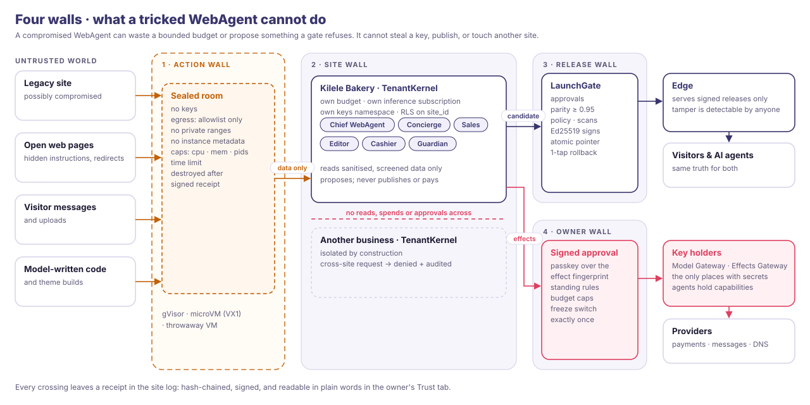

# Agentrix WebAgent Platform: Trust and security

Status: v0.1, 7 Nov 2026. Architecture: [02-architecture.md](02-architecture.md).

A website that acts for a business must earn trust from four parties at once:
- **owners**, whose business it speaks for;
- **their customers**, who talk to it;
- **the people whose sites we read**;
- **Vultr**, whose network it runs on.

This document states what we promise each of them and how the system enforces it. Every
promise here is meant to be tested (§8), not just asserted.

## 1. Promises

| To | We promise | Enforced by |
|---|---|---|
| **Owners** | Nothing goes live until you say so; undo is one tap for 30 days | LaunchGate; atomic release pointer; legacy site kept as a fallback release |
| | WebAgents never act beyond the authority you granted | Autonomy per job and per effect class; signed standing grants; budgets; freeze |
| | No WebAgent ever sees your passwords, card or wallet credentials | Two key holders (Model and Effects Gateways); capability tokens |
| | Every approval is yours and cannot be reused | A passkey signature over the effect fingerprint (primary), or without a passkey a single-use MFA step-up bound to it; exactly-once execution; the receipt names the method |
| | Your site, data and code are yours | One-click export; MIT open source; self-host on Vultr |
| | Zavora never reads your site's content without your signed grant; emergency access needs two people, and you are told at the time | Operator tokens carry no content access; support grants are owner-signed and time-boxed; break-glass needs two humans and notifies the owner (ADR-023) |
| **Their customers** | You always know you are talking to AI | Disclosure in the Ask bar and in every handover |
| | Answers come from the business's own facts, or the site says it doesn't know | Grounded retrieval with citations; no-promise rules (prices, dates and refunds only as stated) |
| | Your conversations stay with this business | Site wall; no cross-site retrieval; no training on customer data |
| **Site owners we read** | Our crawler is polite and identifiable | Web Bot Auth signatures, robots.txt, rate limits, a published crawler page |
| | Without proof of control, we read only what is public | Deep sources (WordPress REST, exports, replays) unlock only after domain proof |
| **Vultr** | Our hosts are never an attack platform or an open proxy | Per-job egress allowlists; byte and rate caps; no generic proxying; abuse monitoring |
| | We never probe Vultr's internal services | The egress proxy refuses link-local addresses including `169.254.169.254` |
| | We run your stack as designed | Sandboxes per your agent-sandboxing guide (VX1 + microVMs), IAM assume-role, Audit Logs |

## 2. Threat model

| Asset | Threat | Controls |
|---|---|---|
| Owner's credentials (inference, payments, messaging, DNS) | An injected agent asks for or leaks them; a sandbox escape; SSRF to instance metadata | Agents never hold secrets (ADR-004); sandbox hosts hold none (ADR-003); metadata and private ranges refused; Vultr assume-role instead of long-lived host keys |
| Live site integrity | A tricked agent publishes; storage tampering; supply-chain injection into a theme | Release wall: only signed releases served; LaunchGate scans; Guardian drift probes with automatic rollback; signed images; SBOM |
| Customer data | Cross-tenant leakage; over-collection; reuse for training | `SiteId` everywhere plus Postgres RLS; per-site encryption keys; data minimisation; retention limits; Vultr states vector-store data is not used for training |
| Money | Unauthorised payment; double charge; refund abuse | Passkey approvals (or an MFA step-up without a passkey) above the owner's signed limit; idempotency keys; Steward's hash-chained ledger; per-category mandates |
| Owner's reputation | An agent posts something harmful or false, fabricates reviews, or impersonates a human | Public posts start at "Ask me first"; fabricated reviews are impossible by policy; AI disclosure; voice guardrails; content-safety screening on output |
| Visitors | Manipulated or false answers | Citations; "I don't know" as a first-class answer; no promises beyond stated facts; injection screening on input |
| Third-party sites | Crawler overload; ignoring robots; scraping beyond consent | Identified crawler; robots; rate limits; deep sources only after domain proof |
| Vultr's network and reputation | Our IPs used for attacks, spam or scraping at scale; metadata probing | Allowlisted egress per job; volume caps; no open proxy; metadata blocked; abuse alerts |
| The platform itself | Dependency compromise; malicious contributor; leaked deploy keys | Pinned adk-rust revision and `Cargo.lock`; cargo-deny/cargo-audit; SBOM; cosign-signed images; protected main branch with reviews; short-lived deploy credentials |

**Assumed adversaries:** prompt injection in any text from outside (pages, messages, reviews,
emails, uploads); a compromised legacy site actively trying to escape; a curious tenant probing
other tenants; an opportunistic attacker on the public edge. **Out of scope for v1:**
nation-state attackers and malicious Vultr insiders. Vultr's data-centre controls (SOC 2,
ISO 27001, PCI) are inherited.

## 3. Controls through the lifecycle

| Phase | Key controls |
|---|---|
| **Assess** | Public crawl only; sealed rooms; identified, rate-limited crawler; findings carry evidence; no guessing |
| **Claim** | DNS TXT or file proof before any deep source; proof re-checked at go-live |
| **Replay** | microVM or throwaway VM; internal network with no route out; dump mounted read-only; destroyed afterwards; the legacy export kept as an encrypted archive and never deleted without the owner's decision |
| **Clean** | Allowlist sanitiser; detectors (spam links, cloaking, executables, MIME mismatch, obfuscated scripts); quarantine needs a decision per item; screening for hidden instructions to AI |
| **Rebuild** | Model output treated as untrusted code: built and rendered only in sealed rooms; no network during render |
| **Launch** | Parity ≥ 0.95; a go-live card signed by the owner; the old site kept as fallback; probes start immediately |
| **Operate** | Autonomy ladder; budgets; standing rules; screening on input and output; Effects Gateway verifies every approval |
| **Maintain** | Drift and tamper probes; automatic rollback; certificate, backup and renewal checks; capability-pack updates as signed releases |

## 4. Responsible crawling (because the crawler runs from Vultr's IP space)

- Identifies itself with HTTP Message Signatures / Web Bot Auth, and a public page at
  `/.well-known/agentrix-crawler` explains who we are and how to opt out.
- Honours `robots.txt`, `crawl-delay` and `noindex`, and backs off on 429 and 503.
- Default politeness is one request at a time per site, with a page cap per assessment.
- Before domain proof, reads only public pages and feeds. After proof, still only what the owner
  can export.
- Every request is logged in the job receipt, with an abuse contact on the crawler page.

## 5. Privacy and data

| Data | Purpose | Retention | Where |
|---|---|---|---|
| Owner account, devices, passkeys, password hashes, MFA enrolment, linked social sign-ins | Access | Life of the account | Control database |
| Site content and releases | Serving | Until the owner deletes; immutable versions for rollback | Object Storage |
| Visitor conversations | Answering, handover, the owner's review | 90 days by default, owner-configurable | Tenant database |
| Leads, orders, bookings | The business's own records | Owner-controlled | Tenant database |
| Crawl evidence and job receipts | Proof and audit | 1 year | Object Storage |
| Legacy archive (encrypted) | Fallback and the owner's property | Until the owner deletes | Object Storage (Archive tier) |
| Visitor memory (consented) | Continuity and preferences a signed-in visitor asked the site to keep | Session only by default; with a consent receipt, until the visitor deletes it or revokes consent (effective within an hour) | Tenant database, read only by public desks; never by back-office WebAgents |
| Visitor artifacts | Documents a visitor made with a desk, and their share links | 30 days by default unless the visitor saves them; share links revocable | Tenant database and CAS |
| Analytics lake | Owner metrics, fleet statistics; content-free only (ids, kinds, counts, durations, keyed hashes) | Raw events 13 months; aggregates kept | Object Storage, per cell (pilot onwards) |
| Telemetry | Running the service | Traces 7 days, logs 30 days, metrics 13 months; content-free | The observability backend |
| Event stream | Fan-out to the lake and audit | 3–30 days by topic; content-free | Managed Kafka (fleet) |
| Backups | Recovery | Database point-in-time recovery 14 days; nightly per-site exports 30 days, sealed with the site's key | The disaster-recovery region: Milan (EU) or London |
| Model prompts and outputs | Answering | Not stored by the gateway beyond receipts and usage. Vultr `/v1/responses` does not store; uploaded files expire after 30 days | Vultr Serverless Inference; region not published by Vultr (being confirmed) |

- **Residency:** Vultr does not publish where Serverless Inference runs. Its subscription API
  takes no region, and its product page says "six continents" (7 Nov 2026). Until Vultr
  confirms the location in writing, owners are told at signup that the model provider's
  region is unconfirmed, and the DPA does not name one. Site records, vectors and objects stay
  in the site's home cell ([09 §8.4](09-data-architecture.md#84-residency)). Every model call
  goes to Vultr's Inference API; the platform runs no models of its own.
- **Export and erasure:**
  - Export of everything is one click.
  - Deletion propagates across every store, including retrieval indexes and the lake, and
    every store returns a receipt ([ADR-028](adr/028-one-erasure-and-export-path.md)).
  - **Erasures are replayed after any restore**, from the erasure ledger, so a backup never
    brings deleted data back.
  - Closing a site destroys its data key, which makes every encrypted copy unreadable,
    including copies in backups ([ADR-030](adr/030-data-keys-have-their-own-holder.md)).
  - adk-core's `SubjectRights` is the path (adk-rust #1334, which closed the #1283 epic). The
    adapters for the kernel, harness, website and payments stores remain
    ([09 §10](09-data-architecture.md#10-what-the-framework-must-add), D4, D5, D16, D17).

## 6. Verifiability

- **Open source (MIT):** anyone can read exactly what the WebAgents can do.
- **Signed releases:** anyone can check that a live page is an approved release (`awp verify`).
- **Receipts:** hash-chained and signed, exportable and checkable offline.
  - **Each issuer signs with its own key,** published at `/.well-known/agentrix/keys`, and
    every receipt names its issuer:
    - the edge signs conversation artifacts and consent receipts;
    - control signs job receipts and decisions;
    - the Effects Gateway signs effect receipts (payments, refunds, messages). In the first release
      there is no Effects Gateway yet, so control signs everything.
  - **One check verifies any receipt:** the Verify button in the browser, or
    `agentrix audit verify --receipt <digest>`, with `--site` for a site's whole chain.
  - **`awp verify` answers a different question:** is this live page an approved release?
- **Honest data:** the console and brief show recorded activity only, never filler.

## 7. Operations

- **SECURITY.md:** a disclosure address and response targets (acknowledge within 48 h; critical
  fixes within 7 days).
- **Incident response:** freeze switches per site and globally; Guardian rollback; owner
  notification within 72 hours of a confirmed incident affecting their data.
- **Abuse handling** ([08 §3.8](08-control-plane.md#38-abuse-handling)):
  - **Intake.** Vultr abuse reports, crawler complaints, and phishing and spam reports all
    arrive at one inbox desk. Like a site's Concierge, it reads untrusted text and holds no
    privileged tool.
  - **Evidence.** It comes from job receipts, so a complaint about an IP and a time is
    answered with the exact requests made, or with proof that none were.
  - **Without a human.** The Security WebAgent may add a crawler deny-list entry, or throttle
    a site's messages for up to 24 hours.
  - **With a human.** Suspending effects or placing a platform hold needs a human.
    Terminating an account needs two.
- **Out-of-band change detection:** every Vultr API call the platform makes carries a receipt
  id, and Vultr Audit Logs are reconciled against the operator ledger. An audit event with no
  matching receipt counts as an out-of-band change. It pages Security and is investigated.
  The target is zero such events.
- **Before general launch:** an external penetration test of the edge, sandbox plane and
  gateways; a cross-tenant red-team exercise.
- **Compliance path:** map controls to SOC 2 Type I during the pilot, inheriting Vultr's
  data-centre certifications.

## 8. How trust is tested

| Test | Runs |
|---|---|
| **Containment gauntlet:** SSRF to metadata and localhost, hidden instructions, spam links, cloaking, a disguised webshell, an exfiltrating replay, fork and memory bombs, visitor injection | Every CI run and every deploy; the score shown publicly |
| **Cross-tenant suite:** every API and store queried with another site's identity, which must be denied and audited | Every CI run |
| **Approval integrity:** replayed, altered and cross-effect approvals must all be refused; the effect executes exactly once under retries | Every CI run |
| **Release integrity:** tampered objects and pointer swaps are detected and rolled back | Every CI run plus Guardian probes in production |
| **Chaos:** a kernel killed mid-run, a runner partitioned, the gateway restarted | Weekly |

## 9. What changed from the proofs of concept

The Agentrix Website proof of concept, built in a week for another hackathon, made choices that
are unacceptable in a product. Its migration screenshotted arbitrary URLs with headless Chrome
on the production host, using `--no-sandbox` and inheriting the server's environment. Its
fetcher did not refuse private addresses. Its owner console used a demo password. Every one of
these is replaced (see [02-architecture.md §14](02-architecture.md#14-what-the-proofs-of-concept-taught-us)).
A fix for the live demo is tracked separately so the running boutique is hardened too.
