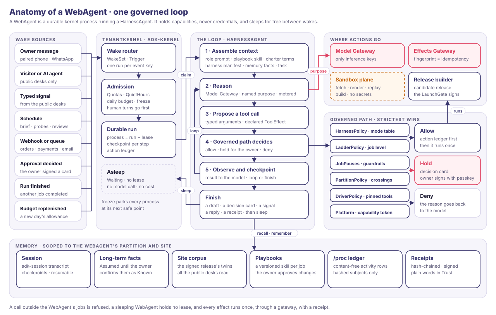
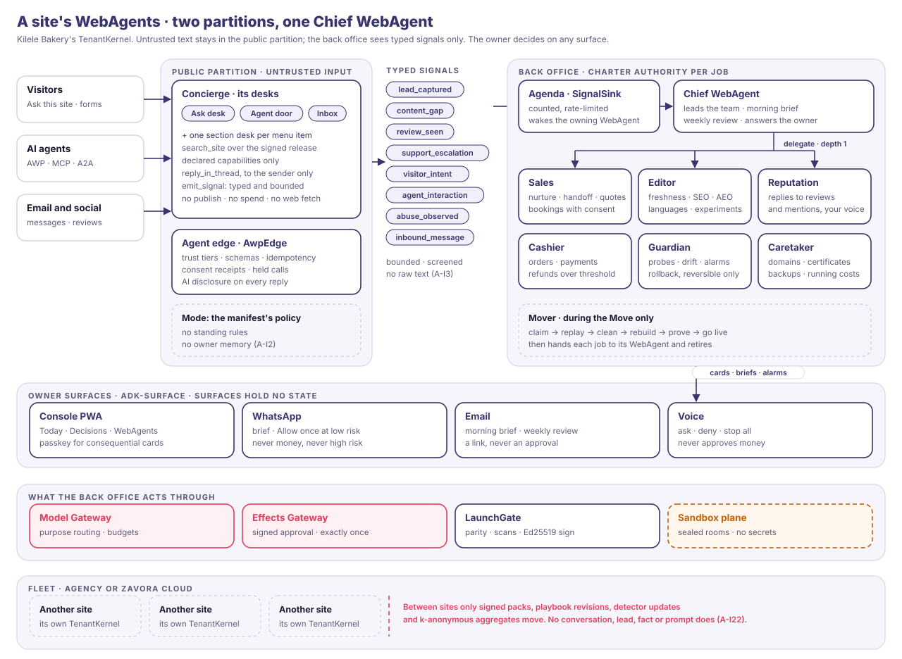
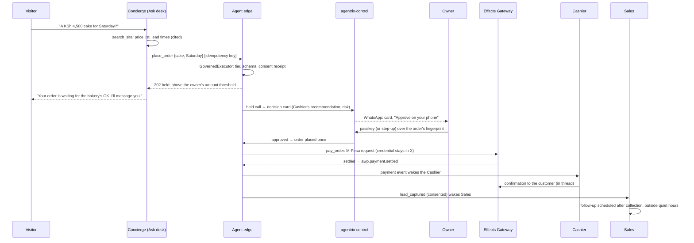

# Agentrix WebAgent Platform: WebAgents

Status: design v0.1, 7 Nov 2026. Product: [01-product.md](01-product.md). Architecture:
[02-architecture.md](02-architecture.md). Trust: [03-trust.md](03-trust.md). Decisions:
[ADR-009 to ADR-016](adr/). Diagrams: [`webagent-anatomy.svg`](diagrams/webagent-anatomy.svg),
[`webagent-team.svg`](diagrams/webagent-team.svg).

This document designs the agents themselves: what one WebAgent is and how it runs, how a
site's WebAgents work together, where swarm patterns help and where they do not, how
WebAgents reach the owner, visitors and other agents, and how they are deployed and run in
production. It fills in the **Agent** plane of [02-architecture.md §2](02-architecture.md#2-planes-and-services).

The substrate is **adk-rust v3** (Zavora's open-source Rust agent framework, Apache-2.0),
pinned by [ADR-001](adr/001-build-on-adk-rust-v3.md). Code references are to adk-rust
`main` at `ffbfb053f` (the revision the first release spike passed on), written as
`crate/src/file.rs:line`. Spec references are to adk-rust's design specs in `docs/design/`:
3.1 (harness), 3.2 (kernel), 3.3 (surfaces), 3.5 (AWP 2.0 and `adk-website`). Invariants
named `A-I…` are spec 3.5 §9.2 and `K-I…` are spec 3.2 §9.2. Where v3 lacks something, §10
lists it as an upstream enhancement (U1–U16) instead of assuming it.

---

## 0. Tenets

1. **A WebAgent is a governed process, not a chatbot.** It is a durable kernel run that
   sleeps on a wake set, wakes for a reason, works through one governed tool path and goes
   back to sleep. Conversation is one of its inputs, not its shape.
2. **One WebAgent, one identity.** Every runtime agent has its own principal, its own jobs,
   its own budget and its own receipts. "Who did this?" always has one answer.
3. **Untrusted text never meets privileged tools.** The desks that read visitors, email and
   other agents hold no privileged tool. The back office never reads their raw text, only
   typed signals (spec 3.5 D-5, A-I2, A-I3).
4. **Authority is per job, earned, and only the owner raises it.** The site can lower its own
   autonomy and never raise it (A-I13).
5. **Capabilities, never credentials.** WebAgents hold short-lived capability tokens. Model
   keys live in the Model Gateway and provider keys in the Effects Gateway
   ([ADR-004](adr/004-two-key-holders.md)).
6. **Sleeping costs nothing.** A sleeping WebAgent holds no lease and makes no model call
   (K-I2). Cost follows work, not headcount.
7. **One lead, not a crowd.** Inside a site, one Chief WebAgent leads and specialists do the
   work. Swarm patterns are used only where the work is bulk, stateless and sandboxed (§6).
8. **Surfaces hold no state.** Every surface renders the same decisions from the kernel, under
   one per-surface rule table (K-I17).
9. **Learning moves as signed artefacts, never as data.** Improvements cross between sites as
   reviewed playbooks, detectors and packs. Customer data never crosses (A-I22).
10. **Honest degradation.** A WebAgent that cannot do something says so in plain words. It
    never invents activity, answers or numbers.

## 1. Vocabulary

| Term | Meaning | In adk-rust |
|---|---|---|
| **WebAgent** | An owner-facing AI worker of one site: a name, a mandate, jobs, a budget and autonomy the owner controls | Backed by one or more runtime agents |
| **Runtime agent** | One governed agent with its own principal, in one partition | `adk_harness::HarnessAgent` over an `LlmAgent` |
| **Desk** | One runtime agent of a WebAgent that serves several channels (the Concierge has three) | A public-partition `HarnessAgent` |
| **Job** | A unit of authority: what a WebAgent may do, at what autonomy level, within what limits | `awp_types::JobAuthority` in the charter, `adk_harness::website::JobBinding` on the ladder |
| **Process** | A WebAgent's job, running or asleep | A durable run with an `adk_kernel::ProcessMeta` row |
| **Charter** | The site's signed goals, KPIs, guardrails, authority, budget, voice and red lines | `awp_types::Charter` (`awp-types/src/v2/charter.rs:36`) in `adk_kernel::charter::CharterStore` |
| **Signal** | A typed, bounded message from the public partition to the back office | `awp_types::SignalKind` (`awp-types/src/v2/signal.rs:61`) through `adk_kernel::charter::SignalSink` |
| **Decision card** | A held call shown to the owner with its effect, risk and recommendation | `adk_surface::DecisionCard` (`adk-surface/src/model.rs:316`) |
| **Effect request** | A consequential action sent to the Effects Gateway with its approval | Platform type in `agentrix-types` ([02 §4.3](02-architecture.md#43-a-webagent-proposes-the-owner-approves-the-effect-runs-once)) |
| **Mission** | A time-boxed goal the owner gives in words, compiled by the Chief WebAgent onto existing jobs (§4.6) | Platform type over charter goals, the agenda and standing triggers |
| **Receipt** | A hash-chained, signed record of what happened | `adk_auth::signed_audit::AuditLog` (`adk-auth/src/signed_audit/log.rs:192`) plus the platform's site log |

## 2. The roster

### 2.1 The WebAgents

Owner-facing names, mandates and starting levels are product decisions
([01-product.md §4.2](01-product.md#42-the-webagents)). This table is how each one is built.
Job ids are `adk-website`'s (`JOBS`, `adk-website/src/jobs.rs:186`, the spec 3.5 §7.20 table)
unless marked *platform*.

| WebAgent | Runtime agents (principal `urn:adk:agent:{site}/…`) | Partition | Built from `adk-website` role | Jobs | Wakes |
|---|---|---|---|---|---|
| **Chief WebAgent** | `coordinator` | Back office, team coordinator | `Steward` | `goals`, `weekly-review`, `owner-questions`, `playbook-learning`; *platform* `morning-brief` | Owner messages from paired devices; the daily brief; Monday's review; signals `support_escalation`, `inbound_message`, `visitor_intent`, `agent_interaction` |
| **Concierge** | `concierge` (Ask desk), `agent-desk` (Agent door), `inbox` (Inbox), and a section desk `desk-{slug}` per menu item the owner turns into a desk (§4.5) | Public | `Concierge`, `AgentDesk`, `Inbox` | `presentations`, `agent-front-door`, `capture`, `multilingual` (conversation), `email` (in-thread replies) | Ask this site (chat, SSE); A2A, MCP and HTTP calls; email and social webhooks |
| **Sales** | `sales` | Back office | `Revenue` | `nurture`, `handoff`, `sell` (quotes and bookings), `email` (sequences) | `lead_captured` signals; daily follow-ups; order events |
| **Editor** | `editor` | Back office | `Growth` (content jobs) | `freshness`, `seo`, `aeo`, `agent-search`, `multilingual` (pages), `experiments` | `content_gap` signals; KPI movements; schedules |
| **Reputation** | `reputation` | Back office | `Growth` (social job) | `social` (playbook `review-replies`) | `review_seen` signals |
| **Cashier** | `cashier` | Back office | `Revenue` (`sell`, payments half) | *platform* `payments`: settlement, refunds, reconciliation with M-Pesa, PayPal and Stripe | Payment and order events; nightly reconciliation |
| **Guardian** | `guardian` | Back office | `Guardian` | `protect`, `alarms` | Probes every 5 minutes; `abuse_observed` signals; status changes |
| **Caretaker** | `caretaker` | Back office | `Guardian` (hosting watch) and `Finance` (wallet) | `hosting`, `running-costs`, `cost-and-return`; upkeep proposals | Daily watch; advisories; renewals; monthly reconciliation |
| **Mover** | `mover` | Back office, during the Move only | `Steward` (`onboarding`) | `onboarding` and the Move's stages ([01 §4.4](01-product.md#44-the-move-migration-as-a-show)) | The owner starting the Move |

`adk-website`'s `advertising` job (Growth with Finance) is not in the default roster. It ships as
a capability pack, off by default, owned by Sales with the Caretaker holding its budget.

The table splits `adk-website`'s eight roles more finely on purpose. `adk-website`'s `Growth`
holds publishing, social posting and experiments in one agent; here the Editor cannot post to
social media and Reputation cannot publish pages. `adk-website`'s `Revenue` handles both
leads and money; here Sales cannot refund and the Cashier cannot email a lead. Each split
shrinks what one injected WebAgent could do.

**How it is built today.** `adk-website`'s roster is a closed enum, `AgentRole`
(`adk-website/src/team.rs:58`), with a constant job table. The ladder underneath it is open:
`JobBinding::new(job, agent, tools)` takes the agent as a string
(`adk-harness/src/website/ladder.rs:140`), and `LadderPolicy` denies any non-read catalogue
tool that none of the agent's jobs covers (`ladder.rs:554`). The platform therefore builds
WebAgents directly on `adk-harness`'s website kits, as `adk-website::team::SiteTeam::build`
does: `HarnessAgent::builder(name)` with `.website_public(PublicKit)` or
`.website_back_office(&BackOfficeKit)`, the WebAgent's own `JobBinding`s, its playbooks and
its run budget. `adk-website` functions keyed by `AgentRole` (playbook install, job tables)
are called with the WebAgent's base role from the table. Making the roster data instead of an
enum is upstream enhancement **U1**.

**The roster as data.** Each WebAgent is defined by a `WebAgentSpec` (platform type): name,
partition, principal suffix, role prompt, jobs with their `JobEffect` classes and starting
levels, wakes, budget, the connections it needs (Effects Gateway drivers) and its base role.
The console's store listing for a WebAgent is generated from its spec, never written by hand,
so its "can" and "never" lists follow from the jobs' tool globs, the red lines and the
invariants. Adding a WebAgent or a capability pack follows adk-kernel's `Kernel::agents` flow
(`preview`, then `apply` with the preview's digest): the owner signs one digest with the
passkey (or approves it with the MFA step-up, [ADR-006](adr/006-passkey-signed-approvals.md)) covering the charter amendment, the pack's verification against the trust list, and
any driver connections. An agent may suggest one; only the owner adds it.

### 2.2 The role name: Chief WebAgent

The product called the lead WebAgent "Chief of Staff". With "staff" renamed to WebAgents
([ADR-009](adr/009-webagents-terminology.md)), the title would keep the old word. **James chose
"Chief WebAgent" on 7 Nov 2026.** Owners understand a chief as the one who leads the others,
and the title carries the product's own word.

| Name | Outcome |
|---|---|
| **Chief WebAgent** | Chosen by James |
| Coordinator | Proposed first. It matches adk-rust's term for the role (`TeamSpec::coordinator`, the partition coordinator), but reads plainly |
| Steward | Not chosen. It is `adk-website`'s name for the role, but collides with Zavora's Steward, the payments and receipts engine behind the Cashier and the Effects Gateway (the fleet release) |
| Manager | Not chosen. It collides with the human team role "manager" in [02 §8](02-architecture.md#8-identity-authority-and-approvals) |
| Chief of Staff | Not chosen. It keeps "staff" in the product after the rename |

**The principal stays `coordinator`** (`urn:adk:agent:{site}/coordinator`). It names the role
the runtime gives this agent (the team's coordinator and the partition coordinator), so the
owner-facing title can change without touching receipts, standing rules or stores. Surfaces
and documents say "Chief WebAgent".

### 2.3 The owner's dial and the ladder

The console's dial is the owner's view of `adk-kernel`'s autonomy ladder
(`adk_kernel::charter::AutonomyLadder`, `adk-kernel/src/charter/autonomy.rs:527`). Each
**job** has a level; a WebAgent's card shows one dial per job.

| Owner's dial | Level (`awp_types::AutonomyLevel`, `charter.rs:773`) | Harness mode (`mode_for_level`, `ladder.rs:118`) | What happens |
|---|---|---|---|
| Watch | `Observe` | `ReadOnly` | Reads and reports; changes nothing |
| Suggest | `Propose` | `Plan` | Drafts and agenda proposals only |
| Ask me first | `ActWithApproval` | `Ask` | Every change is a decision card |
| Do it and tell me | `ActWithinBudget` | `Auto` | Reversible work alone, inside the owner's rules, run budget and spend cap; irreversible work only under a signed standing rule with limits. Each action appears in the next morning brief, with undo |
| Handle it within budget | `ActWithinBudget` | `Auto` | As above; reported in the weekly review |
| Undo only (Guardian) | `ActReversibleOnly` | `Auto` | Only rollback to a signed release and the edge's read-only switch (A-I11) |

**Starting levels and the ceiling**

- **Starting levels** are written into charter version 1 and signed by the owner on the
  go-live card, so they are an owner decision (A-I13). `adk-website`'s default would start
  every job at Propose for the first week (`JobSpec::first_week_level`, `jobs.rs:163`). The
  platform proposes the starting levels in [01 §4.2](01-product.md#42-the-webagents) instead,
  and the owner can lower any of them before signing.
- **Each job has a ceiling set by its tools' effect class** ([ADR-012](adr/012-autonomy-per-job.md) amendment 1).
  The ceiling is that of the most consequential tool the job holds, by `EffectClass`
  (`adk-kernel/src/drivers.rs:134`).
  - Reversible work can rise to Handle it within budget. That covers drafts (`write_local`),
    changes to the site's own pages that a signed release reverts, rollback and the
    read-only switch.
  - Irreversible or outward-facing work is capped at Ask me first:
    - posts and review replies off the site (`publish_public` off the site);
    - messages to customers or third parties (`send_external`);
    - meetings with others (`schedule_with_others`);
    - moving money (`financial`);
    - deletions (`delete`);
    - any tool the catalogue does not class (`other`).
  - **The one exception is an owner-signed standing rule** that states an amount, the
    recipients, a frequency and an expiry. The Effects Gateway checks the signature and all
    four limits before it runs the effect unattended. Examples are the Cashier's refunds
    under the owner's threshold, and one domain's yearly renewal up to a set price.
    `StandingRule` (`adk-harness/src/approvals/rule.rs:386`) already expresses an amount
    and recipients as `AtMost` and `InSet` predicates, and has an optional `expires_at`.
    U6 adds a signature, a use cap per window, and a check that refuses a rule for an
    irreversible class unless it has all four limits.
  - Without the ceiling, the website harness lets `ActWithinBudget` run any non-draft tool
    under the job's rules (`level_decision`, `ladder.rs:66`), messages and payments
    included. `LadderCompiler::declarative` allows every job tool at that level, and
    `wallet_pay`'s only bound is the charter's `spend_cap`, so a job without one pays without
    limit. The website ladder never checks K-I9 (`is_never_auto_allowed`).
- **Value given away is money.** Discounts, refunds, store credit and free items share one
  value-given cap per site across the Concierge, Sales and the Cashier. Curbing one channel
  therefore cannot move the giving to another, as it did in Anthropic's Project Vend.

**Asking, promotion and demotion**

- **Ask anyway** (amendment 2). At every level, a WebAgent that is unsure or meets something
  new raises a decision card instead of acting. New things include a new kind of request, a
  new recipient, an amount outside the job's history and a page type it has not handled.
  - The card is marked as raised by the agent. The owner's answer never counts as a
    rejection and never demotes the job.
  - The weekly review counts asking in the job's favour.
  - The evaluation suite tests both asking when it should and not asking needlessly.
- **Promotion** (amendment 3) is offered when four conditions hold:
  - the job's proposals were approved unchanged 20 times in 30 days (spec 3.5 §7.11
    defaults);
  - there was no guardrail breach;
  - the WebAgent's evaluation suite passes at its current playbook and model
    ([ADR-016](adr/016-evaluation-gates.md));
  - **only reviewed approvals counted**, meaning the owner approved with the card's detail
    open in the console, however it was confirmed (a tap, a key, the passkey sheet, the step-up
    code or a spoken "approve that"). Every approval records its kind: `reviewed`, `one_tap`,
    `spoken`, `batch` or `digest` ([07 §5.3](07-owner-console.md)).

  These approvals don't count:
  - one-tap approvals from a notification, or WhatsApp's Allow once;
  - spoken approvals with no card open;
  - approvals given in a batch or from a digest;
  - a review by another WebAgent, since an agent on the same model shares the worker's
    blind spots.

  Only the owner accepts a promotion; `promote_job` refuses a decision an agent made
  (`ladder.rs:636`, scenario S14). Positions above a job's ceiling are shown locked, with
  the reason.
- **Demotion** is automatic: a guardrail breach, two rejections in a row or an incident in the
  job's area lowers it one level and says why (`apply_demotion`, `ladder.rs:661`). Owner
  edits, rejections and stops are tracked per job and shown in the weekly review.

**Cards and plans**

- **Cards are rationed.** Trivial cards (low risk, reversible, inside the job's limits) go
  into one digest card a day.
  - Individual cards per site are capped per day by the attention manager
    ([07](07-owner-console.md)). An agent-raised card is never trivial, so it is never
    digested, but it counts against the cap.
  - Over the cap, cards are held for the next brief. P1, and a decision a waiting customer
    is blocked on, still arrive individually and count against the cap. The platform knows
    a customer is blocked from the visitor's thread parked on the approval, never from the
    agent's say-so.
  - Held cards stay visible in a collapsed row that opens on demand. No card is held past
    its `expires_at` minus one hour, the same limit as snoozing (§7); it then arrives,
    without ringing in quiet hours.
  - Anthropic reports users approved roughly 93% of Claude Code's permission prompts, which
    is the fatigue this guards against.
  - A job whose cards are mostly digested is promoted only when the owner raises its dial.
- **Approve the plan, not each step** (amendment 4, decided by James). A job may propose a
  bounded plan, such as the Editor's weekly content plan: its items, the pages or recipients
  they touch, its limits and an expiry. Once the owner approves it with the passkey (or the step-up), its
  items run within its bounds without a card each.
  - A change outside the plan falls back to the job's dial.
  - An approved plan compiles to U6 signed standing rules, one per tool, each with an
    `InSet` of the plan's items, a use cap equal to the item count and the plan's expiry. It
    covers irreversible items only if it states the four limits.
  - The plan's approval counts once as a reviewed approval. Its items are not promotion
    evidence; the console lists them as "under plan".
- **Mandates are duties with limits, not targets:** "keep every page true", not "maximise
  sales".
- **The Concierge has no dial.** Public desks run the capability manifest's fixed policy
  (A-I2). Its owner controls are the manifest itself: which capabilities are on, amount
  thresholds (`approvals.json`), consent scopes, languages and the handoff threshold.
- **The first release already sits inside the ceilings.** The Mover asks before going live, the
  Guardian is at Undo only, and the Concierge has no dial. The kernel and harness changes are
  U26 (§10). Until U26 lands, the platform enforces the ceilings in its promotion path and in
  the Effects Gateway.

**Flag for James:** the concept console's dial has three positions. Demotion can land a job at
Suggest or Watch, so the dial needs those positions too, or a visible "lowered" state.

### 2.4 How a WebAgent looks: the living mark

Decided by James, 7 Nov 2026 ([ADR-031](adr/031-a-webagent-is-a-living-mark.md); prototype
[`concept/identity/marks.html`](../concept/identity/marks.html)). Every WebAgent has a
generated mark that is unique to it and wears the site's brand. It has four layers:

- **Silhouette:** a squircle, never a circle, because circles mean a person.
- **Signature:** a pattern seeded by the site, the WebAgent and a seed. The site picks one
  family, and each WebAgent gets its own seed. The pattern moves only while the WebAgent
  works.
- **Glyph:** a role icon or a monogram in the site's display face. Owner uploads come after
  The first release, through a sealed-room cleaner.
- **State:** the platform's grammar from [06 §4.3](06-website-experience.md#43-presence-without-the-bot-costume),
  plus `speaking`, which follows the real voice level.

The owner tunes colour (contrast-checked), corners, glyph, family and seed from the
WebAgent's card. The platform keeps what each motion means, the AI label, and stillness when
idle. The `MarkSpec` is part of the WebAgent's spec. The Chief WebAgent's mark is the team
mark: one dot per WebAgent, each pulsing while that WebAgent works.

## 3. One WebAgent



### 3.1 Identity

| Identity | What it is | Enforced by |
|---|---|---|
| **Principal** | `urn:adk:agent:{site}/{webagent}`, e.g. `urn:adk:agent:kilele/editor`. It acts with its partition's class and tenant, so policy rules written for a class apply | `adk_core::AgentPrincipal` (`adk-core/src/principal.rs:268`); `Partition::identity_source`; `SitePartitions` (`adk-harness/src/website/partitions.rs:58`) |
| **Capability token** | Short-lived and attenuable, scoped to site, WebAgent, tool and effect class, minted by `agentrix-control` | Verified by both gateways; checked again in the platform policy layer (§3.4) |
| **Outbound identity** | When a WebAgent fetches or calls another site, it signs as the site with Web Bot Auth, and every message it sends says an AI wrote it. The Move's crawl is the exception: it signs as the platform's one crawler identity, registered with the big bot-management networks, because a crawler that each site signs as itself cannot be registered and meets default AI-crawler blocks on the very site it was invited to move ([06 §12.3](06-website-experience.md#123-identity-consent-and-disclosure)). HTTP-signature keys are online keys and are never release-signing keys | `adk_harness::website::SiteSigning`; `adk-auth`'s `HttpSignatureSigner`; A-I17 |
| **No roles** | No WebAgent holds a governance role. The charter refuses a role holder whose principal starts `urn:adk:agent:` | `Charter::validate`; A-I23 |

Every audit record carries the run id, the principal, the requester where there is one, the
charter version and the release sequence (spec 3.5 §9.3).

### 3.2 The loop

A WebAgent turn is one durable run. In order:

1. **Wake.** A wake source produces an event with a key (`cron:…`, `hook:…`, `queue:…`, an
   approval id, `run:<pid>:<state>`). `WakeRouter` turns each key into at most one run
   (K-I3), so a redelivered webhook wakes nothing.
2. **Admission.** Before the first model call the kernel checks the partition's `Quotas`
   (`adk-kernel/src/sched.rs:388`), `QuietHours` (`sched.rs:170`), the daily proactive budget
   and the kill switch. A human turn takes a busy slot from background work. A refused run
   waits; it does not fail.
3. **Claim.** A worker takes a lease and resumes the session from its checkpoint.
4. **Assemble context**, in this order: the website preset prompt and the WebAgent's role
   prompt; the job's playbook, loaded as a skill when needed; the charter terms that bind the
   job (voice, red lines, its authority and limits); the harness manifest block (what this
   WebAgent can and cannot do here); recalled long-term facts (back office only); and the
   task. Untrusted content is delimited and marked as data, never concatenated into
   instructions.
5. **Reason** through the Model Gateway, naming a purpose (§3.7).
6. **Propose a tool call** with typed arguments; the tool declares its `ToolEffect`
   (`ReadOnly`, `Idempotent`, `NonIdempotent`; `adk-core/src/tool.rs:558`).
7. **The governed path decides** (§3.4): allow, hold for the owner, or deny with a reason the
   model sees.
8. **Observe and checkpoint**, then loop or finish. A turn ends in a draft, a decision card,
   a signal, an in-thread reply or a receipt.
9. **Sleep** on a `WakeSet`: `Waiting`, no lease, no model call (K-I2).

```mermaid
sequenceDiagram
  participant W as Wake source
  participant K as TenantKernel
  participant A as WebAgent
  participant P as Governed path
  participant M as Model Gateway
  participant S as adk-surface
  participant O as Owner
  participant X as Effects Gateway
  W->>K: event (one run per event key)
  K->>K: admission: quotas, quiet hours, budget, freeze
  K->>A: claim lease, resume from checkpoint
  loop until finished or budget spent
    A->>M: reason [purpose, capability token]
    M-->>A: tokens (metered to site, WebAgent, job)
    A->>P: tool call (args, ToolEffect)
    alt allowed
      P->>P: action ledger entry, kill-switch check
      P->>X: EffectRequest + standing grant
      X-->>P: receipt
    else held
      P->>K: park Waiting on Wake::Approval
      K->>S: DecisionCard
      S->>O: card (passkey or MFA step-up if consequential)
      O-->>S: approval bound to the fingerprint
      S->>K: decided: wake
      K->>A: resume; the held call runs once
    else denied
      P-->>A: reason
    end
  end
  A->>K: finish; sleep on its WakeSet
```

### 3.3 Tools

| Family | Tools | Who holds them | Effect |
|---|---|---|---|
| Public kit | `search_site` (the signed release's Markdown twins), the declared capabilities, `reply_in_thread`, `emit_signal` | Concierge desks only | Read; capability effects; one in-thread reply; signals |
| Content | `content_draft`, `content_edit`, `content_correct`, `content_schedule`, `content_revert`, `translation_draft`, `media_intake` | Editor; Mover; Sales and Reputation draft only | Drafts (reversible) |
| Release | `release_preview`, `site_publish`, `launch_gate_run`, `awp_verify` | Editor, Mover (publish held at launch, A-I21) | `PublishPublic` |
| Incident | `site_rollback`, `edge_read_only`, `host_fetch` | Guardian | Reversible only |
| Growth | `experiment_start`, `experiment_report` | Editor | `PublishPublic` |
| Social | `social_post`, review replies | Reputation | `SendExternal`, `PublishPublic` |
| Leads | `email_send_sequence_step`, `lead_handoff` | Sales | `SendExternal`, owner channels |
| Money | Customer payments, refunds and settlement (platform); `wallet_pay`, `wallet_status` (running costs) | Cashier; Caretaker | `Financial` |
| Governance | `charter_*` drafts, `job_promotion_request`, agenda proposals | Chief WebAgent | Decision cards only |
| Sandbox jobs (platform) | Typed fetch, render, replay, exec and build jobs ([02 §5](02-architecture.md#5-the-sandbox-plane-replacing-the-proofs-of-concepts-in-process-chrome)) | Mover; Editor (render previews); Guardian (probe fetches); Caretaker (upgrade tests) | Sealed rooms |
| Outbound agent calls (platform) | Call another business's AWP, MCP or A2A agent (§5.2) | Sales, Caretaker | `SendExternal`, at Suggest by default |

- **Consequential tools are thin clients.** A tool with `Financial`, `SendExternal` (beyond
  `reply_in_thread`) or DNS effects builds an `EffectRequest` and sends it to the Effects
  Gateway with the owner's signed approval or the standing grant that covers it. The
  credential never reaches the WebAgent ([ADR-004](adr/004-two-key-holders.md)). The edge's
  `PaymentDesk` for `pay_order` is an Effects Gateway client in the same way.
- **Kernel drivers.** `adk-kernel` can run MCP servers as supervised drivers under approved
  manifests, with secrets minted into files by the `CredentialBroker` (spec 3.2 §7.7). On this
  platform a driver that needs a third-party credential runs behind the Effects Gateway, not on
  the kernel host, so the kernel host keeps holding no secrets. Credential-free drivers
  (read-only analytics behind OAuth tokens the gateway refreshes, for example) may run on the
  kernel under `sandbox = "os"`.
- **Tool declarations are pinned.** A driver tool whose declaration changes is stale and asks
  again before every call until re-approved (K-I14).

### 3.4 The governed tool path

Every tool call of every WebAgent passes one checkpoint, in every runtime (kernel process,
team delegation, direct run). The harness composes the layers with `StrictestPolicy`
(`adk-core/src/policy.rs:914`): the strictest decision wins, and the harness refuses to run
without its policy (spec 3.1).

| # | Layer | Decides | Source |
|---|---|---|---|
| 1 | `HarnessPolicy` | The mode table by tool class: what Plan, Ask and Auto allow | `adk-harness/src/policy.rs:978` |
| 2 | `LadderPolicy` | The job's level for this call; a non-read tool no job of this WebAgent covers is denied; an unreadable autonomy store decides as Observe | `adk-harness/src/website/ladder.rs:554` |
| 3 | `JobPauses` | A guardrail breach or an owner's pause denies the job's calls before its next action (A-I15) | `adk-kernel/src/charter/tracker.rs:131` |
| 4 | `PartitionPolicy` | Crossings into another partition need the coordinator and a non-waivable approval; a request for a signal's raw text is a denied crossing; a cross-site request is always denied (A-I22) | `adk-kernel/src/partition/crossing.rs:572` |
| 5 | `DriverPolicy` | Driver tools are judged by their approved manifest and pinned declaration | `adk-kernel/src/drivers/policy.rs:38` |
| 6 | Platform policy (new, `agentrix-kernel`) | The capability token covers this site, WebAgent, tool and effect class; the charter's red lines; consequential tools route to the Effects Gateway | Platform code |

Then, by decision:

- **Allow.** The action ledger records the call before it runs
  (`adk_core::ActionLedger`, `adk-core/src/action_ledger.rs:241`); the kill switch is checked
  again between that record and execution; the tool runs; the result is recorded. A resumed or
  re-issued call is answered from the ledger and never runs twice (K-I4).
- **Hold.** The call goes to the `ApprovalService` (`adk-core/src/approval.rs:1712`); the
  process parks `Waiting` on `Wake::Approval`; adk-surface shows a decision card; the owner's
  decision wakes the process and the held call runs once.
- **Deny.** The reason returns to the model as the tool's result and is audited, so the
  WebAgent can explain itself or choose another way.

**Standing grants are signed.** "Act within budget" works through standing rules the owner's
decision created (A-I13), bounded by argument predicates such as `at_most("/amount", …)` and a
`RunBudget`. `adk-harness` records who created a `StandingRule` (`approvals/rule.rs:386`) but
does not sign it. The Effects Gateway must be able to verify that an unattended effect falls
inside a grant the owner really made. So every promotion card is approved with the owner's
passkey, or the MFA step-up without one, and the gateway checks the grant's signature or
attestation, its bounds and its expiry ([ADR-006](adr/006-passkey-signed-approvals.md)).
Upstream: **U6**.

### 3.5 Memory

| Memory | Holds | Who reads it | In adk-rust |
|---|---|---|---|
| **Session** | The run's transcript and checkpoints | That process | `adk-session` stores; checkpoints per step |
| **Long-term facts** | What the business is and does, with provenance: `Assumed` until the owner's own words or confirmation make it `Known` | Back office only, scoped to the site's back-office partition | `MemoryFact` (`adk-harness/src/facts/types.rs:316`) in a `FactStore` (`facts/store.rs:105`); `Partition::scope_memory` |
| **Site corpus** | The signed release's Markdown twins and machine views | Public desks; back office | `search_site` through adk-rag's `VectorStore`: LanceDB on a single node, pgvector in the fleet, beside the site's records; Vultr's vector store for public text in the first release only ([ADR-026](adr/026-vectors-beside-their-records.md)) |
| **Visitor memory** (consented) | What a signed-in visitor asked the site to remember: typed preferences and the thread across devices | Public desks only, inside that visitor's session, through declared capabilities gated by a consent receipt (§4.5); never the back office | Platform store in the public partition; `ConsentScope::PersistentProfile`, `SessionContinuity` |
| **Business records** | Leads, consent receipts, quotes, orders, bookings, conversations | Through tools, never recalled into context wholesale | `LeadStore`, `CommerceStore`, the edge's stores |
| **Playbooks** | One skill per job, versioned; a revision applies only by the owner's decision | The job's WebAgent | `adk-website::learning`, `PlaybookVersions` (`adk-website/src/learning.rs:304`) |
| **Activity ledger** | Kinds, durations and hashed subjects; never a payload, prompt or secret (K-I19) | Chief WebAgent (brief, review); fleet learning (§6.3) | `adk_kernel::proc`, `LedgerEntry` (`adk-kernel/src/proc/ledger.rs:316`) |
| **Receipts** | Every decision and effect | Owner (Trust tab), auditors | Signed audit log plus the platform's site log |

- **Published claims come only from `Known` facts** (A-I18). An `Assumed` fact can shape a
  question to the owner, never a page.
- **Consolidation** merges duplicate `Assumed` facts and expires stale ones on the maintenance
  queue, outside quiet hours and within budget. It never touches a `Known` fact (K-I22), and
  each tick can be undone.
- **Erasure** reaches every memory: facts, retrieval indexes (adk-rust #1334 adds export and
  erasure of a subject's chunks in `adk-rag`), business records and sessions.

### 3.6 Autonomy, pauses and the kill switch

- **Per job:** the ladder (§2.3).
- **Per WebAgent:** "pause" on its card calls `JobControl::pause` for each of its jobs
  (`adk-kernel/src/charter/tracker.rs:82`) and suspends its running processes at their next
  checkpoint. Resuming needs an `OwnerDecision`.
- **Per site:** `Kernel::freeze` parks every process of the site's kernel at its next safe
  point; the edge serves static pages and read-only capabilities (A-I12). Unfreeze resumes
  exactly the processes the freeze parked.
- **Fleet:** an operator freeze fans out to every TenantKernel through the platform's control
  plane (§8.3).

Who holds which switch (the same line as `docs/07-owner-console.md` §6 and
`docs/08-control-plane.md` §2.4):

| Act | Owner | Agency person with a charter role | Operator (Zavora) |
|---|---|---|---|
| Freeze the site | Yes, and only the owner unfreezes it, with the passkey or the step-up | Yes, as Editor; the owner unfreezes | No; it has its own switch, the platform hold |
| Platform hold (abuse or safety) | Sees the reason and can appeal; cannot lift it | Sees it | Yes. The edge serves the last signed release read-only, or a signed platform notice page for abuse such as phishing. The owner is told at once |
| Roll back a release | Yes, any time | Yes, as Publisher | Only during a platform hold, and only to the previous signed release. It is receipted in the site's Trust log, and the owner rolls forward with the passkey or the step-up |
| Pause a WebAgent or lower a job | Yes | Yes, as Editor | No |

The owner's freeze and the platform hold are separate switches: neither side can lift the
other's. Agency and operator WebAgents hold no charter role, so every agency act above is a
named person's.

### 3.7 Models

WebAgents name a purpose; the Model Gateway picks the model
([02 §6](02-architecture.md#6-the-model-plane)). The purposes WebAgents use:

| Work | Purpose | Default model, from 02 §6 |
|---|---|---|
| Concierge answers | `concierge.answer` | qwen3.8-27b |
| Back-office reasoning and tool use | `webagent.act` | qwen3.8-27b |
| Pages, posts, replies, emails in the owner's voice | `webagent.write` | glm-5.3 |
| Briefs, reviews, session distillation, consolidation | `webagent.summarise` | glm-5.3-flash |
| The Mover's rebuild plan and page code | `plan`, `build` | glm-5.3 |
| Screening inbound text and signal fields | `screen.input` | nemotron-3.5-content-safety |
| Risk on cards, quarantine verdicts | `gate.decide` | systemone |
| Parity | `vision.parity` | qwen3.8-27b |

`adk-model` has retries (`RetryConfig`, `adk-model/src/retry.rs:6`) and priced usage
tracking on every provider stream (`with_priced_usage_tracking`,
`adk-model/src/usage_tracking.rs:139`), but no purpose router, fallback chain or model-level
circuit breaker. The Model Gateway provides those server-side; a client-side `Llm` wrapper
for self-hosters is upstream **U3**.

### 3.8 Budgets

| Level | Bound | Mechanism |
|---|---|---|
| Site | The owner's monthly AI budget; anything above needs a decision card | Model Gateway reservations against the site's cap |
| Partition | Daily spend cap, most running and queued processes | `Quotas` (`sched.rs:388`) |
| Job | Spend cap and actions per day from the charter; run budget within budget | `awp_types::JobLimits`; `JobBinding::run_budget` |
| Run | Model calls, tokens, cost, tool calls, wall time | `adk_core::RunBudget` (`adk-core/src/budget.rs:111`) |
| Call | Cost reserved before the call, settled after | Model Gateway |

A background run is admitted only if the partition's remaining daily spend covers its cost
cap; otherwise it sleeps until `Wake::BudgetReplenished` (spec 3.2 §7.9).

## 4. A site's WebAgents



### 4.1 Topology

- **Two partitions joined only by typed signals** (spec 3.5 §7.10). The public desks read
  untrusted input and hold no privileged tool; the back office acts and never reads raw
  untrusted text. `emit_signal` files a `SignalKind` whose strings are bounded
  (`SIGNAL_FIELD_MAX_CHARS` = 280, `adk-harness/src/website/public.rs:20`), screened,
  PII-redacted with `adk_guardrail::PiiRedactor` and marked untrusted. Repeats of a kind and
  topic count on one agenda item. If a desk's call is refused or its input flagged and it filed
  nothing, the edge files the signal itself.
- **A hub-and-spoke back office.** The back office is one `TeamSpec`
  (`adk-agent/src/team.rs:59`) with the Chief WebAgent as coordinator and a `Delegate` edge to
  each specialist. Under the harness, delegation depth is 1 and every member's context is
  isolated (`harness_team_policy`, `adk-harness/src/team.rs:299`). Each delegate runs under its
  own harness and its own jobs' levels, so delegation never lends authority.
- **No edges between the partitions.** Nothing in the back office delegates to a desk, and no
  desk reaches the back office except by a signal (D-5). Inside the public partition, a desk
  may hand a visitor's thread to another desk (§4.5).
- **No `Handoff` edges in the back office.** `RelationshipKind::Handoff` transfers control
  without return (`team.rs:299`). The back office uses `Delegate` only, so the Chief WebAgent
  stays accountable for every owner request it accepted.

### 4.2 How work moves

| Path | When | Mechanism |
|---|---|---|
| **Direct wake** | Most work: a specialist's own signal, schedule or event | Each job is a kernel process woken by its own `WakeSet`; nothing routes through the Chief WebAgent, so it is not a single point of failure |
| **Signal** | A desk learns something the back office should act on | `emit_signal` → `SignalSink` (`adk-kernel/src/charter/signal.rs:401`) → an agenda item with `AgendaOrigin::Signal` and a `Wake::Signal` for the WebAgent sleeping on that kind |
| **Delegation** | The owner asks for something that spans WebAgents: "Put the Easter menu up and tell last year's Easter customers" | The Chief WebAgent plans and delegates to Editor and Sales as agent-as-tool calls; each result comes back to the Chief WebAgent, which reports to the owner |
| **Process chaining** | One job's outcome starts another | `Wake::RunFinished`: a release the Editor published wakes the Guardian's probe of that release |
| **Agenda proposal** | A WebAgent suggests follow-up work outside its authority | `propose` on the kernel's `Agenda` (`adk-kernel/src/agenda.rs:971`) under the `ProactivityPolicy` (`agenda.rs:624`); in Ask it waits for the owner |
| **Human handoff** | A warm lead or a visitor who needs the owner | Sales' `lead_handoff`, or a `support_escalation` the Chief WebAgent turns into a WhatsApp card with context |
| **Mission** | The owner gives a time-boxed goal in words ("fill the Easter order book by 4 April") | Compiled onto the owning jobs' existing wakes (§4.6) |
| **The Move's handover** | Go-live | The owner signs charter v1; `adk-website::jobs::register` (`jobs.rs:618`) puts every job on the ladder at its signed level; the Mover's process ends and its proposals are reassigned |

### 4.3 Shared state

WebAgents share state only through stores with one writer per artefact:

- **Drafts** live in the `SiteDraftStore`, which allocates ids and writes by version, so two
  WebAgents never overwrite each other's edit.
- **Releases** are built only by the release builder and admitted only by the LaunchGate
  ([ADR-005](adr/005-static-signed-releases.md)). The LaunchGate screens every release, not
  only the Move's, for instructions to an AI hidden in the pages, the Markdown twins and the
  generated agent files.
- **The agenda** is the shared work board: typed items, visible to the owner, each with one
  owning WebAgent.
- **No shared scratch memory.** A WebAgent never reads another's context. The Chief WebAgent's
  brief reads outcomes from the ledger, the agenda and the stores, not from transcripts.

Conflicts (two proposals for one page, a refund and a reorder for one order) resolve by
compare-and-set on the store; the loser re-plans or files an agenda question for the
Chief WebAgent.

### 4.4 Worked example: a cake order



### 4.5 The visitor's side: section desks, threads and visitor memory

The visitor experience (`docs/06-website-experience.md`, written by the website-experience
work) makes each menu item a desk. The architecture settled with it on 7 Nov:

- **Section desks.** Each desk is its own public-partition principal,
  `urn:adk:agent:{site}/desk-{slug}`, with a slug fixed at creation. Its capability subset,
  corpus scope, starters, "may promise" list and presentation scripts are declared in a desk
  manifest signed with the release, so the menu and what a desk may do never drift apart. A
  scope parameter on one desk was rejected: the model sees it, so injection could steer it,
  while a `PublicKit` per desk makes the subset structural. The LaunchGate checks that each
  subset lies within the declared capabilities.
- **The thread belongs to the visitor's session**, not to a desk. Desks keep no state of their
  own and read the thread only while serving that visitor. A desk may hand the thread to
  another desk; the new desk acts under its own subset and the visitor's tier, so authority
  never travels with the thread. A desk may consult another desk's read-only capabilities,
  never its effects. Every turn's receipt names the desk that spoke.
- **Visitor memory is declared capabilities**, so A-I2 holds as written: `memory.recall`
  (read-only), `memory.remember`, `memory.forget` and `memory.export`, each requiring a live
  consent receipt for its scope and a signed-in visitor. Only the visitor's own confirmed words
  write it. Recalled items are delimited as untrusted data. Government, Health and Education
  sites keep memory for the session only.
- **Visitor artifacts** (documents a visitor makes with a desk) are served from a route the
  release declares, not as files, because every file under the domain must belong to the signed
  release (A-I4). They are signed with the edge's delegated receipt key. "Request this" is a
  capability call carrying the artifact's digest; back-office WebAgents receive only its typed
  fields (A-I3).
- **Answers stream as typed events** (presence, answer deltas, citations with anchors, held
  calls). Progress labels come from real tool calls; `resting` is the honest state when the
  budget or the model is unavailable.
- **Promises are checked by machine.** An output check beside `CitationRequired` extracts
  prices, dates, quantities and refund terms and compares them with the turn's tool results and
  cited `Known` facts. A violating sentence is blocked and replaced with a fixed honest line;
  the model never "fixes" a number.
- **Device-held memory.** A visitor who has not signed in may let their own browser keep typed
  items ("follows: Transport", "last visit: Tue"), stored only after an explicit tap and sent
  only with a feature that needs them, shown as visible chips. The edge validates them against
  a bounded schema in the desk manifest and treats them as untrusted parameters. They are never
  identity, consent or authority, and nothing is stored server-side. Off by default for
  Government, Health and Education sites.
- **Sketches without a model.** A configurable product's sketch is an SVG composed from parts
  declared in the signed release (sanitised: no script, no external reference). The `image`
  purpose is an owner opt-in for products without declared parts, watermarked "sketch" and
  never shown on product pages. Since ADR-032 a visitor may also ask for an idea of their
  design, drawn on the `image` purpose from checked options only, always labelled and kept
  out of the site's library.
- **Live takeover by the owner.** A visitor's thread has a speaker: a desk, the owner, or no
  one. When the owner takes over from the console, no desk takes turns in that thread; the
  owner's messages are labelled as a person by the server, never by the client; the visitor is
  told a person joined and when the AI is back (the visitor-facing words are set in
  `docs/06-website-experience.md`). On hand-back the desk summarises the thread and
  treats the owner's words as context, not authority: any effect still needs its card.
  Takeover is on the PWA only, because the owner's WhatsApp messages go to the Chief WebAgent.
- **Gaps:** several public agents per edge with handover (**U17**), anchors and scopes on
  `search_site` hits (**U18**), signed-in human visitors at the edge (**U19**), the promise
  check as an upstream guardrail (**U20**) and a person's path into a public thread
  (**U21**).

### 4.6 Missions

A mission is a goal the owner gives in words, for a time: "fill the Easter order book by
4 April". The Chief WebAgent compiles it, the owner approves it, and it reports through the brief,
a lane in the console and the mission's own card (`docs/07-owner-console.md` §3.5).

| Part | Rule |
|---|---|
| Goal and measure | Bound to an existing charter KPI with a baseline where possible. A mission that needs a new KPI starts measure-only: the owner's number shows as their intention and drives no promotion or guardrail until a baseline exists (A-I14, D-8) |
| Owners | The jobs and WebAgents that do the work, named on the card |
| Wakes | Mission context added to the owning jobs' existing wakes and standing triggers; not one long `ProcessKind::Goal` loop, which suits work with a pass/fail check, not a month of selling |
| Autonomy | At most the jobs' current levels. A mission may lower a level ("ask me first on Easter posts"), never raise it (A-I13) |
| Budget | A slice of the jobs' and partition's budgets; more than the owner's cap needs a card |
| Charter | A charter commit only when the mission adds a KPI, a guardrail or authority; otherwise an owner-approved agenda item plus triggers |
| Guardrails | Still pause jobs before their next action (A-I15) |
| End | At its expiry the triggers are removed and the Chief WebAgent reports the outcome against the measure |

## 5. Outside agents: AWP, MCP and A2A

### 5.1 Inbound: the agent door

Visiting AI agents meet the Concierge's Agent door through `adk-server`'s `AwpEdge`
(`adk-server/src/awp/mod.rs:749`):

- **One capability, every binding.** Each capability (`CapabilityV2`,
  `awp-types/src/v2/capability.rs:32`) is an A2A skill, an MCP tool at `/mcp` and an AWP
  endpoint, under one policy (spec 3.5 D-4). The signed desk manifest also generates the rest
  ([06 §12](06-website-experience.md#12-standards-we-build-on)): the MCP Server Card, the
  signed A2A card, OpenAPI and the RFC 9727 API catalog, the UCP profile, WebMCP tools, the AI
  Catalog, and the site's machine-readable agent terms. All of these are generated with the
  release, never written by hand, so the terms cannot promise what the executor does not
  enforce. The LaunchGate checks every binding against the declared subset. A binding is a
  view, and no binding executes anything: every call reaches the one `GovernedExecutor`.
- **WebMCP tools are thin clients.** They run in the visitor's browser and call the door's
  own endpoints. A browser agent arrives with the visitor's session, so it may be an
  injected agent holding a real person's consent. A WebMCP call to a `NonIdempotent` or
  consent-gated capability therefore needs the person's own confirmation on the page, and it
  is recorded as coming through WebMCP.
- **Hints, not trust.** `CapabilityV2` already declares the consequence (`effect`) and whether
  a call may be held (`approval`). These become MCP tool annotations and WebMCP hints, and the
  executor enforces them, never the caller. Outputs that carry visitor-written or third-party
  text are marked untrusted (**U25**).
- **The governed path at the edge** (`GovernedExecutor`, `adk-server/src/awp/executor.rs:90`):
  tier visibility, then read-only mode and the kill switch, the daily limit, the input schema,
  the idempotency key a `NonIdempotent` capability requires, a live consent receipt,
  idempotent replay, and finally the capability policy with approval, ledger and audit. A
  held call answers `202` with a `Location` to poll on AWP. On MCP it is a Task. On A2A it is
  a task still `working`, whose status says it waits for the owner. `input_required` (A2A
  `input-required`) is kept for when the visiting agent itself must supply something. The
  owner's release happens on the server, so an agent can never resolve a hold.
- **Trust from identity, never claims.** `EdgeTiers` (`adk-server/src/awp/tiers.rs:584`) maps
  a verified Web Bot Auth signature, OAuth client credentials, mTLS or an owner-issued key to
  `known`, the owner's verified list to `verified`, and the owner's allowlist to `partner`
  (`TrustTier`, `awp-types/src/v2/identity.rs:310`). A presented credential that fails
  verification is unauthorised.
- **Agent-to-agent commerce** uses AP2 mandates through `adk-website`'s `Ap2Desk`, with
  receipts; an order is paid once (scenario S9). The buyer's mandate carries the buyer's
  authority and the owner's approval (passkey or step-up) carries the owner's, and both are
  needed. The two are
  chained, not merged:
  - the hash of the merchant-signed checkout is the order effect's `canonical_args` subject;
  - so the [ADR-006](adr/006-passkey-signed-approvals.md) fingerprint
    `H(site, webagent, tool, canonical_args, amount, expiry)` covers it;
  - and that fingerprint stays the idempotency key.

  One hash alone would drop the site, WebAgent and expiry binding that stops an approval from
  being replayed. `Ap2Desk` speaks AP2's first mandate model (`CartMandate`); AP2 v0.2's
  Checkout and Payment Mandates are **U24**.

**Gaps.** The edge's A2A binding advertises `streaming = false` and `push_notifications =
false` (`adk-server/src/awp/a2a.rs:173`), so an agent waiting on a held call must poll; push
and streaming for held calls are upstream **U4**. A push goes to a URL the agent supplied, so
it passes `EgressPolicy` and is signed as the site. `IdentityMethod::Did` exists, but the edge
has no DID verifier (**U12**). `adk-auth` implements Web Bot Auth draft -00 and already
refuses redirects when it fetches a key directory (`adk-auth/src/web_bot_auth/directory.rs`).
Draft -01, accepting the older header form behind a version gate, is **U23**. The edge serves
from Vultr's CDN, so no Cloudflare label reaches it. The tier decision records the edge's own
`direct` or `intermediary` reading of the verified signer, in Cloudflare's terms.

### 5.2 Outbound: WebAgents calling other agents

Sales asking a supplier's site for a quote, or the Caretaker asking a registrar's agent about
a renewal, are outbound agent calls:

- Made through `adk-server`'s A2A client (`A2aV1Client`) or `RemoteA2aAgent`
  (`adk-server/src/a2a/remote_agent.rs:47`) with `allowed_endpoint_origins` pinned, so a card
  that names another origin is refused; or through AWP or MCP to the remote site's door.
- Signed as the site with Web Bot Auth, so the other side can give the site a tier.
- Classed `SendExternal` (`NonIdempotent` unless the remote capability declares otherwise),
  on the ladder at Suggest by default.
- Outbound HTTP passes `adk_core::egress::EgressPolicy` (`adk-core/src/egress/mod.rs:687`,
  egress allowlists for framework tools since #1340).
- **The answer is untrusted input.** A remote agent can inject as well as any web page. Replies
  are screened, bounded and marked as data. A remote team member under `adk-harness` is
  "governed by the remote agent" (`MemberKind::Remote`, `adk-harness/src/team.rs:128`), so the
  platform never makes an outside agent a member of a site's team. It calls the outside agent
  as a tool.

### 5.3 Not between a site's own WebAgents

A site's WebAgents do not talk to each other over A2A. In-process delegation and typed signals
are governed by one policy stack, one action ledger and one audit trail, and cost no network
hop. A2A between them would add a remote boundary whose calls are governed on the far side,
which is the wrong shape for agents that share an owner and a budget
([ADR-011](adr/011-partitions-and-coordinator.md)).

## 6. Swarms, judged honestly

"Swarm" here means many agents coordinating without a central controller: peers that
negotiate, vote, bid, gossip or self-organise. adk-rust has no swarm runtime. Its team
building blocks are directed `Delegate` and `Handoff` edges, blackboard teams
(`BlackboardSpec`), architecture templates and workflow agents (`SequentialAgent`,
`ParallelAgent`, `LoopAgent`, `WorkflowArchitectureTemplate::FanOutFanIn`,
`adk-agent/src/team/templates.rs:143`).

### 6.1 Verdicts

| Pattern | Verdict | Where, and why |
|---|---|---|
| **Chief WebAgent and specialists** | **Yes, the default** | A site's back office. Predictable, accountable, cheap |
| **Fan-out and fan-in workers** | **Yes, for bulk sandboxed work** | The Move (crawl, render and parity per page), translating a site, link checks, re-rendering a fleet's sites after a theme fix. Workers are stateless jobs on the sandbox broker's queue, mostly without a model, bounded by per-site caps; results merge deterministically |
| **Ensembles and juries** | **Narrowly** | High-stakes classification: quarantine verdicts, injection screening (nemotron and systemone), parity disagreements. Independent judgements; any disagreement goes to a person, never to a majority |
| **Blackboard** | **Already, in a safe form** | The agenda: typed items with one owner each, visible to the owner. Not a free-form shared memory |
| **Self-organising swarm inside a site** | **No** | Nobody could answer "who decided this?"; it multiplies model spend for a small business; emergent behaviour cannot be bounded by a charter |
| **Peer-to-peer between sites** | **No** | It would cross the site wall (A-I22); a poisoned site could inject its peers; competitors' agents coordinating prices would invite collusion |
| **Markets and auctions for tasks** | **No** | The kernel's queues, quotas and preemption allocate work more simply at site scale |
| **Agents creating agents** | **No** | An agent may suggest a new agent; only a person adds it (`Kernel::agents`, spec 3.3 §5.7) |
| **Fleet learning** | **Yes, as signed artefacts** | §6.3 |
| **The agentic web** | **Yes, as sovereign peers** | Independent sites trading through AWP, MCP and A2A, each under its own charter (§5) |

### 6.2 Agency fleets

An agency runs 20–200 client sites ([01 §2](01-product.md#2-who-it-is-for)). The fleet is
supervised, not a swarm:

- **One TenantKernel per client site** (§8.1). The agency never shares a kernel, store or kill
  switch across clients. `adk-website`'s own agency mode runs one kernel, one database and one
  kill switch for every site (`serve_agency`, `adk-website/src/deploy/serve.rs:415`), with
  isolation by partition (`Agency`, `deploy/agency.rs:47`); the platform does not use it.
- **Authority through the charter.** The client is `Owner`. The agency holds `Editor` or
  `Approver` roles on each client's charter (`Role`, `awp-types/src/v2/charter.rs:352`), so
  approval chains route to the right people, each a distinct principal (A-I23).
- **The fleet console** shows health, held decisions and spend across sites. Each decision is
  still made on its own site's card under its own charter.
- **Fleet operations are release trains.** A train carries a platform version (the agentrix
  binaries and the adk-rust pin), packs and playbooks, or themes through **rings**: ring 0 is
  Zavora's own sites, ring 1 a canary cohort of sites whose owners opted in, rings 2 and up
  everyone else, in **waves** by share or region. A train halts and rolls back by pin on an
  evaluation regression, SLO burn, guardrail breaches, rising corrections or incidents in the
  wave. Store migrations are expand-then-contract, contracting only after the train completes,
  so a pin rollback never meets an unknown schema. Security fixes roll at once with notice;
  model-routing changes roll after their suites pass and are disclosed in each site's brief;
  packs and playbooks that change a WebAgent's behaviour still need each owner's adoption. The
  control plane runs the trains and partner tenants: `docs/08-control-plane.md` §3.5 and §5.5,
  [ADR-020](adr/020-release-trains-and-rings.md).
- **Fleet freeze** fans out to every TenantKernel; each kernel's own freeze still works alone.
- **Cost** is per site, with the agency's inference subscription where it has one
  ([02 §3](02-architecture.md#3-the-four-walls-in-components)).
- **Operator WebAgents** (Zavora's and each agency's) are ordinary WebAgents in an operator
  tenant of their own, with principals `urn:adk:agent:op:{operator}/{role}`, the same governed
  path and both partitions (support intake reads untrusted text, so it is a public desk). They
  never run in a customer's kernel and never read site content: they see content-free ledger
  rows, telemetry, spend and receipts, and act only on platform levers (a site's platform-version
  pin and pack channel, a platform hold, runner pools, Vultr resources, Zavora's own billing).
  A site's content releases, dials and money stay the owner's. The one exception is a rollback
  to the previous signed release during a platform hold, which the owner reverses with the
  passkey or the step-up (§3.6). Support access to a site is a
  time-boxed grant the owner signs, to people by default; break-glass needs two Zavora people, each with a passkey or the step-up,
  and tells the owner at the time. Agency operator WebAgents hold no charter role: they prepare
  and propose, and agency people decide. The control plane's design is in
  `docs/08-control-plane.md`.

### 6.3 Cross-site learning without leakage

Sites get better faster if what one site learns helps the next. The rule: **learning moves as
signed, reviewed artefacts; data never moves.**

**What may leave a site** (only for sites whose owner opted in; flagged for James):

- Rows of the content-free activity ledger (K-I19) and KPI aggregates.
- Decision outcomes per job and playbook version: approved unchanged, edited or rejected.
- Evaluation results and incident findings reduced to detector signatures (for example "this
  obfuscated loader pattern"), never the site's content.

**What never leaves a site:** conversations, leads, contacts, orders, owner facts, prompts,
model outputs and anything a customer wrote. There is no cross-site retrieval and no training
or fine-tuning on customer data ([03 §1](03-trust.md#1-promises)).

**The loop** (a service in Zavora Cloud's control plane, fleet profile only):

1. **Gate.** Aggregates enter only through a privacy gate: a minimum cohort of sites per
   statistic, k-anonymity on every dimension, and noise from differential privacy on what is
   shown to owners as a benchmark.
2. **Mine.** `adk-eval`'s ledger statistics and `TraceAnalyzer`
   (`adk-eval/src/trace_analyzer.rs:91`) find jobs and playbooks whose outcomes lag the cohort.
3. **Propose.** A candidate playbook revision is a diff with its evidence and expected effect,
   generated from aggregates only and screened for personal data.
4. **Evaluate.** The candidate runs against the WebAgent's evaluation suite and the
   scenarios (§9.4). It must not regress any baseline.
5. **Review and sign.** A Zavora reviewer approves it, and it ships as a signed pack version.
6. **Adopt per site.** Each site's Chief WebAgent offers it as "an improved playbook is available",
   with the evidence. Only the owner applies it, as `adk-website::learning` already requires
   for a site's own revisions; an agency may adopt for its clients only where its charter role
   allows.
7. **Watch.** Waves and per-site experiments (`ExperimentAnalyzer`,
   `adk-eval/src/experiments/analyzer.rs:121`) confirm the effect; a regression rolls the
   pack back.

**Threats to the loop and their controls:**

| Threat | Control |
|---|---|
| Re-identifying a site or customer from aggregates | Minimum cohorts, k-anonymity, differential privacy; no per-site attribution |
| A tenant gaming outcomes to push a bad playbook | Robust aggregation (medians, trimming), cohort minimums, human review, evaluation gates, waves |
| Personal data in a generated revision | Generated from aggregates only; `PiiRedactor`; review |
| One business's tactics reaching its competitor | Only cohort-level generalisations ship; never "what site X did" |
| A poisoned detector or pack | Signed packs verified at install; waves; rollback by version |

adk-rust has no fleet learning today: spec 3.4's self-improvement loop is a draft, and
nothing in the workspace implements federated or cross-tenant learning. Cohort statistics with
privacy gates and pack update channels are upstream **U11**.

## 7. Surfaces

Every surface is a view over the site's kernel through `adk-surface`'s `SurfaceEngine`
(`adk-surface/src/engine.rs:679`): one feed, one projection of decisions, threads, WebAgents
and the briefing, and one set of commands. What a surface may answer comes from one table,
`rules::allowed_answers` (`adk-surface/src/rules.rs:231`). Money or high risk is never
answered with "Always allow" anywhere; chat never answers it at all; voice and the tray keep
only Deny; an agent caller and a camera gesture decide nothing.

| Surface | Who | Built on | May decide | Never |
|---|---|---|---|---|
| **Console PWA** | Owner and team | `adk-surface` `web` and `mobile` (`mobile::Phone`, `PushDoorbell` at `adk-surface/src/mobile/doorbell.rs:51`); `WebsiteDesk` views | Everything, with the passkey, or the MFA step-up without one, for consequential cards ([ADR-006](adr/006-passkey-signed-approvals.md)) | Show a card's arguments in a push notification (the push says only "A decision is waiting") |
| **WhatsApp** | Owner | `WhatsAppAdapter` (`adk-surface/src/channels/whatsapp/mod.rs:282`, Experimental) through the kernel's `ChannelGateway` (`adk-kernel/src/channels/gateway.rs:277`); pairing (`Pairing`, `adk-kernel/src/pairing/mod.rs:680`) | Allow once or Deny at low and medium risk; "stop all" freezes | Money (`money_tools`); high risk; resume after a freeze. A consequential card links to the PWA for the passkey or the step-up |
| **Email** | Owner | The Effects Gateway's email driver | Nothing: the brief and weekly review, with links into the PWA | Approvals (by design: email is easy to spoof and forward) |
| **Voice** | Owner | `VoiceHub` (`adk-surface/src/voice/hub.rs:242`), `VoiceSurface` (`adk-harness/src/packs/voice.rs:460`) over `adk-realtime` | Ask; allow once (after a five-second cancel window) or deny at low and medium risk; stop all, at once | Approve money or high risk (`voice_cant_approve`) |
| **Gesture** (camera, on the device) | Owner at a desk, opt-in per device | MediaPipe's hand landmarker in the browser from a pinned, self-hosted bundle, then a deterministic classifier; no frames leave the browser and no model is in the path ([07 §3.9](07-owner-console.md#39-gestures-hands-free-safely)) | Nothing. It may stop all and pause one WebAgent (`StopAll`, `PauseAgent`); every other gesture only moves the shell: focus, open, snooze, switch world, raise the passkey sheet or the step-up prompt | Approve, deny, edit, resume or unfreeze. After a thumb-up, the decision is the owner's tap and the passkey's user verification (or the typed step-up code), recorded with that origin, never as a gesture |
| **Telegram, Slack, Discord, Matrix** | Teams and agencies | `adk-surface` adapters on `ChannelSink` | As WhatsApp | As WhatsApp |
| **Ask this site** | Visitors | `agentrix-edge` Ask (SSE, typed events) → the Ask desk and the section desks, running in the edge (§4.5) | Visitors decide nothing for the owner; their requests become capability calls under policy | Promise what the pages do not say; hide that it is AI |
| **Agent door** | AI agents | `AwpEdge`: AWP 2.0, MCP, A2A (§5.1) | Capability calls within tier and policy | Reach the back office except through signals |
| **Inbox** | People who email or message the site | `SiteInbox` (`adk-website/src/inbox.rs:162`): unpaired accounts land here, never in the back office | — | Change the site because a message said so (scenario S18) |

**Gestures** are verbs, like a key or a tap (07 §3.8), so the intake rule holds unchanged:
a gesture runs a shell verb or issues a surface command, and never calls an effect. Snooze is a
shell verb whose state the attention manager keeps (below).
- **Commands.** Only `StopAll` and `PauseAgent` reach the kernel from a gesture. `adk-surface`
  has no gesture origin yet, and `PauseAgent` shares the add, change and remove gate
  (`may_change_agents`, web home or terminal only), which also refuses a spoken "pause Sales":
  **U22**.
- **The stop countdown is the shell's.** An open palm commits after 2 s held still. The shell
  then shows a 5 s countdown and sends `StopAll` when it ends. `adk-surface` never delays a
  stop: its five-second window covers a spoken "allow once" only
  (`VOICE_CANCEL_WINDOW_SECS`, `adk-surface/src/rules.rs:40`), and voice's own "stop all"
  takes effect at once.
- **The record.** A content-free `surface.gesture` audit record holds `{gesture, verb,
  outcome}`, where `outcome` is `committed` or `cancelled`, plus the id of the command it led
  to. It never holds landmarks or images. Thumb-up, fist and palm are recorded. Swipes,
  point-up and the two-finger switch are counted on the device for calibration. The record
  goes in the site's audit trail, not the activity ledger: the ledger's rows can leave the
  site for fleet learning (§6.3), and these would show when the owner is at the desk. The
  browser writes it, so it is a report, not proof. The command's own record (for example
  `surface.stop_all`) carries the caller's origin.
- **The first release** sends a gesture's `StopAll` with the web origin. Only the `surface.gesture`
  record ties it to the palm. Server-side gesture policy waits for U22 and is not claimed
  before then.

**Routing by urgency.** `AlarmRouter` (`adk-website/src/alarms.rs:377`): P1 (incident, site
down, payment anomaly) goes out at once on the owner's P1 channels, inside quiet hours, until
acknowledged; P2 (a held decision blocking a customer, a guardrail breach) within the hour
outside quiet hours; P3 in the weekly review. Quiet hours honour the owner's IANA time zone
(`QuietHours::with_time_zone`, `sched.rs:216`).

**Snoozing a held decision** changes when the person is reminded, never the decision. The
held call stays held at its version, and nothing is answered, deferred or extended.
- **Until** the next brief, and never later than one hour before the request's `expires_at`
  (`adk-core/src/approval.rs:585`): an expired request denies the call. A card in its last
  hour cannot be snoozed, and the shell says when it expires and that the call will then be
  refused.
- **Never a P1**, and a snooze ends early when:
  - the card's version changes (S-I2);
  - the card is raised to P1;
  - the approval escalates.
- **Per person.** Snoozing hides the card and silences its reminders on every surface, but
  only for the person who snoozed it. A teammate who can decide still sees it.
- **Feedback, not an outcome.** The attention manager records the snooze and may change when
  and how similar cards arrive, for example batching them into the brief. It never changes
  risk, a job's level or an answer. A snooze counts toward neither promotion (§2.3) nor fleet
  learning's decision outcomes (§6.3). A call that expires is recorded as expired, not
  rejected.
- **Where it lives.** The platform's attention manager, over `AlarmRouter`. The router has
  `acknowledge` and `deferred` but no per-person snooze. `DecisionCard` does not yet carry
  `expires_at` (U22).
- **Not the same as `adk-surface`'s `snooze` verb** (`adk-surface/src/verbs/snooze.rs`). That
  verb moves a Coming up agenda item by an hour or a day, through the governed path. A fist
  on a Coming up item opens its snooze choices, and a tap or key picks one.

**The brief** is composed by the Chief WebAgent from recorded activity only (the ledger, the
agenda, the stores and spend), then rendered per surface: a PWA card, a WhatsApp template
message and an email.

**Gaps.** `adk-surface`'s plain words are English constants (`adk-surface/src/words.rs`), with
no locale layer, while the pilot's owners include Swahili speakers: **U5**. There is no SMS
adapter, no telephone (PSTN or SIP) voice, and no `adk-realtime` provider for Vultr's speech
models: **U7**. An agency's home over many TenantKernels needs a multi-site source: **U15**.

## 8. Deployment

### 8.1 A TenantKernel per site

"TenantKernel" is the platform's name for one site's own `adk-kernel` kernel: its own stores,
process table, agenda, signals, charter, ladder and `GovernanceControl` kill switch. Two
adk-rust forms can provide it:

- **Today: `KernelBuilder` per site.** The platform builds each site's `Kernel` with
  `KernelBuilder` over that site's stores (`KernelBuilder::stores` with
  `KernelStores::open(<the site's store>)`, `adk-kernel/src/kernel.rs:2301`), calls
  `require_durable()` (`kernel.rs:2326`), registers one target per WebAgent
  (`KernelBuilder::agent`, `kernel.rs:1933`) with the back office's compiled team at the
  Chief WebAgent's target, and installs the charter with `CharterKit::install`
  (`adk-kernel/src/charter/kit.rs:176`). `CharterKit` binds each `SiteProcessKind`
  (`site.probe`, `site.watch`, `site.content`, `site.reviews`, `site.outreach`,
  `site.support`, `site.digest`; `adk-kernel/src/charter/site.rs:47`) to the WebAgent that owns
  it as a standing trigger, runs the KPI tracker as the `kernel.kpi` process and wires the
  signal sink. Platform jobs (`morning-brief`, `payments`) are standing triggers of their own.
  This is the same composition `adk-website`'s `deploy::serve` uses for one served site.
- **Later: adk-rust's managed `TenantKernel`** (`adk-kernel/src/managed/tenant.rs:106`), one
  kernel per tenant over its `ManagedStores` (state, runs, decisions, approval service), with
  its own process, partition, agenda, signal and watermark stores, kill switch and
  `DriverSupervisor`, registered in `ManagedKernels` (`tenant.rs:1579`). Its builder has no
  `CharterKit`, KPI tracker or per-agent targets yet, and the managed `HarnessDef`
  (`adk-harness/src/packs/managed.rs:131`) cannot express the website kits, so a website cannot
  run on it today: **U16**. Once it can, WebAgents become declarative definitions that a
  `PartitionAgentResolver` (`tenant.rs:1514`) builds, which is what self-hosters and the
  Marketplace image want.

**Public desks run at the edge.** The Concierge's desks are built in `agentrix-edge` from the
release's desk manifest, as `adk-website`'s `edge::concierge` runs on
`AwpEdgeBuilder::public_agent` (`adk-server/src/awp/mod.rs:382`), not as kernel processes.
Their model calls still go through the Model Gateway, and their signals cross to the kernel's
`SignalSink`. The Ask path therefore has no kernel claim latency, and Ask keeps answering if
the kernel stops. The kernel hosts the back office.

**Isolation.** `ManagedKernels` refuses a duplicate tenant or a store instance shared with
another tenant, but nothing in adk-rust can detect two tenants' rows in one database. The
platform gives each site its own directory of SQLite files (single node), or its own Postgres
schema reached through its own database role (fleet). adk-rust's tables have no tenant
column, so row-level security applies only to the shared tables, such as the outbox
([09 §7](09-data-architecture.md#7-tenancy-and-isolation-in-every-store)). The cross-tenant suite
([03 §8](03-trust.md#8-how-trust-is-tested)) runs against both.

### 8.2 Sleeping WebAgents cost nothing

K-I2 holds at the process level: a sleeping WebAgent holds no lease and makes no model call.
Two costs remain, and the design removes both:

1. **A started kernel polls.** It runs one claim loop per queue (interactive every 500 ms,
   background 2 s, maintenance 5 s) plus the scheduler tick, whether or not anything is due.
   Neither a plain `Kernel` nor `ManagedKernels` has lazy activation, eviction or a tenant
   cap. Design: a node-wide
   **wake front** owns cron, webhook, queue and signal ingress for every site on the node and
   starts a site's TenantKernel on its first wake; a kernel idle past a threshold is stopped,
   which parks its processes in the store. Missed cron ticks fire after a restart under each
   wake's `MissedFirePolicy` (`CronWatermarkStore`), so nothing is lost while dormant. Lazy
   activation, eviction and one shared claim loop with a fairness key are upstream **U2**.
2. **Distillation while asleep.** With long-term memory on, the harness's distiller makes a
   model call ten minutes after a session's last turn, outside any process (spec 3.2, Remaining
   work). The platform runs distillation only inside the admitted maintenance process, within
   budget: **U9**.

Also: `adk-website`'s wakes are six-field UTC cron expressions (`adk-website/src/team.rs`
`WakeSource::Cron`) and `Wake::Cron` carries no time zone, so "06:00 site time" is converted
per site, which breaks across daylight saving outside East Africa: **U8**.

### 8.3 Single node and fleet

| | Single node (the first release, self-host, Marketplace) | Fleet (Zavora Cloud) |
|---|---|---|
| Kernel host | One `agentrix-kernel` process on the control VM hosting every site's TenantKernel | A kernel pool on VKE; sites sharded by a consistent hash of `SiteId` |
| Stores | SQLite per site under `data/sites/<site>/` | Managed PostgreSQL, a schema per site plus RLS; Valkey for the wake front's queues |
| Failover | Restart; leases expire and runs resume from checkpoints | Another pod claims after lease expiry; `KernelConfig::mirrored_governance` makes a freeze on any replica park processes on all within a second (K-I8) |
| Gateways | In-process services on the control VM | HA pools |
| Sandbox | The sandbox VM | The autoscaled VX1 runner pool |

### 8.4 Gateways and the sandbox plane

- **Model Gateway.** WebAgents get an `Llm` that calls `agentrix-models` with a capability
  token and a purpose. The gateway routes, reserves and settles cost, shapes rate (interactive
  Concierge traffic first), screens input and records usage per site, WebAgent and job. Vultr
  prices go into `adk-model`'s `PricingCatalog` (`adk-model/src/pricing.rs:544`) so priced
  usage tracking works on the client side too. Vultr publishes two prices: per-model rates in
  the Inference API's catalogue (qwen3.8-27b $0.15 / $1.00 per million input / output tokens)
  and a flat $0.55 / $2.75 in its support docs (26 Oct 2026); [02 §10](02-architecture.md#10-cost-model)
  costs both. Until billing settles which applies, the gateway reserves budget at the flat
  rate, the ceiling. It reconciles token counts against Vultr's `/v1/usage`, which reports
  tokens only, and money against the account's billing.
- **Effects Gateway.** Every consequential tool is a client (§3.3). The gateway verifies the
  passkey assertion, control's step-up attestation or the signed standing grant, the policy and the budget, uses the effect
  fingerprint as the idempotency key, runs the driver and returns a receipt. It answers a
  refusal with a typed error, never only words: `Forbidden` for a policy, limit or ceiling,
  and `ResourceExhausted` for a budget. A failure says whether the effect ran, so a WebAgent
  never reflects its way round a limit and never retries an effect whose outcome is unknown
  (U27).
- **Sandbox plane.** WebAgent work that touches untrusted input or runs generated code goes to
  sealed rooms as typed jobs: the Mover's fetch, replay, render and build; the Editor's visual
  previews; the Guardian's probe fetches; the Caretaker's upgrade tests; capability-pack
  handlers. On `main`, `adk-sandbox`'s `DockerClient` drops all capabilities, sets
  `no-new-privileges` and a process limit. The hardening (**U14**) landed upstream as explicit
  calls, not new defaults, so existing users are not broken: `with_runtime("runsc")`,
  `with_read_only_root`, `with_user`, `with_resource_limits`, and `with_proxied_egress` for a
  hardened egress sidecar per session. The platform sets every one explicitly, and a sealed
  room built without them fails the runner's startup check.

### 8.5 On Vultr

| Need | Single node | Fleet |
|---|---|---|
| Kernels | Control VM (VX1 or High Frequency) | VKE kernel node pool |
| Kernel stores | Local SQLite, backed up to Object Storage | Managed PostgreSQL with PITR and replicas |
| Wake front, rate limits | In process | Managed Valkey |
| Model calls | Vultr Serverless Inference through the Model Gateway | Same, a subscription per site or agency |
| Sealed rooms | Sandbox VM (VX1) | VX1 runner pool outside Kubernetes |
| Releases, evidence, playbook and pack bundles | Object Storage | Object Storage + CDN |
| Events, fleet learning inputs | Site log | Managed Kafka |

## 9. Running it in production

### 9.1 Failure modes

| Failure | Detected by | Behaviour | The owner sees |
|---|---|---|---|
| Vultr Inference errors or is slow | Gateway timeouts and error rates | Retries with backoff, then the purpose's fallback model; interactive work first | Nothing, or "answers are slower today" |
| No model at all | Fallbacks exhausted | The Concierge says it cannot answer now and offers the contact form or WhatsApp; background processes sleep with backoff | An honest note in the brief (tenet 10) |
| Unsafe or ungrounded output | Citation requirement (`CitationRequired`, `adk-guardrail/src/citation.rs:64`), output screening, red lines | The reply is refused or replaced with "the site doesn't say" | A "teach your site" gap |
| Prompt injection in any inbound text | Screening; partitions | It can at most file a bounded signal (scenario S7) | The attempt, in Trust |
| Kernel crash mid-run | Lease expiry | Resumes from the checkpoint; a completed call is answered from the action ledger (K-I4) | Nothing |
| A WebAgent's tool call fails | The tool result (`adk-retry-reflect`) | The WebAgent reflects on the error and retries with corrected arguments, within per-tool and per-run limits and with backoff. A refusal (the ladder, a policy, a limit, the ceiling) is never retried: the WebAgent raises a card instead (ask anyway, §2.3). A side-effecting call whose outcome is unknown is never retried; the gateway reconciles it first. Error text goes back to the model as fenced, capped, screened data. The builder's render and build errors in the Move use the same loop (Challenge 1, Pattern A) | Nothing, or a card |
| Effects provider fails or times out | Gateway | Retries under the same fingerprint, so a payment or message happens once; unknown outcomes are reconciled with the provider before any retry | A delayed receipt; a P2 alarm if a customer is blocked |
| Autonomy store unreadable | `LadderPolicy` | Decides as Observe (`ladder.rs:546`) | Nothing changes until it recovers |
| Governance store unreadable | Mirror read fails | The replica refuses work until it reads the store | — |
| A WebAgent loops | `LoopGuard` (`adk-harness/src/builder.rs:73`); goal stall detection | Made read-only and stopped; a stalled goal parks | A note on the WebAgent's card |
| Budget exhausted | Admission | Background work sleeps until `BudgetReplenished`; the Concierge keeps answering from the cheapest route, then falls back to the contact form | A card to raise the cap (owner only) |
| Webhook or signal flood | `WebhookIngress` `max_pending`; per-source signal rate limits; per-partition quotas | Excess is refused, repeats count on one item | An abuse note if it persists |
| Duplicate deliveries | Event keys | One run per key (K-I3) | — |
| Owner unreachable | P1 repeats until acknowledged | Held calls expire (`HeldCallState::Expired`); the customer is told honestly | The expired card |
| Driver tool changed | Declaration digest | Stale; asks before every call (K-I14) | A re-approval card |
| Guardrail breach | KPI tracker | The job pauses before its next action and drops a level (A-I15) | The breach and the demotion, in plain words |
| Bad pack or playbook version | Evaluation in the wave, guardrails | The wave halts; sites roll back to the previous version | A note if their site was in the wave |
| Region outage | Health checks | Pages keep serving from the CDN; kernels resume from replicas or PITR | Status page |

### 9.2 Durability

Everything a WebAgent does that matters survives a crash: processes and wake sets (process
store), sessions and checkpoints (`adk-session`), held approvals (approval store), the action
ledger, agenda items, charter versions and ladder levels, drafts, consent receipts, quotes and
orders, cron watermarks, and receipts. `KernelBuilder::require_durable()` refuses to build a
kernel with any store left in memory; the platform always sets it.

### 9.3 Observability

- **Traces:** `adk-telemetry` OpenTelemetry spans with the GenAI semantic conventions
  (`GenAiSpanBuilder`, `adk-telemetry/src/semconv.rs:224`): `harness.run`, `harness.decide`,
  `website.job.{job}`, `kernel.signal`, `awp.request`, `awp.capability.call`, `site.release`,
  `site.probe`. Every span carries `site_id` and `webagent`.
- **Metrics per WebAgent and job:** runs, holds, approval latency, denials, corrections per 100
  actions (the product's trust metric), spend against budget, Concierge first-token latency,
  time to detect and restore.
- **Content-free by default.** Logs and traces carry ids, kinds and durations. The `/proc`
  ledger holds no payloads (K-I19). Content lives only in the site's own stores.
- **For the owner:** plain words on every surface, every receipt in Trust. **For operators:**
  traces, SLO dashboards for [02 §9](02-architecture.md#9-performance-budgets), per-site spend
  anomaly alerts.

### 9.4 Evaluation

| Layer | What runs | With |
|---|---|---|
| **Per WebAgent, offline** | Golden sets: grounded answers, honest "I don't know", refusals (Concierge); tool trajectories for each job (back office); voice and safety rubrics | `Evaluator` (`adk-eval/src/evaluator.rs:61`), `ToolTrajectoryScorer` (`scoring.rs:78`), `LlmJudge` (`llm_judge.rs:16`), regressions against `BaselineStore` (`baseline.rs:62`) |
| **Scenarios** | `examples/website` S1–S19 scripted on every PR; the live set on Vultr models nightly | adk-rust's scenario harness; `--provider vultr` is built upstream (**U13**) |
| **Containment** | The gauntlet ([04 §3](04-vultr-agent-rush.md#3-the-containment-gauntlet-the-videos-containment-moment)) plus S7's injection checks | Every CI run and deploy |
| **Model qualification** | Before the gateway changes a purpose's model, the purpose's suites pass on the new model, then a canary | Gateway routing table |
| **Online** | Corrections per 100 actions, unchanged approvals per job, KPIs, guardrail breaches; playbook variants as experiments | KPI tracker; `ExperimentAnalyzer` |
| **Promotion gate** | A promotion is offered only when the ladder's evidence and the WebAgent's suite both pass | [ADR-016](adr/016-evaluation-gates.md) |

### 9.5 Safety, in layers

1. Partitions and typed signals (§4.1).
2. Input screening (nemotron content-safety and a systemone "instructions to an AI?" check),
   PII redaction on signal fields.
3. The ladder and the owner wall (§2.3, §3.4).
4. Red lines from the charter in the platform policy layer.
5. The Effects Gateway's independent verification.
6. Output rules: citations, AI disclosure on every reply and message (A-I17), no promises
   beyond published facts, `Known` facts only in claims (A-I18).
7. Rate limits per visitor and per requester tier.
8. Kill switches per job, per WebAgent, per site and for the fleet (§3.6).

### 9.6 Cost controls

- **Sleep** (§8.2) and **cost-aware admission** (§3.8).
- **Purpose routing** puts summaries and distillation on cheaper models (§3.7).
- **No model where none is needed:** feed and price updates make zero model calls (scenario
  S19); pages are static.
- **Proactive work is capped** by the `ProactivityPolicy` daily budget, outside quiet hours.
- **Denial of wallet:** the Concierge has per-visitor and per-tier rate limits, a cap on
  turns per conversation and on tokens per answer; past the site's budget it degrades to the
  contact form instead of going silent.
- **Reporting:** spend per WebAgent and job in the brief and the weekly review, against the
  budget the owner set. Unit costs are in [02 §10](02-architecture.md#10-cost-model).

## 10. Upstream enhancements to adk-rust v3

Each lands as a pull request on `zavora-ai/adk-rust` and the platform pins the merged commit
([ADR-001](adr/001-build-on-adk-rust-v3.md)). The adk-rust-framework session owns them; the
status column is its triage of 7 Nov.

| # | Crate | Gap found | Proposal | Needed for | Status (7 Nov) |
|---|---|---|---|---|---|
| U1 | `adk-website` | The roster is a closed enum (`AgentRole`, `team.rs:58`) and a constant job table | Team templates as data: roles with partition, wakes, prompt, tool globs and jobs; the eight roles become the built-in template | Pilot | Queued, pilot |
| U2 | `adk-kernel` (`managed`) | No lazy activation, eviction or cap in `ManagedKernels`; each started tenant polls its stores | Dormant tenants started by a shared wake front; eviction after idle; one claim loop per queue per node with a fairness key (spec 3.2 §7.9's `ClaimOrder`) | Fleet | Queued, fleet |
| U3 | `adk-model` | No purpose router, fallback chain or model circuit breaker | A routed `Llm` wrapper with fallbacks and a breaker; Vultr entries in `PricingCatalog` | Self-host; pilot | Vultr pricing in the Vultr pull request for Sunday; router, fallback and breaker stay in the Model Gateway |
| U4 | `adk-server` (`awp`) | The edge's A2A binding has no streaming or push (`a2a.rs:173`) | Streaming and push notifications for held calls | Pilot | Queued, pilot |
| U5 | `adk-surface` | Plain words are English constants | A locale catalogue for `words`, starting with Swahili | Pilot (Kenya) | Queued, pilot |
| U6 | `adk-harness` approvals | Standing rules record their creator but are not signed; they have no frequency limit, and `expires_at` is optional; "Confirm it's you" is not bound to an external fingerprint | Signed standing rules: the owner's WebAuthn assertion, or control's attestation of an MFA step-up ([ADR-006](adr/006-passkey-signed-approvals.md)), checked by a verifier trait. A rule that allows an irreversible effect must state an amount, the recipients, a frequency limit and an expiry ([ADR-012](adr/012-autonomy-per-job.md) amendment 1). Confirmation is bound to a caller-supplied fingerprint | Pilot | Accepted, pilot; breaking. Expiry exists, and amount and recipients are already `AtMost`/`InSet` predicates. New: a use cap per window (an atomic count in every rule store), a signature checked through a verifier trait, and a hook that requires these for irreversible classes. WebAuthn and the per-tool field table stay in the platform |
| U7 | `adk-realtime`, `adk-audio`, `adk-surface` | No provider for Vultr's speech models; no SMS or telephone channel | A cascaded provider over Vultr's Inference API: realtime transcription over a server-side WebSocket (`voxtral-mini-4b-realtime`, client-committed turns), streamed chat, then `/v1/audio/speech` as SSE. Vultr has no speech-to-speech ([02 §6](02-architecture.md#6-the-model-plane)). SMS and SIP adapters on `ChannelSink`; SIP needs transcoding, because the API takes no telephony codecs | Later | Queued, later |
| U8 | `adk-kernel`, `adk-website` | `Wake::Cron` and `adk-website`'s wakes are UTC only | Time-zone-aware cron wakes, as `QuietHours` already is | Pilot | Queued, pilot |
| U9 | `adk-harness`, `adk-kernel` | The distiller calls a model outside any process while every process sleeps (spec 3.2 Remaining work) | Distillation only inside the admitted maintenance process | Fleet | Queued, fleet |
| U10 | `adk-website` | Owner-initiated pause per role is assembled from `JobControl` by hand | A pause and resume per agent that covers all its jobs and processes | Pilot | Queued, pilot |
| U11 | `adk-eval`, `adk-website` packs | No cohort statistics with privacy gates; no pack update channels | k-anonymous, differentially private cohort statistics; stable and canary channels for signed packs; spec 3.4's loop applied to playbooks | Fleet learning | Queued, fleet |
| U12 | `adk-server`, `adk-auth` | `IdentityMethod::Did` has no verifier at the edge | A DID verifier for the `verified` tier | Later | Queued, later |
| U13 | `examples/website` | `--provider` takes only `anthropic` and `gemini` | `--provider vultr` and the live set on Vultr in CI | The first release | Pull request zavora-ai/adk-rust#1345 (`534af2c46`), open; its red checks fail on `main` too and the CI-fix pull request clears them |
| U14 | `adk-sandbox` | `DockerClient` defaults to root, a writable root and no memory or CPU limit | gVisor runtime, read-only root, non-root user, limits and proxied egress, as explicit calls the platform always sets | The first release | Container-room hardening in zavora-ai/adk-rust#1347 (`02cfdd37b`); proxied egress (`7416c05c2`) built, its pull request awaits James; the live Docker test is pending |
| U15 | `adk-surface` | One `SurfaceEngine` reads one source | A multi-site source for an agency's home | Agency tier | Queued, later |
| U16 | `adk-kernel` and `adk-harness` (`managed`) | A website cannot run on the managed `TenantKernel`: its builder has no `CharterKit`, KPI tracker or per-agent targets, and `HarnessDef` cannot express the website kits | `CharterKit` and per-agent targets on `TenantKernelBuilder`; a website pack in `HarnessDef` so `HarnessResolver` can build WebAgents from definitions | Fleet; self-host, Marketplace | Queued, fleet |
| U17 | `adk-server` (`awp`) | `AwpEdgeBuilder::public_agent` hosts one public agent per edge (`awp/mod.rs:382`) | Several desks per edge keyed by principal, each with its own `PublicKit`; in-thread handover between desks, with the speaking desk on every receipt | Pilot | Queued, pilot |
| U18 | `adk-server`, `adk-site`, `adk-harness` | `SiteHit` is path, title and snippet (`awp/public.rs:292`); `SiteSearch::search` has no scope | `release_seq` and an anchor on each hit; scoped search (desk prefixes, entitlement scope); a stable anchor map from the generator | Pilot | `release_seq` and an optional anchor on `SiteHit` with the visitor-chat demo work; scope and anchor map at pilot |
| U19 | `adk-server` (`awp`), `adk-auth` | No signed-in human visitors at the edge: unverified visitors get a random `VisitorId`, and tiers are for agents | Visitor identity as a principal kind: a passkey, or email and password or social sign-in, always with authenticator MFA (no magic links), so consent-gated capabilities bind to one visitor | Pilot | Queued, pilot |
| U20 | `adk-guardrail` | No promise check beside `CitationRequired` (`citation.rs:64`) | An output guardrail that checks price, date, quantity and refund claims against tool results and `Known` facts, and blocks and replaces | Pilot (platform first) | Platform builds it first; upstream later |
| U21 | `adk-server` (`awp`) | Only the public agent speaks for the site in a public thread | A per-thread speaker state, owner takeover and hand-back authenticated server-side, audit records, visitor notices | Pilot | Queued, pilot |
| U22 | `adk-surface` (`origin.rs`, `rules.rs`, `engine.rs`, `model.rs`) | No gesture origin. `PauseAgent` shares `may_change_agents` (web home or terminal), so voice and the phone cannot pause one agent. `DecisionCard` lacks the request's `expires_at` | `Origin::Gesture` with its own row: no answers, and `execute` accepts only `StopAll` and `PauseAgent` from it, never `ResumeAll`, `ResumeAgent` or `Decide`. `PauseAgent` moves to its own gate open to every human row, since it stops; resuming stays at `may_resume`. `expires_at` goes on `DecisionCard` | Pilot (the first release uses the web origin) | Sent 7 Nov as 07's G1, amended |
| U23 | `adk-auth` (`web_bot_auth`) | Implements Web Bot Auth draft -00 | Draft -01, accepting the older `Signature-Agent` form behind a version gate; redirects stay refused | Pilot | Proposed 7 Nov (06 §12.3) |
| U24 | `adk-payments` (`Ap2Adapter`), `adk-website` (`Ap2Desk`) | AP2's first mandate model (`CartMandate`, `adk-website/src/edge/ap2.rs`) | AP2 v0.2 Checkout and Payment Mandates (SD-JWT), keeping the checkout hash that the order effect's fingerprint covers; a draft M-Pesa STK Push handler alongside, as a proposal | Pilot | Proposed 7 Nov (06 §12.4) |
| U25 | `awp-types` (`CapabilityV2`), `adk-server` (`awp`) | No marking of untrusted text in a capability's output | An output provenance field that marks visitor-written or third-party text, carried into MCP and WebMCP annotations; enforced and stamped by the executor | Pilot | Proposed 7 Nov (06 §12.5) |
| U26 | `adk-kernel` (`charter/autonomy.rs`), `adk-harness` (`website/ladder.rs`) | `ActWithinBudget` runs any non-draft tool under standing rules (`level_decision`, `ladder.rs:66`). `JobDecision` records only the outcome, so the owner's rejection of a card the agent chose to raise counts towards demotion, and a one-tap approval counts towards promotion | A per-job ceiling by `EffectClass` on `JobBinding` (adk-harness, `ladder.rs:140`), which `promote_job` and `level_decision` respect. `JobDecision` records who raised the card and the approval kind (`reviewed`, `one_tap`, `spoken`, `batch`, `digest`; 07 §5.3). `PromotionPolicy` counts only reviewed approvals, and agent-raised decisions are left out of the two-rejections rule ([ADR-012](adr/012-autonomy-per-job.md) amendments 1–3) | Pilot (the first release's WebAgents already sit inside the ceilings) | Accepted, pilot; verified: at `ActWithinBudget` every job tool gets `PolicyRule::allow`, so `wallet_pay` without a `spend_cap` is unbounded, and the website ladder never checks K-I9. Ceilings with ADR-012's defaults on `JobBinding` (adk-harness); optional `raised_by` and `review` on `JobDecision` (JSON, no migration); `PromotionPolicy` counts reviewed approvals only |
| U27 | `adk-retry-reflect`, `adk-core` (tool errors) | The plugin spots refusals by English phrases (`detection.rs:36`). The ladder's refusals are caught, because the governed path wraps them as "denied by policy" (`adk-core` `governance.rs:2364`). A refusal a tool returns itself, such as the Effects Gateway's limit and ceiling answers, is missed and would be reflected; reflecting on a limit invites probing just under it, such as splitting a payment. The plugin receives the typed error but uses it only for logs. Only timeouts of non-idempotent tools are skipped, not other unknown outcomes. `{error}` enters the prompt verbatim (`template.rs`), and error text from third parties is untrusted | Read `adk-core`'s `ErrorCategory` before any phrase: `Forbidden`, `Unauthorized`, `ResourceExhausted` and `Conflict` are never reflected. Add whether a failed call was executed (not executed, outcome unknown, failed); retry a non-idempotent tool only when not executed. A configurable refusal guidance, whose wording the platform sets: ask the owner (ADR-012 amendment 2), never rephrase. By default the error is fenced as untrusted data with a length cap and room for U25's provenance mark | The first release uses the plugin as it is for the builder's sandboxed render and build tools, which are idempotent and refuse nothing, with a platform template that fences the error. Back-office effect tools wait for U27 (Pilot) | Accepted, pilot, medium. Correction: ladder refusals on the governed path reach the plugin as `Tool 'x' denied by policy: …` (`adk-core` `governance.rs:2364`), which its "denied by" marker catches; refusals a tool returns itself (the Effects Gateway's limits) are missed. `adk-core` already has typed categories (`Forbidden`, `Unauthorized`, `ResourceExhausted`, `Conflict`), and the plugin gets the typed error through `ctx.tool_outcome()` but uses it only for logs. Plan: read the category before any phrase; add one new dimension, whether the call was executed (not executed, outcome unknown, failed); retry a non-idempotent tool only when not executed; fence `{error}` with a length cap by default |

## 11. Build order

| Stage | WebAgents | Notes |
|---|---|---|
| **The first release (9 Nov)** | Mover, Concierge (Ask desk), Guardian; the go-live card from the Chief WebAgent's slot | Runs on `adk-website`'s roles with the platform's names on the surface; one site, so eager TenantKernel start is fine |
| **Pilot (Dec–Jan)** | All nine, built on the website kits (U1 or platform code); WhatsApp brief and cards; signed standing grants (U6); Swahili surface strings (U5); the agent door's generated bindings, A2A push for held calls (U4), Web Bot Auth -01 (U23) and AP2 v0.2 (U24) | Live evaluation on Vultr models nightly |
| **Fleet (Q1 2027)** | Dormant TenantKernels (U2); the agency console (U15); fleet learning v1 on aggregates only (U11) | Release trains for packs and playbooks |

## 12. Decisions

| ADR | Decision |
|---|---|
| [009](adr/009-webagents-terminology.md) | "Staff" becomes "WebAgents"; the lead WebAgent is the Chief WebAgent |
| [010](adr/010-webagent-anatomy.md) | A WebAgent is a governed kernel process with its own principal, built on adk-harness's website kits |
| [011](adr/011-partitions-and-coordinator.md) | Two partitions joined only by typed signals; a hub-and-spoke back office led by the Chief WebAgent; no A2A between a site's own WebAgents |
| [012](adr/012-autonomy-per-job.md) | Autonomy is per job on adk-kernel's ladder; the owner's dial maps onto it; standing grants are signed. Amended 7 Nov: irreversible effects capped at Ask me first unless a signed rule states its limits; agents may always ask; only reviewed approvals promote; owners may approve a bounded plan once |
| [013](adr/013-no-swarm-fleet-learning.md) | No swarm inside a site; fleets learn through signed artefacts and private aggregates only |
| [014](adr/014-one-decision-contract.md) | One decision contract on every surface through adk-surface; consequential decisions need a passkey or an MFA step-up |
| [015](adr/015-tenant-kernel-per-site.md) | A kernel per site (the TenantKernel), started on wake; not adk-website's shared agency kernel |
| [016](adr/016-evaluation-gates.md) | Evaluation gates promotions, playbook revisions and model routing |
| [017](adr/017-zavora-runs-on-zavora.md) | Zavora runs on Zavora: operations are done by WebAgents in an operator tenant, under human authority |
| [018](adr/018-tenant-path.md) | The tenant path is operator → partner → organisation → site; authority flows down only by signed grant |
| [019](adr/019-cells.md) | Cells are the unit of deployment and blast radius, with a thin global layer and a standby |
| [020](adr/020-release-trains-and-rings.md) | Release trains with rings and waves; ring 0 is Zavora's own sites; rollback by pin; behaviour changes need owner consent |
| [021](adr/021-infrastructure-changes-are-effects.md) | Infrastructure changes are effects: plan-digest fingerprints, approvals by passkey or MFA step-up, applied by the Effects Gateway |
| [022](adr/022-coding-agents-propose.md) | Coding agents propose and pipelines dispose: no coding agent holds production credentials, signing keys or approval rights |
| [023](adr/023-support-grants-and-break-glass.md) | Support access is an owner-signed, time-boxed grant; break-glass needs two people and tells the owner at the time |
| [024](adr/024-billing-in-the-open-core.md) | Billing lives in the open core; Zavora's books live in zavora-era |
| [025](adr/025-data-classes-and-the-content-free-boundary.md) | Five data classes; personal and business-confidential data never leave their site's stores; cross-site views are content-free |
| [026](adr/026-vectors-beside-their-records.md) | Vectors live beside their records: pgvector in the fleet, LanceDB on a single node |
| [027](adr/027-content-free-lakehouse.md) | A content-free lakehouse per cell, fed by a transactional outbox through Kafka |
| [028](adr/028-one-erasure-and-export-path.md) | One erasure and export path, with a receipt from every store and erasures replayed after any restore |
| [029](adr/029-visualisation.md) | Typed metrics for owners, gold tables for operators, signed documents with provenance for WebAgents |
| [030](adr/030-data-keys-have-their-own-holder.md) | Per-site data keys are wrapped by a key-encryption key held by a third key holder, not by either gateway |
| [031](adr/031-a-webagent-is-a-living-mark.md) | A WebAgent is a living mark: a squircle, a seeded signature, a glyph and the platform's states; owners brand the look, the platform keeps the meaning (decided by James) |
