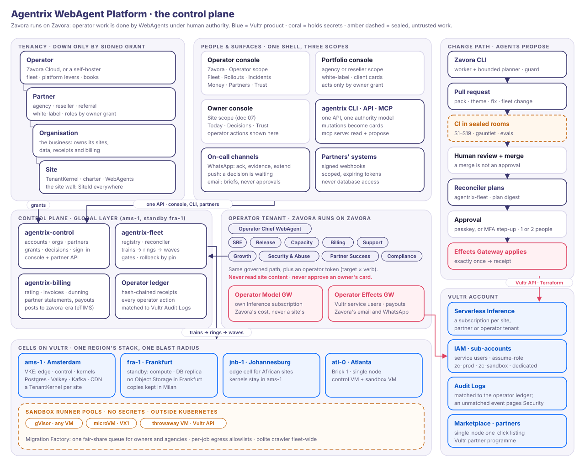
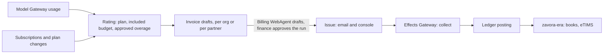
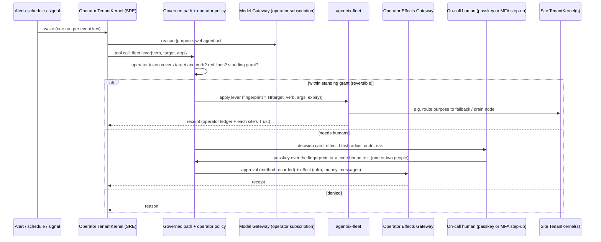

# Agentrix WebAgent Platform: the control plane

Status: design v0.1, 7 Nov 2026. Product: [01-product.md](01-product.md). Architecture:
[02-architecture.md](02-architecture.md). Trust: [03-trust.md](03-trust.md). WebAgents:
[05-webagents.md](05-webagents.md). Data: [09-data-architecture.md](09-data-architecture.md). Diagram:
[`control-plane.svg`](diagrams/control-plane.svg). UI concepts:
[`concept/control-plane/`](../concept/control-plane/).

This document designs how **Zavora** (zavora.ai), and any agency or reseller, runs **all its
customers, the technical infrastructure and the business itself** on the Agentrix WebAgent
Platform. The other documents design one site. This one designs the operator's side: the
tenancy above sites, the fleet on Vultr, the money, the operator's own WebAgents, and the
tools engineers and agencies use to change any of it, including **Zavora CLI**, Zavora's
adk-rust terminal coding agent.

The rule that shapes everything here: **Zavora runs on Zavora.** The operator's own work is
done by WebAgents, under the same anatomy, governed tool path, gateways, sandboxes, ladder and
receipts as a bakery's WebAgents, and under human authority given with a passkey (or, without
one, an MFA step-up).

Facts about adk-rust are from a read-only survey of the v3 workspace
(`~/Developer/projects/adk-rust-wt-sandbox`, branch `feat/sandbox-container-rooms`), cited as
`crate/src/file.rs:line`. Facts about Vultr are from the survey in
`reports/Agentrix WebAgent Platform on Vultr.md` §7, corrected where 09 checked Vultr's
documentation and public API on 7 Nov 2026 ([09 §3.4](09-data-architecture.md#34-fleet-layout-per-cell),
[§8.4](09-data-architecture.md#84-residency)). Prices, costs, sizes and targets marked
*hypothesis* are estimates to validate, not measurements. Where something does not exist yet,
§12 lists it as work to add instead of assuming it.

---

## 0. Principles

1. **Zavora runs on Zavora.** The control plane's operations team is a set of **operator
   WebAgents** in an **operator tenant**. They propose, investigate, draft and pull reversible
   levers. Humans decide everything consequential, with a passkey or, without one, an MFA
   step-up. Zavora is the first customer of
   every operator feature, and its own sites are ring 0 of every rollout.
2. **One governed path for everyone.** An operator WebAgent's tool call passes the same
   policy stack as a site WebAgent's ([05 §3.4](05-webagents.md#34-the-governed-tool-path)),
   plus an operator capability check. There is no side door for people, scripts or coding agents.
3. **Operators hold levers; owners hold their sites.** The operator controls the platform:
   versions, capacity, billing state, safety switches. Inside a site the owner's authority is
   final. The operator never approves an owner's card, raises a dial, or reads site content
   without a grant the owner signed.
4. **Tenancy is a type, all the way up.** `SiteId` extends to a **tenant path**
   (operator → partner → organisation → site). Every token, row, metric, receipt and log line
   carries the part of the path it needs. A cross-tenant action cannot be expressed.
5. **Content-free across sites.** Anything that spans more than one site (fleet views,
   analytics, operator WebAgents, partner dashboards) sees ids, kinds, durations, counts and
   money. Never conversations, leads, prompts or page drafts (A-I22, K-I19).
6. **Everything is a release.** Platform binaries, adk-rust pins, packs, playbooks, themes,
   model routing, detectors and infrastructure all change through signed artefacts, release
   trains and gates. Nothing is edited live.
7. **Infrastructure changes are effects.** A Terraform plan is an effect preview. Applying it
   is an effect, fingerprinted by the plan digest, approved with a passkey (or an MFA step-up
   bound to the digest) and executed exactly once by the Effects Gateway. Vultr credentials stay behind the two key holders
   ([ADR-004](adr/004-two-key-holders.md)).
8. **Coding agents propose; pipelines dispose.** Zavora CLI and any other coding agent works
   in a repository and produces a pull request. No coding agent holds production credentials,
   signing keys or approval rights.
9. **Open core, honest operations.** The whole control plane, including the agency and
   reseller features, is in the MIT repository ([ADR-002](adr/002-open-core-mit.md)). Zavora
   Cloud sells *running it well*. Self-hosters are operators of their own single-node or fleet.
10. **Honest numbers.** Dashboards show recorded activity and measured cost. Forecasts are
    labelled as forecasts. No invented metrics, on any surface, for any audience.

## 1. Vocabulary

| Term | Meaning |
|---|---|
| **Operator** | Whoever runs a deployment of the platform: Zavora Cloud, or a self-hoster on their own Vultr account. Operators do not nest |
| **Partner** | An **agency** (builds and operates client sites), a **reseller** (sells the platform under its own brand and owns billing), or a **referral partner** (refers only) |
| **Organisation** (org) | A customer business. It owns its sites, its data and its billing account, even when it buys through a partner |
| **Site** | One website and its WebAgents: one TenantKernel, one charter, the site wall ([02 §3](02-architecture.md#3-the-four-walls-in-components)) |
| **Tenant path** | `op:zavora/pt:mwangaza/org:kilele/site:kilele`, the chain of tenancy a request acts within |
| **Operator tenant** | The operator's own tenant, with its own TenantKernel, charter, budget, gateways and receipts, where the operator WebAgents run |
| **Operator WebAgent** | A WebAgent whose job is running the platform or the business (SRE, Release, Billing…), with principal `urn:adk:agent:op:{operator}/{role}` |
| **Operator capability token** | A short-lived, attenuable token scoped to a **target** (fleet, cell, partner, org, site set) and a **verb class** (read-telemetry, rollout, hold, rollback, capacity, billing, support-access) |
| **Cell** | One region's complete stack and the unit of deployment and blast radius (§3.2) |
| **Copy region** | A region with Object Storage only, where the platform's copier keeps a cell's release and CAS copies, backups and gold tables (§3.2, §3.9) |
| **Release train** | A versioned bundle of artefacts moving through **rings**; a ring advances in **waves** (§3.5) |
| **Pack** | A signed capability pack: jobs, playbooks, tools, surface strings and evaluations that extend a site's WebAgents |
| **Pin** | The exact adk-rust git revision a platform release is built on ([ADR-001](adr/001-build-on-adk-rust-v3.md)) |
| **Approval** | A person's consent to one exact effect, bound to its fingerprint: a passkey (WebAuthn) assertion over the fingerprint, or, without a passkey, an **MFA step-up** (a fresh, single-use authenticator code bound to the fingerprint). The gateway verifies either one and runs the effect once; the receipt names the method ([02 §8](02-architecture.md#8-identity-authority-and-approvals)) |
| **Support grant** | Time-boxed, scope-limited access to one site, signed by its owner (§2.5) |
| **Platform hold** | The operator's switch on a site, partner, cell or the fleet, for abuse or safety: the edge serves the last signed release read-only, or a signed notice page. It is separate from the owner's freeze; neither side can lift the other's ([05 §3.6](05-webagents.md#36-autonomy-pauses-and-the-kill-switch)) |
| **Break-glass** | Emergency access without the owner's grant: approvals from two Zavora humans, a recorded reason, and the owner told at the time (§2.5) |

## 2. Tenancy and roles



### 2.1 The hierarchy

| Level | Who | Owns | Runs on Vultr as |
|---|---|---|---|
| **Operator** | Zavora Cloud (zavora.ai), or a self-hoster | The deployment, the fleet, the operator tenant, the platform's books | Zavora's Vultr account and its sub-accounts (§2.7) |
| **Partner** | Agency, reseller or referral partner | Its partner workspace, its white-label brand, its client list, its margin | Shared cells by default; a dedicated sub-account on the dedicated tier |
| **Organisation** | A business (Kilele Bakery) | Its sites, data, customers, receipts, billing account | Rows and schemas in its sites' home cell |
| **Site** | kilele-bakery.example | Its TenantKernel, charter, releases, WebAgents | A Postgres schema with RLS, a CAS prefix, an Inference subscription, a CDN zone |
| **Self-hoster** | A developer on Vultr Marketplace | Everything above, as its own operator | Their own Vultr account |

Three rules hold at every level:

- **The org always owns its sites.** A partner's access is a grant from the org, revocable at
  any time. A site can leave a partner ("transfer out") or the platform (export) without the
  partner's consent. This is trust promise 5 ([01 §5](01-product.md#5-trust-promises)) applied
  to agencies.
- **Authority flows down only by signed grant.** No level inherits authority over a lower level
  by being above it. Zavora's position above a partner gives it platform levers (§2.4), not a
  partner's or an owner's decisions.
- **Partners do not nest** in v1. A reseller of a reseller is out of scope.

### 2.2 Agency, reseller, referral

| | Agency | Reseller | Referral partner |
|---|---|---|---|
| Relationship with the org | Builds and operates the client's sites | Sells the platform as its own product | Introduces the client |
| Who bills the org | Zavora bills the agency wholesale (from $15/site/mo, *hypothesis*, [01 §6.1](01-product.md#61-open-core-plus-managed-cloud)); the agency bills its client | The reseller bills the org at its own price; Zavora bills the reseller wholesale | Zavora bills the org; the partner gets a revenue share (20%, *hypothesis*, [01 §7](01-product.md#7-growth-loops)) |
| Access to client sites | Charter roles the owner grants (Editor, Approver, Publisher) | None by default; it can also hold an agency grant | None |
| First-line support | The agency | The reseller | Zavora |
| White-label | Console, emails, WhatsApp sender, footer credit, status page | The same, plus invoices | No |
| Console scope | Portfolio | Portfolio | A referral dashboard |

### 2.3 Human roles at each level

Two kinds of role exist, and they must not be confused:

- **Platform roles** say what a person can see and request in the control plane.
- **Charter roles** (`awp_types::Role`: Owner, Publisher, Editor, Approver, Auditor,
  `awp-types/src/v2/charter.rs:352`) say who may approve what on one charter. Approval chains
  need a distinct person per role and forbid self-approval (`check_chain`,
  `adk-kernel/src/charter/store.rs:234`). Agents can never hold a charter role
  (`is_agent_principal`, `store.rs:192`).

| Level | Platform roles | Charter roles they may hold |
|---|---|---|
| Operator | `op.admin`, `op.sre`, `op.release`, `op.finance`, `op.support`, `op.partners`, `op.security`, `op.auditor` (read-only) | Owner (Zavora's directors) and Approver groups on the **operator charter** (§5.3). Never a role on a customer's charter |
| Partner | `partner.admin`, `partner.manager`, `partner.operator`, `partner.billing`, `partner.viewer` | Editor, Approver or Publisher on a client's charter, **only where that client's owner granted it** |
| Organisation | `owner`, `manager`, `viewer`, `billing` ([02 §8](02-architecture.md#8-identity-authority-and-approvals)) | Owner, and any role the owner gives a teammate |

Every person is one principal with one set of sign-in credentials, on every surface ([02 §8](02-architecture.md#8-identity-authority-and-approvals)):
- **Passkeys first.**
- **Without a passkey:** email and password, or social sign-in (Google, LinkedIn or GitHub),
  always with authenticator-app MFA. There are no magic links.

This holds for Zavora's people, partners and owners alike. An agency employee who also owns a
business has two memberships, and the console's scope switcher (§7.1) never mixes them.

### 2.4 Who may do what

The authority boundary that the owner console ([07 §6](07-owner-console.md#6-multi-site-and-agency-mode)),
the WebAgents design ([05 §3.6](05-webagents.md#36-autonomy-pauses-and-the-kill-switch)) and this
document all state:

| Action | Owner | Agency (granted) | Operator human | Operator WebAgent |
|---|---|---|---|---|
| Approve a site's decision card (order, post, refund, go-live) | ✅ with an approval | ✅ if it holds the role the chain needs | ❌ never | ❌ never |
| Raise a WebAgent's autonomy on a site | ✅ with an approval (A-I13) | ❌ | ❌ | ❌ |
| Lower or pause a site's WebAgent | ✅ | ✅ if Editor | ❌ (its switch is the platform hold) | ❌ |
| Read site content, conversations, leads | ✅ | ✅ within the role's scope | Only with a support grant or break-glass | ❌ (content-free only) |
| Install a pack or theme on a site | ✅ | ✅ if the owner opted the site into the agency's ring | ❌ | ❌ |
| Apply a security patch to an installed pack | Told | Told | ✅ through a release train | Proposes; auto in ring 0–1 if gates pass |
| Roll out a platform version or adk-rust pin | Told (Trust centre) | Told | ✅ through a release train | Proposes, runs gates, halts, rolls back |
| Roll a site back to its previous signed release | ✅ any time | ✅ if Publisher | Only during a platform hold, and only to the previous signed release; the owner rolls forward with an approval | Proposes |
| Freeze a site (the owner's switch) | ✅ and only the owner unfreezes | ✅ if Editor; the owner unfreezes | ❌ | ❌ |
| Platform hold on a site (abuse or safety) | Sees the reason at once; can appeal; cannot lift it | Sees it | ✅ one person (`op.security` or `op.sre`) | Proposes |
| Hold a partner's sites, a cell or the fleet | ❌ | Freezes its own client sites over its grants (a fan-out of site freezes) | ✅ platform hold (two people for the fleet) | Proposes |
| Change price, plan or billing state | ✅ choose plan, cancel | ✅ its own price to its clients | ✅ (`op.finance`) | Drafts invoices and notices; never moves money |
| Suspend for non-payment | — | ✅ for its clients, after its notice | ✅ after notice policy | Proposes |
| Export or delete everything | ✅ | ❌ | Executes the owner's request | ❌ |
| Grant or revoke agency roles and support access | ✅ | ❌ | ❌ | ❌ |

**Every operator action that touches a site appears in that site's Trust centre** as a
plain-words receipt ("Zavora SRE rolled your site back to version 41 at 03:12 because pages
were failing to load; it is back on version 42 since 03:40"), and in the operator ledger.

### 2.5 Delegated administration

All delegation is a **signed grant**: a charter object with a grantee principal, a scope, an
expiry and the grantor's approval (a passkey signature, or the MFA step-up bound to the grant),
stored in the site's charter store and verified by
the gateways like any standing grant ([05 §3.4](05-webagents.md#34-the-governed-tool-path)).

| Grant | Granted by | Scope | Expiry | Notes |
|---|---|---|---|---|
| **Agency role** | The owner | Charter roles on one site, for named agency principals or the agency's group | Until revoked; reviewed yearly | The agency's people act as themselves; receipts name them and the agency |
| **Agency ring opt-in** | The owner | "Apply the agency's pack and theme updates to my site within these bounds" | Until revoked | Changes still pass the LaunchGate; visual changes publish only within the owner's standing grant |
| **Support grant** | The owner, from a support ticket | Read-only or read-write; named areas (pages, releases, jobs, receipts; never payment data) | 1–72 h, default 4 h | To named Zavora people by default. A Support WebAgent may read only typed diagnostics under a grant (ledger rows, configuration, receipts, job status); conversations, leads or customer records only if the owner's grant names them. Requested by the Support WebAgent or a person; every access is a receipt; revocable mid-session |
| **Billing delegate** | The owner | Pay invoices, change plan | Until revoked | For a bookkeeper or the reseller |
| **Break-glass** | Two operator humans (`op.security` + a director) | One site, named reason, read-only by default | 1 h, renewable once | Only for an active SEV1/SEV2 or a legal order; the owner is told at the time ([05 §6.2](05-webagents.md#62-agency-fleets)); reviewed in the postmortem |

Charter roles are per site today, and there are no partner-wide roles or time-boxed grants in
adk-rust (§12, CP9). Until there are, the platform stores grants in `agentrix-control` and
enforces them in its policy layer.

### 2.6 White-label

| May be the partner's brand | Never white-labelled |
|---|---|
| Console domain (`clients.mwangaza.example`), logo, colours (tokens only; the layout and decision contract stay the same) | The AI disclosure on every reply (A-I17) |
| Email sender and templates; WhatsApp sender, where the partner has its own Business number | `/.well-known/agentrix-crawler`, Web Bot Auth identity and receipts, which always name the real operator chain: "Operated by Studio Mwangaza on Agentrix (Zavora Cloud)" |
| Status page, help centre, support channel | The trust promises and the export button |
| The agency's credit on paid tiers, replacing only the "Made with Agentrix" mark in the site footer and in artifact footers (an artifact footer keeps "Made with <business>'s <desk> WebAgent (AI)") | The passkey ceremony and what it shows |
| Invoices (resellers) | Who holds the keys: only the two gateways, whatever the brand |
| | The "a person is one tap away" handover chip; desks always speak for the site's business, never as the agency ([06 §4.6](06-website-experience.md#46-ai-disclosure)) |

The point is that abuse reports, `awp verify` and receipts stay honest whoever sells the site.

**What visitors see when the operator acts** (agreed with website-experience,
[06 §4.3](06-website-experience.md#43-presence-without-the-bot-costume)). Visitors never see the
reason, so an owner is never blamed in public:

| Platform state | The visitor sees |
|---|---|
| Platform hold, or suspension during its read-only grace period | "Answers and forms are paused right now. You can still read the site." The release's own contact line stays visible |
| A hold that serves a notice page (phishing, malware), or after the grace period | A neutral page, "This site isn't available right now", with small print naming the operator chain ("Operated on Agentrix (Zavora Cloud) · report a concern"). Never "suspended" or "unpaid" |
| Budget reached or model unavailable (the owner's own limits) | The desks rest and the forms still work: 06's "resting" state |

### 2.7 Mapping onto the site wall and onto Vultr

**Onto the site wall.** The tenant path is a type in `agentrix-types` (`OperatorId`,
`PartnerId`, `OrgId`, `SiteId`, `TenantPath`). Site slugs may not contain `:`, so an operator
principal (`urn:adk:agent:op:…`) can never collide with a site's.

- Site stores have a Postgres schema and a role per site, with row-level security on the
  shared tables ([09 §3.4](09-data-architecture.md#34-fleet-layout-per-cell),
  [02 §7](02-architecture.md#7-data)).
- Partner and org rows live in the control database with RLS on the path prefix.
- An operator token can address many sites but can never mint a site capability token. So a
  person at Zavora can place a platform hold on a site (built on `Kernel::freeze`,
  `kernel.rs:1108`, plus the edge's read-only mode), but no operator principal can ever call
  that site's `search_site` or read its stores.
- The cross-tenant suite ([03 §8](03-trust.md#8-how-trust-is-tested)) gains three cases:
  - a partner token used on a site without a grant;
  - an operator token used to read content;
  - an expired support grant.

**Onto Vultr.** The account structure, IAM, inference and audit:

| Vultr feature | Use |
|---|---|
| **Account and sub-accounts** (unlimited, billed to the parent, enabled by Vultr sales; survey §7.1) | `zc-prod` (Zavora Cloud cells), `zc-sandbox` (runner pools: a separate inventory, separate credentials and separate IPs from the control plane), `zc-staging`, `zc-dev`, and `zc-dedicated-<partner>` for a partner that buys hard separation. Whether Vultr's abuse process acts per sub-account is **to confirm with Vultr** |
| **IAM** (resource-scoped policies, service users, API keys with expiry, instance assume-role) | One service user per workload: `fleet-provisioner`, `runner-scaler`, `dns-writer`, `inference-admin`, `audit-reader`. Storage has one user per bucket in each cell, `storage-<cell>-{releases,cas,archive,exports,lake,obs,backups}` ([09 §3.4](09-data-architecture.md#34-fleet-layout-per-cell)), so a leaked lake key cannot read a site's CAS. The copier (§3.9) has its own `copier-<cell>`, which reads the cell's buckets and can write, but not delete, in the copy region. Whether one IAM policy can name a single bucket is to test in the pilot; if it cannot, a separate Object Storage subscription per bucket gives the same split, since each subscription has its own S3 keys. Keys live only in the operator's Effects Gateway (infra drivers) and the Model Gateway (`inference-admin`). Hosts use assume-role. Humans use the Vultr console only for break-glass |
| **Serverless Inference subscriptions** | One per site by default; one per partner on the agency tier; pooled subscriptions with gateway metering as a fallback if account limits bind (the cap on subscriptions per account is unverified, [02 §6](02-architecture.md#6-the-model-plane)). Keys go straight into the Model Gateway's vault; no WebAgent or person sees them. The operator tenant has its own subscription, so Zavora's own agent spend is never billed to a site |
| **Audit Logs** | Pulled into the operator ledger. Every Vultr API call the infra driver makes carries a receipt id; a Vultr audit event with no matching receipt is an **out-of-band change** and pages Security (§3.8) |
| **Partner programme, Marketplace vendor programme** | Zavora's own partner relationship with Vultr (§4.5) |

## 3. Fleet operations on Vultr

### 3.1 Desired state and GitOps

Platform configuration lives in git; customer data never does.

- **In git** (a private `zavora-fleet` repository; an MIT template in
  `deploy/fleet-template/`):
  - Terraform for the Vultr substrate of each cell;
  - capacity bounds;
  - release trains;
  - pack channels;
  - model routing;
  - the operator charter;
  - partner configuration.
- **In the database:** the registry of partners, orgs and sites, their placement, versions,
  grants and billing state.

```text
zavora-fleet/
  terraform/modules/{cell,vke,postgres,valkey,kafka,objstore,runner-pool,cdn,dns,iam}
  terraform/cells/{ams-1,fra-1,jnb-1}.tfvars
  terraform/copy/mxp.tfvars      the copy region: Object Storage only (§3.2)
  cells/<cell>.toml              pools, autoscale bounds, placement weight, residency tags
  releases/<train>.toml          artefacts + digests, adk-rust pin, rings, bake times, gates
  channels/packs.toml            stable / canary versions per pack
  routing/models.toml            purpose → model and fallback, per cell (02 §6)
  policy/operator-charter.toml   operator jobs, starting levels, approval chains, red lines
  partners/<partner>.toml        tier, limits, white-label references, dedicated sub-account
```

**The reconciler** (`agentrix-fleet`, a new binary) watches `main`, diffs desired against
actual, and turns every difference into an effect request.

- **Low-risk, pre-approved changes run within the operator charter's standing grants.**
  Examples: adding a runner host inside the cell's autoscale bounds, or moving a pack channel
  in ring 0.
- **Everything else becomes a decision card for the approvers its action class needs (§5.3).**
- **A merge to `main` is not an approval.** Branch protection and review gate the change. The
  apply is gated separately by approval of the exact plan digest (a passkey, or an MFA step-up
  bound to it). This keeps a
  compromised CI token or a careless merge from changing production by itself.

### 3.2 Cells and regions

A **cell** is one region's complete stack:
- a VKE cluster with node pools for edge, control, kernels and gateways;
- Managed PostgreSQL (a primary and a failover replica);
- Managed Valkey;
- Managed Kafka for content-free events ([09 §3.6](09-data-architecture.md#36-events-and-kafka-topics);
  optional in the pilot, [§5.7](09-data-architecture.md#57-phasing));
- Object Storage buckets, one per data class ([09 §3.4](09-data-architecture.md#34-fleet-layout-per-cell));
- CDN pull zones;
- a VX1 runner pool outside Kubernetes ([02 §11.2](02-architecture.md#112-fleet-profile-mvp--scale)).

**Managed PostgreSQL in a cell** ([09 §3.4](09-data-architecture.md#34-fleet-layout-per-cell)):
- **Version 17 or 18.** Version 14 reaches end of life on 12 Nov 2026.
- **A Business plan or higher.** PITR keeps 14 days on Business, 2 on Startup and none on
  Hobbyist. Managed Kafka's Connect, Schema Registry, REST and private access also need
  Business.
- **A primary key on every table**, enforced by Vultr, and no superuser. An adk-rust table
  without a primary key fails to create (09 D19).

Each site has one **home cell**, where its kernel and stores live. A thin **global layer** sits
in the primary cell with a standby in a second: the fleet registry, rollout controller,
billing, the operator tenant, the console API and the partner API.

| Cell | Region | Role | When |
|---|---|---|---|
| `atl-0` | Atlanta | The first release single-node: control VM + sandbox VM, next to Inference ([02 §11.3](02-architecture.md#113-regions)) | 9 Nov |
| `ams-1` | Amsterdam | First full cell; global layer primary | Pilot |
| `fra-1` | Frankfurt | **Standby for compute and the database**: VKE, a runner pool, Valkey and a read-only replica of `ams-1`'s Postgres, promoted on failover; global layer standby. Frankfurt has no Object Storage (and no NVMe block storage), so `fra-1` holds no buckets and no home sites. On failover it serves from the copies in the copy region | Pilot (warm) |
| `jnb-1` | Johannesburg | **Edge cell**: edge and CDN origin for African sites. Kernels stay in `ams-1` until Johannesburg offers what a full cell needs (no VX1 or Object Storage there today, survey §7.2) | Launch |

Checked against Vultr's public API on 7 Nov 2026
([09 §8.4](09-data-architecture.md#84-residency)):
- **The copy region is Milan** (`mxp`; §13 item 10). It runs Object Storage only, in the EU.
  The platform's copier (§3.9) keeps `ams-1`'s release and CAS copies, the nightly per-site
  backups and the gold lake tables there. Milan has no Vultr Load Balancer and a thin
  catalogue, which a copy region does not need. London has both but is outside the EU, so it is
  the alternative rather than the default.
- **A second active cell** needs Object Storage in its own region. If Vultr adds it in
  Frankfurt, `fra-1` becomes a full cell. Otherwise the second active cell is `lhr-1` in
  London, and sites tagged `eu` stay in Amsterdam.

- **Inside a cell**, kernels are sharded by a consistent hash of `SiteId` onto kernel pods.
  Leases make failover safe, and `KernelConfig::mirrored_governance` spreads a hold across
  replicas within a second ([05 §8.3](05-webagents.md#83-single-node-and-fleet)). A node-wide
  wake front starts a site's kernel on its first wake and stops idle ones, so a dormant site
  costs storage only ([ADR-015](adr/015-tenant-kernel-per-site.md); upstream U2).
- **Placement** is by residency tag, latency and cell headroom. A cell has a site cap
  (*hypothesis*: about 2,000 sites, to measure). Beyond it, a new cell opens rather than a cell
  growing without bound.
- **Moving a site between cells** is a scripted migration: copy its schema and CAS prefix
  with every digest checked, hold the site for seconds, switch the registry, lift the hold. It is shown to the owner
  as a platform notice.

### 3.3 Provisioning

Two kinds of provisioning, both as effects:

| Kind | What | How | Approval |
|---|---|---|---|
| **Substrate** (per cell) | VPC, firewall groups, VKE cluster and pools, Managed PostgreSQL, Valkey and Kafka, Object Storage, registry, CDN base, IAM service users | Terraform (Vultr provider) plus vultr-cli for the CDN ([02 §11.2](02-architecture.md#112-fleet-profile-mvp--scale)). `terraform plan` runs in a sealed room whose only egress is `api.vultr.com`; the plan digest is the effect fingerprint `H(cell, plan_digest, expiry)`; apply runs in a fresh room with a short-lived key minted by the infra driver | Two humans (`op.sre` + `op.admin`) for a new cell or anything destructive; within standing bounds otherwise |
| **Per site** (at runtime) | Inference subscription, Postgres schema, CAS prefix, CDN pull zone, DNS records (Vultr DNS, or guided records at the customer's DNS), ACME certificate | Idempotent steps in `agentrix-fleet` called by the Capacity WebAgent or by sign-up. Each is an Effects Gateway call keyed by `H(site, step)`, so a retried sign-up never makes two subscriptions | Covered by the operator charter's standing grant (sign-up is routine); DNS changes are always held for the owner ([`DriverCapPolicy`](05-webagents.md#33-tools), A-I21) |

**Deprovisioning** follows the owner's export or deletion. Delete steps run only after the
export receipt exists and the retention notice has passed. Throwaway VMs are confirmed deleted
when the Vultr API returns 404 ([02 §5](02-architecture.md#5-the-sandbox-plane-replacing-the-proofs-of-concepts-in-process-chrome)).
A reaper compares the registry with Vultr's inventory every hour and proposes deleting orphans.

### 3.4 Sandbox runner pools and the Migration Factory

The sandbox plane ([02 §5](02-architecture.md#5-the-sandbox-plane-replacing-the-proofs-of-concepts-in-process-chrome))
is the platform's most variable cost and its largest abuse surface, so it is managed as a
first-class fleet.

| Pool | Hosts | Runs | Scales on |
|---|---|---|---|
| `gvisor` | Optimized or VX1 VMs | Fetch, render, sanitise, build, pack tests, canary probes | Queue depth and cold-start p95 |
| `microvm` | VX1 (nested virtualisation, $43.80/mo for 2 vCPU/8 GB, survey §7.1) | Legacy PHP and database replays, high-risk exec | Replay queue depth |
| `throwaway` | A fresh VX1 per job via the API | Large or known-compromised replays | Per job, with a fleet-wide cap |

**The Migration Factory** is the queue of Moves. A single owner's Move and an agency's import
of 40 client sites share it under fair-share scheduling:

- **Admission** per site (one Move at a time), per partner (a concurrency share from its tier)
  and per pool. Backpressure shows as an honest estimate ("your 40 sites will be ready in about
  6 hours"), never as silent waiting.
- **Reservations.** A partner planning a bulk import books capacity a day ahead through
  Partner Success. Capacity then proposes adding hosts inside the cell's bounds, or a temporary
  bound increase for a human to approve.
- **Crawl politeness is global, not per job.** One identified crawler, one request at a time
  per origin, across the whole fleet ([03 §4](03-trust.md#4-responsible-crawling-because-the-crawler-runs-from-vultrs-ip-space)).
  Two agencies importing sites on the same shared host never double the load on it.
- **Sizing** (*hypothesis*, to measure in the pilot): a 2 vCPU/8 GB VX1 host runs about four
  concurrent gVisor rooms or one or two microVMs. A 50-page Move uses about 15–30 room-minutes.
  At that rate one host moves a few dozen sites a day. These numbers set the first autoscale
  bounds and are replaced by measurements.

### 3.5 Rollouts: release trains, rings and waves

**What rides a train:**

| Artefact | Signed by | Changes behaviour a site owner chose? | Rolls without per-site consent? |
|---|---|---|---|
| **Platform release** (agentrix binaries and images, **adk-rust pin**, `Cargo.lock`, SBOM) | Release key (cosign) after CI | No | Yes, under the operator charter, only if no behaviour an owner can see changes; owners are told in the Trust centre |
| Schema migrations | With the release | No | Yes; expand first, and the contract step runs only after the whole train completes, so a rolled-back binary never meets a schema it doesn't know |
| Model routing table | Ops | Yes: it can change answers | Yes, only after the purpose's suites pass with no regression ([ADR-016](adr/016-evaluation-gates.md)); disclosed in each site's changelog and brief, without per-site adoption |
| Detector updates (quarantine, injection) | Security | No | Yes |
| **Pack patch** (same capabilities, fixes only) | Pack key | No | Yes for security fixes; otherwise by the owner's or agency's opt-in ring |
| **Pack upgrade** (new or wider capabilities) | Pack key | Yes | **No.** An owner decision card shows the capability diff |
| Playbook revision | Zavora review | Yes | **No.** Offered per site ([05 §6.3](05-webagents.md#63-cross-site-learning-without-leakage)) |
| **Theme update** | Theme key | Yes, visually | Produces a candidate release per site that must pass the LaunchGate; it publishes only within the owner's standing grant, otherwise it becomes a card |
| Terraform modules | Merge plus approval of the plan digest | No | Cell by cell, as their own train |

**Rings.** A train moves through rings. Inside a ring it advances in waves (by cell, then by
percentage).

| Ring | Who | Bake (*hypothesis*) | Advances when |
|---|---|---|---|
| **0 · Zavora runs on Zavora** | zavora.ai, classyperfumes.shop, and synthetic canary sites per archetype (bakery, clinic, shop, news) running scripted traffic and the live scenario set (S1–S19) | 24 h | Gates pass; the Release WebAgent may advance alone |
| **1 · Canary cohort** | Owners who opted into early updates (an agency may propose its clients; the owner opts in); self-hosters on the `canary` channel | 24 h | Gates pass; one human approves (`op.release`) |
| **2 · 10%** | Stratified by cell, archetype, plan and pack mix | 12 h | Two humans (`op.release` + `op.sre`) |
| **3 · 50%** | | 12 h | Two humans |
| **4 · All** | Every managed site; the `stable` channel for self-hosters | — | Two humans |

**Expedited trains** (security fixes) use the same rings with bake times of 1–2 hours and two
approvers from the start.

**Gates.** Every gate must pass:

1. **Before ring 0** (CI, in sealed rooms):
   - scenarios S1–S19 scripted;
   - the containment gauntlet;
   - the cross-tenant suite;
   - approval-integrity and release-integrity tests ([03 §8](03-trust.md#8-how-trust-is-tested));
   - WebAgent evaluation suites, with no regression on any baseline ([ADR-016](adr/016-evaluation-gates.md));
   - cargo-deny and cargo-audit;
   - SBOM and signatures.
2. **Canary analysis** compares the ring's sites on the new version against matched sites still
   on the old one, in the same cell and window. The analysis is `adk-eval`'s
   `ExperimentAnalyzer` (sequential, with `GuardrailSpec` and `ErrorBudget`,
   `adk-eval/src/experiments/analyzer.rs:121`, `config.rs:128,160`), wired to promote and halt
   (§12, CP6). The metrics:
   - edge 5xx;
   - TTFB p95;
   - Ask first-token p95;
   - wake → claim p95;
   - approval → effect p95;
   - sandbox cold start;
   - error-budget burn;
   - guardrail breaches per 1,000 actions;
   - corrections per 100 actions;
   - held-call expiry;
   - policy-denial rate (a jump means behaviour changed);
   - model spend per site;
   - restarts.
3. **Hard stops:** halt and roll back automatically on any of these.
   - a receipt-chain verification failure;
   - an approval-integrity failure;
   - an anomaly in cross-tenant denials;
   - a SEV1 or SEV2 opened in the wave's cells;
   - spend per site more than 2× its matched control (*hypothesis* threshold).

**Rollback by pin.** The fleet registry records each site's platform version, pin and pack
versions.
- Rolling back sets the previous version for the affected cell or cohort.
- Kernels drain at their next checkpoint and resume on the old binary. Durable stores stay
  compatible because the contract step of a migration waits until the whole train completes;
  parked runs and checkpoints stay resumable across the pin change.
- Releases of site content are not touched; a platform rollback never changes what visitors
  see.
- Target: a cell back on the previous version in under 15 minutes (*hypothesis*).

**An adk-rust pin bump** is an ordinary platform release with one extra gate: the full live
scenario set on Vultr models (nightly, [05 §9.4](05-webagents.md#94-evaluation)) must pass at
the new pin before ring 0.

**Fleet learning rides the same trains** ([05 §6.3](05-webagents.md#63-cross-site-learning-without-leakage),
[ADR-013](adr/013-no-swarm-fleet-learning.md)). The loop runs in the operator tenant and never
touches site content:
1. **Gate.** Only content-free ledger rows (K-I19), KPI aggregates and decision outcomes from
   sites whose owners take part pass a privacy gate: minimum cohorts, k-anonymity, differential
   privacy on anything shown as a benchmark. The Compliance WebAgent checks the gate's
   parameters on every run.
2. **Propose and evaluate.** The Release WebAgent assembles a candidate playbook revision or
   detector update from gated aggregates and runs it against the WebAgents' suites; any
   regression on a baseline drops it.
3. **Review and sign.** A Zavora person reviews it and signs it as a pack version.
4. **Adopt.** It rides a train like any pack; each site's Chief WebAgent offers it with the
   evidence, and only the owner adopts it. Watching the waves can roll it back by version.

Whether taking part is opt-in or opt-out is still open for James. Cohort statistics and pack
channels are upstream U11.

### 3.6 SLOs and observability

The performance budgets of [02 §9](02-architecture.md#9-performance-budgets) become SLOs. All
targets are *hypotheses* until the pilot measures them.

| SLI | SLO | Window |
|---|---|---|
| Edge availability: signed pages served without 5xx | 99.95% | 30 days, per cell |
| Edge TTFB p95, cache hit, in region | < 50 ms | 30 days |
| Ask: an answer or an honest fallback (never silence) | 99.9% | 30 days |
| Ask first-token p95 | < 1.5 s (US inference) | 7 days |
| Approval → effect started p95 | < 2 s | 30 days |
| Kernel wake → run claimed p95 | < 1 s | 7 days |
| Sealed-room cold start p95 | gVisor < 1 s; microVM < 3 s | 7 days |
| The Move, 50-page site, to go-live card | < 10 min, p90 | 30 days |
| Rollback of a site's release to every edge | < 5 s | per event |
| Console interaction p95 | < 100 ms | 30 days |
| **Invariants** (not budgets): effects executed exactly once; receipts never lost; consequential actions without authority | 100%, 100%, 0 | always |

- **Error budgets.** Multi-window burn-rate alerts: fast burn pages on-call, slow burn opens a
  ticket. A cell that has spent its budget freezes its release trains except for fixes.
- **Pipeline.** `adk-telemetry` exports OTLP traces and metrics (`init_with_otlp`,
  `adk-telemetry/src/init.rs:96`) to an OpenTelemetry collector per cell. It has no OTLP log
  exporter, so the collector reads services' JSON logs from stdout
  ([09 §5.6](09-data-architecture.md#56-telemetry-is-a-separate-pipeline)). The backend runs
  on VKE and stores to the cell's `agx-<cell>-obs` bucket. `fra-1`, which has no Object
  Storage, writes to a bucket in the copy region.
  - Every span carries `site_id` and `webagent` ([05 §9.3](05-webagents.md#93-observability)).
  - Fleet metrics carry `cell`, `partner_id`, `platform_version` and `pack_version`, with
    cardinality guards. Per-site series are kept only where per-site billing or SLOs need them.
- **Backend** (recommended, §13 item 7;
  [09 §5.6](09-data-architecture.md#56-telemetry-is-a-separate-pipeline)):
  Prometheus-compatible metrics (Mimir or VictoriaMetrics), Tempo for traces and Loki for
  logs, with Grafana for dashboards, SLO burn-rate alerts and on-call views.
  - Grafana, Loki, Tempo and Mimir are AGPL-3.0. Zavora runs them unmodified as separate
    services, and the MIT repository does not bundle them. VictoriaMetrics, VictoriaLogs and
    Jaeger (Apache-2.0) are the permissive alternative.
  - Grafana is for Zavora's SRE and on-call only. Partners and owners see console views built
    from the lake ([09 §6.2](09-data-architecture.md#62-operator-bi-in-the-control-plane)).
  - Self-hosters point OTLP at whatever they run.
- **Content-free by default.** Logs and traces hold ids, kinds and durations. Debugging content
  needs a support grant.
- **Views:**
  - Zavora sees the whole fleet.
  - A partner sees its own sites, filtered by tenant path.
  - An owner sees plain words in the Trust centre.
  - A public status page per cell, white-labelled per partner, is drafted by the Support
    WebAgent and published by a human for SEV1 and SEV2.

`adk-telemetry` has no SLO, error-budget or alerting code today, and only three kernel
instruments (§12, CP7). The platform defines SLOs in `zavora-fleet` and computes burn in the
backend until that lands.

### 3.7 Incident response

| Severity | Example | Commander | Comms |
|---|---|---|---|
| **SEV1** | Many sites not serving; data exposure; money moved wrongly; a sandbox escape | Human on-call (`op.sre`), plus `op.security` if security | Status page within 30 min; owners and partners told; 72 h owner notice for data incidents ([03 §7](03-trust.md#7-operations)) |
| **SEV2** | An SLO burning fast in one cell; one partner's sites degraded; Ask fallbacks fleet-wide | Human on-call | Status page; partners told |
| **SEV3** | One site degraded; a slow-burn SLO | SRE WebAgent, human informed | The site's owner, through its Chief WebAgent |
| **SEV4** | Cosmetic | Ticket | — |

**The SRE WebAgent** detects, opens the incident, gathers content-free evidence (traces,
metrics, receipts, recent changes, Vultr status), keeps the timeline, pulls the levers its
standing grant allows, and puts everything else in front of the commander as a decision card
with the exact effect, the blast radius and how to undo it.

| Lever | Scope | Reversible | SRE WebAgent alone (standing grant) | Needs humans |
|---|---|---|---|---|
| Shift a purpose to its fallback model ([02 §6](02-architecture.md#6-the-model-plane)) | Cell | ✅ | ✅ for up to 4 h | Longer |
| Lower background concurrency, pause background queues | Cell, partner | ✅ | ✅ | — |
| Drain a runner host or kernel node | Host | ✅ | ✅ | — |
| Scale a pool inside its bounds | Cell | ✅ | ✅ | Beyond bounds: one human |
| Halt a release train | Train | ✅ | ✅ | — |
| Roll back a platform version (pin) | Cell, cohort | ✅ | ✅ when the train's plan pre-approved automatic rollback | Otherwise one human |
| Platform hold on one site, with rollback to its previous signed release | Site | ✅ (the owner rolls forward) | ❌ (the site's own Guardian already rolls back on failing probes) | One person; abuse holds per §3.8 |
| Edge read-only mode for a cell | Cell | ✅ | ❌ | One human |
| Platform hold on a partner, cell or the fleet | Wider | ✅ | ❌ | One person; two for the fleet |
| Revoke a token class, rotate a gateway key | Fleet | Partly | ❌ | Two humans |
| Restore from PITR | Cell | ❌ (data) | ❌ | Two humans plus the commander |

Every incident ends with a blameless postmortem. The SRE WebAgent drafts it from the timeline;
humans own the conclusions and the actions. Actions become tickets, gauntlet cases or ADRs.

### 3.8 Abuse handling

The platform runs a crawler and sandboxes from Vultr's IP space, and it hosts small
businesses' sites and messages. Abuse handling protects third parties, Vultr and the platform.

| Source | Arrives at | Handled by |
|---|---|---|
| **Vultr abuse reports** to Zavora's account contact | `abuse@` mailbox | Security & Abuse WebAgent's inbox desk |
| **Crawler complaints** from the contact on `/.well-known/agentrix-crawler` ([03 §4](03-trust.md#4-responsible-crawling-because-the-crawler-runs-from-vultrs-ip-space)) | `crawler@` and a web form | Same desk |
| Phishing or malware reported on a hosted site | `abuse@`, the site's report link | Same desk |
| Spam complaints about email or WhatsApp sent through the Effects Gateway | Provider feedback loops, `abuse@` | Same desk |
| Internal detection: egress denials spike, a room hits byte caps, Vultr audit events without receipts, sign-up fraud | Telemetry, operator ledger | SRE and Security WebAgents |

- **The inbox desk is a public-partition desk.** It reads untrusted text (an abuse email can
  carry an injection) and holds no privileged tool, exactly like a site's Concierge. It files
  typed signals (`abuse_report{kind, target, evidence_refs}`) for the back office ([ADR-011](adr/011-partitions-and-coordinator.md)).
- **Evidence comes from receipts.** Every crawler request is logged in its job receipt (site,
  origin, time, bytes; [02 §5](02-architecture.md#5-the-sandbox-plane-replacing-the-proofs-of-concepts-in-process-chrome)),
  so a complaint about a given IP and time is answered with the exact requests made, or proof
  that none were.
- **Actions:**

  | Action | Who may do it |
  |---|---|
  | Add an origin to the fleet crawler deny list | Security WebAgent alone. It protects third parties and is reversible |
  | Throttle a site's outbound messages | Security WebAgent alone, for up to 24 h |
  | Suspend a site's outbound effects | A human |
  | Place a platform hold on a site (last signed release, read-only) | A human |
  | A platform hold that serves a signed notice page instead (phishing, malware) | A human |
  | Terminate an account | Two humans |

  The owner always sees why, in the Trust centre and from Support.
- **Response time.** Within the deadline in Vultr's notice. The internal target is first
  response in under 4 business hours (*hypothesis*).
- **Learning.** Each confirmed case can become a detector update or a gauntlet case, shipped
  through a train.

### 3.9 Backups and disaster recovery

| Data | Backup | RPO / RTO (*hypothesis*) |
|---|---|---|
| Control and kernel stores (Postgres) | Managed PostgreSQL PITR (14 days on Business), a failover replica in the cell and a read-only replica in `fra-1`; a nightly logical export **per site schema**, sealed with the site's key, to the backups bucket in the copy region (`agx-<dr>-backups`), which also makes per-site restore and export cheap | RPO ≤ 5 min; RTO ≤ 1 h per cell |
| Releases and evidence (CAS) | Copied to the copy region by the platform's copier; a release pointer may switch only when every object in the release has a copy receipt; immutable by digest | RPO 0 for releases; other CAS objects ≤ 5 min |
| Single-node SQLite (the first release, self-host) | Continuous WAL shipping or snapshots to Object Storage | RPO ≤ 15 min |
| Operator ledger, receipts | Hash-chained, replicated, exported daily; verified by `agentrix audit verify` | RPO 0 for committed entries |
| `zavora-fleet` repository and Terraform state | Git remotes plus encrypted state in Object Storage with versioning | — |
| Signing keys | Release root offline on hardware keys held by two directors; online intermediates rotated quarterly | — |

**The copier.** Vultr Object Storage has no bucket replication and no bucket notifications
([09 §3.4](09-data-architecture.md#34-fleet-layout-per-cell)), so cross-region copies are the
platform's own job, in `agentrix-fleet`:
- **Nothing is triggered by an upload.** The writer emits an event (a release published, a CAS
  object stored, a backup written). The copier works from those events, plus a nightly sweep
  that lists both sides and copies whatever is missing.
- **Every copy is checked.** The copier reads the object back in the copy region, compares its
  SHA-256 with the source digest and writes a copy receipt. A mismatch is retried, then pages
  SRE.
- **The release gate.** The rollout controller (§3.5) switches a release pointer only when
  every object in the release has a copy receipt.
- **The copier never deletes.** Deletion in the copy region is done by lifecycle rules and by
  the erasure job ([09 §8.2](09-data-architecture.md#82-erasure-across-stores)).

**Visitors are protected first.** Pages are static and cached at the CDN, so a control-plane
or kernel outage does not take pages down. Ask degrades to an honest fallback.

**Drills:**
- **Monthly:** the SRE WebAgent restores a random site from the copy region into a scratch cell, verifies its
  receipt chain and release signatures, and reports. A human reviews.
- **Quarterly:** a game day fails `ams-1` over to `fra-1`, which promotes its replica and
  serves from the copy region's buckets.

### 3.10 Cost management

| Cost | Measured from | Attributed to |
|---|---|---|
| Inference | The site's own subscription; the Model Gateway's usage ledger (reserve and settle per call) reconciled daily against Vultr's usage endpoint | Site, WebAgent, job, purpose |
| Sandbox | Room-minutes from job receipts, by runtime class | Site (Moves, previews), partner (bulk imports), operator (canaries, CI) |
| Kernel compute | CPU-seconds from kernel admission accounting; the node pool cost shared pro rata | Site |
| Storage and CDN | Bytes per CAS prefix; egress per pull zone, or apportioned | Site |
| Platform overhead | Postgres, Valkey, Kafka, LB, audit, observability, cross-region copies | Allocated per site per cell |

- **Margin per site, plan and partner** is computed monthly in the lake's gold
  `cost_to_serve_monthly` table (site × cost line, from silver usage and Vultr billing;
  [09 §5.4](09-data-architecture.md#54-tables)) and compared with the cost model's
  *hypotheses* ([02 §10](02-architecture.md#10-cost-model)).
- **Spend anomalies** per site (denial of wallet) alert Billing and SRE.
- **Capacity duties.** The Capacity WebAgent proposes rightsizing, reserves capacity for
  imports, and reaps orphans. It forecasts each cell's spend against its budget.
- **No cost is hidden from its payer.** An owner sees AI spend against the budget they set;
  a partner sees its sites' cost and margin; Zavora sees everything.

## 4. The business

### 4.1 Customer lifecycle

| Stage | Entered when | Led by | What happens | Leaves when |
|---|---|---|---|---|
| **Lead** | An assessment runs ([01 §3](01-product.md#3-the-experience-a-ladder-of-wow)) and the visitor leaves contact details with consent | Growth WebAgent | Preview reminders within the consent given; no contact without a consent basis (the same red line as a site's Sales) | Preview kept or expired |
| **Preview** | A living preview exists (7 days) | Growth | Nudges based on what the visitor did with the preview: talked to it, shared it | "Keep it": sign up, passkey first |
| **Kept** | Account created | Support, Billing | Plan chosen and the subscription approved on the provider's page; the first charge is on go-live day (§4.2) | The Move starts |
| **Moving** | Domain proved, the Move runs | The site's Mover; Support watches | Migration Factory queue; honest estimates | Go-live card signed |
| **Live** | Go-live | The site's own WebAgents; operator WebAgents watch health | Health score computed weekly | — |
| **At risk** | Health score drops (below) | Support or Partner Success | A human-approved outreach; a check-in call offer | Health recovers, or notice |
| **Suspended** | Unpaid after the notice policy (§4.2) | Billing proposes, a human decides | The last release serves read-only; WebAgents frozen; data kept | Paid, or closed after notice |
| **Leaving** | Cancel or transfer out | Support | **Export first**: content, customers, built site, receipts. Full service to the end of the paid period, then 30 days read-only (§4.2). Undo until closure; DNS hand-back guide | Exported, then deleted after retention, with notice |

**Health score** from content-free signals:
- owner minutes per week;
- decisions handled versus expired;
- corrections per 100 actions;
- the Concierge's "don't know" trend;
- spend versus budget;
- SLO breaches on the site;
- open tickets;
- payment status;
- days since the owner last opened the console.

A partner sees its own clients' scores. The score is never shown to the owner as a grade; it
triggers help, not pressure.

### 4.2 Money

**Plans and pricing are data.** The plan catalogue (`plans.toml` in `zavora-fleet`) holds:
- price points (USD list, plus local KES, NGN and ZAR);
- included AI budget;
- WebAgents and packs included;
- limits.

All prices are hypotheses from [01 §6](01-product.md#6-business-model).

**Three price lists exist in Zavora's systems today, and they disagree:**
- Agentrix's $29/$79/$149 (01);
- zavora.ai's startup tiers, a $100/$150/$350 monthly fee (`zavora-website/lib/business-plan.ts:6-43`);
- the ERP's own SaaS plans, KES 2,500–14,900 (`zavora-era/zavora-erp-api/src/services/billing.rs:26`).

They sell different things. Customers must never see two prices for the same thing, so this
is flagged for James (§13).

**Metering.**
1. The Model Gateway records every call against the site's tenant path, reserving cost before
   the call and settling after ([02 §6](02-architecture.md#6-the-model-plane)).
2. Each site's own Vultr Inference subscription is the **reconciliation source**: daily token
   counts per model from Vultr's `GET /v1/usage` are matched against the gateway's ledger. A
   variance above 2% (*hypothesis*) alerts the Billing WebAgent.
   - **The price comes from the account's bill, not from a table.** Vultr publishes two
     schedules: per model (qwen3.8-27b $0.15/$1.00 per 1M) and a flat $0.55/$2.75 per 1M
     ([02 §10](02-architecture.md#10-cost-model)). Until a real bill settles which applies,
     forecasts use the flat rate as the ceiling, so cost to serve is $4–12 per site per month
     (*hypothesis*).
3. Sandbox minutes come from job receipts; storage and CDN from bytes. These are cost
   attribution (§3.10), not line items for owners.

**What an owner is billed:**
- the plan fee, which includes an AI budget;
- AI usage above the included budget, **only** when the owner has raised their cap on a
  decision card. It is billed at cost plus a disclosed margin (decision for James, §13);
- one-off fees they accepted, such as white-glove migration.

The budget is a boundary, not a meter ([01 §6.1](01-product.md#61-open-core-plus-managed-cloud)).
Nothing is billed that the owner did not approve.

**The billing service** is `agentrix-billing`, a new crate in the MIT core so agencies and
self-hosters can bill too:



**Payments.** Collected only through the Effects Gateway. Card data never touches the
platform: providers' hosted pages or STK prompts only.

| Method | Provider | Notes |
|---|---|---|
| **M-Pesa** (Kenya) | Safaricom Daraja | STK Push per invoice is already built in zavora-era (`payments/daraja.rs:145`). Recurring needs a standing-order product (to verify) or a monthly STK prompt the owner taps |
| **Cards** (Africa and elsewhere) | Paystack | Already integrated in zavora-era (card, M-Pesa, bank; signed webhook). Stripe is used nowhere in Zavora's systems today; adding it is a decision (§13) |
| **PayPal Subscriptions** (the plan fee) | PayPal | The owner approves the subscription on PayPal's own page. The Effects Gateway creates, revises and cancels it as effects, each with a receipt. PayPal collects each period, and its verified webhooks post each payment to the ledger against `agentrix-billing`'s invoice. Overage and other one-off charges never go on the subscription |
| **PayPal one-off charges and payouts** | PayPal through **Steward** | Steward's governed path: the policy file, `GovernedTool` executing only against an unused approval for the exact call digest, `PayPal-Request-Id` from the receipt, a hash-chained ledger (`steward/crates/steward-core/src/governed.rs:25`, `ledger.rs:25`; `steward-paypal/src/client.rs:238`). The fleet release brings it into the platform |

**Plan changes and cancellation** (*hypothesis* policy; each is a card the owner approves):
- **The first charge is on go-live day.** The owner chooses a plan and approves the
  subscription when the account is kept, and the period starts at go-live. An owner who never
  goes live is never charged. A Move that never goes live is acquisition cost, bounded by the
  Migration Factory's fair-share queue (§3.4).
- **Upgrade:** applies at once. The prorated difference is a one-off charge, through the rail's
  one-off path: Steward for PayPal, Paystack's hosted page for cards, an STK prompt for M-Pesa.
- **Downgrade:** applies at the next period. The card lists what stops then, for example the
  Cashier when leaving Commerce.
- **Cancel:** the export link comes first. The site keeps full service to the end of the period
  already paid for, then serves read-only for 30 days (the last signed release, WebAgents off,
  nothing billed) so the owner can move DNS. Then it closes. Data is kept 90 days after
  closure, then deleted with notice and a receipt. Undo works any time before closure. There is
  no pro-rata refund for the unused part of a period.

**Dunning** (*hypothesis* policy):
1. Reminder at day 0, day 3 and day 7.
2. Read-only suspension at day 14, with the last signed release still serving.
3. Closure notice at day 30, with an export link.
4. Data kept for 90 days after closure.

The Billing WebAgent sends reminders within this policy. Suspension and closure are human
decisions.

**Zavora's own books run on Zavora's ERP.** Zavora Cloud's invoices, collections and payouts
post to **zavora-era**:
- double-entry `JournalEntry` with immutable postings (`zavora-erp-core/src/ledger/journal.rs:43`,
  `migrations/002_immutability_triggers.sql`);
- multi-currency with Central Bank of Kenya FX;
- KRA **eTIMS** transmission of sales invoices (`services/etims.rs:351`).

**Amos**, the ERP's AI accountant, reconciles. It already scopes tools (`erp:read`, `erp:write`,
`ledger:post`) and requires a human click for any `ledger:post` (`amos/src/scope.rs:16,53`).

Gaps to close in zavora-era (§12):
- service tokens and an OpenAPI description (today it has JWT login only);
- subscription invoices posting to the ledger (today they don't);
- M-Pesa C2B and B2C (STK Push only today).

**Partner margins and payouts.**
- Agencies and resellers are billed wholesale per site per month plus any approved AI overage.
  They bill their clients themselves; resellers can use `agentrix-billing` white-labelled.
- Referral partners earn a revenue share on the plans they referred, computed monthly from
  paid invoices only.
- The Billing WebAgent drafts the payout statement. Partner Success checks it with the partner.
  `op.finance` and a director approve the payout run, each with a passkey or an MFA step-up.
- The Effects Gateway pays through PayPal Payouts (Steward's `paypal_send_payout`,
  `sender_batch_id` per run) or bank transfer. M-Pesa B2C comes once the ERP gains it.
- Payout details are held only by the Effects Gateway.

**Revenue analytics.** Computed from posted invoices and payments, never from the funnel:
- MRR by plan, partner and country;
- net revenue retention;
- gross margin per site (actual cost from `cost_to_serve_monthly`, §3.10);
- collection rate;
- the partner-sourced share.

The data path ([09 §3.6](09-data-architecture.md#36-events-and-kafka-topics) and
[§5.4](09-data-architecture.md#54-tables)): `agentrix-billing` publishes rated usage, invoices
issued and payment outcomes (amounts only) on `agx.billing.v1`. The lake turns them into the
gold `revenue_monthly` table (plan × partner × country: MRR, collection, margin). The Money
view and the Billing WebAgent's `revenue-report` read it through the metric catalogue
([09 §6.1](09-data-architecture.md#61-owner-analytics-in-the-console)). Invoices stay records
in `agentrix-billing`; the lake only counts them.

The Operator Chief WebAgent's weekly business review states the method beside each number.

### 4.3 Support

| Line | Who | Channel |
|---|---|---|
| 0 | The site's own Chief WebAgent ("Ask your Chief WebAgent") answers how-to questions from the docs and the site's own state | Console, WhatsApp |
| 1 | **Support WebAgent**. Its inbox desk (public partition) reads tickets, emails and WhatsApp messages, then files typed signals. Its back office answers from the docs, platform status, the owner-visible receipts and content-free telemetry, and drafts replies | Console help, email, WhatsApp |
| 2 | Zavora support humans (`op.support`), or the partner's people for white-label clients | The same thread |
| 3 | Engineering, through a ticket linked to an incident or a pull request | — |

- **Partner clients go to the partner first.** A partner can opt to route its clients straight
  to Zavora.
- **Support never sees content by default.** When an answer needs it, the Support WebAgent
  asks the owner for a support grant (§2.5) on a decision card. The owner chooses the scope and
  duration. Every access is a receipt the owner can read.
- **Response targets** per plan (*hypotheses*):
  - Essential: within 1 business day;
  - Business: 8 business hours;
  - Commerce and agencies: 4 business hours;
  - SEV1 and SEV2: 30 minutes, any time.
- **Ticket store.** Platform tickets live in `agentrix-control`. Zavora's own B2B accounts
  (agencies) may also be tracked in zavora-era's CRM (`crm_tickets`, `migrations/046_crm.sql:133`),
  linked by id.

### 4.4 Partner management

- **Programme.**
  - Referral (no access, revenue share).
  - Agency (charter-role access to client sites, wholesale pricing, Portfolio console,
    white-label).
  - Reseller (adds reseller billing and invoices).
  - Dedicated (adds a dedicated Vultr sub-account and cell).
- **Onboarding.**
  - A human verifies the business and signs the contract.
  - Payout details go straight to the Effects Gateway.
  - Partner Success runs the checklist: brand tokens, domain, WhatsApp sender, first client
    import plan, nominated canary sites.
- **Certification.** Partners who build packs or themes pass a review: capability diff,
  evaluation suites, gauntlet. They sign with their own pack key, registered to their partner
  id (§6.4).
- **Partner health:**
  - active sites;
  - clients' health scores;
  - decision latency on client cards;
  - support load;
  - payment status.

  Partner Success proposes help, and humans decide commercial terms.
- **Zavora as a Vultr partner.** Zavora applies to Vultr's partner programme
  (reseller, service-provider and innovator tracks) and the Marketplace vendor programme
  (survey §7.1). Every migrated site adds Vultr Inference, compute, storage and CDN spend
  ([01 §6.3](01-product.md#63-vultr-partnership)).

### 4.5 The Vultr Marketplace listing

- **The image:** the single-node profile ([02 §11.1](02-architecture.md#111-single-node-profile-first-release-self-host-marketplace)).
  Marketplace apps deploy one instance, but the sandbox plane must be a separate host
  ([ADR-003](adr/003-sandbox-plane.md)).
  - The first-run wizard asks for a **scoped** Vultr API key (instances, firewall), stores it
    only in the local Effects Gateway, and creates the sandbox VM.
  - Until the sandbox VM exists, migration and every sandboxed feature stay off. They are never
    run on the control host.
- **Updates:** the `stable` channel (ring 4), signed. `agentrix upgrade` verifies signatures
  and the schema-compatibility window before switching.
- **Telemetry:** off by default. When the self-hoster opts in, content-free crash reports and
  a version census are sent.
- **Upgrade path:** "Lift to Zavora Cloud" is export plus import, with the receipt chain
  preserved. The reverse ("take it home") is the same flow, and it is a trust promise.
- **Revenue:** a paid support and updates subscription for self-hosters
  ([01 §6.1](01-product.md#61-open-core-plus-managed-cloud)).

### 4.6 Compliance and audit

| Record | Holds | Verified by |
|---|---|---|
| Site receipts | Every decision and effect on a site | The owner (Trust centre), `awp verify`, `agentrix audit verify --site` |
| **Operator ledger** | Every operator action: who, what, which tenant path, the approval, the effect, the result | Hash-chained like site receipts; `agentrix audit verify --operator` |
| Vultr Audit Logs | Every API action on Zavora's Vultr accounts | Reconciled against the operator ledger (§2.7) |
| Books | Invoices, payments, payouts, tax | zavora-era's double-entry ledger with immutability triggers |

- **Frameworks:**
  - SOC 2 Type I mapping during the pilot, inheriting Vultr's data-centre certifications
    ([03 §7](03-trust.md#7-operations)).
  - Kenya's Data Protection Act 2019, which means registration with the Office of the Data
    Protection Commissioner.
  - GDPR for EU owners: a DPA, and disclosure that inference runs in the US.
  - KRA eTIMS for Kenyan invoices, through zavora-era.
  - PCI scope kept minimal: no card data in the platform.
- **The Compliance WebAgent:**
  - collects evidence continuously;
  - proposes quarterly access reviews (who holds which platform and charter roles, which
    grants are stale), with humans approving revocations;
  - checks that retention jobs ran;
  - keeps the sub-processor list (Vultr, Safaricom, Paystack, PayPal, the WhatsApp provider,
    the email provider).

## 5. Operator WebAgents

### 5.1 The operator tenant

The operator tenant is built exactly as a site is ([05 §8.1](05-webagents.md#81-a-tenantkernel-per-site)):
- its own TenantKernel and durable stores;
- a charter (the **operator charter**, in `zavora-fleet/policy/`, signed by Zavora's
  directors). For now it is an `awp_types::Charter` of kind Business with empty public terms;
  an operator-specific charter type can come later;
- an autonomy ladder per job, budgets and a kill switch;
- a public partition for untrusted inbound text (Support's intake, the abuse desk, Growth's
  inbound prospect replies), holding only declared capabilities and `emit_signal`, and a back
  office that sees only typed signals;
- its own Model Gateway subscription and its own Effects Gateway instance, holding Zavora's
  operational credentials (Vultr service users, payout rails, Zavora's email and WhatsApp
  senders);
- receipts in the operator ledger.

**An operator capability token is never valid at a customer site's Effects Gateway
connections.** Operators can never move a customer's money, send as the customer or publish
for them. Billing is Zavora's own, through Zavora's own Effects Gateway.

A partner gets an operator tenant of its own on the agency tier, with a smaller roster (§5.5).

### 5.2 The roster

The lead is the operator tenant's **Chief WebAgent**. The console calls it the **Operator Chief
WebAgent**, so it is never confused with a site's Chief WebAgent. Its principal is
`coordinator`, as for every lead ([ADR-009](adr/009-webagents-terminology.md)).

| WebAgent | Principal | Mandate | Jobs | Wakes | Starts at | Never, without humans |
|---|---|---|---|---|---|---|
| **Operator Chief WebAgent** | `op:zavora/coordinator` | Single point of contact for Zavora's people: the daily ops brief, routing decisions, answering "Ask" about the fleet and the business | `ops-brief`, `weekly-business-review`, `operator-questions` | 07:00 EAT daily; Monday review; messages from paired operators | Do it and tell me (briefs only) | Decides any card |
| **SRE** | `op:zavora/sre` | SLOs, alerts, incidents, drills | `watch`, `triage`, `mitigate`, `postmortem-draft`, `restore-drill` | Burn-rate alerts; probes; incident signals; monthly drill | Handle it within budget, **for the reversible levers in §3.7 only**; Ask me first for the rest | Pulls an irreversible lever; places a platform hold on a paying site; restores data |
| **Release** | `op:zavora/release` | Release trains: composing, gating, canary analysis, notes | `train-compose`, `canary-analyse`, `promote`, `halt-rollback`, `release-notes` | A merged release manifest; ring bake timers; gate events | Handle it within budget for ring 0 and for halts and rollbacks; Ask me first for rings 1–4 | Promotes past ring 1 alone; skips a gate |
| **Capacity** | `op:zavora/capacity` | Vultr provisioning, runner pools, Migration Factory scheduling, cost | `provision-site`, `pool-autoscale`, `terraform-plan`, `reap`, `cost-forecast` | Queue depth; sign-ups; hourly inventory diff; month end | Within bounds for autoscaling and per-site provisioning; Ask me first for Terraform applies | Applies a plan outside bounds; deletes a resource holding data |
| **Billing** | `op:zavora/billing` | Metering reconciliation, invoice runs, dunning notices, payout statements, revenue reports | `reconcile-usage`, `invoice-draft`, `dunning-notice`, `payout-statement`, `revenue-report` | Daily usage import; month end; payment events | Do it and tell me for reconciliation and reminders within policy; Ask me first for everything else | Moves money; changes a price; writes off; suspends |
| **Support** | `op:zavora/support` (back office); `op:zavora/support-desk` (inbox desk) | First-line support across console, email and WhatsApp; support-grant requests; status-page drafts | `answer`, `grant-request`, `escalate`, `status-draft` | Ticket signals; incident updates | Do it and tell me for answers grounded in docs and status; Ask me first for anything account-changing | Accesses a site without a grant; promises a refund or credit |
| **Growth** | `op:zavora/growth`; `op:zavora/growth-desk` (inbound replies) | The assessment funnel, preview nurture within consent, onboarding nudges, referral programme, experiments on Zavora's own marketing site (through its own release wall) | `nurture`, `onboarding-nudge`, `referral`, `experiment` | Lead signals; preview events; schedules | Suggest. Outreach is `SendExternal`: it needs a consent basis and AI disclosure (A-I17) | Contacts anyone without a consent basis; offers a discount |
| **Security & Abuse** | `op:zavora/security`; `op:zavora/abuse-desk` | Abuse inbox, crawler complaints, out-of-band change detection, detector update proposals, key-rotation reminders. Works on fleet aggregates and public crawl evidence, never site content | `abuse-triage`, `crawler-deny`, `drift-detect`, `detector-propose` | Abuse signals; Vultr audit diff; egress anomalies | Handle it within budget for crawler deny-list entries and 24 h message throttles; Ask me first otherwise | Freezes or takes down a site; terminates an account; reads content |
| **Partner Success** | `op:zavora/partners` | Partner onboarding, health, bulk-import plans, certification, payout statement checks | `partner-onboard`, `partner-health`, `import-plan`, `certify` | Partner events; weekly | Ask me first | Changes commercial terms |
| **Compliance** | `op:zavora/compliance` | Evidence, access reviews, retention checks, sub-processor register | `evidence`, `access-review`, `retention-check` | Quarterly; monthly; on change | Watch and Suggest | Revokes access itself |

All of them are **hub and spoke under the Operator Chief WebAgent**, at delegation depth 1, with
no swarm inside the tenant ([ADR-011](adr/011-partitions-and-coordinator.md),
[ADR-013](adr/013-no-swarm-fleet-learning.md)). Fan-out is used only for bulk sandboxed work:
canary probes across a ring, restore drills, re-rendering a fleet's sites after a theme fix.

### 5.3 Authority and approvals

The operator charter's **approval chains** use adk-kernel's rule of a distinct person per
role, with no self-approval (`check_chain`, `store.rs:234`):

| Action class | Approvers |
|---|---|
| `fleet.rollout.ring1` | `op.release` |
| `fleet.rollout.ring2+`, `fleet.rollout.expedited` | `op.release` + `op.sre` |
| `fleet.capacity.apply` within bounds | Standing grant |
| `fleet.capacity.apply` outside bounds, new cell, destructive | `op.sre` + `op.admin` |
| `fleet.hold.site` (abuse or safety) | `op.security` or `op.sre` |
| `fleet.hold.partner`, `fleet.hold.cell` | `op.sre` + `op.admin` |
| `fleet.hold.all` | Two directors, or `op.admin` + `op.security` |
| `money.invoice_run` | `op.finance` |
| `money.payout_run`, `money.credit_or_writeoff` | `op.finance` + a director |
| `account.suspend` | `op.finance` (non-payment) or `op.security` (abuse) |
| `account.terminate` | Two of `op.admin`, `op.security`, a director |
| `access.breakglass` | `op.security` + a director, with owner notice |
| `charter.operator.change` | Two directors (charter commit, `CommitDecision`) |

**How each approver approves** ([02 §8](02-architecture.md#8-identity-authority-and-approvals)):
- **With a passkey** (first): a WebAuthn assertion whose challenge is the effect's fingerprint.
  It is the person's own signature.
- **Without a passkey:** an MFA step-up. The card shows the exact effect, and a fresh,
  single-use authenticator code is bound to its fingerprint. It rests on the platform's
  attestation rather than the person's signature.
- **Either way,** the Effects Gateway verifies the approval against the fingerprint and runs
  the effect once. The receipt and the operator ledger name each approver's method.
- **Two-person rules stay two people.** Each approver uses their own method, and one person
  never counts twice.

**Operator WebAgents never hold a charter role.** adk-kernel refuses it (`is_agent_principal`).
So they can only propose, act inside standing grants, or pull levers the charter marks as
reversible. **Promotion** of an operator WebAgent's job follows the site rules
([ADR-012](adr/012-autonomy-per-job.md), [ADR-016](adr/016-evaluation-gates.md)): the ladder's
evidence plus a passing evaluation suite, approved by a director. Demotion is automatic after a
guardrail breach or a bad call.

**On-call humans** are paired with their WhatsApp and the PWA. A consequential card opens the
approval on the PWA (the passkey ceremony, or the step-up without one); WhatsApp can acknowledge, ask for evidence or decline
([ADR-014](adr/014-one-decision-contract.md), §7.4).

### 5.4 How operator WebAgents act on the fleet



- **The platform policy layer** (layer 6 in [05 §3.4](05-webagents.md#34-the-governed-tool-path))
  checks two things for operator principals. The operator capability token must cover the
  target and the verb class. The operator charter's red lines must hold:
  - never read site content;
  - never approve a site card;
  - never change a dial;
  - never touch payment credentials.
- **Fleet levers are thin clients of `agentrix-fleet`.** Credentialled effects (Vultr API,
  payouts, outbound messages to customers) are thin clients of the operator's Effects Gateway,
  as consequential tools are for sites ([05 §3.3](05-webagents.md#33-tools)).
- **Anything that runs code runs in sealed rooms with egress allowlists.** That includes
  `terraform plan`, a repro of a bug, a canary probe and a restore drill. `terraform plan`'s
  room may reach only `api.vultr.com`.
- **An effect on a site is executed by that site's own controls.** The platform hold
  (`Kernel::freeze` plus the edge's read-only mode), the release pointer and the purpose routing
  table are called through the control-plane API with the operator token. Each one writes a receipt in the operator ledger **and** in the site's
  receipts, so the owner sees it.

### 5.5 Partner operator tenants

An agency on the Portfolio tier gets its own operator tenant with a smaller roster, scoped
by its operator token to **the sites whose owners granted the agency a role**:

| Partner WebAgent | Does |
|---|---|
| Chief WebAgent | The agency's morning portfolio brief: client cards waiting, sites at risk, imports in flight |
| Release | The agency's own ring for its packs and themes, over sites that opted in, using the same gates |
| Support | First-line support for its clients, white-labelled, with escalation to Zavora |
| Billing (reseller) | Its clients' invoices through `agentrix-billing` |

The agency's WebAgents never see Zavora's fleet or another partner's data, and never act on a
client site outside the client's grant.

- **They hold no charter role** (A-I23). They prepare and propose: draft cards, suggest ring
  membership, file support items. They pull only the levers the agency may use, such as the
  pack channel within packs the client adopted, and support diagnostics. Approving, signing a
  charter change or deciding for a client is always an agency person with an approval, under a
  distinct-principal chain.
- **The token's site set is derived from the committed charters** (who holds an agency role),
  and tokens are short-lived, so removing the role revokes access within one token lifetime.

### 5.6 Worked example: a canary halts itself

Platform release 2026.11.2 bumps the adk-rust pin.

1. **Ring 0 passes.** The Release WebAgent advances it to ring 1 after a human approves.
2. Six hours into ring 1, the canary analysis shows that the **policy-denial rate on the
   Editor's `content_edit`** rose sharply against the control cohort. Every other metric is
   flat.
3. The Release WebAgent halts the train. This is within its grant: halting is reversible and
   always allowed.
4. It rolls the ring-1 cohort back by pin. The train's plan pre-approved automatic rollback on
   a guardrail-class regression.
5. It files a card with the evidence: a span diff showing a changed tool declaration digest,
   which makes the tool stale and ask before every call (K-I14).
6. It drafts the owner notice: "an update was paused; your site is unchanged".
7. A human reads the card and opens an issue. An engineer uses Zavora CLI to find the cause
   (§6.1). The fix ships as 2026.11.3 through ring 0 again.
8. Owners in ring 1 saw one plain line in their Trust centre and nothing else.

## 6. Zavora CLI and developer tooling

### 6.1 Zavora CLI against the platform

**Zavora CLI** (`zavora-cli` 2.1.1, MIT, on adk-rust 3.0.0) is Zavora's terminal coding
agent. The facts below are from `~/Developer/projects/zavora-cli`.

- **A worker model owns the work.** It holds the conversation, the tools and the
  implementation.
- **A bounded planner.** `plan_work` is a `BudgetedPlannerTool`: no tools, one iteration, under
  700 words, 4 calls per process by default; it then returns `budget_exhausted`
  (`src/model_roles.rs:11,42,63`; `src/config.rs:882`).
- **In-place approvals.**
  - Tools are classed `ReadOnly`, `Mutating` or `NetworkEgress`, and only read-only tools
    auto-approve (`src/tool_policy.rs:381,396`). MCP tools count as egress.
  - File writes show a diff and shell calls show the command. The human answers
    `AllowOnce`, `TrustSession` or `Deny` (`src/tools/confirming.rs:75`).
  - The model cannot set `approved` or `allow_dangerous` itself (`confirming.rs:201`).
- **Guards.**
  - `secret_policy` blocks `.env*`, `.git`, `.zavora` and `env`/`printenv`-style commands
    (`src/tools/secret_policy.rs:14`).
  - `PermissionRules` take globs such as `execute_bash:git push*` (`tool_policy.rs:276`).
  - `pre_tool` hooks can block a call by exiting with code 2 (`src/hooks.rs:68`).
- **Headless mode** for CI. It never waits for a human, and unapproved tools fail
  (`docs/HEADLESS.md`; `confirming.rs:623`).
- **MCP both ways.** It can call MCP servers, and `mcp serve` exposes it as one.

**What engineers and agencies build with it:**

| Work | Repository | Ships as |
|---|---|---|
| Capability packs (e.g. a table-booking pack, an eTIMS receipts pack for Kenyan shops) | A pack repository from `agentrix pack new` | A signed pack on a channel, installed by owner decision |
| Themes | A theme repository | A signed theme; per-site candidate releases through the LaunchGate |
| Migration adapters (e.g. Squarespace import, a page builder's shortcodes) | The platform repository (`agentrix-move`) | A platform release |
| Fixes and features in the platform | `agentrix-webagent-platform` (MIT) | A platform release through the trains |
| Fleet changes (capacity bounds, routing, a new cell) | `zavora-fleet` | A reconciled, approved apply |

**A pack-building session:**
1. `agentrix pack new booking --webagent sales` scaffolds the manifest, a playbook skill, tool
   stubs, evaluation golden sets and a local fixture site.
2. The engineer asks Zavora CLI for the feature. The planner drafts a bounded plan; the worker
   edits files, with a diff approval for each write.
3. `agentrix pack test` runs the pack's evaluations, the relevant scenarios and the gauntlet in
   local sealed rooms (`agentrix dev up` runs the single-node profile with a sandbox VM or a
   local gVisor runtime).
4. The worker opens a pull request (`github_ops pr_create`). Telemetry and the agent-run record
   are attached as provenance.
5. CI repeats the tests in sealed rooms. A human reviews the **capability diff** (what new
   tools or effect classes the pack asks for).
6. `agentrix pack sign` uses the publisher's hardware-backed key, a human touch.
7. `agentrix pack publish --channel canary` puts it on a train. Owners see an "available"
   card with the capability diff.

The [CLI concept](../concept/control-plane/cli.html) shows this session.

**Gaps found in Zavora CLI** (§12):
- It has no Vultr or generic OpenAI-compatible provider (`Provider`, `src/cli.rs:9`). Only Meta
  and Baseten take a base URL. So Zavora's own coding agent cannot run on Vultr Inference today.
- It has no OS-level sandbox for its shell. Hosted dev rooms (§6.4) cover agency developers who
  need one.

### 6.2 The `agentrix` CLI and API

One binary, `agentrix`, in the MIT repository (`crates/agentrix-cli`), with a context per
scope. Every mutating command creates a decision card unless a standing grant covers it. The
CLI prints a link and QR code and waits for the approval (passkey, or the MFA step-up) on the
approver's device. It
never approves anything itself.

```text
agentrix login                          # browser sign-in, passkey first; short-lived, device-bound token
agentrix context use op:zavora | pt:mwangaza | org:kilele
agentrix dev up | seed --archetype bakery | down
agentrix pack new|lint|test|eval|build|sign|publish|status
agentrix theme new|test|render --sites <selector>|publish
agentrix migrate adapter test --fixture <wxr|dump>
agentrix fleet status | cells | sites ls --cell ams-1 --version 2026.11.2
agentrix site show <site>               # content-free: placement, versions, health, receipts index
agentrix release plan|start|status|promote --ring 2|halt|rollback
agentrix incident open|status|timeline|lever <name>|close
agentrix hold site|partner|cell|fleet --reason "…"   ;  agentrix hold lift …
agentrix capacity plan --cell ams-1     # terraform plan in a sealed room → plan digest
agentrix capacity apply --plan <digest> # held for approvers
agentrix billing run --period 2026-11 --dry-run | payouts propose
agentrix support grant request --site <site> --scope pages:read --ttl 4h
agentrix audit verify --operator | --site <site>
agentrix gitops validate | diff
agentrix mcp serve --read-only          # for Zavora CLI and other coding agents
```

- **The API** is REST + SSE (OpenAPI) on `agentrix-control` and `agentrix-fleet`.
- **Partner webhooks** (`site.live`, `decision.held`, `invoice.issued`, `incident.update`) are
  signed with HTTP Message Signatures.
- **Partner API credentials** are scoped, expiring operator tokens. They are never long-lived
  keys.

### 6.3 GitOps for fleet configuration

See §3.1. The flow:

1. **Pull request.** An engineer, or a coding agent, opens it.
2. **CI** validates the change in sealed rooms: schema, Terraform plan, a policy lint of the
   operator charter, and a dry run of release plans against the registry.
3. **Review** by a human.
4. **Merge** to `main`.
5. **The reconciler plans** the difference.
6. **Approval.** A card goes to the approvers for that action class; each approves the plan
   digest with a passkey or an MFA step-up.
7. **Apply.** The Effects Gateway applies.
8. **Receipt.**

**Drift.** Two checks run:
- an hourly plan against actual;
- the Vultr Audit Log reconciliation (§2.7).

Either check turns drift into a card.

### 6.4 Keeping coding agents governed near production

| Control | How |
|---|---|
| **No production credentials where coding agents run** | Operator tokens are short-lived, device-bound and tied to one person's sign-in. Zavora CLI's `secret_policy` already refuses `.env*` and environment dumps. Vultr keys exist only in the gateways |
| **Output is a pull request** | Code, packs and GitOps changes. `agentrix mcp serve` exposes read tools (fleet status, content-free telemetry, receipts) and *proposal* tools (draft a release plan, request a support grant). It never exposes apply, promote, hold or approve tools |
| **Approval is out of band** | A mutating `agentrix` call made by an agent becomes a card that needs a human's approval (passkey or MFA step-up) on another device. Even `--yolo` in Zavora CLI cannot approve it |
| **Defence in depth in the agent** | An `agentrix-guard` hook profile for Zavora CLI blocks, with exit code 2 from `pre_tool`: `agentrix * apply\|promote\|hold`, `terraform apply`, mutating `vultr-cli` and `kubectl` against production contexts. Together with `PermissionRules` deny globs |
| **CI never auto-approves** | Headless runs fail unapproved tools. A CI policy check rejects `--always-approve` and `--yolo` in pipeline definitions |
| **Signing is a human act** | Pack, theme and release signing keys are hardware-backed and need a touch. No agent and no CI job holds a signing key that can publish to `stable` |
| **The trains catch what review missed** | Ring 0 is Zavora's own sites; the gates and automatic halts apply to agent-written code exactly as to human code |
| **Diagnosis without content** | Read tools return content-free telemetry. Content needs a support grant, and only an owner can sign one |
| **Provenance** | Zavora CLI's telemetry and agent-run records (`.zavora/telemetry/events.jsonl`, `agent-runs.db`) are attached to the pull request: planner calls, tools approved, by whom |
| **Hosted dev rooms** (later) | Agency developers can run Zavora CLI inside a sealed room on Zavora Cloud, with the repository mounted and egress limited to git, the model endpoint and package registries, because Zavora CLI's own shell has no OS sandbox |

### 6.5 Capability packs

A pack is a signed bundle with a manifest:

```toml
[pack]
id = "booking"                  # unique per publisher
version = "1.3.0"
publisher = "pt:zavora"         # or a certified partner id
attaches_to = "sales"           # the WebAgent it extends

[capabilities]                  # the diff an owner approves
tools = ["booking_hold", "booking_confirm"]
effect_classes = ["SendExternal"]
drivers = []

[jobs]
booking = { playbook = "playbooks/booking.md", starts_at = "ActWithApproval" }

[surfaces]
locales = ["en", "sw"]

[evaluation]
golden = "evals/booking.golden.json"
scenarios = ["S5", "S7"]
```

- **Review.**
  - Automated: lint, capability diff, evaluations, gauntlet, licence and dependency scan.
  - Human: any new capability.
- **Channels.** `canary` and `stable`, per publisher. Pack update channels are adk-rust
  enhancement U11 ([05 §10](05-webagents.md#10-upstream-enhancements-to-adk-rust-v3)).
- **Install** is an owner decision card listing the capabilities in plain words: "This pack
  lets your Sales WebAgent hold and confirm bookings, and send booking confirmations by
  WhatsApp." The owner sets the starting level, which can be lower than the manifest's.
- **Revenue.** Premium packs and themes are sold by Zavora and by certified partners
  ([ADR-002](adr/002-open-core-mit.md)), and billed through `agentrix-billing`.

## 7. Interfaces

### 7.1 The operator console

**One app, three scopes, one shell.** The operator and agency consoles are the owner console's
OS shell ([07 §4.2 and §6](07-owner-console.md#6-multi-site-and-agency-mode); concepts in
[`concept/console/`](../concept/console/)), built from the same
[`console.css`](../concept/console/console.css) on the same tokens
([`styles.css`](../concept/styles.css)):

| Shell region | Site scope (owner) | Portfolio scope (agency, reseller) | Operator scope (Zavora) |
|---|---|---|---|
| **Status bar** | Site chip; world pager; shift, budget and trust pills; **Freeze** | Scope chip with a teal mark; import and grants pills; **Freeze clients** (a fan-out of site freezes over its grants) | Scope chip with an indigo-900 mark and an "Operator · Zavora Cloud" tag; error-budget, on-call and ledger pills; **Platform hold** |
| **Dock** | WebAgents as apps; Store, Activity, Memory, Trust | Clients, Sites, Rollouts, Billing, Team; the agency's operator WebAgents | Fleet, Rollouts, Incidents, Customers, Money, Partners, Trust; the operator WebAgents with presence marks |
| **Field** | Back office, Night shift, Front of house | The selected app ("Clients" by default) | The selected app ("Fleet" by default) |
| **Lane** | Needs you · Proposals · Done for you | Its own cards, client cards its roles cover, and **Send to client** for owner-only cards | Cards for the approvers the operator charter names; two-person cards show both signers |
| **Command bar** | The site's Chief WebAgent | The agency's Chief WebAgent | The Operator Chief WebAgent |

- **The scope switcher is the status-bar chip.** A person with memberships at several levels
  switches explicitly; the scope mark is always visible, so nobody confuses acting on the fleet
  with acting on one site. The two worlds exist only in the Site scope.
- **The same decision contract everywhere:** "If you approve, exactly this happens", a risk
  with reasons, and an approval for anything consequential: a passkey, or the MFA step-up
  without one ([ADR-014](adr/014-one-decision-contract.md)).
- **Two switches, never confused:** the owner's **Freeze** and the operator's **Platform hold**
  are separate, and neither side can lift the other's.
- Below 900 px the shell reflows into the phone order: status bar, lane, field, command bar,
  then the dock as a bottom bar.

The concepts, under [`concept/control-plane/`](../concept/control-plane/):

| Concept | Shows |
|---|---|
| [`fleet.html`](../concept/control-plane/fleet.html) | The operator fleet overview: cells, pools, the Migration Factory, the operator WebAgents, decisions, SLOs |
| [`portfolio.html`](../concept/control-plane/portfolio.html) | An agency's customer portfolio, white-labelled: clients, health, held client cards, a bulk import, margin |
| [`rollout.html`](../concept/control-plane/rollout.html) | A release train at ring 2 with canary versus control, gates and a two-person promotion |
| [`incident.html`](../concept/control-plane/incident.html) | An incident handled by the SRE WebAgent: a lever pulled within its grant, a card held for a human, the WhatsApp on-call thread |
| [`billing.html`](../concept/control-plane/billing.html) | Metering reconciliation, the invoice run, payment rails, partner payouts |
| [`cli.html`](../concept/control-plane/cli.html) | A Zavora CLI session building and shipping a capability pack |

### 7.2 CLI and API

The `agentrix` CLI, MCP server and REST + SSE API are described in §6.2. The console, the CLI
and coding agents all use the same API, so there is one authority model.

### 7.3 Partner integration

- **Webhooks** (signed), the **partner API** (scoped tokens) and **white-label configuration**
  (§2.6).
- A partner's own systems (CRM, invoicing) integrate through the API. They never get database
  access.

### 7.4 On-call: WhatsApp, push and email

This follows the decision contract ([ADR-014](adr/014-one-decision-contract.md)), applied to
operators.

| Surface | May | Never |
|---|---|---|
| **Console PWA** | Everything, with a passkey or the MFA step-up; two-person cards | — |
| **WhatsApp** (paired per person, adk-kernel `Pairing`) | Acknowledge a page; ask for evidence; extend a reversible lever the SRE already pulled; decline | Approve a rollout promotion, money, a platform hold on a paying customer, a restore, break-glass. These link to the PWA |
| **Push** | "A decision is waiting" or "SEV2 opened in ams-1", with no arguments | Show effect details |
| **Email** | The daily ops brief, the weekly business review, postmortems | Approve anything |

**Paging:**
- SEV1 pages the primary and secondary on-call until one acknowledges, then a director after
  15 minutes (*hypothesis*).
- SEV2 pages the primary.
- Quiet hours apply to SEV3 and below only.

On-call escalation and acknowledgement are not in `adk-surface` today; `AlarmRouter` is per
site (§12, CP8).

## 8. Journeys

**J1. An agency moves its book (40 WordPress sites).**
1. Partner Success and the agency agree an import plan. Capacity reserves runner hours.
2. Each client owner receives an invitation from the agency's white-labelled console: prove the
   domain, grant the agency Editor and Approver, choose a plan.
3. The Migration Factory runs Moves under the agency's fair share.
4. Each site's go-live card goes to its owner, or to the agency's Approver where the owner
   granted that role.
5. The agency watches progress in Portfolio. Zavora bills the agency wholesale from each
   site's go-live.

**J2. A platform release rolls out** (§5.6).
1. The release goes ring 0 → 1.
2. The canary regresses on one metric, so the train halts and the cohort rolls back
   automatically.
3. The fix goes through again.
4. Promotion to rings 2–4 takes two signers each.

**J3. A 03:12 incident** (the [incident concept](../concept/control-plane/incident.html)).
1. Ask first-token p95 burns its budget fast for the 212 sites still on pooled subscription
   `ams-pool-2`. An agency's bulk import is filling that subscription's concurrency for
   qwen3.8-27b (16 concurrent for chat models, [02 §6](02-architecture.md#6-the-model-plane))
   with `vision.parity` checks, so Concierge answers queue behind them.
2. Within its grant, the SRE WebAgent caps `vision.parity` at 6 of 16 slots on the pooled
   subscription, protecting interactive answers. The open SEV2 pauses the release train in
   that cell.
3. It holds a card: create a dedicated Inference subscription for the agency's Migration
   Factory traffic and move `vision.parity` and `build` there.
4. The on-call human acknowledges on WhatsApp and approves on the PWA with a passkey (or the
   step-up without one).
5. A person publishes the status page; the SRE drafts the postmortem.

**J4. A Vultr abuse report.**
1. Vultr reports scanning traffic from a runner IP.
2. The abuse desk files a signal. The Security WebAgent pulls the job receipts for that IP and
   window: 14 requests to one origin, all within an assessment of that origin's own site,
   robots honoured.
3. It drafts the reply to Vultr with the evidence and adds the origin to the crawler deny list
   (its standing grant).
4. A human sends the reply.

**J5. Month end.**
1. The Billing WebAgent reconciles each site's Vultr usage against the gateway ledger and flags
   two variances.
2. It drafts invoices (KES with eTIMS for Kenya, USD elsewhere) and partner statements.
3. `op.finance` approves the invoice run.
4. Collections run through M-Pesa, Paystack and PayPal via Steward. Postings flow to zavora-era.
5. The payout run waits for two signers.

**J6. An engineer ships a pack with Zavora CLI** (§6.1, the
[CLI concept](../concept/control-plane/cli.html)).

**J7. A self-hoster lifts to Zavora Cloud.**
1. `agentrix export` on the self-hoster's node.
2. Import into Zavora Cloud.
3. The receipt chain is verified. DNS cutover is held for the owner.
4. The self-hosted node stays as a fallback for 30 days.

## 9. Metrics

| Kind | Metric | Target |
|---|---|---|
| **Invariants** | Operator actions taken without the authority the charter grants | **0, always** |
| | Site content accessed without a support grant or break-glass | **0, always** |
| | Vultr audit events without a matching operator receipt (out-of-band changes) | **0** (each one investigated) |
| | Effects executed more than once | **0** |
| **Reliability** | SLO attainment per cell (§3.6); error budget remaining | Per SLO |
| | Time to detect and to mitigate, by severity | Measured in the pilot, then set |
| | Change failure rate (trains halted or rolled back ÷ trains), rollback time | Measured |
| **Operator WebAgents** | Corrections per 100 proposals; unchanged approvals; time from card to decision | Falls month over month |
| **Business** | Sites live; preview → kept ([01 §8](01-product.md#8-metrics), ≥ 15% pilot target); net revenue retention; gross margin per site, actual versus [02 §10](02-architecture.md#10-cost-model); collection rate; partner-sourced share | From posted data only |
| **Partners** | Active partners; sites per partner; client health; decision latency on client cards | Measured |
| **Cost** | Cost to serve per site per month versus the $4–12 *hypothesis* ([02 §10](02-architecture.md#10-cost-model)); room-minutes per Move; inference variance | Measured |

## 10. Roadmap

| | **The first release** (Vultr Agent Rush, 9 Nov) | **Pilot / MVP** (Dec–Jan, 10 sites) | **Launch → scale** (Q1 2027 →) |
|---|---|---|---|
| Tenancy | `TenantPath` types in `agentrix-types` with `SiteId`; one org, one site | Operator and org levels; support grants; break-glass ceremony | Partners (agency, reseller, referral); white-label; dedicated sub-accounts |
| Fleet | `atl-0` single node from Terraform/cloud-init, reproducible; IAM: a scoped key, assume-role on the sandbox VM; Audit Logs on | `ams-1` cell; `fra-1` warm standby (compute and a Postgres replica); the Milan copy region and the copier; `zavora-fleet` GitOps; reconciler v0 (plan, approve, apply) | Multi-cell; `jnb-1` edge cell; inventory reaper; cell moves |
| Rollouts | Pin recorded in the build; manual deploy | Trains with ring 0 (zavora.ai, classyperfumes.shop, synthetic sites) and ring 1; manual canary review | Rings 0–4 with automated canary analysis (CP6); pack channels; expedited trains |
| SLOs and incidents | The freeze switch and receipts demonstrated | SLO dashboards, burn alerts, severity process, WhatsApp on-call, status page | Per-partner status pages; quarterly game days |
| Operator WebAgents | **None.** The first release ships the seams (receipts, freeze, per-site spend) | Operator Chief WebAgent (ops brief), SRE (watch and reversible levers), Release (ring 0), Support (desk), Billing (drafts only) | Capacity, Growth, Security & Abuse, Partner Success, Compliance; partner operator tenants |
| Money | Per-site AI spend shown (needs CP1) | Billing WebAgent drafts; invoices through zavora-era with eTIMS; M-Pesa and Paystack; PayPal via Steward after the fleet release | `agentrix-billing` for partners; reseller invoices; payouts; revenue analytics |
| Tooling | — | `agentrix` CLI v0 (status, release, hold, audit verify); pack SDK alpha with Zavora CLI | Pack marketplace for certified partners; hosted dev rooms; `agentrix mcp serve` |
| Distribution | — | — | Vultr Marketplace listing; Vultr partner programme |
| Compliance | — | SOC 2 Type I mapping starts; Kenya ODPC registration; DPA | SOC 2 Type I report; access reviews by the Compliance WebAgent |

## 11. What the architecture must add

**New platform components** (in the MIT repository):

| Component | Purpose |
|---|---|
| `agentrix-types` additions | `OperatorId`, `PartnerId`, `OrgId`, `TenantPath`; operator capability tokens (target and verb class, attenuable); grants (agency role, support, break-glass) |
| `agentrix-fleet` (binary) | The fleet registry (placement, versions, pins, packs per site), the reconciler, the rollout controller (trains, rings, waves, gates, halts, rollback by pin), provisioning steps, the inventory reaper |
| The copier (in `agentrix-fleet`) | Digest-checked copies of releases, CAS objects, backups and gold tables to the copy region, because Vultr Object Storage has no replication or notifications (§3.9) |
| `agentrix-billing` (crate) | Rating, invoices, dunning, partner statements and payouts, posting to an accounting sink (zavora-era for Zavora Cloud; export for others) |
| `agentrix-cli` (binary `agentrix`) | §6.2, including `mcp serve --read-only` |
| The operator tenant | The operator charter, the roster of §5.2, the abuse and support inbox desks, and the platform policy layer's operator checks |
| Infra drivers behind the Effects Gateway | Vultr API (instances, VKE pools, Inference subscriptions, CDN, DNS), and Terraform apply as an effect fingerprinted by plan digest |
| The operator ledger | The site log's format, for operator actions, reconciled with Vultr Audit Logs |
| Console scopes | Portfolio and Operator scopes on the owner console's shell |

**Changes the owning sessions should consider** (this document does not edit them):

- **02-architecture:**
  - §2 adds `agentrix-fleet` and `agentrix-billing` to the planes table.
  - §11 adds cells and the global layer.
  - §8 adds operator tokens and grants.
- **03-trust:**
  - A promise to owners: "Zavora never reads your site's content without your signed grant;
    emergency access needs two people and you are told."
  - Abuse handling (§3.8) and out-of-band change detection.
- **05-webagents:** §6.2 agency fleets point at §5.5 and §3.5 of this document for rings.
- **Proposed ADRs** (for the owning session to file; numbering is a suggestion):

| # | Decision |
|---|---|
| 017 | Zavora runs on Zavora: operator work is done by WebAgents in an operator tenant, under human authority |
| 018 | The tenant path is operator → partner → org → site; the org always owns its sites; authority flows down only by signed grant |
| 019 | Cells are the unit of deployment and blast radius; a thin global layer with a standby |
| 020 | Release trains with rings; ring 0 is Zavora's own sites; rollback by pin; behaviour changes need owner consent |
| 021 | Infrastructure changes are effects: plan-digest fingerprints, approvals by passkey or MFA step-up, applied by the Effects Gateway |
| 022 | Coding agents propose, pipelines dispose: no coding agent holds production credentials, signing keys or approval rights |
| 023 | Support access is an owner-signed, time-boxed grant; break-glass needs two humans and tells the owner at the time; the platform hold is separate from the owner's freeze |
| 024 | Billing lives in the open core; Zavora's books live in zavora-era |

## 12. What the framework must add

Sent to the adk-rust framework session on 7 Nov. CP1 is accepted for Sunday; CP2–CP12 are
queued as pilot or fleet work.

| # | Crate | Missing today | Why the control plane needs it | Urgency |
|---|---|---|---|---|
| CP1 | `adk-model` | No Vultr `PriceVendor` and no Vultr prices in `PricingCatalog::standard()` (`pricing.rs:109,559`); the Vultr preset is on `feat/webagent-platform` only | Priced usage for per-site spend; overlaps U3 | **The first release: accepted.** `PriceVendor::Vultr` at the flat $0.55/$2.75 per 1M, in the Vultr preset PR |
| CP2 | `adk-core` | `SpendKey {org, agent, vendor, period}` (`spend.rs:105`) has no site or partner dimension | Metering by tenant path | Pilot |
| CP3 | `adk-core`, `adk-kernel` | `GovernanceScope = Org \| Tenant \| Agent` (`governance_state.rs:52`); no partner, cell or fleet scope | A fleet or partner hold as one recorded decision fanning out to N kernels | Pilot |
| CP4 | `adk-kernel` (`managed`) | `ManagedKernels` (`tenant.rs:1579`) is an in-memory map: no persistence, placement, version labels or health aggregation | The fleet registry the rollout controller targets | Fleet |
| CP5 | `adk-deploy` | Client only (`DeployClient` → `/api/v1/*`, no server in the repo); canary is one `traffic_percent` field; no waves, gates, halts, rollback by pin or Vultr target | Release trains over three artefact kinds. Agreed split: upstream only the `RolloutPlan` types; the server stays in `agentrix-fleet` | Fleet |
| CP6 | `adk-eval` | `ExperimentAnalyzer` is not wired to promote or rollback; no cohort-versus-cohort comparison across tenants | The canary gate (§3.5) | Pilot |
| CP7 | `adk-telemetry` | No SLO, error-budget, burn-rate or alerting code; three kernel instruments; no standard tenant dimensions | Operator SLOs (§3.6) | Pilot |
| CP8 | `adk-surface` | One `Source` per `SurfaceEngine` (`engine.rs:736`); `AlarmRouter` is per site | Portfolio and Operator scopes (U15), on-call paging with acknowledgement and escalation | Pilot |
| CP9 | `awp-types`, `adk-kernel` charter | Roles are per site only; no partner-wide roles; no time-boxed, scoped grants | Agency roles across client sites; support grants | Pilot |
| CP10 | `adk-drivers` | Only `Rfc2136Dns` for DNS; no cloud-infra driver class | Vultr DNS for go-live cutover; infra effects under `DriverCapPolicy` | Pilot (DNS); fleet (infra) |
| CP11 | `adk-payments` | No PayPal, M-Pesa, Paystack or Stripe adapters; no usage → invoice, subscriptions or payouts | Zavora Cloud billing; Steward's core already covers PayPal | The fleet release (PayPal); pilot |
| CP12 | `adk-auth` | `Permission` is `Tool \| AllTools \| Agent \| AllAgents` (`permission.rs:7`), with no resource or tenant scoping | Operator tokens scoped by target and verb, attenuable | Pilot |

**Also needed from [05 §10](05-webagents.md#10-upstream-enhancements-to-adk-rust-v3):**
- U2: lazy activation and eviction of tenant kernels, so a dormant site costs storage only;
- U11: cohort statistics with privacy gates, and pack channels;
- U15 (the same as CP8): a multi-site surface source;
- U16: a managed `TenantKernel` that can host a website, which self-hosters and the Marketplace
  image want.

**Outside adk-rust** (other Zavora repositories, for their owners):

| # | Repository | Missing | Why |
|---|---|---|---|
| ZC1 | zavora-cli | A Vultr preset or a generic OpenAI-compatible provider with a base URL (`Provider`, `src/cli.rs:9`) | Zavora's coding agent should run on Zavora's inference provider |
| ZC2 | zavora-cli | A shipped `agentrix-guard` hook and permission profile | Defence in depth near production (§6.4) |
| ZE1 | zavora-era | Service tokens and an OpenAPI description (JWT login only today) | `agentrix-billing` posts invoices and payments |
| ZE2 | zavora-era | Subscription invoices posted to the ledger; M-Pesa C2B and B2C | Zavora Cloud's books and payouts |

## 13. Decisions for James

1. **The operator roster and names** (§5.2), and the "Operator Chief WebAgent" label for the
   operator's lead.
2. **One price list.** Agentrix ($29/$79/$149), zavora.ai startup tiers ($100/$150/$350) and
   the ERP's plans (KES 2,500–14,900) are three different catalogues. Confirm they stay
   separate products, and where Agentrix sits on zavora.ai.
3. **AI overage pricing:** at Vultr cost, or cost plus a disclosed margin?
4. **Cards:** Paystack only (already in zavora-era), or Stripe as well for outside Africa?
5. **Accounts:** both now sign in the same way (passkey first; email, password or social
   sign-in with MFA; 02 §8). Are Agentrix accounts separate from zavora.ai accounts
   (Better Auth), or linked by single sign-on?
6. **Sub-accounts:** ask Vultr sales to enable sub-accounts and confirm how abuse handling and
   Inference subscription limits apply per sub-account.
7. **The observability backend** on VKE (§3.6). Recommended: Prometheus-compatible metrics,
   Tempo, Loki and Grafana, run unmodified and not bundled (AGPL-3.0). The permissive
   alternative is VictoriaMetrics, VictoriaLogs and Jaeger.
8. **Ring 0 membership:** zavora.ai and classyperfumes.shop as the first production canaries.
9. **Break-glass approvers:** which two people, and their backups.
10. **The copy region** (§3.2): Milan (recommended, in the EU) or London (a fuller catalogue,
    outside the EU). And whether the second active cell is `lhr-1` in London if Vultr does not
    add Object Storage in Frankfurt.

## 14. Coordination

The agreements with the other sessions are recorded in the top session's notes folder
(`control-plane-agreements-2026-11-07.md`):

- **owner-console (O1–O4): settled.** One app, three scopes, one OS shell (`console.css`):
  - the scope chip is the switcher, the dock is navigation, the lane holds decisions and the
    command bar is the scope's Chief WebAgent;
  - the authority line of §2.4 matches [07 §6](07-owner-console.md#6-multi-site-and-agency-mode);
  - the Trust centre shows platform notices, support access and agency names.
- **webagent-architecture (C1–C5): settled**, all accepted with amendments, now in this
  document and in [05 §3.6](05-webagents.md#36-autonomy-pauses-and-the-kill-switch) and
  [§6.2](05-webagents.md#62-agency-fleets):
  - partitions inside the operator tenant;
  - operator tokens never valid at a customer's Effects Gateway connections;
  - the platform hold, separate from the owner's freeze;
  - support grants to people, with typed diagnostics only for a Support WebAgent;
  - break-glass told to the owner at the time;
  - ring 1 by owner opt-in, and migrations that contract only after the train completes;
  - agency WebAgents holding no charter role, with tokens derived from committed charters.
  The naming follows [ADR-009](adr/009-webagents-terminology.md): the Chief WebAgent.
- **website-experience (W1–W3): settled** in
  [06 §4.3 and §4.6](06-website-experience.md#43-presence-without-the-bot-costume): what is never
  white-labelled, the agency credit replacing only the "Made with Agentrix" mark, and what
  visitors see during a hold or suspension (§2.6).
- **data (C1–C6): settled**, all accepted, from
  [09 §11](09-data-architecture.md#11-what-other-workstreams-should-consider):
  - `fra-1` is a standby for compute and the database, with no buckets; Milan is the copy
    region, and London the alternative (§3.2, §13 item 10);
  - a digest-checked copier replaces bucket replication (§3.9);
  - 09 §5.6's observability backend is the recommendation in §13 item 7, with Grafana for
    Zavora's own people only (§3.6);
  - cells run Managed PostgreSQL 17 or 18 on a Business plan or higher (§3.2);
  - `agx.billing.v1`, `revenue_monthly` and `cost_to_serve_monthly` feed §4.2 and §3.10;
  - one storage user per bucket, plus a copier user that cannot delete (§2.7).
- **James's decision `d-auth-passkey-first`** (hub row `r-platform-auth-to-control-plane`;
  [02 §8](02-architecture.md#8-identity-authority-and-approvals) at 44caae1): passkeys first for
  sign-in and approvals. Without one, sign-in is email and password or social sign-in with MFA,
  and an approval is an MFA step-up bound to the fingerprint, with the method in the receipt.
  Two-person rules are unchanged. Applied in §1, §2.3–2.5, §5.3 and the concepts.
- **adk-rust-framework (CP1–CP12):** CP1 accepted for Sunday (Vultr prices in adk-model);
  CP2–CP12 queued; for CP5, only the `RolloutPlan` types go upstream.
