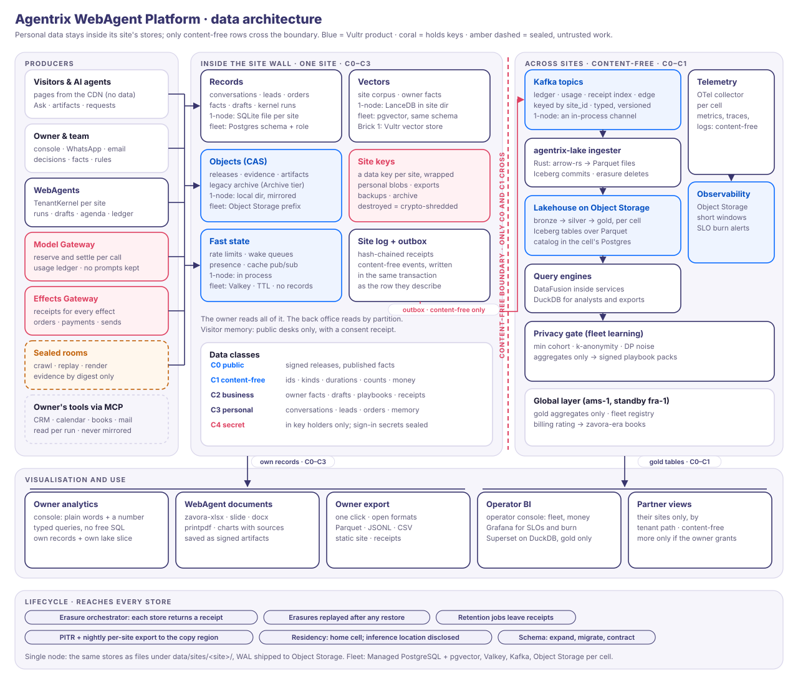
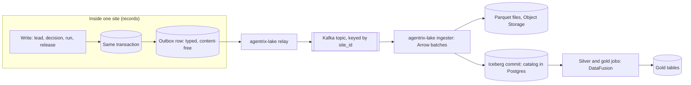

# Agentrix WebAgent Platform: Data architecture

Status: v0.1, 7 Nov 2026 (data workstream). Architecture: [02-architecture.md](02-architecture.md).
Trust: [03-trust.md](03-trust.md). WebAgents: [05-webagents.md](05-webagents.md). Experience:
[06-website-experience.md](06-website-experience.md). Console: [07-owner-console.md](07-owner-console.md).
Control plane: [08-control-plane.md](08-control-plane.md). Diagram:
[`diagrams/data-architecture.svg`](diagrams/data-architecture.svg). Decisions: ADR-025 to ADR-029.

This document says where every kind of data lives, in both profiles. It covers what may cross a
site's wall, how analytics are made without moving anyone's content, how owners and operators
see numbers, and how data is kept, exported, erased, backed up and evolved. It builds on what
adk-rust v3 already stores, on Zavora's own projects, and on Vultr's managed services. Costs
and capacities are **hypotheses** until the pilot measures them.



---

## 0. In one page

- **Five data classes** (§2.1): C0 public, C1 content-free, C2 business-confidential,
  C3 personal, C4 secret. **C2 and C3 never leave their site's stores.** C4 is never in a data
  store in plaintext: keys stay in the key holders, and per-person sign-in secrets (password
  hashes, authenticator seeds) are stored sealed and open only inside `agentrix-keys` (§2.3).
  Everything that spans sites sees only C0 and C1 ([ADR-025](adr/025-data-classes-and-the-content-free-boundary.md)).
- **Eleven data domains** (§2.2, M1–M11), each with one system of record, one class and one retention rule.
- **Stores** (§3):
  - **Single node:** a directory per site holding SQLite files, a LanceDB vector index and a
    site log, plus a local content-addressed store mirrored to Object Storage.
  - **Fleet:** one cell per region with Managed PostgreSQL (a schema and a database role per
    site, pgvector beside the records), Managed Valkey for fast state only, Object Storage
    buckets with a prefix per site, and Managed Kafka for content-free events.
- **Vectors live beside their records** (§4, [ADR-026](adr/026-vectors-beside-their-records.md)):
  pgvector in the fleet, LanceDB on a single node, one adk-rag `VectorStore` trait. Vultr's
  vector store is an optional adapter for public text only; Brick 1 may use it. Qdrant is the
  escape hatch for very large corpora.
- **A content-free lakehouse per cell** (§5, [ADR-027](adr/027-content-free-lakehouse.md)):
  - an outbox written in the same transaction as each change, relayed to Kafka;
  - a Rust ingester (`agentrix-lake`) writing Parquet under Apache Iceberg on Object Storage;
  - DataFusion inside services and DuckDB for analysts.

  Telemetry is a separate pipeline with short retention windows.
- **Visualisation** (§6, [ADR-029](adr/029-visualisation.md)):
  - **Owners:** typed metrics, never free SQL, each with its method and sources. The Chief
    WebAgent calls the same catalogue, so it and the console never disagree.
  - **Operators:** gold tables only. Grafana for SLOs, Superset on DuckDB for business BI.
  - **WebAgent documents:** made with zavora-xlsx, zavora-slide, zavora-docx and
    zavora-printpdf, and saved as signed artifacts with provenance.
- **Lifecycle** (§8, [ADR-028](adr/028-one-erasure-and-export-path.md)):
  - one erasure and export path, built on adk-core's `SubjectRights`;
  - erasure receipts from every store;
  - erasures replayed after any restore;
  - crypto-shredding by per-site data keys.
- **Vultr facts that changed the design** (§3.4, §4.2, §8.4):
  - Frankfurt has no Object Storage;
  - Object Storage has no replication or notifications;
  - Managed PostgreSQL requires a primary key on every table;
  - the Inference vector store returns a fixed 10 unscored results;
  - Vultr's model catalogue places every model in a US datacenter, so an EU site's prompts
    leave the EU while in flight.
- **Framework gaps** (§10): 19 asks to adk-rust (D1–D19), triaged by the framework session:
  - in adk-rust: 12, as fixes or small seams, for the pilot (two in the next PR);
  - later: 1;
  - platform-side or no work: 6, including D19, which was false.

  D20 (sealed sign-in secrets for U19's visitor accounts) was added on 7 Nov, evening, and
  awaits triage.

## 1. Principles

1. **Data stays home.** A site's business and personal data lives in that site's stores, in its
   home cell. Nothing else holds a copy, except encrypted backups and the owner's own exports.
2. **Content-free across sites.** Fleet views, the lake, telemetry, fleet learning, partner and
   operator dashboards see ids, kinds, durations, counts, digests and money
   ([08 §0](08-control-plane.md#0-principles) principle 5, K-I19).
3. **Records are the truth; everything else is derived.** Vectors, lake tables, caches and
   dashboards can be rebuilt from the records and the site log. Only records, the site log,
   releases and receipts need full durability.
4. **Open formats, owned by the owner.** Exports are Parquet, JSON Lines, CSV and a static site.
   An owner can leave with everything and read it without Zavora.
5. **Erasure is provable.** Every store answers an erasure with a receipt. A request is done
   only when every store has answered.
6. **Honest numbers.** Every number on every surface carries its method, its window and links
   to its sources ([08 §0](08-control-plane.md#0-principles) principle 10). No number is
   generated by a model.
7. **Fetch, don't hoard.** Data from an owner's connected tools is read when a run needs it,
   and is not mirrored into the platform.
8. **No data on the page path.** Pages are signed static releases; no database, vector index or
   query engine sits on page load ([02 tenet 1](02-architecture.md#0-tenets)).
9. **One design, two profiles.** Every store has a single-node and a fleet form behind the same
   trait ([ADR-007](adr/007-two-profiles.md)).

## 2. Data domains and classes

### 2.1 Classes

| Class | What | Examples | May cross the site wall | At rest | To a model |
|---|---|---|---|---|---|
| **C0 public** | Published by the owner | Signed releases, Markdown twins, desk manifests, published prices | Yes (it is public) | Signed; not encrypted beyond the bucket | Yes |
| **C1 content-free** | Facts about activity, with no content | Ids, kinds, durations, counts, digests, money, model names, token counts, keyed subject hashes | Yes: Kafka, lake, telemetry, fleet views | Bucket or database encryption | Rarely needed |
| **C2 business-confidential** | The business's own knowledge and work | Owner facts (`Known` and `Assumed`), drafts, playbooks, decisions, charter, crawl evidence, migration inventory | No | Database or bucket encryption; payloads sealed where adk-rust supports it | Yes, through the Model Gateway |
| **C3 personal** | About an identifiable person | Visitor conversations, leads, orders, bookings, visitor memory, visitor artifacts, consent receipts, owner and team contacts, accounts, passkey public keys, linked social sign-ins | No | As C2, plus per-site data-key envelopes for objects | Only what the turn needs, screened and delimited |
| **C4 secret** | Grants access, or lets someone guess their way to it | Model keys, payment and messaging credentials, MCP tokens, signing keys, data-key wrapping keys, OAuth client secrets, authenticator (TOTP) seeds, password hashes | Never | Only in the key holders ([ADR-004](adr/004-two-key-holders.md)): the Model and Effects Gateways, and `agentrix-keys` for key-encryption keys ([ADR-030](adr/030-data-keys-have-their-own-holder.md)). One exception: per-person sign-in secrets are stored as sealed blobs that open only inside `agentrix-keys` (§2.3) | Never |

Rules:
- A record takes the class of its most sensitive field.
- Derived data takes the class of its source. An embedding of a `Known` fact is C2; an
  embedding of a published page is C0.
- A **keyed subject hash** (HMAC under a per-site key, as the kernel ledger's `subject_hash`
  already is, `adk-kernel` `LedgerStore`) is C1 for this design. It is pseudonymous data under
  GDPR, so the lake removes it on erasure (§8.2).
- Logs and traces are C1 by construction: content capture in `adk-telemetry` stays off
  (`SemconvConfig::capture_content`, default off).

### 2.2 Domains

Domains are numbered M1–M11, so they do not collide with the framework asks D1–D20 (§10).

| # | Domain | Class | System of record | Writers | Readers | Retention (default) |
|---|---|---|---|---|---|---|
| M1 | **Site content and signed releases** | C0 (releases); C2 (drafts, candidates) | CAS: `releases/<site>/<seq>/…` and `current.pointer`; drafts in `SiteDraftStore` | Release builder, LaunchGate; drafts by WebAgents | Edge, desks, owner | Releases until the owner deletes (rollback set kept); drafts until merged or abandoned plus 30 days ([03 §5](03-trust.md#5-privacy-and-data)) |
| M2 | **Visitor conversations** | C3 | Site records: threads and turns; adk-session events for desk runs | Edge (desks), owner on takeover | Owner; the desk serving that visitor; back office only as typed signals | 90 days, owner-configurable ([03 §5](03-trust.md#5-privacy-and-data)) |
| M3 | **Leads, orders, bookings** | C3 | Site records (`LeadStore`, `CommerceStore`, bookings) | Desks via capabilities; WebAgents via tools; Effects Gateway outcomes | Owner; the owning WebAgent through tools | Owner-controlled |
| M4 | **WebAgent memory, facts and embeddings** | C2; visitor memory C3 | `FactStore` (`adk-harness`), adk-session sessions, kernel stores; vectors per §4; visitor memory in the public partition | WebAgents, the owner (confirm, correct, forget), distillation in the maintenance process | By partition ([05 §3.5](05-webagents.md#35-memory)) | Facts until forgotten; sessions 90 days; visitor memory per consent |
| M5 | **Artifacts** that visitors and WebAgents make | C3 (visitor); C2 (owner reports) | CAS objects plus an index row in site records | Desks, WebAgents, document engines | The visitor and the people they share with; the owner | 30 days unless saved ([06 §5.4](06-website-experience.md#54-website-artifacts)); owner reports until deleted |
| M6 | **Evidence, receipts and audit** | C1 (receipts, ledger); C2 (evidence) | Site log (hash-chained receipts), kernel `LedgerStore`, adk-core `AuditLogStore`; evidence in CAS | Gateways, LaunchGate, sandbox runners, kernels | Owner (Trust centre), auditors, `agentrix audit verify` | Receipts for the life of the site plus 90 days; evidence 1 year ([03 §5](03-trust.md#5-privacy-and-data)) |
| M7 | **Telemetry** | C1 | Observability backend (§5.6) | Every service, through `adk-telemetry` | Operators; owners as plain words | Traces 7 days, logs 30 days, metrics 13 months (*hypotheses*) |
| M8 | **Inference metering and billing** | C1; billing contacts C3 | Model Gateway usage ledger (adk-core `SpendLedger`, kernel `adk_kernel_usage`); `agentrix-billing`; zavora-era for Zavora's books | Model Gateway, billing | Owner (spend against budget), partner, operator, finance | Usage 25 months; invoices per tax law (KRA: to confirm) |
| M9 | **Fleet and ops data** | C1 | Fleet registry and operator ledger (control database); Vultr Audit Logs | `agentrix-fleet`, operator WebAgents, infra drivers | Operators; partners for their sites | Operator ledger for the life of the platform |
| M10 | **Owners' connected-tool data via MCP** | C2 or C3 | **The owner's own tool.** Not stored by Agentrix | Read per run through the Effects Gateway | The run that asked | None: kept only in the run's context; a typed record is written only when the run makes one (a booking, a lead) |
| M11 | **Accounts and sign-in** ([02 §8](02-architecture.md#8-identity-authority-and-approvals), d-auth-passkey-first) | C3; password hashes and authenticator seeds C4, stored sealed (§2.3) | Control database for owners, partners and Zavora's people; the site's own records for visitor accounts (06 §4.10, U19) | `agentrix-control`; the site's sign-in page for visitors; `agentrix-keys` for sealed secrets | The person (their own methods and devices); control; `agentrix-keys` for verification only. Desks see an entitlement, never the account (06 §4.10) | Life of the account ([03 §5](03-trust.md#5-privacy-and-data)); sign-in history 13 months (*hypothesis*) |

**M10 in more detail.** An owner may connect a CRM, calendar, mailbox, books or a bank feed
through MCP servers (§9). Then:
- The MCP credential is C4 and lives in the Effects Gateway, so even reads go through it.
- Results are untrusted data, delimited and screened like web content.
- Nothing is mirrored into the platform's records, vectors or lake.
- Agentrix cannot erase what lives in the owner's tools, and says so in the Trust centre's list
  of connected tools.

### 2.3 Sign-in credentials (M11)

James decided passkeys first on every surface. Without a passkey, people sign in with email and
password, or Google, LinkedIn or GitHub, always with authenticator-app MFA
([02 §8](02-architecture.md#8-identity-authority-and-approvals);
[ADR-006](adr/006-passkey-signed-approvals.md)). Each piece of sign-in material is classified
here. The same rules apply to owners, partners and Zavora's people (in the control database) and
to visitor accounts (in the site's own records).

| Material | Class | Stored | How |
|---|---|---|---|
| Passkey: credential id, public key, sign count, authenticator model, device name | C3 | Plain rows | A public key grants nothing. The sign count exposes a cloned authenticator |
| Linked social sign-in: provider, the provider's subject id, verified email, name, date linked | C3 | Plain rows | Sign-in asks the provider for a name and a verified email only ([06 §4.10](06-website-experience.md#410-visitor-sign-in)) |
| Session: a hash of the session token, device, created, last seen | C3 | Plain rows | The token is 256 random bits, so its hash cannot be guessed offline and needs no sealing. Sessions are bound to the device (02 §8) |
| Last accepted authenticator time step | C1 | Plain column | Control refuses a code at or before it, which makes each code single-use (ADR-006) |
| **Password hash** | **C4** | **Sealed blob** | Control computes Argon2id with a per-person salt. `agentrix-keys` seals the result and compares inside itself at sign-in |
| **Authenticator (TOTP) seed** | **C4** | **Sealed blob** | Generated and sealed inside `agentrix-keys`. Codes are verified there |
| Provider access and refresh tokens | C4 | **Not kept** | Used once at the callback to read the name and email, then dropped |
| OAuth client secrets for Google, LinkedIn and GitHub | C4 | In a key holder | Never in the control database. Which holder runs the code exchange is architecture's call (§11, A8) |
| Step-up attestation signing key | C4 | In a key holder | ADR-006: control signs today. A8 proposes `agentrix-keys` |
| Sign-in and step-up counts | C1 | `agx.auth.v1` → lake | Method, outcome, surface, site, count. No person id, email, address or code |

**Seeds and hashes are held inside a key holder, not only encrypted under one.**

The other way, encrypting under a key holder, means control unwraps a key and decrypts the seed
itself. Then every seed control checks passes through control's memory, and a compromised
control can decrypt every seed it is able to ask for. The rule here is different:
- **The database stores only sealed blobs.** The rows live beside the account, so PITR,
  backups, the erasure ledger, deletion and export treat them like every other row. A stolen
  backup or dump yields blobs that cannot be opened, and hashes that cannot be guessed offline.
- **Only `agentrix-keys` opens a blob.** Control sends the blob, the principal and the code,
  or the Argon2id output for a password. The holder answers valid or not, plus the matched
  time step, and never returns the plaintext.
- **A plaintext seed leaves the holder exactly once**, at enrolment, as the QR code shown to
  the person's browser. It is never logged and never stored in plaintext.
- **Each blob is bound to its principal and, for visitors, its site** by the blob's associated
  data, so a blob copied into another row fails to open.
- **Two kinds of sign-in key**, both wrapped by the key-encryption keys of
  [ADR-030](adr/030-data-keys-have-their-own-holder.md) and never released to callers:
  - one per site, for visitor accounts, separate from the site's data key, which callers do
    receive;
  - one for the global layer, for owners, partners and Zavora's people.
- **Closure destroys a site's sign-in key with its data key**, so visitor secrets in old
  backups become unreadable at the same moment.
- **Verifications are counted** per principal and site, with content-free alarms, as unwraps
  are today.
- **On a single node,** `agentrix-keys` is its own process (ADR-030), so the separation is
  weaker, as with the two gateways on one host.

**What this does for ADR-006.** If the holder also signs the step-up attestation (A8), a
control compromise can no longer mint a step-up approval from nothing. It would need a fresh
code that the person typed, and could at worst rebind that one code to another effect within
its time window. A passkey approval stays stronger, as ADR-006 says.

**What adk-rust v3 has.** adk-rust has no password, authenticator or passkey store. adk-auth
validates SSO tokens (Google, generic OIDC, Okta, Azure, Auth0) and resolves secrets, and its
`VisitorTokens` authenticate no one (`adk-auth/src/visitor.rs`). The owner-side tables are
therefore `agentrix-control`'s. Visitor accounts wait on U19 (05 §10). D20 asks that U19's
store hold sealed blobs and call a verifier, never plaintext seeds or hashes.

## 3. Stores

### 3.1 The store catalogue

| Store kind | Single node | Fleet | adk-rust v3 type | Holds |
|---|---|---|---|---|
| **Relational records** | SQLite files per site under `data/sites/<site>/data/`: adk-website's `kernel.db`, `kernel/sessions.db`, `edge.db` and `wallet.db` (adk-rust stores), plus `records.db` (platform tables); §3.3 | Managed PostgreSQL per cell: schema `site_<id>` per site, reached through role `site_<id>` | `SessionService`, `KernelStores`, `FactStore`, `SiteDraftStore`, adk-core durable stores | M1 drafts, M2–M4, M6 indexes |
| **Control** | SQLite: `data/control.db` | PostgreSQL in the global layer, row-level security on the tenant path ([08 §2.7](08-control-plane.md#27-mapping-onto-the-site-wall-and-onto-vultr)) | — (platform; adk-rust has no credential store, §2.3) | Accounts, orgs, partners, sites, plans, grants, devices, sessions, M11 sign-in: passkey public keys, linked social sign-ins, password hashes and authenticator seeds as sealed blobs (§2.3); fleet registry, operator ledger, erasure ledger |
| **Vectors** | LanceDB: `data/sites/<site>/vectors/` | pgvector tables in the site's schema | adk-rag `VectorStore`: `LanceDBVectorStore`, `PgVectorStore`; adk-memory `PostgresMemoryService` | Site corpus chunks, fact embeddings (§4) |
| **Content-addressed objects** | `data/cas/sha256/<aa>/<bb>/<digest>`, mirrored to Object Storage | Object Storage buckets per cell, prefix `sites/<site>/` | adk-site `SiteHost`: `DirectoryHost` (content-addressed `objects/`, `retain_releases`) and `ObjectStoreHost` over `S3Store` with `with_prefix` (`host/object.rs:90`); `LegacyArchive`; `adk-artifact` (files, GCS) | M1 releases, M5 artifacts, M6 evidence, exports, legacy archive |
| **Fast state** | In process | Managed Valkey per cell | adk-session `RedisSessionService` etc. (not used for records) | Rate limits, wake-front queues, presence, cache invalidation, gateway pre-checks |
| **Site log and outbox** | `data/sites/<site>/data/log.db` (the site log on `AuditLogStore`) and an outbox table in `records.db` | Site log rows in the site schema; one shared `platform.outbox` table per cell | `AuditLogStore` (Merkle log), kernel `LedgerStore` | Receipts; content-free events waiting for the relay |
| **Events** | In-process channel | Managed Kafka per cell | — (kernel `EventBus` is in-process) | Content-free events (§3.6) |
| **Lakehouse** | None (Brick 1); Parquet under `data/lake/` (pilot) | Iceberg tables on Object Storage per cell | — | C0–C1 history (§5) |
| **Observability** | Local OTLP endpoint or none | OTel collector per cell; backend on Object Storage | `adk-telemetry` `init_with_otlp` | M7 |

### 3.2 What adk-rust v3 already stores

Inventory of `adk-rust-wt-sandbox` at `3c32989e9`, 7 Nov. Paths are relative to the adk-rust
checkout. The full inventory is in the session notes (`data-inventory-adk-core.md`,
`data-inventory-adk-site-ops.md`).

| Crate | Stores | Backends | Erasure today |
|---|---|---|---|
| `adk-core` | Store traits: `DurableRunStore` (`run_store.rs:653`), `ScheduleStore`, `LeaseStore`, `GovernanceStateStore`, `ApprovalStore` (`governance.rs:1036`), `ActionLedger`, `SpendLedger` (`spend.rs:376`, micro-USD), `AuditLogStore` (`audit_log.rs:552`, Merkle-hashed, `prune` and `redact`), `ConsentStore`, `SubjectRegistry`, `SubjectDataStore` (`subject/rights.rs:143`) | In-memory here; durable ones in adk-session | `SubjectRights` (`subject/rights.rs:372`) orchestrates export and erasure per subject |
| `adk-session` | `SessionService` (`service.rs:316`), plus SQL, Redis, Mongo, Neo4j and Firestore forms of every core store (`adk_runs`, `adk_spend_entries`, `adk_audit_*`, `adk_subjects`, `adk_consent_records`) | In-memory, SQLite, Postgres, Redis/Valkey (TTL), MongoDB, Neo4j, Firestore, Vertex; `EncryptedSession` (AES-256-GCM, one key ring) | `delete_all_sessions`; `SessionSubjectData` |
| `adk-memory` | `MemoryService` (`service.rs:86`), scoped by app, user and project | SQLite with FTS5; Postgres with pgvector (HNSW or IVFFlat, `halfvec` above 2,000 dimensions); Redis; MongoDB; Neo4j; Vertex Memory Bank; a bi-temporal SQLite knowledge graph | `export_user`, `delete_user` on all eight backends; `MemorySubjectData` |
| `adk-rag` | `VectorStore` (`vectorstore.rs:151`) with an opaque `Scope` (`scope.rs:36`); Fixed, Recursive and Markdown chunkers; OpenAI, Gemini and ONNX embedders; only `NoOpReranker` | In-memory, pgvector (no ANN index created), Qdrant (scope as an indexed tenant field), LanceDB (logical delete until `purge_deleted`), SurrealDB, Vertex Agent Retrieval | `delete_where`, `purge_scope`; `RagSubjectData` (export returns counts only) |
| `adk-artifact` | `ArtifactService` (`service.rs:239`), immutable versions | In-memory, local files, GCS. **No S3** | `delete_user`; `ArtifactSubjectData` |
| `adk-kernel` | `KernelStores` (`stores/bundle.rs:80`): processes with daily spend and usage, agenda, partitions and crossings, cron watermarks, the content-free activity ledger (`adk_kernel_ledger`, subjects as HMAC), devices, drivers, agents, channels, charters (append-only), KPI samples, autonomy, signals | In-memory, SQLite (one file shared with the harness; adk-website names it `kernel.db`), Postgres, Redis | **None** on the ledger, charter, KPI, autonomy or signal stores |
| `adk-harness` | `FactStore` (`facts/store.rs:105`, `MemoryFact` with `Known`/`Assumed`, PII redacted before storage), fact embeddings, modes, standing rules, goals, snapshots, `SiteDraftStore` | In-memory, file, SQLite, Postgres; one `StoreKeyring` seals payloads | Soft "forget" only (`Forgotten` status); no subject adapter |
| `adk-telemetry` | No store. OTLP traces and metrics over gRPC (`init.rs:96`); a SQLite span exporter for local debugging | — | No pruning of SQLite spans |
| `adk-eval` | Files: eval sets, baselines, annotations, reports; `ledger.rs` statistics over the kernel ledger's JSONL | Files | n/a |
| `adk-site` | Content (`ContentStore`, `FsContentStore`), content history, held updates; releases as `ReleaseManifest` (`awp-types/src/v2/release.rs:178`), SHA-256 digests, deltas with a snapshot every 100 releases; the site log as an RFC 9162 Merkle log on `AuditLogStore` (`log_id = awp-site-log:{domain}`, `log/mod.rs:239`) with an Ed25519-signed checkpoint; migration inventory, findings, quarantine, drift reports; the encrypted `LegacyArchive` | `DirectoryHost` (content-addressed, `retain_releases`); `ObjectStoreHost` over `S3Store`/R2, GCS, Azure with a per-site prefix (`s3.rs:219`). Object-store releases are copied per `releases/<seq>/`, not content-addressed, and **never deleted** | None: releases, the log and the archive are append-only by design |
| `adk-website` | One project directory per site (`deploy/project.rs`): `data/kernel.db` (all `KernelStores`), `data/kernel/sessions.db` (back office), `data/edge.db` (adk-server edge stores plus `website_contacts`, quotes, orders, bookings, alarms, drafts), `data/wallet.db`, `data/audit.jsonl`, JSON files for updates, experiments, desk, reviews, learning | SQLite and files. **Visitor and Inbox conversations use `InMemorySessionService`** (`adk-server/src/awp/mod.rs:617`, `inbox.rs:215`) and are lost on restart. Search is an in-memory BM25 index rebuilt per release | `SiteSubjectData::erase` deletes contacts only (`edge/adapters.rs:184`); leads' answers, orders, bookings, alarms and `audit.jsonl` (not pseudonymised) remain |
| `adk-server` (`awp`), `adk-awp` | Edge stores: 13 `adk_awp_*` tables (leads with a `contact_ref` digest, consent receipts, events, idempotency, deliveries, daily beacon counts, consenting beacon visitors, rate windows). Every row carries `site` | SQLite, Postgres (`awp-sqlite`, `awp-postgres`), Redis | `ConsentReceiptStore::erase`, `LeadStore::delete`, `IdempotencyStore::purge_before`; a beacon `SubjectDataStore` |
| `adk-payments` | `WalletStore` payment journal (idempotent per wallet and key), `TransactionStore` on session state, `EvidenceStore` on artifacts; receipts are signed JWS, not stored. **No double-entry ledger** | SQLite, Postgres, Redis; ACP idempotency and the AP2 mandate ledger in memory only | None |
| `adk-auth` | `AuditSink` (`audit.rs:424`) with `query` and `purge_before`; the Postgres sink has `tenant_id` and `workspace_id`; a pseudonymous sink; signed audit export | File (JSONL, optional chain), Postgres | `purge_before` |
| `adk-surface`, `adk-deploy`, `adk-managed` | Surface: an answer log on the audit store, passkeys and push subscriptions as kernel device attachments. Deploy: a client only; its config file holds a bearer token in plain text. Managed: `ManagedStateStore` | Audit store; files; session backends | None |

**What it means for the platform:**
- **Tenancy.** No adk-rust table has a tenant column, and no crate uses row-level security.
  Isolation is by `app_name`/`user_id`, RAG `Scope`, kernel `partition_id`, or one store set
  per tenant (the managed `TenantKernel` over `ManagedStores`). The platform therefore gives each
  site **its own store set**: its own directory on a single node, its own schema and database
  role in the fleet (§7). Row-level security protects the shared tables the platform owns.
- **Durability.** Kernel stores on MongoDB, Firestore and Neo4j fall back to memory for devices,
  control, channels and the charter stores (`stores/bundle.rs:133`). The platform uses SQLite
  and Postgres only, which cover every store, and always calls `require_durable()`.
- **Erasure.** The subject-rights framework covers sessions, memory, artifacts, RAG and the
  audit log. The kernel and harness stores need adapters (D4).
- **Keys.** Encryption is one key ring per process, so a site cannot be crypto-shredded on its
  own inside adk-rust's payloads. The framework defers a key resolver (D6), so the platform seals
  C3 objects itself (§7).
- **Change capture.** No store emits changes. The outbox is the platform's by design; the
  framework agrees (D8 declined), and the kernel's `EventBus`/`EventSink` feeds it for kernel
  changes.

### 3.3 Single-node layout

The single node keeps adk-website's own per-site project layout (`deploy/project.rs`), one
directory per site, and adds what the platform needs beside it.

```text
data/
  control.db                      accounts, sites, devices, sessions, passkeys, linked sign-ins, sealed
                                  password hashes and authenticator seeds (§2.3), plans, grants, erasure ledger
  sites/<site_id>/
    data/kernel.db                adk-kernel KernelStores: runs, processes, approvals, action and spend
                                  ledgers, agenda, partitions, activity ledger, charter, KPIs, signals
    data/kernel/sessions.db       back-office sessions (adk-session)
    data/edge.db                  adk-server edge stores (adk_awp_*: leads, consent receipts, events,
                                  beacon counts), website_contacts, quotes, orders, bookings, alarms, drafts
    data/wallet.db                adk-payments wallet journal
    data/records.db               platform: threads and turns, desk sessions, artifact index, facts
                                  (SqliteFactStore), vector metadata, outbox
    data/log.db                   the site log (adk-core AuditLogStore, pseudonymised), replacing audit.jsonl
    vectors/                      LanceDB collections (corpus@<release_seq>, facts)
    site/                         adk-site DirectoryHost: objects/ (content-addressed), manifests/,
                                  log/ tiles, checkpoints/, current.pointer
  cas/sha256/<aa>/<bb>/<digest>   evidence, artifacts, exports (C3 blobs sealed with the site key)
  lake/                           pilot: Parquet partitioned by date (no lake in Brick 1)
```

- **Releases** are written by `DirectoryHost` locally, which the edge serves. They are also
  published through `ObjectStoreHost` to the site's Object Storage prefix, which keeps a copy
  for the fleet and the CDN.
- **Conversations are durable.** adk-website keeps public conversations in memory. The
  platform gives desks a durable session service and its own thread tables in `records.db`
  (D15).
- **One site, one directory.** Backup, export, move and closure all act on one path.
- **Backups:** SQLite WAL is shipped continuously to Object Storage, with snapshots of the
  vectors directory; RPO ≤ 15 minutes (*hypothesis*, [08 §3.9](08-control-plane.md#39-backups-and-disaster-recovery)).
- **Mirror:** every blob is written locally first and then copied to the site's Object
  Storage prefix. A release pointer may switch only after its files are mirrored.

### 3.4 Fleet layout (per cell)

**PostgreSQL (Managed PostgreSQL, a primary and a replica per cell):**
- database `cell`:
  - schema `site_<id>` per site, holding:
    - adk-rust's tables (each store's own migrations);
    - the platform's record tables;
    - pgvector collections;
    - the site log;
  - schema `platform` with the shared `outbox` table (insert-only for site roles, row-level
    security on `site_id`), the relay's cursors, and the lake's Iceberg catalog tables.
- **The control database** lives in the global layer (`ams-1`, standby `fra-1`), with
  row-level security on the tenant path.
- **Connection model:** a site's TenantKernel opens its stores over a small pool whose
  connections run as the site's role, with `search_path` set to its schema. Kernels start on
  wake and stop when idle (U2), so pools exist only for active sites. One shared pool with a
  per-transaction `SET LOCAL ROLE` and `search_path` also works today: adk-rust's stores accept an
  injected pool and their migrations respect `current_schema()` (the framework's documented
  pattern, D7). The pilot measures both.
- **Catalog size:** about 2,000 sites per cell ([08 §3.2](08-control-plane.md#32-cells-and-regions))
  means about 2,000 schemas of roughly 60 tables each (*hypothesis*). The pilot measures
  catalog size, migration time per schema and planning overhead before a cell's cap is set.

**Object Storage buckets** (names illustrative):

| Bucket | Class | Layout | Notes |
|---|---|---|---|
| `agx-<cell>-releases` | C0 | `ObjectStoreHost` with prefix `sites/<site>`: `releases/<seq>/…`, `previews/…`, `current.pointer` | Private; the edge and CDN read it. adk-site copies unchanged files into each release prefix and deletes nothing, so the platform needs a content-addressed layout and a rollback-set retention upstream (D14) |
| `agx-<cell>-cas` | C2, C3 | `sites/<site>/sha256/<digest>`; runner uploads under `jobs/<job>/` | C3 blobs sealed with the site's data key. Runners may write only under their job's prefix ([02 §5](02-architecture.md#5-the-sandbox-plane-replacing-the-proofs-of-concepts-in-process-chrome)) |
| `agx-<cell>-archive` | C3 (may hold anything) | `sites/<site>/legacy/<digest>` | Encrypted legacy archive; Archive tier where offered |
| `agx-<cell>-exports` | C2, C3 | `sites/<site>/exports/<id>/` | Sealed; signed download links; lifecycle deletion after 7 days |
| `agx-<cell>-lake` | C0, C1 | Iceberg tables (§5) | Content-free |
| `agx-<cell>-obs` | C1 | Observability backend | Short windows |
| `agx-<copy>-backups` | C2, C3 | `sites/<site>/<date>/` | Nightly per-site logical exports, sealed with the site key, written by the platform's copier to the copy region (Milan; London the alternative, [08 §13](08-control-plane.md#13-decisions-for-james) item 10) |

**What Vultr Object Storage does and does not do** (checked 7 Nov 2026; sources in the session
notes, `data-vultr-facts.md`):
- **Supported:** the S3 API, strong consistency, private by default, lifecycle rules,
  presigned URLs, bucket policies, multipart uploads and tagging.
- **No bucket replication and no bucket notifications.** The platform's own copier makes
  cross-region copies (releases before a pointer switch, nightly backups, gold tables) and
  verifies every digest. Nothing is triggered by an upload; the uploader emits the event.
- **Versioning and Archival cannot be combined.** A bucket that ever had versioning can never
  use Archival. The `archive` bucket never has versioning. Releases and evidence get their
  immutability from content addressing and the site log, not from bucket versioning.
- **Object Lock is not documented** (only IAM action names exist), so nothing relies on it. The
  hash-chained site log makes tampering detectable instead.
- **SSE-C is documented; SSE-S3 and SSE-KMS are not.** C3 objects are sealed client-side with
  the site's data key before upload, so the key never reaches Vultr.
- **Regions:** 14 regions, **neither Frankfurt nor Johannesburg** (nothing in Africa).
  Amsterdam has two clusters.
- **Archive tier:** works only on Standard or Archive subscriptions, and archived objects must
  be restored before they are read. Which tiers each cluster offers is unconfirmed.

**Managed PostgreSQL facts that bind this layout:**
- **Versions:** 14 to 18. Version 14 reaches end of life on 12 Nov 2026, so cells start on 17
  or 18.
- **Every table must have a primary key**, and Vultr enforces it. The framework checked: every
  adk-rust table has one (D19 withdrawn). The platform's own migrations are checked in CI.
- **No superuser.** Whether the admin user can create a role per site is to be tested in the
  pilot. The fallback is schema-level grants to a few service roles.
- **Connection pooling:** PgBouncer is pre-enabled with transaction mode, so a per-transaction
  `SET LOCAL` works through it.
- **PITR and plans:** PITR keeps 2, 14 or 30 days on Startup, Business or Premium, and none on
  Hobbyist. Cells use Business or higher.
- **Replicas:** up to three per cluster. Read-only replicas can be in another region.

**Valkey (Managed Valkey per cell):** fast state only, never a record.

| Key space | Example key | TTL | Holds |
|---|---|---|---|
| Rate limits | `rl:{site}:ask:<window>` | Window | Counters |
| Wake front | `wake:{shard}` streams | Until acknowledged | Wake ids (site, process, reason) |
| Presence | `pres:{site}:<desk or webagent>` | Seconds | Presence enum ([07 C6](07-owner-console.md#91-from-the-architecture-agreed-with-webagent-architecture)) |
| Gateway pre-checks | `gw:{site}:budget` | Minutes | A cached view of the budget; the `SpendLedger` in Postgres is the truth |
| Cache invalidation | `inv:releases` channel | — | Release pointer switches |

- The `{site}` hash tag keeps a site's keys in one slot.
- Each service has its own Valkey user with key-pattern ACLs.
- **No C2 or C3** is stored in Valkey, so Valkey needs no backup and no erasure. An SSE stream
  that reconnects replays from the thread in Postgres.

### 3.5 Domain to store, both profiles

| Domain | Single node | Fleet |
|---|---|---|
| M1 releases | CAS directory → Object Storage | `agx-<cell>-releases`, CDN in front |
| M1 drafts | `edge.db` (`SqliteSiteDraftStore`, as adk-website keeps them) | Site schema |
| M2 conversations | `records.db`: threads, turns and desk sessions | Site schema |
| M3 leads, orders, bookings | `edge.db` (`adk_awp_leads`, `website_contacts`, `website_orders`, `website_bookings`) | Site schema |
| M4 facts | `records.db` (`SqliteFactStore`) | Site schema (`PostgresFactStore`) |
| M4 embeddings | LanceDB in `vectors/` | pgvector in the site schema |
| M4 visitor memory | `records.db`, public-partition tables | Site schema, public-partition tables |
| M5 artifacts | CAS (sealed) + index row in `records.db` | `agx-<cell>-cas` (sealed) + index row |
| M6 receipts and ledger | Site log in `log.db`; activity ledger in `kernel.db` | Site schema; content-free copy in the lake |
| M6 evidence | CAS | `agx-<cell>-cas` |
| M7 telemetry | Local OTLP endpoint (optional) | Collector → `agx-<cell>-obs` |
| M8 usage | `kernel.db` spend and usage tables | Site schema, plus `agx.usage.v1` → lake |
| M8 invoices | `control.db` (`agentrix-billing`) | Control database; postings to zavora-era for Zavora Cloud |
| M9 fleet | `control.db` | Control database, `agx.fleet.v1` → lake |
| M10 connected tools | Not stored | Not stored |
| M11 owner, partner and operator sign-in | `control.db`; seeds and hashes sealed (§2.3) | Control database; seeds and hashes sealed |
| M11 visitor accounts (when a site turns them on) | `records.db`, or U19's store when it lands; seeds and hashes sealed under the site's sign-in key | Site schema, the same |

### 3.6 Events and Kafka topics

Every event is a typed, versioned, content-free record from an `agentrix-events` crate. A lint
rejects free-text `String` fields in boundary events other than enumerated kinds and
identifiers. Each event is keyed by `site_id`, so one site's events stay in order.

| Topic | Producer | Holds | Retention (*hypothesis*) |
|---|---|---|---|
| `agx.ledger.v1` | Kernels (`LedgerStore` rows) | Kind, effect, duration, WebAgent, job, keyed subject hash | 7 days |
| `agx.receipts.v1` | Control, gateways, LaunchGate | Receipt kind, digest, decision id, amount, outcome | 7 days |
| `agx.usage.v1` | Model Gateway | Purpose, model, tokens in and out, reserved and settled micro-USD, subscription | 7 days |
| `agx.edge.v1` | Edge | Page-view counts per path per minute; Ask turn facts (desk, first-token latency, outcome kind, citation count) | 3 days |
| `agx.jobs.v1` | Sandbox broker | Job kind, runtime class, room-minutes, bytes, exit | 7 days |
| `agx.kpi.v1` | Kernel KPI tracker | `KpiSample` (site, KPI, time, value, source) | 7 days |
| `agx.billing.v1` | `agentrix-billing` | Rated usage, invoices issued, payment outcomes (amounts only) | 30 days |
| `agx.fleet.v1` | `agentrix-fleet`, control | Provisioning, rollouts, versions, holds, incidents | 30 days |
| `agx.erasure.v1` | Control | Subject-hash tombstones for the lake | Compacted |
| `agx.auth.v1` | Control; the site's sign-in for visitors | Sign-ins and step-ups by method (passkey, password, social; with or without MFA), outcome and surface, per site. No person id, email, address or code | 7 days |

**The outbox.**
1. A service writes its change and its event in one transaction: into `records.db`'s outbox on a
   single node, or into `platform.outbox` in the cell's Postgres.
2. The relay (part of `agentrix-lake`) reads committed outbox rows in order and publishes them
   to Kafka, or to the in-process channel on a single node.
3. The relay marks rows sent and deletes them after a day.
4. Consumers are idempotent on `(site_id, seq)`.

No table-level change capture of C2 or C3 tables is used, even where Managed PostgreSQL
supports logical decoding: an outbox carries only what was designed to cross.

**Two Vultr facts make the outbox the right call** (7 Nov 2026):
- **Logical replication on Managed PostgreSQL** is claimed only in a marketing FAQ. There is no
  superuser and `wal2json` is not listed, so change capture from it is unconfirmed.
- **Managed Kafka features need a Business plan or higher:** Kafka Connect, Schema Registry,
  Kafka REST and private (VPC) access. The connector catalogue is not published, so a Debezium
  or S3-sink connector is unconfirmed. The relay and the ingester are the platform's own, so
  neither depends on Connect. Topic retention is set per topic.

## 4. Vector strategy

### 4.1 What needs retrieval

| Use | Corpus | Class | Reader |
|---|---|---|---|
| Ask and agentic search ([06 §5.2](06-website-experience.md#52-agentic-site-search)) | The signed release's Markdown twins and machine views, per `release_seq` | C0 | Public desks (`search_site`) |
| Back-office recall | `Known` and `Assumed` facts | C2 | Back-office WebAgents in the site's partition |
| Teach your site | Unanswered questions (`content_gap`) clustered for the owner | C3 (visitor words) | Owner; the Editor through typed items |
| Owner's own documents | Files the owner uploads for a WebAgent to know (menus, policies) | C2 | Back office; public desks only once published |

Not embedded: **visitor memory** (typed items, [05 §4.5](05-webagents.md#45-the-visitors-side-section-desks-threads-and-visitor-memory)),
conversations in bulk, and anything from the owner's connected tools (M10).

### 4.2 The options

| | **Vultr Serverless Inference vector store** | **pgvector** (Managed PostgreSQL) | **Embedded Rust index** (LanceDB) | **Qdrant** (Cloud Alliance partner) |
|---|---|---|---|---|
| adk-rust today | None (an HTTP adapter would be new) | `PgVectorStore`, `PostgresMemoryService` | `LanceDBVectorStore` | `QdrantVectorStore` |
| Isolation | A collection per site; the subscription is per site or agency | The site's own schema and role; same transaction as records | A directory per site | A collection per site, or a scope payload as tenant key |
| Export | Items can be listed; whether vectors come back is unconfirmed | `pg_dump` of the schema; rebuildable from records | Copy the directory | Snapshot API |
| Erasure | API delete; files also expire after 30 days | In the same transaction as the record | `delete` then `purge_deleted` | API delete, then optimiser |
| Residency | Not published; unconfirmed | The site's home cell | The node | The VKE cluster's region |
| Latency from the edge | A cross-region call | In-cell, a few ms (*hypothesis*) | In-process | In-cell |
| Cost | Bundled with the subscription (to verify) | Shares the cell database; memory per HNSW index | Disk only | A separate cluster to run |
| Operations | None | None beyond Postgres | None | A stateful system per cell |
| Fit | Brick 1, public text | **Fleet default** | **Single-node default** | Very large corpora |

**Vultr's vector store is simpler than its name** (its API docs, 7 Nov 2026):
- **Search:** takes only the query text and returns a fixed 10 results, with no scores, no
  metadata filters and no `top_k`.
- **RAG route:** searches on the first user message only and passes 4 passages to the model.
- **Collection ids:** a collection's id is its name lowercased and cut to 14 characters, so
  per-site names can collide unless the platform maps them.
- **Limits:** uploaded files expire after 30 days, a subscription holds up to 1,000 files, and
  the embedding model it uses is not named.

It cannot do hybrid search, scoped search (U18), citations with anchors or reranking, which
Ask and agentic search need. It suits a demo over public pages, which is how Brick 1 uses it.

**Qdrant on Vultr** means Qdrant Hybrid Cloud on VKE: Qdrant's agent runs in the cluster and
is managed from Qdrant's control plane.
- Vultr does not support CSI volume snapshots, which Hybrid Cloud's backups expect.
- There is no Marketplace app, and Qdrant's own managed cloud is not offered on Vultr.

### 4.3 The choice

**pgvector in the fleet, LanceDB on a single node, both behind adk-rag's `VectorStore`**
([ADR-026](adr/026-vectors-beside-their-records.md)). The reasons, in order:

1. **Erasure and export come with the record.** A fact and its embedding are written and
   erased in one transaction. A site export or closure is one schema or one directory. A
   second system would be a second place to forget.
2. **Residency.** Vectors stay in the site's home cell. Embedding calls still go to Vultr
   Inference in the US (`qwen3-embedding-4b` is served from San Jose; §8.4), but nothing is
   stored there.
3. **Isolation by construction.** A site's vectors are in its own schema or directory, so a
   scope bug cannot return another site's chunks.
4. **Size fits.** A small site's corpus is hundreds to a few thousand chunks (*hypothesis*: a
   50-page site at about 500 tokens per chunk). An HNSW index at that size is small, and
   pgvector's recall and latency are within [02 §9](02-architecture.md#9-performance-budgets).
5. **No new system to run.** Postgres is already in every cell.

**Single node: LanceDB now, SQLRight in evaluation.** adk-rag supports LanceDB today. Zavora's
own SQLRight (an embedded SQLite engine with HNSW and hybrid search, §9) would put a site's
vectors inside its own SQLite, which is simpler still. The pilot evaluates it as an adk-rag
`VectorStore` backend on recall, latency and erasure, and adopts it if it passes.

Vultr's vector store remains an **adapter for C0 only**. Brick 1 lists it as a Should
([04](04-vultr-agent-rush.md)), so the demo may answer from it. It never holds facts,
conversations or visitor data. **Qdrant** on Vultr is the escape hatch for a site whose corpus
outgrows pgvector (a large publisher), measured against the Ask budget. It goes behind the same
trait, one collection per site.

### 4.4 Index design

- **Collections per site:** `corpus@<release_seq>` (C0) and `facts` (C2), later `docs` (owner
  uploads). The scope is the site id, even inside a site's own schema, as defence in depth.
- **Metadata per collection:** embedding model, dimensions, distance, source version
  (`release_seq` or fact digest), index version, chunker and its parameters. adk-rag does not
  store the model today (D3). The platform keeps it in a `vector_collections` table until then.
- **Embeddings:** `qwen3-embedding-4b` through the Model Gateway, purpose `embed`
  ([02 §6](02-architecture.md#6-the-model-plane)). Its output is wider than pgvector's 2,000
  dimensions for an HNSW `vector` index, so the index uses `halfvec`, as adk-memory already
  does, or a reduced output width if Vultr's endpoint honours a `dimensions` parameter (to
  test).
- **ANN index:** HNSW, cosine. `PgVectorStore` creates no index today (D1).
- **Hybrid search:** a Postgres `tsvector` keyword match, fused with the vector hits, so names,
  SKUs and prices are found exactly. adk-memory's Postgres backend already keeps both.
- **Rerank:** `bge-reranker-v2-m3` through the Model Gateway, purpose `rerank`. adk-rag ships
  only `NoOpReranker`, so the platform implements adk-rag's `Reranker` trait over the gateway
  (D13 is platform-side).
- **Releases:** a new release embeds into `corpus@<new seq>` as part of the release build.
  The pointer switch moves the edge's search to it. The previous collection is kept while its
  release is in the rollback set, then dropped.
- **Re-embedding** after a model change runs as maintenance within budget. It writes a new index
  version, and reads switch only when that index is complete.

## 5. The lakehouse

### 5.1 What it is for, and what it is not

**For:**
- owner trends beyond what a site's own records answer quickly;
- operator fleet health, money, cost to serve and partner views;
- billing rating inputs;
- fleet learning behind the privacy gate ([05 §6.3](05-webagents.md#63-cross-site-learning-without-leakage));
- evaluation statistics over the activity ledger (`adk-eval` `ledger.rs`).

**Not:**
- a copy of anyone's content. It is C0 and C1 only ([ADR-025](adr/025-data-classes-and-the-content-free-boundary.md)).
- on any request path for visitors.
- telemetry (§5.6).
- the system of record for anything. Billing posts invoices from `agentrix-billing`'s own
  tables, and the lake only feeds rating.

### 5.2 Ingestion



- **The ingester** is a Rust service:
  - it consumes Kafka (rdkafka);
  - it builds Arrow record batches (arrow-rs);
  - it writes Parquet (zstd, about 128–512 MB files after compaction, *hypothesis*);
  - it commits Iceberg snapshots through iceberg-rust.
  
  Each snapshot records its source topic offsets and the ingester version, so a table can be
  traced to the events that made it.
- **Cadence:** bronze commits every few minutes (*hypothesis*: 5). Silver and gold rebuild
  their affected partitions hourly and at day close.
- **Single node:** the relay writes to an in-process channel, and the ingester writes local
  Parquet, from the pilot onwards. Brick 1 has no lake.

### 5.3 Edge analytics without trackers

Pages come from the CDN, so the edge sees only cache misses. adk-server's AWP beacon already
counts visits as **daily aggregates per metric** (`adk_awp_beacon`), keeps consenting visitors
separately (`adk_awp_beacon_visitors`), parses host logs without keeping addresses, and has a
`SubjectDataStore`. The platform builds on it. The visitor and owner wording, the defaults and
the consent analysis for the EU, UK and Kenya are in
[06 §4.9](06-website-experience.md#49-counting-visits-without-trackers).

**How it works:**
- The release includes the beacon as a small inline script, sent with `navigator.sendBeacon`
  after the page has loaded. It is not render-blocking
  ([02 §9](02-architecture.md#9-performance-budgets)), and it goes to the site's own edge, never
  to a third party.
- It carries the route, the referrer's host, a device class and the page's `release_seq`. The
  edge derives the country from the IP address and then drops the address.
- The edge emits `agx.edge.v1` rows from its counters. No visitor identifier leaves the site.

**Rules:**
- **Routes, not URLs.** Query strings and fragments are stripped, and private links collapse to
  their route: `/a/{id}` is counted as `/a/:id`, because an artifact's id is its access secret.
- **One purpose.** Counts serve the owner's own statistics only: no ads, no A/B audiences, no
  conversion tracking, no joins with other data, no third parties. That limit is what keeps the
  audience-measurement exemptions open (06 §4.9).
- **Opt-out.** A "Don't count my visits" link sets a device flag. The beacon is not sent when
  `navigator.globalPrivacyControl` is true.
- **Visitor-level counts stay opt-in.** `adk_awp_beacon_visitors` holds only visitors with a
  consent receipt, inside the site.
- **The payload is declared.** The LaunchGate rejects a release whose beacon sends fields
  beyond the declared ones.
- **Small cells are hidden.** Any breakdown (page × country × device) with fewer than 5 visits
  is shown to the owner as "fewer than 5". Suppression happens in `agentrix-analytics` at query
  time: silver and gold keep exact counts, and no screen, analytics export or report shows a
  cell under 5.
- **Defaults.** On for commercial sites, off for Government, Health and Education sites, as with
  device memory ([05 §4.5](05-webagents.md#45-the-visitors-side-section-desks-threads-and-visitor-memory)).
  The owner can turn it off.

### 5.4 Tables

| Layer | Table | Grain | Source |
|---|---|---|---|
| Bronze | `ledger_events`, `receipts`, `usage_events`, `edge_events`, `job_receipts`, `kpi_samples`, `billing_events`, `fleet_events` | One row per event | Kafka topics as received |
| Silver | `fact_webagent_action` | Site, WebAgent, job, kind, effect, outcome, duration, autonomy level | `ledger_events` |
| Silver | `fact_decision` | Site, job, card kind, outcome (approved unchanged, edited, rejected, expired), latency, surface | `receipts` |
| Silver | `fact_model_call` | Site, partner, cell, purpose, model, tokens, reserved and settled cost | `usage_events` |
| Silver | `fact_ask_turn` | Site, desk, first-token latency, outcome kind (answered, "doesn't say", handover, blocked), citations | `edge_events` |
| Silver | `fact_page_views` | Site, path, minute, referrer host, device class, country | `edge_events` |
| Silver | `fact_job` | Site, job kind, runtime class, room-minutes | `job_receipts` |
| Silver | `dim_site` | Site, org, partner, cell, plan, archetype, tier, residency tag (ids only) | `fleet_events` |
| Gold | `site_daily`, `site_monthly` | One row per site per day or month: the metric catalogue's measures (§6.1) | Silver |
| Gold | `partner_monthly`, `fleet_daily` | Sums by tenant path and cell | Silver |
| Gold | `cost_to_serve_monthly` | Site × cost line ([08 §3.10](08-control-plane.md#310-cost-management)) | Silver, plus Vultr billing |
| Gold | `revenue_monthly` | Plan, partner, country: MRR, collection, margin ([08 §4.2](08-control-plane.md#42-money)) | `billing_events` |
| Gold | `cohort_stats` | Privacy-gated cohort statistics: minimum cohort, k-anonymity, DP noise | Silver, through the gate |

**Names are not in the lake.** It holds ids. Site, organisation and partner names are joined at
display time from the control database, under the viewer's own access.

### 5.5 Format, catalog, partitioning, engines

- **Format:** Apache Iceberg (format v2) over Parquet ([ADR-027](adr/027-content-free-lakehouse.md)).
  It was chosen over Delta Lake for:
  - engine neutrality (DuckDB, DataFusion through iceberg-rust, Trino, Spark, ClickHouse and
    the large warehouses all read it);
  - equality deletes, which erasure needs;
  - schema evolution by field id;
  - partition evolution.
  
  **Maturity risk:** iceberg-rust's writer has trailed its reader. If a needed feature (equality
  deletes, compaction) is missing when the pilot builds, the ingester writes Delta Lake through
  delta-rs behind the same interface.
- **Catalog:** Iceberg's SQL catalog in the cell's Postgres (`platform` schema), so there is no
  separate catalog service. On a single node it lives in SQLite.
- **Partitioning:** `day(ts)` and `bucket(16, site_id)` for bronze and silver; `month` for
  gold. Per-site partitions would make thousands of small files.
- **Compaction:** a daily job rewrites small files and expires snapshots older than 7 days
  (*hypothesis*). Expiring snapshots is also what makes erasure deletes final (§8.2).
- **Engines:**
  - **DataFusion** inside `agentrix-analytics` and the operator console API. Iceberg tables
    are read through iceberg-rust's DataFusion integration.
  - **DuckDB** for analysts, BI tools, ad hoc audits and the owner's export of their lake slice.
  - If many concurrent analysts outgrow DuckDB, Trino or ClickHouse reads the same tables;
    nothing moves.
- **Access:** services read the lake with a read-only Object Storage user per cell. No owner
  or partner gets raw lake access. They get the analytics API, filtered by tenant path.

### 5.6 Telemetry is a separate pipeline

| | Telemetry (M7) | Lake (§5) |
|---|---|---|
| Purpose | Is the system healthy now? | What happened, for whom, at what cost? |
| Content | Spans, metrics, logs: C1 | Typed events: C0–C1 |
| Retention | Short: traces 7 days, logs 30 days, metrics 13 months downsampled (*hypotheses*) | Bronze 13 months, gold for the life of the platform |
| Users | SRE, operator WebAgents, on-call | Owners (through the API), operators, billing, fleet learning |

**The pipeline:** `adk-telemetry` exports OTLP traces and metrics over gRPC
(`init_with_otlp`, `adk-telemetry/src/init.rs:96`) to an OpenTelemetry Collector per cell. It
has no OTLP log exporter (D9), so the collector reads services' JSON logs from stdout.

**Proposed backend** ([08 §13](08-control-plane.md#13-decisions-for-james) item 7 is open; this
is a proposal for James):
- Prometheus-compatible metrics (Mimir or VictoriaMetrics), Tempo for traces and Loki for logs,
  each storing to `agx-<cell>-obs` on Object Storage;
- Grafana for dashboards, SLO burn-rate alerts and on-call views, for Zavora's SRE and on-call
  only. Partners and owners see console views built from the lake.

Grafana, Loki, Tempo and Mimir are AGPL-3.0. Running them unmodified as separate services is
compatible with the MIT core, but the platform does not bundle them. VictoriaMetrics with
VictoriaLogs and Jaeger (Apache-2.0) is the permissive alternative. Self-hosters point OTLP at
whatever they run. Grafana, Prometheus and SigNoz are on the Vultr Marketplace; Superset,
Metabase and ClickHouse are not.

### 5.7 Phasing

| Phase | Lake | Events | Analytics |
|---|---|---|---|
| **Brick 1** (9 Nov) | None | Site log only | The console reads the site's records and the kernel's KPI store directly |
| **Pilot** (10 sites) | Date-partitioned Parquet in Object Storage, read by DuckDB | Outbox and relay; Kafka optional | `agentrix-analytics` over records plus Parquet; the first metric catalogue |
| **Fleet** | Iceberg tables, erasure deletes, compaction, per cell | Managed Kafka per cell | Operator BI, partner views, the privacy gate for fleet learning |

## 6. Visualisation

### 6.1 Owner analytics in the console

**A metric catalogue, not a query box.** `agentrix-analytics` answers named metrics
(`metric(id, site, window, breakdown)`). Each catalogue entry has:
- an id and a version;
- a definition in plain words;
- its source: the site's records, its lake slice, or both;
- its query;
- a minimum sample below which the console says "not enough data yet";
- the words used to show it.

The catalogue is a versioned artifact, reviewed like a playbook.

**First metrics** (from [06 §9](06-website-experience.md#9-metrics), [07 §8](07-owner-console.md#8-metrics)
and [01 §8](01-product.md#8-metrics)):

| Metric | Source | Shown as |
|---|---|---|
| Customer moments handled well (north star) | Records: threads resolved, requests completed, handovers met in time | "34 customers helped this week, 6 more than last week" |
| Answers not corrected per 100 | Records (owner corrections) + lake (`fact_ask_turn`) | A number with a 4-week sparkline |
| "Doesn't say" rate and days to close a gap | Lake + records (`content_gap`) | The teach-your-site queue with counts |
| Leads, orders and bookings, by count and value | Records | Numbers with links to the records |
| Artifacts made → shared → requested | Records | A three-step funnel |
| Decisions: count, approved unchanged, time to decide | Lake (`fact_decision`) | A number per job; it feeds promotion offers |
| Corrections per 100 WebAgent actions | Lake (`fact_webagent_action`) | The trust metric ([07 §8](07-owner-console.md#8-metrics)) |
| AI spend against budget | Records (`SpendLedger`) | Spend, budget and forecast, labelled as a forecast |
| Page views and top pages | Lake (`fact_page_views`) | Counts by route; cells under 5 shown as "fewer than 5" (§5.3) |
| Ask first-token p95 | Lake (`fact_ask_turn`) | Only in the Trust centre's health card |
| Erasures honoured within an hour | Control (erasure ledger) | An invariant: shown when it is not 100% |

**Rules:**
- **Provenance on every number.** It shows its window, its method in one line and a link to
  the rows or receipts behind it. Briefs and mission reports cite ledger rows and receipts
  ([07 §9.1](07-owner-console.md#91-from-the-architecture-agreed-with-webagent-architecture)).
- **The Chief WebAgent uses the same catalogue.** "How did Easter go?" becomes catalogue calls
  through a read-only `analytics.metric` tool, and the reply cites them. There is no
  natural-language-to-SQL path, so a model never writes a query or invents a number.
- **Charts are small and server-rendered:** a sparkline, a bar or a funnel as inline SVG from
  the console server, in `console.css` tokens. No chart library ships to the phone.
- **Owner-defined metrics** come later, as reviewed catalogue entries, not as free SQL.

Zavora's own pieces: `adk-ui` (2.2.0) has chart, table and dashboard-layout render tools for
generative UI, drawn with recharts in its React package. It targets ADK v2, so the console
uses it only after a port, for charts inside the Chief WebAgent's replies. `mcp-bi` already
follows the rule this section needs ("numbers are authoritative; pixels are for people"): it
returns the numbers behind every chart it renders.

### 6.2 Operator BI in the control plane

| View | Where | Data |
|---|---|---|
| Fleet, Rollouts, Incidents, Money, Partners ([08 §7.1](08-control-plane.md#71-the-operator-console)) | Operator console (same shell, Operator scope) | `agentrix-analytics` over gold tables |
| SLOs, error budgets, burn rate, capacity | Grafana | Observability backend |
| Weekly business review | Operator Chief WebAgent's report: a signed document artifact | Gold tables, through the catalogue; method beside each number ([08 §4.2](08-control-plane.md#42-money)) |
| Analyst bench | Apache Superset (Apache-2.0) on DuckDB, behind single sign-on | Gold and silver tables only (C0–C1) |
| Partner dashboards | Portfolio scope of the console | Gold tables filtered by tenant path |

**Analysts cannot reach C2 or C3 through BI,** because BI connects only to the lake. Reading
a site's content still needs an owner-signed support grant
([ADR-023](adr/023-support-grants-and-break-glass.md)).

### 6.3 WebAgent-generated charts, reports and decks

WebAgents make documents for owners (monthly report, mission report, a price-list spreadsheet,
an investor deck from the site's numbers) and for visitors (a quote PDF, a comparison sheet, a
saved presentation as a deck, [06 §5.4–5.5](06-website-experience.md#54-website-artifacts)).

1. The WebAgent asks the metric catalogue, or its own typed records, for the data.
2. A document engine builds the file. All four are Zavora's own pure-Rust engines, linked as
   crates into the document service `agentrix-docs` rather than spawned as stdio MCP servers:
   - **zavora-xlsx** for spreadsheets: native charts (including waterfall, funnel, treemap and
     box plots), pivot tables, sparklines, and live formulas with its own recalculation engine;
   - **zavora-slide** for decks: charts with editable data, rendered to SVG, PNG or PDF for
     previews;
   - **zavora-docx** for reports: tables and charts, rendered to PDF, HTML or Markdown from one
     document;
   - **mcp-pdf** (on zavora-printpdf) for quotes, receipts and statements.
3. The file is stored as an artifact in the site's CAS, signed, with a **provenance block**:
   metric ids and versions, the window, record counts, and the release it cites.
4. Owners receive it in the console, on WhatsApp or by email. Visitors receive it through the
   artifact route ([06 §5.4](06-website-experience.md#54-website-artifacts)).

Rules:
- Visitor-facing documents use only C0 and that visitor's own artifact fields.
- Documents generated from typed data run in-process. Parsing files someone uploaded (an
  owner's spreadsheet, a visitor's brief) happens only in sealed rooms.
- Charts inside documents use the same catalogue numbers as the console.

### 6.4 Open-source BI options

| Tool | Licence | Strength | Use here |
|---|---|---|---|
| **Grafana** | AGPL-3.0 | Metrics, traces, logs, alerting | SLOs and on-call (chosen) |
| **Apache Superset** | Apache-2.0 | SQL exploration, many charts, SSO, row-level filters | Analyst bench over DuckDB (chosen) |
| **Metabase** | AGPL-3.0 (open source edition) | Easiest self-serve questions | Alternative to Superset |
| **Evidence** | MIT | Reports as code (Markdown + SQL) built to static pages | Candidate for the weekly business review as a signed static release |
| **Lightdash** | MIT | A semantic layer over dbt | Not needed without dbt |
| **Redash** | BSD-2-Clause | SQL dashboards | Not chosen; less active |

AGPL tools run as separate services and are not bundled in the MIT repository.

## 7. Tenancy and isolation in every store

| Store | Isolation unit | Enforced by | Tested by |
|---|---|---|---|
| SQLite (single node) | A directory per site | Path derived from `SiteId` in `agentrix-types`; the kernel opens only its own; no `ATTACH` | Cross-tenant suite: open site B's path from site A's kernel |
| PostgreSQL site data | A schema and a role per site | The role has privileges on its own schema only; `search_path` fixed; no `BYPASSRLS` | Query another schema as a site role; a mis-set `search_path` |
| PostgreSQL shared tables (`platform.outbox`, catalog) | Row | Row-level security on `site_id`: site roles insert their own rows only (`WITH CHECK`) and read none | Insert with another `site_id`; select as a site role |
| Control database | Tenant path | Row-level security on the path prefix ([08 §2.7](08-control-plane.md#27-mapping-onto-the-site-wall-and-onto-vultr)) | The three control-plane cases in 08 §2.7 |
| Sealed sign-in secrets (§2.3) | Principal, and site for visitors | The blob's associated data; `agentrix-keys` opens one only for control's token, or the site's sign-in token for that site | Present a blob copied into another principal's or another site's row |
| Vectors | Schema or directory, plus `Scope` | As the records | Search with another site's scope |
| Object Storage | Prefix `sites/<site>/`; C3 sealed with the site's data key | Services hold per-bucket users; runners write only under their job's prefix; the key unwraps only for the site in the caller's capability token | Read site B's prefix with site A's token; decrypt with the wrong key |
| Valkey | Key prefix with the `{site}` hash tag | ACL users per service; no records | Read another site's keys as the edge user |
| Kafka | Topic per domain, key per site | Content-free types; ACLs per service principal | Schema lint; a boundary event with a free-text field fails CI |
| Lake | Partition by `bucket(site_id)`; rows carry `site_id` and tenant path | Only the analytics API queries it, adding the caller's tenant filter | A partner token asking for another partner's site |
| Telemetry | Labels `site_id`, `partner_id`, `cell` | Content-free; only Zavora's SRE uses Grafana, and partners see console views from the lake filtered by tenant path | A partner view showing another partner's series |

**Per-site data keys.** Each site has a data key, wrapped by a per-cell key-encryption key held
by `agentrix-keys`, a third key holder that only wraps and unwraps
([ADR-030](adr/030-data-keys-have-their-own-holder.md); [ADR-004](adr/004-two-key-holders.md)).
It is kept apart from the Effects Gateway so that one compromise cannot both act and read, and
so that an effects outage never stops visitor reads.
- A service receives the unwrapped key only for the site named in its capability token, only
  for the life of that use.
- The key seals C3 objects, exports and backups.
- adk-rust's payload encryption (`EncryptedSession`, harness `StoreKeyring`) uses one key ring
  per process today. A per-site key resolver is deferred upstream (D6). Until then, C3 objects
  are sealed by the platform, and adk-rust payloads rely on the site's own schema or directory.
- Destroying a site's key at closure makes every encrypted copy unreadable, including copies in
  backups.

## 8. Lifecycle

### 8.1 Retention

[03 §5](03-trust.md#5-privacy-and-data) sets retention for the data owners see. This table
adds the stores it does not name.

| Data | Store | Default | How |
|---|---|---|---|
| Finished kernel runs | `adk_runs` | 30 days after finishing (*hypothesis*) | `DurableRunStore::prune(finished_before)` |
| Desk and WebAgent sessions | adk-session | As conversations: 90 days | `delete` by age, a platform job |
| Activity ledger | Kernel `LedgerStore`; lake bronze | 13 months in the site; 13 months bronze; gold aggregates kept | Kernel prune needed upstream (D12); Iceberg snapshot expiry |
| KPI samples | Kernel `KpiStore` | 25 months (year-on-year comparisons) | Prune needed upstream (D12) |
| Forgotten facts | `FactStore` | Hard-deleted 30 days after "forget" (the undo window) | Hard delete needed upstream (D4) |
| Kafka topics | Managed Kafka | 3–30 days (§3.6) | Topic retention |
| Telemetry | Observability backend | Traces 7 days, logs 30 days, metrics 13 months | Backend retention |
| Exports | `agx-<cell>-exports` | 7 days | Bucket lifecycle rule |
| Postgres PITR | Managed PostgreSQL | 14 days on Business, 30 on Premium | Vultr |
| Per-site nightly exports | `agx-<copy>-backups` | 30 days (*hypothesis*) | Bucket lifecycle rule |
| Erasure ledger | Control database | Life of the site plus 90 days | Holds only subject hashes and receipts |
| Accounts and sign-in methods (M11) | Control database; the site's records for visitors | Life of the account ([03 §5](03-trust.md#5-privacy-and-data)); a removed passkey, password or authenticator is deleted at once | Account deletion runs as a subject erasure; sealed blobs in backups stay sealed and age out |
| Sign-in history | Control database; the site's records | 13 months (*hypothesis*) | A platform prune job |

**Every retention job writes a receipt.** The Compliance WebAgent checks that each job ran
([08 §4.6](08-control-plane.md#46-compliance-and-audit)).

### 8.2 Erasure across stores

There are three kinds of request:
1. **Subject:** a visitor or customer asks; or a visitor runs `memory.forget`; or an owner
   erases a customer.
2. **Record:** the owner deletes one lead or one artifact.
3. **Site:** closure, 90 days after the notice ([08 §4.2](08-control-plane.md#42-money)).

**How a subject erasure runs** ([ADR-028](adr/028-one-erasure-and-export-path.md)), built on
adk-core's `SubjectRights` (`subject/rights.rs:372`):

| Step | Store | Mechanism | Today |
|---|---|---|---|
| 1 | Subject registry | Mark `Erasing`; revoke consent | `SubjectRegistry`, `ConsentStore` |
| 2 | Sessions | `delete_all_sessions` | `SessionSubjectData` |
| 3 | Memory and facts | `delete_user`; facts hard-deleted | `MemorySubjectData`; facts need D4 |
| 4 | Vectors | `delete_where` on the subject tag; `purge_deleted` on LanceDB | `RagSubjectData` |
| 5 | Artifacts | `delete_user`; CAS objects unlinked, then removed by GC | `ArtifactSubjectData`, platform CAS GC |
| 6 | Platform records (leads, orders, threads, bookings, visitor memory) | Platform `SubjectDataStore` adapters. Payment records are pseudonymised, not deleted, because of legal retention duties | Platform work; adk-website and adk-payments adapters are D16 and D17 |
| 7 | Audit log and site log | Redact bodies; keep hashes, so the chain still verifies | `AuditLogSubjectData` |
| 8 | Kernel ledger | Delete rows with the subject's HMAC | Needs D4 |
| 9 | Lake | Iceberg equality delete on `subject_hash`; final after snapshot expiry | `agentrix-lake` |
| 10 | Kafka | Ages out within topic retention (no C3) | — |
| 11 | Backups | Not edited; the erasure ledger is replayed after any restore | Platform |
| 12 | Vultr Inference files | API delete if any were uploaded for the subject | Platform |
| 13 | Owner's connected tools | Not reachable; the owner is told which tools may hold copies | — |

- **Deadlines:** visitor memory within one hour ([06 §9](06-website-experience.md#9-metrics));
  other subject requests within 30 days.
- The request's receipt lists every store's answer: `Hard`, `Eventual{within}` or `External`.
- **Site closure:**
  1. Run the export the owner asked for.
  2. Drop the site's schema or directory and delete its prefixes.
  3. Destroy its data key, which crypto-shreds every backup copy.
  4. Write tombstones for the lake: the site's rows are removed at the next compaction.
- **Restore rule:** a restored store replays the erasure ledger before it serves. Each restore
  drill ([08 §3.9](08-control-plane.md#39-backups-and-disaster-recovery)) checks it.

Upstream: adk-rust #1283 is the subject-rights epic; #1334 closed it, and its framework is in
v3. What is still missing is adapters, all accepted for the pilot: D4, D16 and D17. A site
scope (D5) needs no new API: the platform runs one `SubjectRights` per site, scoped with
`with_app`.

### 8.3 Export and portability

**The owner's one-click export** (site scope) is a signed bundle:
- `records/`: every platform and adk-rust table as JSON Lines and Parquet, plus CSV for the
  spreadsheet-shaped ones (leads, orders, bookings);
- `site/`: the current release as a static site that runs on any host, plus its Markdown twins;
- `receipts/`: the site log and audit checkpoints, verifiable with `agentrix audit verify --site`;
- `analytics/`: the site's lake slice as Parquet;
- `vectors/`: not exported, since they rebuild from `records/` and `site/`; the manifest says so;
- `manifest.json`: format version, the schema version of each table, digests, and the signature.

Other exports:
- **A visitor's `memory.export`** uses the same registry with subject scope
  (`SubjectDataStore::export`).
- **An agency moving a client out** uses the owner's export, started by the owner.
- **Re-import** into another Agentrix installation (a self-host, a different cell) reads the
  same bundle, so leaving Zavora Cloud for a self-host is a supported path.
- **Sign-in material in exports** (§2.3):
  - A person's own export lists their sign-in methods: passkey names and dates, linked
    providers, and whether MFA is enrolled.
  - A site export carries visitor accounts with their passkey public keys, which keep working if
    the site keeps its domain.
  - No export carries password hashes or authenticator seeds. They are sealed to this
    installation's `agentrix-keys`, so after a move, visitors who used a password set a new one
    and enrol their authenticator again. The new installation's sign-in page tells them why.

### 8.4 Residency

| Data | Where |
|---|---|
| A site's records, vectors, objects, site log | Its home cell: `ams-1` (EU) for the pilot; `atl-0` (US) for Brick 1. `fra-1` is a standby for compute and the database only, with no buckets and no home sites; a second active cell would be `lhr-1` ([08 §3.2](08-control-plane.md#32-cells-and-regions)) |
| Backups and release copies | The copy region, written by the platform's copier, which reads each copy back and compares digests: Milan (EU), or London. Not Frankfurt, which has no Object Storage |
| Lake | Per cell; the global layer receives gold aggregates only |
| Control database (owner accounts and contacts: C3) | Global layer, `ams-1`, standby `fra-1` |
| Model prompts and embeddings in flight | Vultr Serverless Inference, in the US. `GET /v1/models` lists one datacenter per model (7 Nov 2026): text models in Seattle (`sea`) or Atlanta (`atl`), and embedding, screening and rerank models in San Jose (`sjc`). Nothing is stored there except files uploaded to Vultr's vector store |
| African sites | Kernels and stores in the EU until `jnb-1` can host a full cell ([08 §3.2](08-control-plane.md#32-cells-and-regions)); edge in Johannesburg |

**Vultr facts that bound residency** (7 Nov 2026):
- **Johannesburg is Vultr's only African region.**
  - It has: Cloud Compute, Bare Metal, VKE, Load Balancers and HDD block storage. Managed
    Databases appear on its region map.
  - It lacks: **Object Storage and VX1.**
  - A full cell needs Object Storage, so African sites keep their stores in the EU until Vultr
    adds it there.
- **Frankfurt has no Object Storage.** The EU regions with both VX1 and Object Storage are
  Amsterdam and Milan; Milan has a thin catalogue and no Load Balancer. London has both but is
  outside the EU. 08 §3.2 now makes `fra-1` a standby for compute and the database (a read-only
  replica of `ams-1`'s Postgres, promoted on failover), with no buckets. Backups and release
  copies for `ams-1` go to the copy region, Milan or London.
- **Vultr Inference runs in the US.** The subscription API takes no region, but
  `GET /v1/models` now lists each model's datacenter. Every one of the 33 models read on
  7 Nov 2026 is in the US (`sea`, `sjc` or `atl`).
  - An EU site's prompts and embedding text therefore cross to the US in flight. That is a
    transfer under GDPR Chapter V.
  - The DPA must name the US and Vultr's transfer basis, and 03 §5 should tell owners plainly
    (§11, A9).
  - Whether Vultr offers inference hosted in the EU is a question for Vultr; asking is James's
    call.

Each site carries a residency tag that placement honours. Moving a site between cells is the
scripted migration of [08 §3.2](08-control-plane.md#32-cells-and-regions): replicate schema
and prefix, hold, switch, release. It is recorded as a receipt.

### 8.5 Backup and disaster recovery

[08 §3.9](08-control-plane.md#39-backups-and-disaster-recovery) owns the backup table. This
document adds:

| Data | Backup | Note |
|---|---|---|
| pgvector collections | Covered by Postgres PITR and the per-site export | Rebuildable from records and releases |
| LanceDB (single node) | Directory snapshot with the WAL shipping | Rebuildable |
| Lake | Gold tables copied to the copy region daily by the platform's copier (*hypothesis*); bronze not copied | Losing bronze loses analytics history, not records |
| Kafka | Not backed up | The outbox and the lake are the durable ends |
| Valkey | Not backed up | Holds no records |
| Erasure ledger | Control database PITR | It must survive every restore |
| Per-site data keys | Wrapped copies in `agentrix-keys`' own backup; KEK under two-person control ([ADR-030](adr/030-data-keys-have-their-own-holder.md)) | Losing a KEK loses every site under it, so KEKs are per cell |

### 8.6 Lineage and governance

- **A data catalogue in the repository** (`data/catalog/*.toml`). Each dataset has one entry:
  - name, domain and class;
  - store and owner workstream;
  - retention and erasure method (`SubjectDataStore` name, site drop, tombstone or TTL);
  - export format and schema version;
  - producers and consumers.
- **CI checks the catalogue:**
  - every migration's tables, every topic and every bucket has an entry;
  - every C2 or C3 dataset has an erasure method;
  - no boundary event type has a free-text field.
- **Lineage:**
  - Iceberg snapshot summaries carry source offsets and the ingester version;
  - gold tables carry the metric catalogue version;
  - every owner-facing number links to its metric id, window and row counts.
  
  OpenLineage events can be added later without changing this.
- **Who may read what:**

| Reader | Reads |
|---|---|
| Owner | Everything of their own site |
| Agency | Its clients' sites within the charter role the owner granted |
| Operator | Content-free data across the fleet; content only under an owner-signed support grant or break-glass ([ADR-023](adr/023-support-grants-and-break-glass.md)) |
| Analysts | Gold and silver tables |
| WebAgents | By partition and capability ([05 §3.5](05-webagents.md#35-memory)) |
| Visiting AI agents | C0 only, plus their own requests |

### 8.7 Schema evolution

| What | How |
|---|---|
| adk-rust stores | Each store's embedded migrations (`adk-session/src/migration.rs`), with a Postgres advisory lock. In the fleet each site schema migrates when the new version reaches it through its release ring ([ADR-020](adr/020-release-trains-and-rings.md)), ring 0 first. A kernel refuses to start on a schema older than it supports |
| Platform tables | sqlx migrations in two dialects (SQLite, Postgres), both run in CI. **Expand, migrate, contract:** a column is dropped only in a release after the one that stopped using it |
| Events | `v1` types in `agentrix-events`; only additive changes within a version; a breaking change is a `v2` topic, dual-published for one release train |
| Lake | Iceberg schema evolution by field id (add, rename, widen); partition evolution; gold rebuildable from silver |
| Vectors | Index versions (§4.4) |
| Exports | A versioned manifest; the importer reads every earlier version |

### 8.8 Cost

All figures are *hypotheses* to be replaced by measured cost per site
([08 §3.10](08-control-plane.md#310-cost-management)). [02 §10](02-architecture.md#10-cost-model)
already budgets serving and storage at $0.10–0.50 per site per month and platform overhead
(Postgres, Valkey and the rest) at $0.50–1.50.

| Driver | Grows with | Lever |
|---|---|---|
| Postgres size and memory | Records, sessions, HNSW indexes | Retention jobs; `halfvec`; pruning runs and sessions |
| Object Storage | Releases kept for rollback, evidence, legacy archives | Rollback set size; evidence for 1 year; Archive tier for legacy |
| Kafka | Events per second per cell | Short retention; content-free rows are small |
| Lake | Rows × 13 months of bronze | Compaction; gold kept, bronze expires |
| Observability | Span volume | Sampling; short windows |
| Embeddings | Release size × releases | Embed only changed chunks (digest per chunk) |

**Vultr's published prices** (vultr.com, read 7 Nov 2026):
- **Object Storage Standard:** $18 a month, including 1,000 GB stored and 1,000 GB of
  outbound traffic. Extra storage is $0.018 per GB and extra egress $0.01 per GB. Archive's base
  is $6. There is no charge for API requests.
- **NVMe block storage:** $0.10 per GB-month.
- **Managed Databases:** from $15 a month. The cells' Business plans cost more; see the
  pricing page.

At these prices storage is not what a small site costs. The Postgres plan per cell, the Kafka
plan and inference are.

**Per-site footprint (*hypothesis*, a 50-page site):**
- records: a few MB;
- vectors: about 1,000 chunks × 2,560 dimensions × 2 bytes (`halfvec`) ≈ 5 MB, plus the HNSW
  graph;
- releases: tens of MB across the rollback set;
- evidence from one Move: tens of MB of screenshots and HARs;
- legacy archive: from MB to GB, which is why it sits in the Archive tier.

The pilot measures each of these.

## 9. Zavora's own projects in the data architecture

Surveyed read-only on 7 Nov under `~/Developer/projects`. The full survey is in the session
notes (`data-inventory-local-projects.md`).

**The headline:** Zavora has strong document and chart engines, a real ledger, an embedded
retrieval engine and a large MCP catalogue. It has **no analytics engine**: no project uses
DataFusion, DuckDB, Arrow, Parquet, Iceberg, Kafka or any change capture. The lakehouse (§5) is
new work.

| Project | What it is | What it gives the data architecture | Caveats |
|---|---|---|---|
| **zavora-xlsx** (0.1.2) | Pure-Rust xlsx reader and writer, 52 test files | Spreadsheet exports with native charts, pivots, sparklines and live formulas (its own recalculation engine); a streaming writer for large exports (§6.3, §8.3) | Formula coverage not fully verified |
| **zavora-slide** (0.1.1) | Native pptx engine, 9 crates | Decks with charts; SVG, PNG and PDF rendering for previews (§6.3) | |
| **zavora-docx** (0.1.4) | docx engine (a fork of rdocx), 8 crates | Reports rendered to PDF, HTML and Markdown from one document (§6.3) | Only 3 test files |
| **zavora-printpdf** (0.7.1) | Maintained fork of printpdf 0.7 | Keeps `mcp-pdf` stable (quotes, receipts, statements) | Its README points new work at upstream printpdf |
| **mcp-servers** | 107 Rust MCP servers (rmcp 3.1.2), about 2,165 tools | Owners' connected tools (M10): CRM, calendar, email, banking, finance, ERP, market data, news, maps, real estate. Document producers: `worksheet-mcp` (95 tools), `docx-mcp` (88), `mcp-slides` (71), `mcp-pdf` (57). Data: `mcp-bi` (Superset, Metabase, Power BI, Tableau, Looker, Qlik, QuickSight), `mcp-storage` (S3 with a custom endpoint, so likely Vultr Object Storage; untested), `mcp-search`, `mcp-session-memory`, `mcp-artifact-store` | Only about 11 serve HTTP; docx, slides, pdf, bi and erp are stdio only. About 40 keep state in memory. `mcp-analytics` runs on seeded demo data only |
| **zavora-era** | Rust double-entry ERP on Postgres: 62 migrations, about 120 tables, immutability triggers, closed periods, M-Pesa, KRA eTIMS, 24 report types | Zavora Cloud's books ([ADR-024](adr/024-billing-in-the-open-core.md)); and, through `mcp-erp`, an owner's own books as a connected tool (M10) | Tenancy is an application-enforced `entity_id`, with no row-level security; `mcp-erp` exposes 87 tools in source but 34 in its manifest |
| **zavora-erp** | Earlier event-sourced, commitment-based ERP | Prior art for commitments, obligations and proofs as an audit model | Not production-ready |
| **adk-rust-enterprise-platform** | Multi-tenant platform on ADK v2 | **The only Postgres row-level security in Zavora's code** (17 migrations keyed on `app.current_tenant_id`) and an S3 store (`ep-store`): the reference for D7 and D10 | Targets ADK v2 |
| **SQLRight** (`sqlrite` 1.0.2) | Embedded SQLite retrieval engine: lexical, vector (hnsw_rs) and hybrid search, tenant-aware filters, an MCP server | A candidate single-node vector backend that would keep a site's vectors inside its own SQLite (§4.3) | Not an adk-rag `VectorStore` backend; its benchmark is the README's own |
| **adk-ui** (2.2.0) | Generative UI: chart, table, dashboard and form render tools | Charts inside the Chief WebAgent's replies in the console (§6.1) | Targets ADK v2; React with recharts |
| **agentrix-os** | Owner OS prototype on Postgres | Prior art: a content-free activity log and per-agent MCP allowlists with effect gating, the rules M10 needs | |
| **excel-agent-app** | Versioned workbooks in Postgres plus S3 | Prior art for versioned documents | ADK `2.0.0` dependency |
| **xberg** | Third-party (MIT, the successor of Kreuzberg): extraction from 96 formats, OCR, sqlite-vec RAG | Parsing owners' uploaded documents into the `docs` corpus, inside sealed rooms | Not Zavora's code |

Not relevant to data: `logic-map` (diagrams of Rust code), `finance-ide` (old ADK),
`finhub-africa` (TypeScript app), `zavora-office` (mockups only). `knowledge` was not found.

**How they are used:**
- **The platform links the engines; owners connect the servers.** Document generation links
  zavora-xlsx, zavora-slide and zavora-docx as crates, from typed data. The MCP servers are for
  owners' connected tools (M10), which reach the platform through the Effects Gateway. Stdio
  servers need a process bridge to run on Vultr.
- **mcp-bi lets an owner bring their own BI.** An owner who already runs Power BI or Metabase
  can connect it; the WebAgents read numbers through it, and those numbers are labelled with
  that tool as their source.

## 10. What the framework must add

Sent to the adk-rust-framework session on 7 Nov. Paths are relative to the adk-rust checkout.
The framework session checked every claim against adk-rust `main` (`b37afb612`) and triaged
them against one bar: fix what adk-rust ships, add seams rather than policy, put vendor backends
behind features, and keep core tenant-agnostic. The result:
- **In adk-rust:** 12 items, as fixes or small seams.
- **Later:** 1 consolidation, which waits for a release boundary.
- **Platform-side or no work:** 6 items.

None is needed for Brick 1. Its notes, with file and line evidence, are in the session notes
(`adk-rust-data-gaps-triage.md`).

| # | Crate | Missing today | Why the platform needs it | Urgency | Framework verdict (7 Nov) |
|---|---|---|---|---|---|
| D1 | `adk-rag` | `PgVectorStore` creates no ANN index (`pgvector.rs`). adk-memory's Postgres store already builds HNSW with `halfvec` | HNSW (with `halfvec` above 2,000 dimensions) for Ask latency | Pilot | **In, pilot.** adk-rag reuses adk-memory's HNSW and `halfvec` code |
| D2 | `adk-rag` | `OpenAIEmbeddingProvider` has a fixed `api.openai.com` endpoint (`openai.rs:13`) | Embeddings through the Model Gateway to Vultr's OpenAI-compatible endpoint | Pilot | **In, next PR.** Base URL and an injectable client |
| D3 | `adk-rag` | Collections do not record their embedding model or dimensions | Refuse mismatched queries; safe re-embedding | Pilot | **In, pilot.** Collections record `model_id` and dimensions and refuse a mismatched embedder |
| D4 | `adk-kernel`, `adk-harness`, `adk-telemetry` | No `SubjectDataStore` adapter for the kernel ledger, charter, KPI, autonomy and signal stores; `FactStore` "forget" is a status, with no hard delete; SQLite spans never pruned | Cross-store erasure (the #1283 epic covers only session, memory, artifact, RAG, audit and beacon) | Pilot | **In, pilot.** Forget hard-deletes; span retention; adapters only for kernel stores that hold personal data |
| D5 | `adk-core` (`subject`) | Export and erasure are per subject only | A tenant (site) scope for export and closure | Pilot | **Declined in core.** One `SubjectRights` per site, scoped with `with_app`; the framework documents the pattern |
| D6 | `adk-session`, `adk-harness` | `EncryptedSession`, `EncryptedApprovalStore` and `StoreKeyring` take one key ring | A key resolver per tenant, so one site's data can be crypto-shredded | Fleet | **Deferred.** At most a key-resolver trait later; no KMS in core |
| D7 | `adk-session`, `adk-kernel`, `adk-memory`, `adk-rag` (Postgres stores) | Stores take a pool and fixed table names; no tenant context | A schema name, or a per-transaction `SET LOCAL ROLE` and `search_path` hook, so one pool serves many site schemas | Fleet | **Declined, works today.** Stores take an injected pool and migrations respect `current_schema()`; set `search_path` or `SET LOCAL ROLE` in `after_connect` or per transaction. Documented |
| D8 | `adk-kernel`, `adk-session` | No change hook or outbox on any store | A `ChangeSink` that writes typed, content-free change records in the store's own transaction | Pilot | **Declined.** Change capture is the platform's (this design's outbox); the kernel's `EventBus`/`EventSink` covers its own changes |
| D9 | `adk-telemetry` | No OTLP log exporter; no standard tenant dimensions (overlaps CP7) | Logs into the same pipeline; `site_id` and tenant path on every signal | Pilot | **Partly, pilot.** An OTLP log exporter and custom resource attributes; the platform sets `site_id` and the tenant path itself |
| D10 | `adk-artifact` | No S3-compatible backend | Visitor artifacts and documents on Vultr Object Storage, with a per-tenant prefix and sealed payloads | Pilot | **Partly, pilot.** An S3-compatible `ArtifactService` behind a feature, reusing adk-site's SigV4 `S3Store` |
| D11 | `adk-memory`, `adk-rag` | Two `EmbeddingProvider` traits | One trait, so one gateway client serves both | Later | **Later.** Breaking, so it waits for a release boundary |
| D12 | `adk-kernel` | No retention or prune on `LedgerStore`, `KpiStore`, `SignalStore` | Retention (§8.1) | Pilot | **In, pilot.** `prune_before(ts)`; the platform picks the windows |
| D13 | `adk-rag` | Only `NoOpReranker` | A reranker over an OpenAI-compatible rerank endpoint (Vultr's `bge-reranker-v2-m3`) | Pilot | **Declined.** The platform implements the `Reranker` trait over the Model Gateway |
| D14 | `adk-site` | `ObjectStoreHost` copies unchanged files into every `releases/<seq>/` prefix and never deletes releases or previews; only `DirectoryHost` is content-addressed with `retain_releases` | A content-addressed object layout and rollback-set retention on Object Storage | Pilot | **In, pilot.** Release and preview retention for `ObjectStoreHost`; `ObjectStore` gains `list` |
| D15 | `adk-server` (`awp`), `adk-website` | Public desk and Inbox conversations use `InMemorySessionService` (`awp/mod.rs:617`, `inbox.rs:215`) | Durable conversations (D2) with the 90-day retention | Pilot | **In, pilot.** adk-website passes a durable session service to desks and the Inbox |
| D16 | `adk-website` | `SiteSubjectData::erase` deletes contacts only (`edge/adapters.rs:184`); leads' answers, orders, bookings, alarms and `audit.jsonl` remain; the edge's own audit records are pseudonymised but other `audit.jsonl` writers record raw; `website_contacts` has no `site` column; `RecordsRetention` publishes a policy but nothing enforces it | Visitor erasure that reaches every record | Pilot | **In, pilot.** Erasure reaches leads, orders, bookings and alarms; every audit writer pseudonymised |
| D17 | `adk-payments` | No erase or purge path for wallet journals; ACP idempotency and the AP2 mandate ledger are in memory only | Retention and durability before payments go live | Pilot | **In, pilot, scoped.** Durable idempotency and mandate ledger; erasure **pseudonymises** payment records, because of legal retention duties |
| D18 | `adk-deploy` | The client's config file holds a bearer token in plain text, written without restricted file permissions | No secret at rest outside a key holder (C4) | Pilot | **In, next PR.** Config written with mode 0600; a warning if an existing file is readable by others |
| D19 | all SQL stores | (Claimed) a table without a primary key, which Vultr Managed PostgreSQL refuses | Fleet profile on Vultr | — | **Withdrawn: the claim was false.** Every adk-rust table has a primary key |
| D20 | `adk-auth`, `adk-server` (`awp`), with U19 | No credential store yet. When U19 adds visitor accounts, a store that kept password hashes or authenticator seeds in plaintext would put C4 in the site's records | Visitor sign-in (06 §4.10) under §2.3's rule: the store keeps sealed blobs and calls a verifier trait that the platform implements over `agentrix-keys`. Passkey public keys and linked sign-ins stay plain rows | Pilot, with U19 | **Sent 7 Nov, evening; not yet triaged** |

## 11. What other workstreams should consider

This document edits none of 01–08. Each item below was sent to the owning session and filed in
the Program Hub as one `requirements` row per workstream (`r-data-to-…`).

**Status (7 Nov, 14:40 EAT):**
- **A1–A7:** applied by architecture in `4a41c30`. A7 became
  [ADR-030](adr/030-data-keys-have-their-own-holder.md), a third key holder.
- **O1–O3:** answered by the console in `f9e6411`.
- **E1–E4:** answered by experience in `99426f8`. E1 became 06 §4.9, with beacon rules and a
  small-cell rule that §5.3 now carries.
- **C1–C6:** accepted by control-plane in `bc515db`. `fra-1` became a standby for compute and
  the database; Milan is the copy region.
- **D1–D19:** triaged by the framework (§10).

**Added 7 Nov, evening, for d-auth-passkey-first** (the coordinator's ask, hub
`r-platform-auth-to-data`):
- §2.3 classifies the sign-in material, and §3 holds it.
- A8 goes to architecture and D20 to the framework. Both are open.
- A9 (Inference runs in the US) followed from Brick 1's model check (S0-05). It is open.

**webagent-architecture (02, 03, 05):**

| # | Ask | Priority |
|---|---|---|
| A1 | 02 §7: point at this document, and correct three rows. Single-node retrieval becomes LanceDB, with Vultr's vector store for public text in Brick 1 only. "Row-level security on `site_id`" becomes "a schema and a role per site; row-level security on shared tables", since adk-rust's tables have no tenant column. Events go through an outbox to Kafka | MVP |
| A2 | 02 §2 and §13: add `agentrix-lake` (relay and ingester), `agentrix-analytics`, the `agentrix-events` crate and the document service | MVP |
| A3 | 02 §6, 03 §5: Vultr does not publish where Inference runs; "the US" is unconfirmed. Confirm with Vultr before the DPA | MVP |
| A4 | 02 §11.3: Frankfurt has no Object Storage ("Amsterdam / Frankfurt: VX1 and Object Storage" holds for Amsterdam only) | MVP |
| A5 | 03 §5: add retention rows for the lake, telemetry, Kafka and backups, and the rule that erasures replay after any restore. #1283 is closed by #1334; what remains is D4, D5, D16 and D17 | MVP |
| A6 | 05 §3.5 (site corpus) and §8.1 (isolation): the same corrections as A1 | MVP |
| A7 | ADR-004's scope: per-site data keys wrapped by a key-encryption key in the Effects Gateway's vault, or a third key holder | MVP |
| A9 | 02 §6 and 03 §5: Vultr's catalogue now places every model in the US (7 Nov 2026). "Unconfirmed" becomes "in the US"; EU owners are told their prompts leave the EU in flight; the DPA names the US and Vultr's transfer basis | MVP |
| A8 | ADR-030's scope, for d-auth-passkey-first (§2.3). `agentrix-keys` gains:<br>(1) sign-in keys: one per site and one for the global layer, never released;<br>(2) `seal`, `verify_password` and `verify_totp`, which never return plaintext;<br>(3) TOTP enrolment, which returns the seed once for the QR code.<br>Two further choices: whether it also signs ADR-006's step-up attestation, and which holder keeps the OAuth client secrets for Google, LinkedIn and GitHub | MVP |

**website-experience (06):**

| # | Ask | Priority |
|---|---|---|
| E1 | The words, defaults and consent analysis for edge analytics (§5.3), built on adk-server's AWP beacon | MVP |
| E2 | Artifacts (06 §5.4) are sealed with the site's key in its CAS, expire by a retention job that leaves a receipt, and carry a provenance block when generated | MVP |
| E3 | Search (06 §5.2): suggestions from a static index built into the release; requests use hybrid vector and keyword search with rerank. Vultr's vector store cannot do scoped, scored or filtered search, so it serves Brick 1 only | MVP |
| E4 | Public conversations are in memory in adk-website today (D15). 06's owner review and the 90-day retention need durable threads | MVP |

**owner-console (07):**

| # | Ask | Priority |
|---|---|---|
| O1 | 07 §8's metrics become entries in the metric catalogue (§6.1), with ids. Every number shows its window, its method and its sources. The Chief WebAgent answers numbers only through `analytics.metric` | MVP |
| O2 | Charts are small server-rendered SVG in `console.css` tokens; adk-ui only after a port to ADK v3 | MVP |
| O3 | The Trust centre shows export and erasure progress with each store's receipt (§8.2–8.3), and lists connected tools that may hold copies (M10) | MVP |

**control-plane (08):**

| # | Ask | Priority |
|---|---|---|
| C1 | 08 §3.2: Frankfurt has no Object Storage. `fra-1` can hold compute and a Postgres read replica, but `ams-1`'s backups and release copies need Milan (EU) or London | MVP |
| C2 | 08 §3.9: Vultr Object Storage has no bucket replication, so "replicated to the other cell before a release pointer may switch" needs the platform's copier | MVP |
| C3 | 08 §13 item 7: the observability backend proposal in §5.6 | MVP |
| C4 | Cells need Managed PostgreSQL on Business or higher (PITR 14 days; Kafka Connect, Schema Registry and private access need Business too). PostgreSQL 14 reaches end of life on 12 Nov 2026, so cells start on 17 or 18 | MVP |
| C5 | `agx.billing.v1` and the gold `revenue_monthly` and `cost_to_serve_monthly` tables feed 08 §4.2's revenue analytics and §3.10's cost | MVP |
| C6 | 08 §2.7's `storage-<cell>` service user splits into one user per bucket (releases, CAS, archive, exports, lake, observability, backups) | MVP |

**adk-rust-framework:** D1–D19 in §10, with crate, gap, reason and urgency.

## 12. Decisions

| ADR | Decision |
|---|---|
| [025](adr/025-data-classes-and-the-content-free-boundary.md) | Five data classes; C2 and C3 never leave their site's stores; only typed, content-free events cross, through an outbox |
| [026](adr/026-vectors-beside-their-records.md) | Vectors live beside their records: pgvector in the fleet, LanceDB on a single node, Vultr's vector store for public text only, Qdrant as the escape hatch |
| [027](adr/027-content-free-lakehouse.md) | A content-free lakehouse per cell: Iceberg over Parquet on Object Storage, fed by outbox → Kafka → a Rust ingester; DataFusion and DuckDB |
| [028](adr/028-one-erasure-and-export-path.md) | One erasure and export path on adk-core's `SubjectRights`, with receipts from every store, erasure replay after restore, and crypto-shredding per site |
| [029](adr/029-visualisation.md) | Typed metrics for owners, content-free BI for operators, documents as signed artifacts with provenance |

**For James:**
1. **The observability backend** (§5.6): the Grafana stack on Object Storage (AGPL, run
   unmodified) or the permissive VictoriaMetrics and Jaeger alternative.
2. **Edge analytics** (§5.3): cookieless page counts by default on commercial sites, off by
   default for Government, Health and Education sites. 06 §4.9 agrees, and its consent analysis
   is marked as pending counsel. Confirm.
3. **Analyst bench:** Superset (chosen here) or Metabase.
4. **Data keys:** settled by architecture as a third key holder, `agentrix-keys`
   ([ADR-030](adr/030-data-keys-have-their-own-holder.md), Proposed). It needs only James's
   confirmation. If architecture accepts A8, the same holder also verifies sign-in secrets
   (§2.3). Confirming ADR-030 then confirms both.

## 13. Build order

| When | Data work |
|---|---|
| **Brick 1** (9 Nov) | SQLite per site, local CAS mirrored to Object Storage; Vultr's vector store for the Concierge (C0); the kernel's KPI store and ledger in the console; no lake |
| **Pilot** | Platform records and their `SubjectDataStore` adapters; LanceDB and pgvector behind `VectorStore` (D1–D3; the reranker on the platform); per-site data keys for objects; outbox and relay; Parquet lake with DuckDB; `agentrix-analytics` with the first metric catalogue; the export bundle; the erasure orchestrator and ledger; the data catalogue and its CI checks |
| **Fleet** | Schema and role per site (D7); Managed Kafka; Iceberg with erasure deletes and compaction; operator BI and partner views; Grafana and the observability backend; a per-tenant key resolver if adk-rust adds one (D6, deferred); restore drills with erasure replay |
