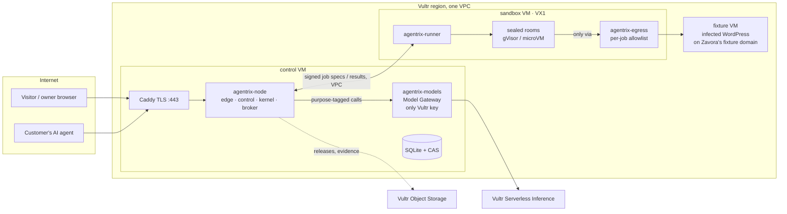
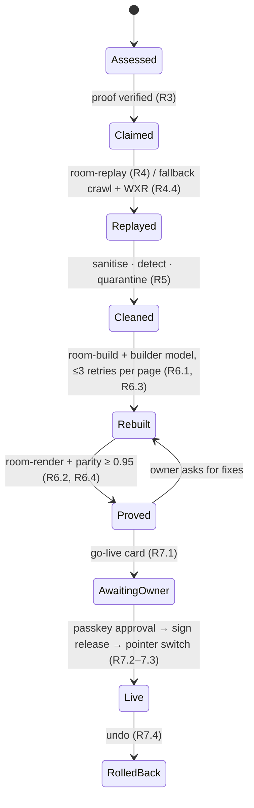

# Brick 1: Design

Status: v1.0 for James's review, Sat 7 Nov 2026. Spec chain: [requirements.md](requirements.md) →
**design (this file)** → [tasks.md](tasks.md).

This is the build design for the single-node profile. It narrows the platform design (docs
01–09, ADRs 001–030) to what ships on Sunday, and every choice here is one the fleet profile
keeps. Where this file is silent, the docs govern.

## 1. Design decisions for Brick 1

| # | Decision | Why | Platform doc |
|---|---|---|---|
| D1 | **Three processes on `control`, two on `sandbox`.** `agentrix-node` (edge + control + kernel + broker client), `agentrix-models` (Model Gateway), Caddy; `agentrix-runner` and `agentrix-egress` on the sandbox VM | Keeps the two walls that matter in separate processes (the only Vultr-key holder; untrusted content on another host) without building nine services in a day | 02 §2, §11.1 |
| D2 | **No Effects Gateway process this weekend.** No third-party effect runs (no payments, email or WhatsApp); approvals end at a signed decision. The `EffectRequest` type and seam ship | Nothing to execute yet; adding a process with nothing behind it is cost without proof | 02 §2 (Effects) |
| D3 | **adk-rust v3 pinned** to one `main` commit in `[workspace.dependencies]` (git + rev). Moved only by the integrator, after the framework's PRs merge | One reproducible build; the Vultr preset is a thin config, so it does not block (see §6) | ADR-001 |
| D4 | **SQLite + a content-addressed store (CAS) on disk**, mirrored to Vultr Object Storage when configured | Single node; zero ops; same seams as the fleet's Postgres + Object Storage | 09, 02 §7 |
| D5 | **Server-rendered UI** (axum + **minijinja**, templates embedded with minijinja-embed for release, autoreload only under a dev feature; typed `serde::Serialize` view models) built from the `concept/` screens' markup and `concept/styles.css` tokens, with small JS islands and SSE for live parts. API: `Console::new()`, `Console::render(Page, &impl Serialize)`, `agentrix_console::view::*`, `agentrix_console::assets()` (decided 7 Nov, console lane) | The concepts are the design source of truth; Jinja keeps templates close to the concept HTML and template edits don't force heavy rebuilds | 02 §13 (`agentrix-console`) |
| D6 | **Signed job specs, no secrets on the sandbox.** Control signs each job spec (Ed25519); the runner holds only control's public key. Receipts are signed by control after it checks artifact digests | R12.2, N6; a compromised sandbox VM yields no credential | ADR-003, ADR-004 |
| D7 | **The Move is a persisted state machine** (one row per step, one row per job), resumable after a crash | N9; honest progress on screen | 02 §4.4 |
| D8 | **Heavy builds on the Vultr `control` VM**, not on James's Mac (about 14 GB free). Sessions run `cargo check -p <crate>` locally in one shared `target/` | Disk guard; Linux binaries for the VMs anyway | — |
| D9 | **Passkeys via `webauthn-rs` `=0.5.5` directly** (the version adk-surface pins), in `agentrix-node`. **Sign-in** uses its passkey ceremonies: user verification required, attestation `none`, RP id = the platform domain, the origin matched exactly. **Approvals commit to the card:** with `danger-allow-state-serialisation`, the ceremony's challenge (state `ast.challenge` and the options sent to the browser) is set to SHA-256(fingerprint ‖ 16-byte nonce). webauthn-rs still checks origin, RP id, user verification, signature and counter, and the receipt (nonce, clientDataJSON, authenticatorData, signature, credential id) verifies offline against the published credential key. **Without a passkey:** password (argon2id) and TOTP; an approval is a TOTP step-up bound to the fingerprint, with the method in the receipt (§4.1's approve route must accept it: raised with the coordinator, since §4 is frozen) | Spike S0-07, 7 Nov, at the pinned adk-rust rev: adk-surface wraps webauthn-rs 0.5.5 behind its `mobile` feature, but its `PasskeyVerifier` is `pub(crate)` and tied to the phone surface (pairing, holders, `/surface/phone/*`). Its confirmations use a random challenge bound server-side, so the assertion alone does not commit to the effect, which 02 §8 needs for offline checks. adk-surface's own tests rebuild ceremonies the same way (`mobile/tests.rs:1327`). webauthn-rs links OpenSSL: Homebrew `openssl@3` locally, `libssl-dev` on the VMs | 02 §8, 07 §8, 565d30a |

**D10. Cost discipline in development (7 Nov, James asked for low development cost).** The
demo and acceptance runs are unchanged; development stops paying for the same tokens twice.

| # | Rule | Owner | Saves |
|---|---|---|---|
| a | The Model Gateway caches responses by (purpose, model, request digest) and runs in `AGENTRIX_MODELS_MODE=live\|record\|replay`. Lane tests and CI run on **replay**, never live; recordings live in the repo as fixtures | data (S1-04) | Most development spend; deterministic tests; fewer 429s |
| b | Route overrides by configuration, `AGENTRIX_ROUTE_<PURPOSE>=<provider>:<model>`. **Phase 1 runs on Claude** (§4.3, James 7 Nov). At the switch gate, a **bake-off** on the 5-page fixture (parity per page, retries, cost per Move) picks the Phase 2 `build` model among `deepseek-v4.1-flash-1017` ($0.15 / $0.60; tool calling confirmed live), `glm-5.3`, `qwen3.8-flash-next` and `glm-5.3-flash`; Claude results from Phase 1 are the quality baseline | data (S1-04), move (S1-06) | Pays Opus prices only while validating |
| c | Development uses a **5-page fixture**; the 50-page fixture runs only for acceptance, the gauntlet and the demo | gauntlet fixture owner (S1-11) | About 90% of each development Move |
| d | Reasoning effort set per purpose: low for `screen`, `vision-parity` and `decide`; `clef-flash` for bulk decisions; `max_tokens` with headroom only where an answer needs it | data (S1-04) | Reasoning tokens, which are billed as output |
| e | A hard development budget of **$5 a day per site** in the gateway, so a runaway loop stops itself | data (S1-04, S2-11) | Caps the worst case |
| f | VMs are created only when there is something to run on them, and destroyed after judging with `deploy/provision.sh destroy --yes`; the deploy is reproducible from the repo | control-plane | Idle hours |

Estimated model spend for the weekend with these rules: Phase 1 on `claude-opus-5-5`, mostly
5-page Moves recorded once and replayed (about $1 per live 5-page Move, about $10 per live
50-page Move), about $15–30; Phase 2 on Vultr, under about $5.

## 2. Topology on Vultr



Firewall groups: `control` accepts 80/443; `sandbox` accepts only the runner port from
`control`'s VPC address; `fixture` accepts 80/443. Host nftables on `sandbox` drops all room
traffic that does not go through the egress proxy.

Ports (frozen 7 Nov, control-plane lane; `deploy/README.md` is the source): `agentrix-node`
127.0.0.1:8080 and `agentrix-models` 127.0.0.1:8090 behind Caddy on `control`; runner
0.0.0.0:7443 on `sandbox`, reachable from `control`'s VPC address only; rooms on Docker network
`agx-rooms` (bridge `agx-r0`, 172.30.0.0/24) reaching only egress proxies on
172.30.0.1:3128–3191; fixture WordPress on 127.0.0.1:8081 behind Caddy on `fixture`. Plans
in Atlanta: control `vhp-4c-8gb-intel`, sandbox `vx1-g-4c-16g-240s`, fixture `vc2-1c-2gb`
(about $0.23 an hour together at list price).

## 3. Components

| Crate | Kind | Owns | Built on (adk-rust v3) |
|---|---|---|---|
| `agentrix-types` | lib | `SiteId`, `MoveId`, `JobSpec`, `JobResult`, `Receipt`, `Finding`, `DecisionCard`, `EffectRequest`, fingerprints, signing helpers | `adk-core` types where they exist |
| `agentrix-node` | bin | HTTP: public pages, Assess, sign-in, console, site serving by `Host`, Ask SSE, agent door; the Move orchestrator; the Concierge and the Chief brief; the broker client | axum, `adk-site` (host, signer, gate, release), `adk-website` (team, edge, leads), `adk-awp`, `adk-surface` (words, rules), `adk-harness` approvals |
| `agentrix-move` | lib | The Move state machine; inventory → sanitise → detect → quarantine → map → rebuild → parity → candidate | `adk-site::migrate`, `adk-site::scan`, `adk-site::generator`, `adk-site::gate` |
| `agentrix-console` | lib (templates + static) | Console and public templates ported from `concept/`; SSE islands | askama or minijinja |
| `agentrix-models` | bin | Model Gateway: purpose routing, budgets, metering, retries, screening calls | `adk-model` OpenAI-compatible client pointed at Vultr |
| `agentrix-sandbox` | lib + bin `agentrix-runner` | Broker client lib (used by node); runner: verify spec, start room, collect artifacts, destroy, report | `adk-sandbox` (Docker + gVisor; #1347 hardening), `adk-browser` sealed mode (B1/B2, #1349) |
| `agentrix-egress` | bin (exists, tested) | Per-job allowlist proxy, metadata and private-range refusal | — |
| `agentrix-gauntlet` | bin | Runs the ten attacks against a deployment and computes the score from receipts | — |
| `fixtures/wordpress-infected` | compose | The infected WordPress with the ten planted attacks | adk-rust `examples/website` S3 fixture and `infected` overlay |
| `deploy/` | scripts | cloud-init for the three VMs, Caddyfile, nftables, deploy script, smoke test | — |

### 3.0 Who owns which module

Shared crates are split by folder so two lanes never edit the same file. Each module exposes
`pub fn router(state) -> axum::Router` (or a plain API); the coordinator merges them in
`main.rs`/`app.rs` and owns every root and crate-root file.

| Path | Lane |
|---|---|
| `crates/agentrix-node/src/{main.rs,app.rs,state.rs}`, `broker/`, `assess/` | coordinator |
| `crates/agentrix-node/src/auth/`, `claim/` | control-plane |
| `crates/agentrix-node/src/site/` (Host routing, release serving, `/ask`, twins), `door/` (`/.well-known/awp`, `/mcp`) | experience |
| `crates/agentrix-node/src/decisions/`, `launch/` (LaunchGate, pointer, rollback) | move |
| `crates/agentrix-node/src/brief/`, `db/` (migrations, CAS, receipts store) | data |
| `crates/agentrix-node/src/pages/` (GET handlers that fill console views: `/console/*`, `/receipts/{digest}` page, `/frames/{digest}`) | console |
| `crates/agentrix-console/` except the two folders below | console |
| `crates/agentrix-console/templates/site/`, `static/site/` | experience |

### 3.1 Room images (sandbox VM)

| Image | Use | Network | Caps (default) |
|---|---|---|---|
| `room-fetch` | Crawl and screenshot public pages (Chromium, adk-browser sealed mode) | Egress proxy, allowlist = the site's hosts | 2 CPU, 2 GB, 256 pids, 10 min |
| `room-replay` | Replay WordPress from WXR/dump (PHP + MariaDB) | Internal only | 2 CPU, 2 GB, 512 pids, 15 min |
| `room-render` | Render the candidate pages, screenshots | None | 2 CPU, 2 GB, 256 pids, 10 min |
| `room-build` | Run the static generator on the clean inventory | None | 2 CPU, 2 GB, 256 pids, 10 min |

All rooms: gVisor `runsc`, read-only root, non-root user, tmpfs scratch, no environment
secrets, destroyed after the job; the runner confirms destruction on the result.

How (approved 7 Nov, architecture lane): rooms run through the Docker CLI behind a
`RoomRuntime` trait, which swaps to adk-sandbox's `DockerClient` once #1347 merges and the pin
moves. Every room gets `--runtime=runsc --read-only --user 65534:65534 --cap-drop ALL
--security-opt no-new-privileges`, `--cpus`, `--memory` (= `--memory-swap`), `--pids-limit`, a
tmpfs `/tmp`, no environment but the proxy variables, and a wall-clock kill at the deadline.
Each fetch job gets its own `agentrix-egress` process on its own Docker bridge, started with
the spec's allowlist; host nftables let that bridge reach only the proxy's port; the proxy's
JSON-line events become `request` and `refused` JobEvents. Render and build rooms get
`--network none`.

## 4. Interfaces

### 4.1 HTTP (served by `agentrix-node` behind Caddy)

| Route | Who | Purpose | Req |
|---|---|---|---|
| `GET /` | Public | Start page: paste your URL | R1.1 |
| `POST /assess` → `GET /assess/{id}` + `GET /assess/{id}/events` (SSE) | Public | Start an assessment; live receipt ticks, frames, report | R1 |
| `/auth/passkey/{register,login}/{start,finish}`, `/auth/password`, `/auth/totp` | Owner | Sign-in | R2 |
| `POST /sites/{id}/claim`, `POST /sites/{id}/claim/verify` | Owner | DNS TXT or file proof | R3 |
| `POST /sites/{id}/moves`, `GET /moves/{id}`, `GET /moves/{id}/events` (SSE) | Owner | Start and watch the Move | R4–R6 |
| `GET /console/{today,decisions,move,trust,webagents}` | Owner | Console slice | R10 |
| `POST /decisions/{id}/approve`: JSON `{method: "passkey", credential: <webauthn-rs PublicKeyCredential>}` (options embedded in the page as `card.passkey_options`; challenge = SHA-256(fingerprint ‖ nonce), D9) or, for an owner without a passkey, form `{method: "totp", code, fingerprint}` as a step-up bound to the same fingerprint. Replies 303 or JSON `{redirect}`; errors JSON `{message}` in plain words; the receipt records the method. `/decline` | Owner | Go-live and other cards | R7.2 |
| `GET /auth/signin`, `GET /auth/register` (render the pages), `POST /auth/signout`; passkey ceremonies take and return webauthn-rs JSON (base64url), register start takes `{email}`, finish replies `{redirect}` | Owner | Sign-in pages | R2 |
| `GET /console/decisions/{id}`, `GET /console/quarantine` | Owner | One card; the quarantine list | R7, R5.4 |
| `POST /sites/{id}/quarantine/{item}/restore` (form `reason`) | Owner | Raises a `quarantine-restore` card, approved through `/decisions/{id}/approve` | R5.4 |
| `GET /frames/{digest}` | Owner, public during Assess | A frame from the CAS (the `frame` event's `src`) | R1.4 |
| `GET /receipts/{digest}` with `Accept: application/json` | Anyone | The signed receipt JSON; without that header, the receipt page | R10.3 |
| `GET /receipts?site=&since=&kind=` (`Accept: application/json`) → `[{digest, kind, ended_at}]` | Owner session, or `Authorization: Bearer <gauntlet token>` | Lists receipts for the gauntlet runner | R13.2 |
| `POST /gauntlet/runs` `{site, started_at, ended_at, attacks:[{id, receipts:[digest]}]}` | Owner session or gauntlet token | Node **recomputes every verdict** from its own stored, verified receipts with `agentrix_gauntlet::score()` (a pure library), then issues a `gauntlet.run` receipt (`detail: {score, out_of, attacks:[{id, name, held, plain, receipts}]}`) and writes `gauntlet_runs`. The runner never sends a score (R13.2, N8) | R13 |
| `GET /internal/tls-ask?domain=` (loopback only) | Caddy | On-demand TLS: answers 200 only for domains of sites the platform serves | R8.1, R14.1 |
| `POST /sites/{id}/rollback` | Owner | Undo | R7.4 |
| `GET /receipts/{digest}`, `GET /.well-known/agentrix/keys` | Anyone | Open and verify a receipt | R10.3, R12.5 |
| Host-routed: `https://{site-host}/…` | Visitors | The signed release | R8.1 |
| Host-routed: `POST /ask` (SSE) | Visitors | Ask this site | R8.2–8.4 |
| Host-routed: `/.well-known/awp`, `/mcp` | Agents | The agent door; `request_custom_order` | R9 |

### 4.2 Broker ↔ runner (VPC, HTTP/2)

`POST /jobs` with a `JobSpec` signed by control: `{job_id, kind: fetch|replay|render|build,
image, inputs: [digest], allowlist: [host], caps, deadline}`. The runner verifies the
signature, starts the room, streams `JobEvent`s (`started`, `request`, `refused`, `frame`,
`artifact`, `killed`, `destroyed`), and finishes with `JobResult {artifacts: [digest], peaks,
refusals, destroyed: true}`. Control fetches artifacts by digest, checks them, writes the
receipt, and signs it.

Routes (approved 7 Nov, architecture lane): `PUT /blobs/{digest}` (control uploads each input
before `POST /jobs`; the runner checks the sha256 and mounts it read-only at `/in/<digest>`);
`POST /jobs` (streams `JobEvent`s as NDJSON, ends with `JobResult`); `GET /artifacts/{digest}`
(control fetches results).

### 4.3 Model Gateway (control VM, localhost only)

OpenAI-compatible `/v1/chat/completions`, `/v1/embeddings`, plus `/v1/screen` (content safety)
and `/v1/decide` (systemone), each requiring headers `x-agentrix-site` and
`x-agentrix-purpose`.

**Two phases (James, 7 Nov).** The gateway is provider-agnostic (R11).
- **Phase 1, build and validate: Claude.** Every purpose runs on Anthropic until the
  pipeline is tested and validated end to end, so failures are pipeline bugs and not model
  quirks. Models are chosen by **tier** (below): Opus, Sonnet or Haiku depending on the task.
  Thinking stays adaptive; no `budget_tokens`, no forced `tool_choice`. `screen` and `decide`
  return typed verdicts through structured outputs, in the same shapes as `/v1/screen` and
  `/v1/decide`. **`embed` stays on Vultr** (`qwen3-embedding-4b`), because Anthropic has no
  embeddings endpoint.

**Model tiers (James, 7 Nov).** Callers never name a model or a provider; they name a purpose
and, optionally, a tier. Three tiers, each mapped per provider in `.env`, so switching provider
is one variable and every tier switches with it:

```dotenv
AGENTRIX_PROVIDER=anthropic                      # anthropic | vultr (the S3-10 switch)
AGENTRIX_TIER_DEEP_ANTHROPIC=claude-opus-5-5     # $4 / $20 per M
AGENTRIX_TIER_STANDARD_ANTHROPIC=claude-sonnet-5-5  # $2 / $10
AGENTRIX_TIER_FAST_ANTHROPIC=claude-haiku-5-5    # $0.10 / $0.50
AGENTRIX_TIER_DEEP_VULTR=glm-5.3                 # $0.75 / $3.00
AGENTRIX_TIER_STANDARD_VULTR=qwen3.8-27b         # $0.15 / $1.00; the bake-off may set deepseek-v4.1-flash-1017
AGENTRIX_TIER_FAST_VULTR=deepseek-v4.1-flash-1017   # $0.15 / $0.60
AGENTRIX_EMBED=vultr:qwen3-embedding-4b          # both phases
AGENTRIX_SCREEN_VULTR=nemotron-3.5-content-safety   # Vultr's specialist for `screen`
AGENTRIX_DECIDE_VULTR=clef                       # Vultr's `/v1/systemone` for `decide`
# AGENTRIX_ROUTE_<PURPOSE>=<provider>:<model>    # optional per-purpose override
```

| Purpose | Default tier | Dynamic? | Floor – ceiling | Effort (Anthropic) |
|---|---|---|---|---|
| `build` | standard | **auto** | standard – deep | `high` |
| `concierge` | standard | **auto** | fast – standard | `medium` |
| `brief` | standard | no | standard | `medium` |
| `vision-parity` | fast | no | fast – standard | `low` |
| `screen` | fast (Vultr: the safety specialist) | no | fast | `low` |
| `decide` | fast (Vultr: systemone `clef`) | no | fast | `low` |

**Dynamic selection (`x-agentrix-tier: auto`).** The gateway picks the tier per request, in
this order, and records the tier, model and reason on the usage row and the receipt:
1. **Rules first** (free, deterministic): one tier up on each retry of the same job (R6.3:
   attempt 1 at the default, attempt 2 one up, attempt 3 at the ceiling); one tier up when the
   input is large (over 30K tokens) or the page has forms, scripts or more than 8 sections.
2. **The router** when no rule applies: one fast-tier call with structured output
   `{tier, reason}`, given a **task descriptor the gateway builds** (purpose, sizes, retry
   count, page features), never the untrusted page or visitor text, so content cannot talk its
   way into a dearer model. Router answers are cached by descriptor digest and replayed (D10a).
3. **Clamp** to the purpose's floor and ceiling, then the site's budget (R11.3) has the last
   word: if the budget is short, it drops a tier and says so.

**Specialist inference stays on Vultr in both phases (James, 7 Nov).** Anything Claude does
not offer routes to Vultr whatever `AGENTRIX_PROVIDER` says. Ids are from Vultr's catalogue
(`GET /v1/models`, 7 Nov); each gets one live call before first use.

```dotenv
AGENTRIX_EMBED=vultr:qwen3-embedding-4b            # embeddings (Concierge retrieval)
AGENTRIX_RERANK=vultr:bge-reranker-v2-m3           # rerank (optional, S3-06)
AGENTRIX_VECTOR_STORE=vultr                        # Vultr vector store (R11.5, S3-06)
AGENTRIX_IMAGE=vultr:qwen-image-2.1                # text or image in, image out (sketches, edits)
AGENTRIX_IMAGE_FAST=vultr:z-image-turbo            # quick drafts
AGENTRIX_STT=vultr:whisper-large-v3-turbo          # transcription, batch
AGENTRIX_STT_REALTIME=vultr:voxtral-mini-4b-realtime  # live voice (Could)
AGENTRIX_TTS=vultr:qwen3-tts-12hz-1.7b             # speech (alternatives: auk, auk-flash, chatterbox)
AGENTRIX_VIDEO=vultr:minimax-h3                    # video (not this weekend)
```

| Capability | Brick 1 use | Requirement |
|---|---|---|
| Embeddings, vector store, rerank | Ask this site retrieval | R8.2, R11.5 |
| Image generation | Sketches and product images, an owner opt-in (06 S1) | Could |
| Speech to text, text to speech | Voice brief and voice desk | R10.4 (Could) |
| Video | None | Pilot |

Retrieval for Ask (S3-06, decided Sat 7 Nov): with `AGENTRIX_RETRIEVAL=vultr`, the first Ask after a
release goes live indexes that release's public passages (C0 only) into one fresh Vultr collection,
in the background and after the refusal policy. Indexing waits for that first Ask, not go-live, so
go-live stays under 60 s (N4) and `launch/` is untouched. Ask keeps only the Vultr hits its own
relevance check agrees with, because Vultr's search returns 10 unscored results, so it can still say
the site doesn't say. Every citation carries `retrieved: {store, collection, item}`, and the reply
carries `retrieval`; that is the evidence, so no receipt kind is added. Any store failure falls
back to Ask without retrieval. Default off until proved live.
- **Phase 2, from the switch gate (S3-10, Sun about 10:00): Vultr.** After the acceptance run
  passes on Claude, routes switch to the Vultr table below by configuration only; the bake-off
  (D10b) picks the `build` model; acceptance and the gauntlet re-run on Vultr; the demo and the
  video run on Vultr, as Challenge 1 asks. Claude stays configured as the alternative.

**Routing table (Phase 2, Vultr).** Confirmed in S0-05 on Sat 7 Nov, between 18:17 and 18:35 EAT, in two ways:
- `GET /v1/models` with the project key returned 33 models.
- One live call per purpose succeeded.

Prices are from the same catalogue, per million tokens.

| Purpose | Vultr endpoint | Model | Confirmed by a live call | Inputs, context | Tools | Datacenter | Price in / out | Used by |
|---|---|---|---|---|---|---|---|---|
| `build` | `/v1/chat/completions` | `glm-5.3` | Tool call returned (`finish_reason: tool_calls`) | Text, image, file; 1M | **Yes** | US, `sea` | $0.75 / $3.00 | Rebuild page code |
| `build` (development; candidate for the demo) | `/v1/chat/completions` | `deepseek-v4.1-flash-1017` | Tool call returned (spec session and data lane, 7 Nov): 44 completion tokens, 0 reasoning | Text, image, file; 1M | **Yes** | US, `sea` | $0.15 / $0.60 | Development builds (D10b). The 5-page bake-off decides the demo's build model (S1-06) |
| `concierge` | `/v1/chat/completions` | `qwen3.8-27b` | Tool call returned | Text, image, file, video; 262K | **Yes** | US, `sea` | $0.15 / $1.00 | Ask this site, the Chief brief |
| `vision-parity` | `/v1/chat/completions` | fast tier: `deepseek-v4.1-flash-1017` (named a test PNG's colour, 36 reasoning tokens at low effort); `qwen3.8-27b` is the bake-off alternative and the pin (`AGENTRIX_ROUTE_VISION_PARITY=vultr:qwen3.8-27b`) if DeepSeek disagrees with Phase 1's Claude verdicts on the 5-page fixture | Named the colour of a test PNG (both) | Images as URL or base64 (PNG, JPEG, WebP, GIF; up to 20 MB) | Yes | US, `sea` | $0.15 / $1.00 | Parity verdicts on screenshots |
| `screen` | `/v1/chat/completions` | `nemotron-3.5-content-safety` | Answered `User Safety: unsafe` to an injection | Text, image, file; 131K | No | US, `sjc` | $0.05 / $0.15 | Untrusted text screening (R5.3) |
| `decide` | **`/v1/systemone`** | `clef`; `clef-flash` for bulk | `noul` and `score` answers with probabilities and confidence | Text, image; 262K | n/a | US, `sea` | $0.10 (`clef-flash` $0.05), input only | Quarantine and card risk scores |
| `embed` | `/v1/embeddings` | `qwen3-embedding-4b` | 2,560-dimension vector returned | Text; 32K. `dimensions` truncates; `input_type` is `search_query` or `search_document` | n/a | US, `sjc` | $0.05 | Concierge retrieval |
| `rerank` (optional) | `/v1/rerank` | `bge-reranker-v2-m3` | Not called | Text; 8K | n/a | US, `sjc` | $0.05 | Concierge rerank, if S3-06 needs it |

The catalogue also lists `tools` (not `tool_choice`) for `glm-5.3-flash` ($0.10 / $0.35)
and `qwen3.8-flash-next` ($0.10 / $0.20). Neither has been called live; test them only if
DeepSeek Flash loses the bake-off.

What S0-05 found that the gateway (S1-04) must handle:
- **systemone is an endpoint, not a model.** `POST /v1/systemone` takes a decision model
  (`clef`, `clef-flash`, `d3` or `pplx-decider-v1.2`), a `state` and typed `questions`:
  - `noul`: yes or no, answered as a probability;
  - `choice`: one of up to 255 options;
  - `score`: ordered levels, with a legend.

  `choice` and `score` answers also carry probabilities and a confidence. The gateway's own
  `/v1/decide` keeps its route and maps onto this.
- **The safety model answers in plain text,** for example `User Safety: unsafe`. `/v1/screen`
  parses that into a typed verdict and keeps the raw line on the receipt.
- **The text models reason by default.** At `reasoning_effort: minimal`, 63 of 67
  completion tokens were reasoning, and a 60-token cap ended with no answer. The gateway sets
  `max_tokens` with headroom for reasoning and meters reasoning tokens as completion tokens.
- **Errors to back off on** include 529 (overloaded), as well as 429 and the other 5xx codes.
  A 402 means the account is not funded, and is shown in plain words with no retry.
- **Every model is served from the US** (`datacenters` in `GET /v1/models`: `sea`, `sjc` or
  `atl`). This settles the "location not published" question for Brick 1. The platform docs
  are updated separately.

Budgets per site and purpose; usage rows `{site, purpose, model, tokens_in, tokens_out,
cost_estimate, at}` feed the console meter (R11.3). 429/5xx: exponential backoff with jitter,
three tries, then a plain-words status (R11.4).

### 4.3a UI events (SSE)

`/assess/{id}/events` and `/moves/{id}/events` carry typed events defined once as
`agentrix_types::UiEvent` (serde, `event:` name = the variant in kebab-case, `data:` = JSON).
The console lane proposes the names and payloads its islands need; the spec session approves
them into this section; the data lane adds the type; `agentrix-node` emits them from broker
`JobEvent`s and Move step changes.

**Approved schema (7 Nov, console lane).** Transport: every event has SSE `id:` = `seq` (u64,
monotonic per assessment or Move); on reconnect node replays from `Last-Event-ID` out of the
persisted rows, or sends `snapshot`; `: ping` every 15 s; pages render current state
server-side first; times RFC 3339 with offset; every payload has `at`.

| Event | Payload |
|---|---|
| `step` | `{step: assess\|claim\|replay\|clean\|rebuild\|prove\|golive, state: pending\|running\|waiting\|done\|failed, elapsed_ms, summary (≤140 chars, plain words), receipt?}` |
| `receipt-tick` | `{job?, hosts, requests, bytes, refusals}`: cumulative totals, never deltas |
| `frame` | `{kind: live\|sealed-screenshot, page_url, digest, src: "/frames/{digest}", w, h}`: no data URLs in the stream |
| `page` | `{n, of, url, status: read\|refused\|failed, reason?}` |
| `finding` | `{id, severity: urgent\|warn\|info, category: security\|speed\|links\|ai-readiness, title, where}` |
| `quarantined` | `{item_id, title, reason, where}` |
| `parity` | `{page?, score 0–1, verdict, state: pass\|retry\|flagged, attempt}`; `page: null` = whole site |
| `card` | `{decision_id, kind: go-live\|quarantine-restore\|order-held, title, href}` |
| `done` | `{outcome: report-ready\|unreachable\|candidate-ready\|live\|stopped, href?}` |
| `error` | `{step?, message (plain words, never a trace), retrying}` |
| `snapshot` | `{steps: [step], tick, last_frame?, parity?}`: on connect without a usable `Last-Event-ID` |

Honesty in the islands: `sealed-screenshot` frames are labelled "Sealed screenshot, about 1 a
second"; only `live` frames say "Live"; fixture sites carry a "Zavora's fixture" label from the
view's `fixture: bool`.

### 4.4 Receipt (signed JSON, content-addressed)

`{receipt_id, kind, site, subject (move/job/decision), inputs[], policy (allowlist, caps,
runtime), observed (hosts, requests, bytes, refusals[], peaks), outputs[] (digests),
destroyed, started_at, ended_at, issuer, signature}`. Canonicalised (RFC 8785) before
signing with control's Ed25519 key; the public key is published at
`/.well-known/agentrix/keys`. The gauntlet score is a function over receipts only (R13.2).

Job receipts carry `detail.killed` (`pids`, `memory`, `deadline` or absent) when the runner
killed the room; gauntlet attack 9 is scored from it with `destroyed: true` (approved 7 Nov,
gauntlet lane).

Receipt kinds: `job.fetch`, `job.replay`, `job.render`, `job.build`, `move.step`,
`claim.verified`, `decision.approved`, `decision.declined`, `release.signed`,
`release.rollback`, `quarantine.restored`, `concierge.refusal`, `door.order-held`,
`gauntlet.run`, `routing.changed` (a provider or model route change, R11.4). Node issues `routing.changed`, because the gateway holds no signing key. It reads the gateway's `GET /v1/status` at startup and every 15 minutes, and signs one receipt per owned site whenever the provider or a purpose's model differs from that site's last one. The detail is `{from, to, reason}`, with the reason taken from `AGENTRIX_ROUTING_REASON`, for example the bake-off. **Owner-facing signals are receipts:** the Trust tab lists them by kind and
the Chief brief (S2-04) summarises them, so a lane surfaces something to the owner by writing
a receipt through the data lane's receipts store, never by writing to console tables.

### 4.5 Release signing (frozen 7 Nov; adk-site's model, so `awp verify` works, 03 §6)

- **The release** is an `awp_types::ReleaseManifest`; its digest is
  `adk_site::release::manifest_digest`; the manifest is stored in CAS under that digest and
  every file in CAS under its own digest.
- **At go-live** the `launch/` module (move lane) verifies the passkey approval over the card
  fingerprint (release digest + charter v1), appends the release to the site log and signs the
  checkpoint with `adk_site::signer::Ed25519ReleaseSigner`, key name
  `{domain}/.well-known/awp/log`; the verifier key is published in the site's AWP keys.
- **Stored:** the `releases` row (data lane) holds the manifest digest and the signed
  checkpoint; a `release.signed` receipt links the decision fingerprint to the manifest digest.
- **Served:** the edge (`site/`, experience lane) resolves `site_pointer` → digest, runs
  `verify_checkpoint` and `verify_release_inclusion`, checks each file digest, and keeps the
  last good release on any failure (R8.1).
- **Receipts** are signed separately with control's key at `/.well-known/agentrix/keys`
  (§4.4).

## 5. Data (SQLite, `control.db`)

`accounts`, `credentials` (passkey public keys; password hashes; TOTP seeds sealed), `sessions`,
`sites`, `claims`, `assessments`, `moves`, `move_steps`, `jobs`, `artifacts` (digest, kind,
size, location), `findings` (detector, severity, item, evidence digests), `quarantine`
(item, reason, state, decision), `releases` (seq, digest, signature, state), `site_pointer`,
`charters` (v1, starting levels, signed), `decisions` (card, fingerprint, state, signer,
assertion), `receipts`, `usage`, `gauntlet_runs`. One writer per table; migrations in
`agentrix-node`.

## 6. The Move



Each transition writes a `move_steps` row and a receipt. A crash resumes from the last
completed step (N9). The Mover asks at every irreversible step; it never goes live by itself.

## 7. Security design (the four walls, Brick 1 cut)

| Wall | Brick 1 enforcement | Verified by |
|---|---|---|
| Action | Separate sandbox VM; gVisor/microVM rooms; read-only root; caps; per-job allowlist via `agentrix-egress` + nftables; destroy and confirm; signed job specs | Gauntlet 1, 2, 8, 9; egress review (R12.6) |
| Release | Agents produce candidates only; the go-live card's passkey signature is required to sign a release; the edge serves only verified releases | R7, R8.1; tamper test |
| Site | One site in Brick 1; `SiteId` in every key and table; per-site budget | Schema review |
| Owner | Model Gateway is the only key holder; approvals bound to fingerprints; charter v1 signed; Concierge has no authority to discount | Gauntlet 3, 10; R7.2 |

**Egress review cases (blocking, R12.6):** DNS rebinding; redirect to a refused host;
IPv6 and encoded IPv4 (decimal, octal, hex, IPv4-mapped); `CONNECT` to refused ports/hosts;
header and request smuggling (CL/TE, absolute-form URIs, Host mismatch). One test each in
`crates/agentrix-egress/tests/`.

## 8. UI: screens to port

The `concept/` screens are the design source of truth. Brick 1 ports these, with real data:

| Screen | Source | Req |
|---|---|---|
| Start + Assess (live receipt, frames, report) | `concept/assess.html`, `concept/journeys/owner-discover.html` | R1 |
| Sign-in (passkey first) | `concept/journeys/owner-account.html`, `concept/identity/` | R2 |
| Claim | `concept/journeys/owner-domain.html` | R3 |
| The Move | `concept/move.html`, `concept/journeys/owner-move.html` | R4–R6 |
| Go-live card | `concept/journeys/owner-golive.html` | R7 |
| Console: Today, Decisions, Trust, WebAgents | `concept/console.html`, `concept/console/trust.html`, `concept/console/shell.html` | R10 |
| Converted site + Ask | `concept/site.html`, `concept/experience/search.html` | R8 |

Rules: phone-first; the tokens in `concept/styles.css`; light and dark; WCAG 2.2 AA; no
claim on screen that the data does not support (honesty rule).

## 9. Traceability

| Req | Components | Verified by (test or demo step) |
|---|---|---|
| R1 | node (assess), sandbox (`room-fetch`), egress, console | E2E: assess the fixture domain; report lists the planted spam links and footer script |
| R2 | node (auth), console | E2E: register passkey, sign out, sign in; TOTP fallback |
| R3 | node (claim), sandbox | E2E: TXT proof on the fixture domain |
| R4 | move, sandbox (`room-replay`) | Gauntlet 8; inventory receipt |
| R5 | move, models (`screen`, `decide`) | Gauntlet 3–7; quarantine list |
| R6 | move, sandbox (`room-build`, `room-render`), models (`build`, `vision-parity`) | Parity report ≥ 0.95 on the fixture |
| R7 | node (decisions, LaunchGate), console | E2E: passkey approval → live < 60 s; rollback |
| R8 | node (edge, Ask), models (`concierge`, `embed`) | Cited answer; honest "don't know"; gauntlet 10 |
| R9 | node (agent door), console (card) | Agent race rehearsal |
| R10 | console, node | Demo walkthrough on a phone |
| R11 | models | Usage meter; 429 test; key only in gateway env |
| R12 | sandbox, egress, deploy | Egress review suite; gauntlet 1, 2, 9; destroy confirmation |
| R13 | gauntlet, fixtures | 10/10 from receipts on the deployed URL |
| R14 | deploy | Fresh deploy from the README on clean VMs |
| R15 | README, video, slides | Submission checklist |

## 10. Risks and fallbacks

| Risk | Fallback | Decided by |
|---|---|---|
| VMs not up by Sat 22:00 | Develop rooms against a local Linux Docker; deploy Sun 08:00 latest | Gate G0 |
| Replay runtime fails | adk-site `migrate` crawl + WXR without replay, stated on screen (R4.4) | Gate G1, Sun 04:00 |
| Sealed live frames not ready | Sealed screenshots ~1 fps over SSE, labelled | Sun 10:00 |
| Agent door order flow not ready | Race shrinks to a cited question (R9.3) | Gate G3, Sun 10:00 |
| Egress review fails a case | Deploy blocked until fixed (no fallback) | Gate G2, Sun 08:00 |
| Disk on James's Mac < 10 GB | Stop local builds; build on the control VM (D8) | Any time |
| Vultr rate limits during the demo | Gateway backoff; pre-warm; demo on a quiet minute | — |
