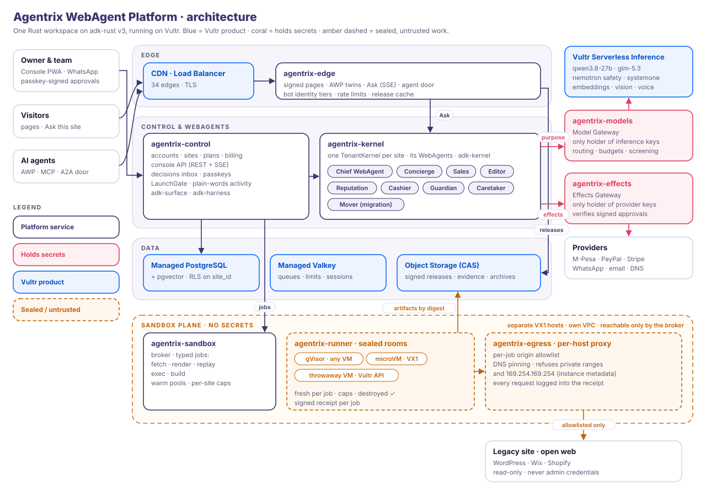
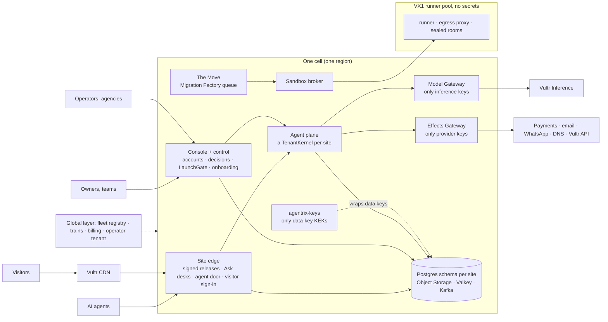

# Platform architecture: from the first release to production

Status: draft v0.1, Sat 7 Nov 2026, 23:52 EAT (from `date`). Read with
[how-we-work.md](how-we-work.md) and [voice.md](voice.md). Sources: docs 02, 03, 05, 07, 08, 09,
ADR-001 to ADR-031, `specs/first-release/{requirements,design,tasks,status}.md`, every crate under
`crates/`, `deploy/`, `.cargo/config.toml`, `Cargo.toml`, `README.md`. Line numbers are at
`main` 98eb717; `status.md` is cited by section because it is edited live.

This page answers five questions for the parallel build sessions: what production looks like,
what the first release already built, what one WebAgent needs, which UI stack to use, and who owns which
files. It does not restate the docs. Where a doc already decides something, this page links it.

## 0. The short version

1. The first release is a real single-node product: sealed rooms, the egress proxy, signed receipts,
   signed releases, passkey approvals bound to an effect fingerprint, the Move, and a
   provider-agnostic Model Gateway. 286+ tests pass (`specs/first-release/status.md`, "Code complete").
2. **There is no WebAgent runtime yet.** `adk-kernel`, `adk-harness`, `adk-website`,
   `adk-surface`, `adk-server`, `adk-sandbox` and `adk-browser` are pinned (`Cargo.toml:40-48`),
   but no crate depends on them and they are not in `Cargo.lock`. The Chief WebAgent is a
   15-minute timer, the Concierge is a request handler, and the Mover is a library pipeline.
3. **All sites share one `control.db`**, and the Model Gateway writes into the same file
   (`crates/agentrix-node/src/db/mod.rs:46-77`, `crates/agentrix-models/src/main.rs:45-51`).
   The design wants a directory per site (09 §3.3) and a Postgres schema per site (ADR-025).
4. **No Effects Gateway, no capability tokens, no key holder.** The gateway trusts an
   `x-agentrix-site` header (`crates/agentrix-models/src/gateway.rs:235`). Every key sits in a
   file on the control VM (`crates/agentrix-node/src/state.rs:69-77`, `app.rs:116`).
5. **No tenancy above the site.** One owner per site, no orgs, roles, grants or partners.
6. The fleet profile (cells, trains, billing, operator WebAgents) is designed, not built.
7. The code argues for one more workstream: **W8 Platform core** (stores, gateways plumbing,
   sandbox, egress, observability, single-node deploy). W1, W2, W4, W5 and W6 block on its
   store layer.

---

## 1. Target production architecture





**Planes.** One Cargo workspace on adk-rust v3 at a pinned commit (ADR-001). Full table:
[02 §2](../../docs/02-architecture.md#2-planes-and-services).

| Plane | What it does | Doc |
|---|---|---|
| Site edge | Serves signed static releases; runs the Concierge's public desks for Ask; the agent door (AWP, MCP, A2A); visitor sign-in; rate limits; content-free beacons. No model or database on the page path | 02 §4.1–4.2, ADR-005, 05 §4.5, §5.1 |
| Console | The owner's OS shell in three scopes: site, portfolio (agency) and operator | 07 §4, 08 §7.1 |
| Control | Accounts, orgs and the tenant path; sessions, passkeys and MFA; decisions; the LaunchGate; minting capability tokens; the erasure orchestrator | 02 §8, ADR-006, ADR-018, ADR-028 |
| Agent | One TenantKernel per site, started on wake; the back-office WebAgents; charter, ladder, budgets, receipts | 05 §3–4, §8, ADR-010, ADR-015 |
| Move | Assess → claim → replay → clean → rebuild → prove → go-live, as a queued, fair-shared factory | 02 §4.4, 08 §3.4 |
| Sealed rooms | Broker, runner and egress proxy; gVisor, microVM, throwaway VM; signed job specs; receipts | 02 §5, ADR-003 |
| Model Gateway | The only holder of inference keys: purpose routing, budgets, rate shaping, metering | 02 §6, ADR-004 |
| Effects Gateway | The only holder of provider credentials: verifies the approval or signed grant, runs the effect once | 02 §4.3, ADR-004, ADR-006 |
| Keys | `agentrix-keys`: wraps per-site data keys and seals sign-in secrets | ADR-030, ADR-025 |
| Fleet, billing, CLI | Registry, reconciler, release trains, provisioning; rating and invoices; the `agentrix` CLI | 08 §3, §6.2, ADR-024 |
| Data | Relational per site, CAS on Object Storage, Valkey, outbox → Kafka → lake | 09, ADR-025 to ADR-028 |

**Two profiles, one codebase** (ADR-007). Every store and queue sits behind a trait with two
implementations.

| | Single node (self-host, Marketplace, `atl-0`) | Fleet (Zavora Cloud) |
|---|---|---|
| Processes | `agentrix-node` (edge + control + kernel + broker) and, as separate users, `agentrix-models`, `agentrix-effects`, `agentrix-keys`; runner and egress on the sandbox VM | The same `agentrix-node` binary per role (`--role edge\|control\|kernel`) on VKE pools; gateways and keys as HA deployments; VX1 runner pool outside Kubernetes |
| Site stores | One directory per site: `kernel.db`, `edge.db`, `records.db`, `log.db`, LanceDB, CAS (09 §3.3) | A Postgres schema and role per site, pgvector beside the rows (09 §3.4, ADR-026) |
| Fast state | In process | Managed Valkey |
| Events | Outbox and site log | Outbox → Managed Kafka → Iceberg lake (ADR-027) |

Proposal (not in the docs): keep edge, control and kernel as **libraries** composed by one
binary with roles, not as three binaries (02 §13 lists three). The single node stays at a few
processes (design D1). The fleet still deploys each role on its own pool. The trust walls are
unchanged because the walls are the gateways, the key holder and the sandbox hosts, and those
stay separate processes in both profiles.

**Cells and release trains.** A cell is one region's full stack and the unit of blast radius.
`atl-0` is the first release; `ams-1` is the first full cell and the global primary; `fra-1` is standby;
`jnb-1` is edge only (ADR-019, 08 §3.2). Every change ships as a signed artefact on a train:
ring 0 is Zavora's own sites, then opted-in owners, then everyone in waves. Rollback is by pin.
Migrations expand first and contract after the train completes (ADR-020, 08 §3.5).

**Trust walls** (02 §3, 03): the *action* wall (untrusted input only in sealed rooms on
secret-free hosts), the *release* wall (agents propose candidates; only the LaunchGate signs),
the *site* wall (`SiteId`, then the tenant path, in every key; a store per site), and the
*owner* wall (three key holders; approvals bound to fingerprints; freeze). The platform hold
and the owner's freeze are separate switches (ADR-023).

---

## 2. Built versus designed, component by component

Sizes are for one build session working full time, tests included: **S** ≤ 3 days, **M** ≤ 2
weeks, **L** ≤ 6 weeks, **XL** more than 6 weeks or blocked on upstream adk-rust work.
Paths are under `crates/` unless they start with another folder. Short paths such as
`site/ask.rs` or `app.rs` are under `crates/agentrix-node/src/`.

### 2.1 Edge and sites

| Component | The first release built | Production needs | Gap | Size |
|---|---|---|---|---|
| Release serving by Host | `site::router` (`agentrix-node/src/site/mod.rs:104`); release cache that verifies the signed checkpoint and the release's inclusion (`site/release.rs:154`, `:182-201`); Host dispatch (`agentrix-node/src/app.rs:294`); Caddy on-demand TLS via `/internal/tls-ask` (`site/mod.rs:116`, `deploy/caddy/control.Caddyfile`) | Own crate; reads from Object Storage behind the CDN; pointer switch plus purge in under 5 s (02 §9); security headers and CSP; content-free beacons (09 §5.3) | No CDN or purge; edge is a module of node; no CSP | M |
| Ask this site | Pipeline in `site/ask.rs:1-20`: refusal policy, screen, rank, cite, honest "doesn't say"; model port `AskModel` (`site/ask.rs:35`); optional Vultr vector store | Desks per section from a signed desk manifest (U17); `PublicKit` per desk; durable threads; typed signals to the kernel; promise check (U20); LanceDB or pgvector (ADR-026); takeover (U21) | Not a governed agent; no threads, signals or per-visitor limits | L |
| Agent door | Hand-written MCP and AWP discovery and held calls (`door/mod.rs:71-75`); port `HeldCalls` (`door/mod.rs:47`); `HeldOrders` raises the card (`decisions/mod.rs:724`) | adk-server `AwpEdge` with `GovernedExecutor`; A2A; Web Bot Auth tiers; bindings generated from the desk manifest; AP2 (05 §5.1) | One capability; the framework edge is not used | L |
| Visitor accounts | None. Passkey RP id is the platform origin only (`auth/mod.rs:67`) | Per-site sign-in, passkey first, RP id per site domain (06 §4.10, U19); consent receipts; visitor memory capabilities | Everything | L |
| Site theme | One theme, `agentrix-console/templates/site/page.html`, read by the Move through `include_str!` (`agentrix-move/src/theme.rs:12`) | A theme per archetype; the living mark in releases (ADR-031); sample sites | Cross-crate file coupling; one theme | M |

### 2.2 Console and control

| Component | The first release built | Production needs | Gap | Size |
|---|---|---|---|---|
| Owner sign-in | Passkeys via webauthn-rs, password (argon2id) plus TOTP, sessions (`auth/routes.rs:44-53`, `auth/session.rs:42`); Origin check on POST (`auth/routes.rs:172`); in-memory throttle per email (`auth/routes.rs:90`) | Teams and roles (owner, manager, viewer, agency); social sign-in; recovery codes; device-bound sessions; password hashes and TOTP seeds sealed by `agentrix-keys` (ADR-025); email verification | argon2id hashes stored unsealed in `accounts` (`auth/schema.sql:10`), against ADR-025; TOTP seeds sealed with a node-local key (`auth/seal.rs:17`), not `agentrix-keys` | L |
| Tenancy | `SiteId` on every site table (`agentrix-node/src/db/migrations/0001_control.sql:17`); one owner per site (`0001_control.sql:23`); the console shows the owner's first site only (`wiring/mod.rs:181`) | Tenant path types and checks (ADR-018); org owns sites; signed grants; partner roles; RLS on shared control tables | No org, roles, grants or multi-site owners | L |
| Decisions | `DecisionCard` with the effect and its fingerprint (`agentrix-types/src/decision.rs:39`); approve and decline (`decisions/mod.rs:183-188`); passkey challenge = SHA-256(fingerprint ‖ nonce) (`auth/approvals.rs:68`, `:121-132`); TOTP step-up; `Approver` port (`decisions/mod.rs:79`) | Card v2: `expires_at`, `raised_by`, approval kind (ADR-012); attention manager, daily cap and digest; signed standing grants and plans; the WhatsApp confirmation page; step-up attestations signed by their own key | No kind, origin or rationing; one key signs all | M |
| Console UI | 13 server-rendered pages (`agentrix-console/src/lib.rs:27`); JS islands (`agentrix-console/static/*.js`, about 350 lines); SSE (`static/live.js`) | The OS shell of `concept/console/` (status bar, dock, worlds, lane, command bar); Store; missions; PWA and push; three scopes (08 §7.1); Swahili | Plain nav, not the shell; one site; English only | L |
| Chief brief | Lines composed from receipts, the model writes only the headline (`brief/mod.rs:1-17`), on a 15-minute timer (`app.rs:258-268`) | The Chief WebAgent in the kernel; brief on WhatsApp and email; mission reports | Not an agent | (in §3) |

### 2.3 The Move and onboarding

| Component | The first release built | Production needs | Gap | Size |
|---|---|---|---|---|
| Assess | `agentrix-node/src/assess/` (router `assess/mod.rs:229`, `robots.rs`), sealed fetch rooms with live frames | Abuse controls for anonymous crawls; fleet-wide politeness per origin; Web Bot Auth crawler identity and its public page (03 §4); a queue | Anyone can point the crawler anywhere, unthrottled across users | M |
| Claim | DNS TXT or file proof checked from the sandbox (`claim/mod.rs:534-535`, `broker/claim_probe.rs`) | Re-check at go-live; DNS cutover as an effect (Vultr DNS driver, CP10); guided records for other DNS hosts | No cutover | M |
| The Move | Persisted, resumable state machine (`agentrix-move/src/pipeline.rs:1-7`, `Mover` at `:119`, `resume_all` at `:1389`); clean, detect, quarantine, rebuild, parity, candidate; every dependency a port (`agentrix-move/src/ports.rs:19-186`) | The Mover as a WebAgent job; the Migration Factory with fair share and partner admission (08 §3.4); microVM replays; more sources; 50 pages in under 10 minutes | Runs outside any kernel; one Move per process call | M |
| LaunchGate and releases | `go_live` and `roll_back` (`agentrix-node/src/launch/mod.rs:421`, `:671`); probes (`:398`); 30-day undo (`:62`); per-site release keys derived from one master key in a file (`:64-91`, `app.rs:116`) | A LaunchGate for every release (Editor, themes, packs), screening each for hidden instructions (05 §4.3); signing keys off the node, hardware-backed (ADR-022); CDN purge; Guardian drift probes | Master key on the serving host; only the Move releases | M |

### 2.4 Agents, gateways and keys

| Component | The first release built | Production needs | Gap | Size |
|---|---|---|---|---|
| WebAgent runtime | None (§3). Framework crates pinned but unused (`Cargo.toml:40-48`) | TenantKernel per site, wake front, governed tool path, ladder, signals, team | Everything | XL |
| Charter and dial | `Charter { jobs }` with `Level` and ceiling (`agentrix-types/src/records.rs:18-55`); charter v1 written on the go-live card (`agentrix-move/src/golive.rs:16`); shown read-only | `awp_types::Charter` with goals, KPIs, red lines, voice and budget; the ladder enforced; promotion and demotion (ADR-012) | Nothing reads the levels to decide anything | L |
| Model Gateway | Purpose → tier → model; Vultr and Anthropic; record and replay; metering into `usage`; per-site budgets and a daily cap (`agentrix-models/src/gateway.rs:159-168`, `route.rs:113`, `meter.rs:154`) | Capability tokens instead of a site header; purposes `webagent.act`, `.write`, `.summarise`; reserve then settle; a Vultr subscription per site in a vault; Valkey rate shaping with Ask first; `/v1/usage` reconciliation; its own store; HA | Trusts `x-agentrix-site` (`gateway.rs:235`); shares node's database | M |
| Effects Gateway | `EffectRequest` and its fingerprint only (`agentrix-types/src/effect.rs:25`, `:44`); no process (design D2) | Verify passkey, step-up attestation or signed grant; idempotency by fingerprint; drivers for email, WhatsApp, M-Pesa, Paystack, PayPal (Steward), Stripe, DNS, Vultr; typed refusals (U27); its own receipt key | Everything | XL |
| Key holder | None. Receipt key, seal key and release master are files in the data folder (`state.rs:69-77`, `app.rs:116`) | `agentrix-keys`: KEK per cell, per-site data keys, sealed sign-in secrets, unwrap by capability token (ADR-030) | Everything | M |

### 2.5 Sealed rooms

| Component | The first release built | Production needs | Gap | Size |
|---|---|---|---|---|
| Broker | In node (`agentrix-node/src/broker/mod.rs:327`, `for_node` at `:606`); the `agentrix-sandbox` library is a stub (`agentrix-sandbox/src/lib.rs:7`) | Broker as a library in `agentrix-sandbox`; queue with backpressure; per-site and per-partner caps; warm pools; several runner hosts | Single runner, no queue | M |
| Runner and rooms | Verifies signed specs; Docker CLI with `runsc`, read-only root, non-root, caps, destroy and confirm (`agentrix-sandbox/src/bin/agentrix-runner.rs:1-15`, `agentrix-sandbox/src/bin/agentrix-runner/room.rs:1-20`); six images (`agentrix-sandbox/images/`) | mTLS between broker and runner (plain HTTP today, `agentrix-sandbox/src/bin/agentrix-runner/http.rs:1-8`); adk-sandbox `DockerClient` once #1347 is pinned; microVM class; throwaway VMs; signed images; autoscaled pools (08 §3.4) | No mTLS, no microVM, one host | L |
| Egress proxy | Pinned DNS, private and metadata refusal, caps, strict parsing, ClientHello checks; 27 review tests (`agentrix-egress/src/lib.rs:1-30`, `tests/security_review.rs`) | Close the open items in 02 §5 (HelloRetryRequest, Host inside TLS); external pen test; review before every change (ADR-003) | Small | S |
| Gauntlet | Score is a pure function of verified receipts (`agentrix-gauntlet/src/lib.rs:173`, `:217`); runs after each deploy | A release-train gate (ADR-020); a fixture per archetype | Small | S |

### 2.6 Data and operations

| Component | The first release built | Production needs | Gap | Size |
|---|---|---|---|---|
| Relational store | One `control.db` (WAL) for every site and lane: 18 tables in `0001_control.sql`, plus `auth/schema.sql` and `claim/schema.sql` applied raw on every open (`db/mod.rs:46-77`) | Store traits with SQLite and Postgres implementations (ADR-007); a directory per site (09 §3.3); a schema and role per site in the fleet (ADR-025); expand-then-contract migrations | Site wall is a column, not a store | XL |
| CAS and Object Storage | Local CAS that serves a blob only to its site (`db/cas.rs:28`, `:211`); read-through to Object Storage and a 60 s mirror (`objects.rs:285`, `app.rs:281-285`) | Per-site prefixes; C3 sealed with the site's data key; CDN; copier to the copy region; pointer switch only after mirror (09 §3.3) | No per-site encryption; switch does not wait for mirror | M |
| Receipts | RFC 8785 + Ed25519, one control key, published key set (`agentrix-types/src/receipt.rs:317`, `agentrix-node/src/db/receipts.rs:55`, `app.rs:328`) | One key per issuer (edge, control, effects); a hash chain per site log; `agentrix audit verify`; export (03 §6) | Single issuer, no chain | M |
| Events, lake, analytics, documents | Only the `usage` table | Outbox in each transaction, Parquet then Iceberg, metric catalogue, signed documents (ADR-027, ADR-029) | Everything | L |
| Erasure and export | None | One orchestrator over `SubjectRights`, receipts per store, erasure ledger replayed after restore (ADR-028) | Everything | L |
| Backups and DR | Blobs and receipts mirrored to Object Storage | WAL shipping of every database, key escrow, restore drills (08 §3.9, 09 §8.5) | `control.db` and the key folder are not backed up | M |
| Observability | `tracing` text to stderr (`agentrix-node/src/main.rs:12-18`) | OpenTelemetry with `site_id`, metrics, SLO dashboards, content-free logs (02 §12, 05 §9.3) | Everything | M |
| Single-node deploy | `deploy/provision.sh`, `deploy/deploy.sh` (lock, rollback, smoke test, gauntlet), systemd credentials, Caddy, nftables, cloud-init | Marketplace image; signed artefacts; upgrade with migrations; backups | Packaging and upgrades | M |
| Fleet | None (concepts in `concept/control-plane/`) | `agentrix-fleet`, Terraform modules, VKE, reconciler, trains (08 §3) | Everything | XL |
| Billing | None | `agentrix-billing` (ADR-024) | Everything | L |
| CI | fmt, clippy, test (`.github/workflows/ci.yml`). There is no git remote, so it has never run on GitHub | Both profiles; cross-tenant suite; gauntlet; cargo-deny and cargo-audit; SBOM; benchmarks for 02 §9; accessibility checks | Runs only by hand | M |

---

## 3. The individual WebAgent

A WebAgent is a governed kernel process with its own principal, not a chatbot (ADR-010,
05 §0). ADR-031 adds its look. This is what the runtime for one WebAgent must provide, and what
exists.

| Capability | What production needs | Built on (adk-rust) | The first release today |
|---|---|---|---|
| Identity | Principal `urn:adk:agent:{site}/{webagent}`; operator WebAgents under `op:` (05 §3.1, ADR-017) | `AgentPrincipal`, `SitePartitions` | A string in `EffectRequest.webagent` (`agentrix-types/src/effect.rs:29`) |
| Mandate | A signed charter: goals, KPIs, red lines, voice, budget; mandates are duties with limits (ADR-012) | `awp_types::Charter`, `CharterKit::install` | `Charter { jobs }` (`records.rs:52`), signed through the go-live card |
| Autonomy dial per job | Five positions on the ladder; a ceiling by effect class; promotion only on reviewed approvals; automatic demotion; "ask anyway" (05 §2.3, ADR-012) | `AutonomyLadder`, `LadderPolicy`, `JobBinding` (needs U26) | Levels and ceilings stored (`records.rs:18-48`), read-only, never enforced |
| Wake reasons | A `WakeSet`: cron in the site's time zone, webhook, queue, approval, signal, another run finishing; one run per event key (05 §3.2) | `WakeRouter`, `Wake::*` (U8 for time zones) | Timers only: brief (`app.rs:258-268`), routing watch, mirror; the owner starts a Move |
| Admission | Quotas, quiet hours, proactive budget, freeze before the first model call | `Quotas`, `QuietHours`, `Kernel::freeze` | Gateway budget and daily cap only (`agentrix-models/src/meter.rs:154-205`) |
| Durability | Leases, checkpoints, action ledger so a call never runs twice (K-I4) | `KernelBuilder::require_durable`, `ActionLedger` | The Move only: one row per step, resume at startup (`pipeline.rs:1-7`, `:1389`) |
| Governed tool path | Six layers composed strictest-wins: harness mode, ladder, job pauses, partitions, drivers, platform policy (05 §3.4) | `StrictestPolicy`, `HarnessPolicy`, `LadderPolicy`, `PartitionPolicy`, `DriverPolicy` | None. Ask's refusal policy runs before the model (`site/policy.rs`) |
| Decision contract | One card on every surface; passkey or step-up bound to the fingerprint; card records who raised it and how it was approved; expiry (ADR-006, ADR-014) | `adk-surface` `DecisionCard` (needs U22) | Card and fingerprint-bound passkey approval exist (`decision.rs:39`, `auth/approvals.rs:121-132`); no kind or `raised_by` |
| Effects | Consequential tools are thin clients of the Effects Gateway; typed refusals never retried (05 §3.3, U27) | `adk-retry-reflect` after U27 | Type only (`effect.rs:25`) |
| Receipts | Every decision and effect, signed by its issuer, chained into the site log | `adk-auth` signed audit log | Receipts signed by one key (`db/receipts.rs:55`) |
| Memory | Session; long-term facts that are `Assumed` until the owner confirms; site corpus; consented visitor memory for desks only (05 §3.5) | `adk-session`, `FactStore`, `adk-rag` | Corpus only, ranked per question (`site/ask.rs`) |
| Partitions and signals | Public desks hold no privileged tool; the back office reads only typed, bounded, screened signals (ADR-011) | `SignalSink`, `PublicKit`, `BackOfficeKit` (U17 for several desks) | In spirit: the brief never sends visitor text to a model (`brief/mod.rs:5-8`); passed questions stored as data (`db/questions.rs`) |
| Chief and specialists | Hub and spoke, `Delegate` edges at depth 1, no `Handoff`, no A2A inside a site (ADR-011, ADR-013) | `TeamSpec`, `harness_team_policy` (U1 for roster as data) | None |
| Budgets | Site, partition, job, run and call (05 §3.8) | `RunBudget`, `JobLimits`, `Quotas` | Site and purpose only |
| Kill switches | Job pause, WebAgent pause, site freeze, platform hold, fleet freeze (05 §3.6) | `JobControl::pause`, `Kernel::freeze` (U10, CP3) | None |
| Evaluation | A suite per WebAgent; gates on promotion, playbooks and model routing (ADR-016) | `adk-eval` | The Move's bake-off test (`agentrix-move/tests/bakeoff.rs`), the gauntlet |
| Living mark | `MarkSpec` in the WebAgent's spec; one generator in Rust for releases and in JS for the console, golden-tested (ADR-031) | — | Prototype only (`concept/identity/marks.html`) |

**How much exists:** the decision contract, receipts, the Move's durability and the
gateway's budgets: parts of 4 of the 17 rows above. The rest is adk-rust composition plus a
platform layer.

**Recommended shape** (W1, new crate `agentrix-kernel`):

| Module | Job |
|---|---|
| `spec` | `WebAgentSpec` (05 §2.1) and the built-in roster of nine; `MarkSpec` |
| `host` | One `Kernel` per site with `KernelBuilder`, `KernelStores::open` over the site's store, `require_durable()`, one target per WebAgent, `CharterKit::install` (05 §8.1). Moves to the managed `TenantKernel` when U16 lands |
| `wake` | The node-wide wake front: owns cron, webhook, queue and signal ingress; starts a kernel on first wake; stops idle ones (ADR-015, U2 later) |
| `policy` | Layer 6: capability token, charter red lines, ceilings until U26, routing of consequential tools to the Effects Gateway |
| `llm` | An adk `Llm` that calls the Model Gateway with a token and a purpose |
| `tools` | Platform tools: sandbox jobs, `release_propose` through the LaunchGate, the effects client, the metric catalogue |
| `desks` | The public partition's desk builder. The edge process runs it (05 §8.1), so Ask works when the kernel is down |
| `signals` | Desk → `SignalSink` bridge, with screening and PII redaction |
| `feed` | Processes, cards and activity for the console, through `adk-surface` |
| `brief` | Moves in from `agentrix-node/src/brief/` and becomes the Chief WebAgent's `morning-brief` job |

**W1 slices, in order:**
1. Kernel host on the single node, over a per-site store, with freeze. Guardian (probes, undo
   only) and the Chief's brief as the first two processes.
2. Editor drafts and `release_propose` through the LaunchGate, with the dial enforced.
3. Concierge desks on the edge, emitting signals; Sales on `lead_captured`.
4. Cashier and Caretaker, once the Effects Gateway exists.
5. The Mover as a WebAgent whose tools call `agentrix-move` (keep its ports, they are good).

**Upstream it depends on** (05 §10): U1, U2, U6, U16, U17, U26 and U27 first. Build platform
stopgaps behind traits where an item has not landed; never fork adk-rust.

---

## 4. The UI stack

**The first release uses:** axum + minijinja in strict mode, templates embedded at build time
(`crates/agentrix-console/build.rs`, `minijinja_embed::embed_templates!`), a `dev-reload`
feature for editing, typed view models (`agentrix-console/src/view.rs`), one `Page` enum
(`agentrix-console/src/lib.rs:27`), about 620 lines of plain JS islands with no framework or
bundler (`static/*.js`, and `static/site/ask.js` for Ask), SSE for live parts (`static/live.js`, typed
`UiEvent`s in `agentrix-types/src/ui.rs:347`), and CSS tokens copied from `concept/styles.css`
(`static/app.css`). No template has an inline script.

**Recommendation: keep one stack everywhere.** The reasons are strong and nothing argues for
a second stack:
- `concept/` is the design source of truth, and it is HTML. Porting it to Jinja is close to
  copying. A component framework would mean rewriting every concept.
- 02 §9 sets HTML+CSS under 60 KB with no render-blocking JS, and LCP under 1.2 s on a
  mid-range phone. Server rendering meets that by default.
- Strict undefined in templates enforces the honesty rule: a missing value is an error, not a
  blank.
- One language and one toolchain. No npm in the build, no supply chain beyond Cargo.
- A strict CSP (`script-src 'self'`) is already possible.

**The rules:**

| Rule | Detail |
|---|---|
| Server | axum + minijinja (strict), templates embedded; `dev-reload` only in development |
| Client | Plain ES modules, one island per job, loaded with `defer`. Reusable interactive parts (the mark, a card, the lane, the live feed) become native Custom Elements. No framework, no bundler, no npm |
| Live data | SSE only, one stream per page, typed events, `Last-Event-ID` replay (design §4.3a) |
| CSS | Tokens from `agentrix-ui`; one stylesheet per surface family; light and dark; system fonts only, no third-party requests |
| Security | CSP `default-src 'self'`; no inline scripts; move the 34 inline `style=` attributes into classes so `style-src` can drop `'unsafe-inline'` |
| One exception | The opt-in gesture bundle (MediaPipe WASM, pinned, self-hosted, 07 §3.9), loaded only after the owner turns gestures on |
| Words | All strings from templates or a words catalogue (W7), never built in Rust handlers, so Swahili can follow (U5) |

**Per surface:**

- **Owner console (W5).** The OS shell of `concept/console/shell.html` and `console.css`:
  status bar, dock, worlds, lane, command bar. A PWA: manifest plus a service worker for the
  offline shell and Web Push. The push says only "A decision is waiting" (05 §7). The VAPID
  private key is a provider credential, so it lives in the Effects Gateway (ADR-004).
- **Control plane for operators (W3).** The same shell in the portfolio and operator scopes
  (08 §7.1), from the same UI kit. Serve it on its own host (for example
  `ops.agentrix.website`) so a site-scope bug cannot ride an operator session. Passkeys can
  still use the platform's RP id.
- **The three sample sites (W2).** Each is an ordinary site on the platform, not a separate
  app: a seed (content, catalogue, prices, desk manifest, all marked "Sample") in
  `fixtures/samples/<archetype>/`, built by the release builder into a **signed static
  release**, served by the edge with Ask and the agent door. Seed them with
  `agentrix dev seed --archetype <name>` (08 §6.2). I assume local services (bakery), a shop and
  a company site, matching ring 0's canaries (08 §3.5); W2 confirms.
  - *Customer accounts* are visitor sign-in on the site's own host (06 §4.10): passkey first,
    then email and password with TOTP. Pages like "My orders" are edge routes the release
    declares, rendered server-side in the site's theme. They are never files in the release.
  - *Owner admin per archetype* is not a separate admin site. It is console apps in the site
    scope (Orders, Bookings, Catalogue), registered into W5's shell (07 §3.4).
- **Onboarding pages (W4).** Start, Assess, sign-up, claim, the Move and the go-live card stay
  in the same stack (they already are).

---

## 5. Ownership map for parallel build sessions

### 5.1 The split

The code argues for two changes to W1–W7:
- **Add W8 Platform core.** `agentrix-models`, `agentrix-sandbox`, `agentrix-egress`,
  `agentrix-gauntlet`, `agentrix-node/src/db/`, `objects.rs` and `deploy/` have no owner among
  W1–W7, and the store layer blocks five workstreams (W1, W2, W4, W5, W6).
- **Name W0 Integration** as the coordinator session ("Agentrix WebApp Platform" in
  [how-we-work.md](how-we-work.md)). It owns the root files and hot spots, and merges.

| Workstream | Owns (crates and folders) | First deliverable |
|---|---|---|
| **W0 Integration** | `Cargo.toml`, `Cargo.lock`, `.cargo/`, `rust-toolchain.toml`, `.github/`, `README.md`; `agentrix-node` (composition root only: `main.rs`, `app.rs`, `state.rs`, `wiring/`, `Cargo.toml`); `agentrix-types/src/lib.rs`; new `agentrix-host` | Skeletons of every new crate in one commit; the module seam (§5.3) |
| **W1 WebAgent runtime** | New `agentrix-kernel` (from `agentrix-node/src/brief/`); `agentrix-types/src/webagent.rs` | Kernel host slice 1 (§3) |
| **W2 Sample websites** | New `agentrix-edge` (from `agentrix-node/src/site/` and `door/`); new `agentrix-themes` (from `agentrix-console/templates/site/`, `static/site/`, `agentrix-move/src/theme.rs`); new `agentrix-records` (customers, orders, bookings, leads, threads); `fixtures/samples/`; console apps in `agentrix-console/templates/apps/` and `src/apps/` | One sample site as a signed release with Ask, door and visitor sign-in |
| **W3 Control plane** | New `agentrix-operator` (operator and portfolio scopes), `agentrix-fleet`, `agentrix-billing`, `agentrix-cli`; `deploy/fleet-template/` | Operator scope over the registry, read-only |
| **W4 Onboarding and owner journey** | `agentrix-move`; new `agentrix-onboarding` (from `agentrix-node/src/assess/`, `claim/`; sign-up and plan choice); new `agentrix-releases` (from `agentrix-node/src/launch/`, `decisions/moves.rs`, `decisions/watch.rs`) | Assess → sign-up → claim → Move → go-live on the new crates |
| **W5 Owner console** | `agentrix-console` (shell, core apps, from `agentrix-node/src/pages/`); new `agentrix-decisions` (card store, attention manager, from `agentrix-node/src/decisions/mod.rs`) | The OS shell with Today, Decisions, WebAgents, Trust on real data |
| **W6 Identity, payments, trust** | New `agentrix-identity` (from `agentrix-node/src/auth/`: owners, teams, visitors, operators, passkeys, TOTP, social, sessions, capability tokens, grants, approval verification); new `agentrix-effects` (bin), new `agentrix-keys` (bin); `agentrix-types/src/{tenancy,token,grant}.rs`; the cross-tenant suite; security reviews of egress and sandbox changes | Tenant path types and the capability token, then the Effects Gateway skeleton |
| **W7 Design system and voice** | New `agentrix-ui` (tokens, base layouts, macros, islands, icons, the mark generator in Rust and JS, the words catalogue); `concept/`; `specs/platform/voice.md`; `scripts/copy-lint` | Tokens, base layout and macros the others import |
| **W8 Platform core** | New `agentrix-store` (store traits, per-site SQLite directory, Postgres, CAS, Object Storage, receipt issuers, outbox; from `agentrix-node/src/db/` and `objects.rs`); `agentrix-models`; `agentrix-sandbox` (broker moves in from `agentrix-node/src/broker/`); `agentrix-egress`; `agentrix-gauntlet`; `fixtures/wordpress-infected/`; `deploy/` (single node); observability | Store traits with the SQLite per-site implementation; Model Gateway on its own store with tokens |

The docs' `agentrix-control` is the control role of `agentrix-node`, composed from
`agentrix-identity`, `agentrix-decisions`, `agentrix-releases` and `agentrix-onboarding`.

### 5.2 Crate dependency direction

```text
agentrix-types ← agentrix-ui ← (console, operator, themes, onboarding, edge)
agentrix-types ← agentrix-store ← (identity, decisions, releases, records, kernel, edge, models)
agentrix-host  ← every crate that mounts routes or tasks ← agentrix-node (composition only)
```

- No crate depends on `agentrix-node`. Only W0 edits it.
- A port trait lives in the crate that **uses** it, as the first release does (`agentrix-move/src/ports.rs`).
  The adapter lives in `agentrix-node/src/wiring/`.
- No `include_str!` across crates. The first release has two (`agentrix-move/src/theme.rs:12`,
  `agentrix-gauntlet/src/lib.rs:23`); both move into their owners' crates.

### 5.3 Hot spots and their rules

| Hot spot | Rule |
|---|---|
| `Cargo.toml` (members, workspace deps, adk-rust pin) | W0 only. W0 adds **every** new crate to `members` in one commit on day 0, so no workstream edits the list. A new dependency is a one-line ask to W0. The pin moves only with W0, after upstream PRs merge, at most once a week, with a full test run |
| `Cargo.lock` | As in how-we-work.md: commit only your own lines when you add a dependency. W0 settles conflicts at merge from a clean export (`git archive` + `cargo metadata --locked`). Never hand-merge a lock |
| `agentrix-node/src/{main,app,state}.rs`, `wiring/` | W0 only. Replace the 330-line hand wiring of `app.rs` with one seam in `agentrix-host`: each crate exports `pub fn module(ctx: &NodeContext) -> anyhow::Result<Mounted>`, where `Mounted` carries platform routes, site routes and background tasks. Adding a crate is then one line in `app.rs` |
| `agentrix-types` | Each owner has its own module file; `lib.rs` re-exports are W0's. **Never change a signed type in place.** Receipts, fingerprints and job specs are signatures over RFC 8785 JSON, so a new field changes every fingerprint and breaks old receipts. Add a versioned type (`DecisionCardV2`) and keep the old one verifying |
| Migrations | Today one migrator (`agentrix-node/src/db/migrations/0001…`, `0002…`) plus raw schema files applied on every open. Rules: (1) one database file per owning crate in the single node (`identity.db`, `decisions.db`, per-site `kernel.db`, `edge.db`, `records.db`), each with its own migrator in its own crate; (2) versions are UTC timestamps (`202611081530_orders.sql`), never 0003; (3) expand only until the train completes (ADR-020); (4) the first release's `control.db` is frozen at 0002, and a one-off importer moves its rows |
| `agentrix-console/src/lib.rs` (`Page` enum) and `view.rs` (753 lines) | W5 replaces the enum with a registry: each crate ships its templates under its own prefix and renders by name. View models live beside their handlers, not in one file |
| `agentrix-console/static/app.css`, `concept/styles.css` | W7 only. Others use tokens and macros, never new colours or sizes |
| `deploy/`, `.github/workflows/ci.yml` | W8 (single node) and W0 (CI). `deploy/fleet-template/` is W3's |
| `crates/agentrix-models/recordings/` | Add-only. Recordings are keyed by digest, so files never collide |
| `docs/` | Each doc keeps its owning session. Workstreams propose changes; they don't edit another's doc |
| Local ports | Each workstream runs its preview on its own range: W1 18100, W2 18200 … W8 18800. Use `localhost`, never an IP: passkeys refuse IPs (`specs/first-release/status.md`, "Integration") |

---

## 6. Dependencies and order

### 6.1 Contracts to agree before parallel coding

Each is a type or trait with a fake, merged by W0 in the first two days. Code against the fake.

| # | Contract | Owner | Consumers |
|---|---|---|---|
| C1 | Tenant path and principals: `OperatorId`, `PartnerId`, `OrgId`, `SiteId`, `TenantPath`, person and WebAgent principals (ADR-018, 08 §2.7) | W6 | all |
| C2 | Capability token: claims (site, principal, tool or purpose, effect class, expiry), mint, attenuate, verify trait | W6 | W1, W2, W8 |
| C3 | Effect contract: `EffectRequest` (exists), approval proof with method and kind, signed grant with the four limits (ADR-012), outcome `executed / not_executed / unknown` (U27), the Effects Gateway's HTTP API | W6 | W1, W2, W4, W5 |
| C4 | Decision card v2 and `DecisionStore`: `expires_at`, `raised_by`, approval kind, risk; raise, list, decide; the existing `Approver` port (`decisions/mod.rs:79`) | W5 | W1, W2, W4, W6 |
| C5 | Store traits: `SiteStore` (open a site's store), `Blobs`, receipt `Issuer` per service, outbox `EventSink` | W8 | all |
| C6 | Release contract: `ReleaseSource` (exists, `site/release.rs:47`); `LaunchGate::{propose, go_live, roll_back}`; the desk manifest inside a release | W4 | W1, W2 |
| C7 | Kernel ↔ edge: `DeskRuntime` (one Ask turn as a typed event stream), `SignalSink`, `HeldCalls` (exists, `door/mod.rs:47`) | W1 | W2 |
| C8 | Model Gateway API: purposes, token header, tier header, response headers (exists in part, `agentrix-models/src/gateway.rs:1-25`) | W8 | W1, W2, W4 |
| C9 | Console app registration and the feed (processes, cards, activity) | W5 | W1, W2, W3 |
| C10 | UI kit: tokens, base layouts, macro names, island conventions, words catalogue keys | W7 | W2, W3, W4, W5 |
| C11 | The module seam: `module(ctx: &NodeContext) -> Mounted` in `agentrix-host` (§5.3) | W0 | all |

### 6.2 Who needs what from whom

| Workstream | Needs | Can stub with |
|---|---|---|
| W1 | C5 (W8), C2 and C3 (W6), C4 (W5), C6 (W4) | The first release's per-site rows; an in-memory store; a fake gateway |
| W2 | C10 (W7), C1 and visitor sign-in (W6), C7 (W1), C6 (W4), payments (W6) | The first release's Ask as the default `DeskRuntime`; held orders without payment |
| W3 | C1 and operator tokens (W6), metering (W8), payments (W6) | Read-only views over seed data marked "Sample" |
| W4 | Sign-up (W6), C10 (W7), themes (W2), plans (W3), DNS effect (W6) | The first release's auth; one theme; a fixed plan |
| W5 | C10 (W7), C9 feed (W1), approvals (W6), archetype apps (W2) | The first release's receipts and cards |
| W6 | C5 (W8), C10 for sign-in pages (W7) | The first release's auth module as the base |
| W7 | Nothing | — |
| W8 | Nothing to start; C2 to finish the gateway | Header-based site id until C2 lands |

### 6.3 Order

1. **Day 0–2: contract freeze.** W0 lands crate skeletons, `agentrix-host` and the C1–C11 types
   with fakes. W7 lands tokens and base macros from `concept/styles.css` and `app.css`. W8 lands
   the store traits.
2. **Then all workstreams in parallel** against the fakes.
3. **Critical path:** W8 per-site store → W1 kernel host → Chief, Guardian, Editor. Separately:
   W6 tokens → gateways enforce them → W6 Effects Gateway → W1 Cashier and W2 checkout.
4. **Fully parallel from day 0:** W7; W2 themes and sample content; W3 operator UI on sample
   data and the billing model; W4 Assess hardening and the Migration Factory queue; W5 shell
   port.
5. **Last:** fleet profile (W3 with W8): Postgres store, Valkey, Kafka, VKE, trains. It needs
   the single-node versions of every store first.

---

## 7. Constraints for build sessions

[how-we-work.md](how-we-work.md) holds the process rules (branches, commits, the shared cache,
the 15 GB bar). This section adds the technical facts behind them.

**Disk.** About 32 GB free on 7 Nov at 23:50 EAT (`df -h /System/Volumes/Data`). The first release's own
`target/` is 6.2 GB. Use the shared cache from how-we-work.md:

```sh
export CARGO_TARGET_DIR=/Users/jameskaranja/Developer/hackathons/.agentrix-platform-target
```

- Git and registry dependencies (adk-rust, tokio, sqlx, webauthn-rs) are built once and shared.
  Workspace crates are built once per worktree path, because Cargo keys them by path. Expect
  about 6 GB for the shared part and well under 1 GB per extra worktree with `debug = 0`.
- **W1 will add `adk-kernel`, `adk-harness`, `adk-website` and `adk-surface`** for the first
  time; they are not in `Cargo.lock` today. That grows the cache by several GB. Add them once,
  early, with default features off (`Cargo.toml:33-36`), and tell W0 before the first build.
- Cargo locks the cache during a build, so sessions queue. Use `-p <crate>` while working.
- Optional, for W0 to decide: a `.cargo/config.toml` with `[build] target-dir = …` in the
  folder that holds the worktrees. Cargo reads config from every parent folder, so a session
  that forgets the variable still uses the shared cache.

**Profile and toolchain.**
- `rust-toolchain.toml`: Rust 1.95.0 with clippy and rustfmt; edition 2024; resolver 3.
- `.cargo/config.toml`: dev builds with `debug = 0` and `incremental = false`. Tests inherit it.
  Don't change it.
- `Cargo.toml:95-101`: `unsafe_code = "forbid"`, `missing_docs = "warn"`; release with thin LTO
  and one codegen unit. CI sets `RUSTFLAGS=-D warnings`, so **a public item without a doc
  comment fails CI**.
- webauthn-rs links OpenSSL: Homebrew `openssl@3` on the Mac (design D9).
- No release builds on the Mac. Release builds happen on the control VM through
  `deploy/deploy.sh` only, and no platform session runs it before the hackathon closes.

**Test commands.**

```sh
df -h /System/Volumes/Data                                   # stop under 15 GB free
cargo check -p <crate> --locked                              # while working
cargo test  -p <crate> --locked                              # before each commit
RUSTFLAGS=-D warnings cargo clippy -p <crate> --all-targets --locked
cargo fmt --all -- --check
# Before asking W0 to merge: the workspace-wide commands in how-we-work.md, from a clean
# export of your branch (git archive <branch> | tar -x -C <scratch>).
```

- Model calls in tests run in replay mode (`AGENTRIX_MODELS_MODE=replay`, design D10a). A
  missing recording returns 503 `no_recording`; record it once with
  `AGENTRIX_MODELS_MODE=record`. Never call live models from tests.
- To run a local node: `AGENTRIX_DATA_DIR=<scratch> AGENTRIX_ORIGIN=http://localhost:<port>
  AGENTRIX_LISTEN=127.0.0.1:<port> AGENTRIX_INTERNAL_LISTEN=127.0.0.1:<port-1>`
  (`specs/first-release/status.md`, "Integration"), on your workstream's port range (§5.3).
- `scripts/acceptance.sh` is the end-to-end regression check against a running node.
- Never `source .env`: one line in it breaks the shell. Only `agentrix-models` reads keys.

**What must never break before Mon 9 Nov, 02:00 EAT.**
- **The live deploy at https://agentrix.website** (`atl-0`): no `deploy/deploy.sh`, no
  `deploy/provision.sh`, no SSH to `agx-control`, `agx-sandbox` or the fixture VM, no DNS or
  Vultr API changes, no builds on the control VM, nothing in `deploy/.state/`.
- **`main`** and the first release checkout's working tree: no commits, merges or rebases onto
  `main`, and no file edits there (how-we-work.md). Platform work merges into `platform` only.
- **The adk-rust pin** stays at `3e797c38` until W0 moves it after the hackathon.
- **Secrets:** never print a key. The Vultr Inference key in git history (80905be) must be
  rotated before the repo gets a remote (`specs/first-release/status.md`, "Waiting on James").

---

## 8. Production readiness checklist

Owner in brackets. "Today" is the first release at 98eb717.

| Area | Must be true before general availability | Today |
|---|---|---|
| **Security** | Three key holders running as separate users (ADR-004, ADR-030) [W6]; capability tokens verified by both gateways and `agentrix-keys` [W6, W8]; release signing keys off the serving host, hardware-backed (ADR-022) [W4]; broker ↔ runner mTLS [W8]; CSP and security headers on every host [W2, W5]; cargo-deny, cargo-audit, SBOM, cosign-signed images [W0]; external pen test of edge, sandbox and gateways; SECURITY.md with 48 h acknowledgement (03 §7) | Keys in files on control; header trust in the gateway; plain HTTP to the runner; HSTS and nosniff only (`deploy/caddy/control.Caddyfile`) |
| **Multi-tenancy** | Tenant path in every token, row, metric and log line [W6]; a store per site (directory or schema plus role) [W8]; RLS on shared control tables; cross-tenant suite in CI for every API and store, including partner, operator and expired-grant cases (03 §8, 08 §2.7) [W6] | `site_id` columns in one shared database; one owner per site |
| **Observability** | OpenTelemetry traces with `site_id` and `webagent` from edge to sandbox; metrics per WebAgent and job; SLO dashboards for 02 §9; content-free logs; on-call paging (08 §3.6, §7.4) [W8] | Text logs to stderr |
| **Backups and DR** | WAL shipping of every database (RPO ≤ 15 min, 09 §3.3); key escrow under two-person control; restore drills that replay the erasure ledger (ADR-028); copy region (08 §3.9) [W8] | Blobs and receipts mirrored; `control.db` and keys not backed up |
| **Rate limits** | Per visitor, per agent tier and per site at the edge; turns and tokens per conversation (05 §9.6); sign-in throttles in Valkey, not process memory [W2, W6] | Per-email sign-in throttle in memory (`auth/routes.rs:90`); gateway daily cap per site |
| **Abuse** | Assess limits per IP and per target origin; fleet-wide crawler politeness; crawler identity page and opt-out (03 §4); abuse inbox desk; platform hold (08 §3.8) [W4, W3] | Anonymous Assess with robots.txt; no cross-user limit |
| **Email and WhatsApp** | Email driver with SPF, DKIM and DMARC on the sending domain, bounces and complaints handled; WhatsApp Business templates approved; both behind the Effects Gateway; email never approves (ADR-014) [W6, W5] | None |
| **Payments** | Effects Gateway drivers for M-Pesa, Paystack, PayPal (Steward) and Stripe as James decides (08 §13 item 4); idempotent by fingerprint; reconciliation; the value-given cap (ADR-012); no card data on our hosts (PCI scope stays with providers) [W6] | Orders are held for the owner; no payment |
| **Legal** | Terms, privacy notice, DPA, cookie-free analytics statement, AI disclosure text, subprocessor list (Vultr, Anthropic if used), the residency note that inference runs in the US (design §4.3), Kenya ODPC registration (08 §10) [James, via W0] | None in the product; AI disclosure in Ask |
| **Accessibility** | WCAG 2.2 AA on every page; automated checks in CI plus a manual screen-reader pass per journey; reduced motion respected by marks (ADR-031) [W7] | Target stated (N7); no automated checks |
| **i18n** | Words catalogue with Swahili written by a person (voice.md rule 11, U5); locale-aware money and dates; per-site languages as approved releases (06 §3.3) [W7] | English strings in templates |
| **Cost controls** | Reserve-then-settle per call; budgets per site, partition, job and run (05 §3.8); per-visitor caps; Vultr `/v1/usage` reconciliation; per-site spend anomaly alerts; sleeping WebAgents cost nothing (U2) [W8, W1] | Per-site and per-purpose budgets, $5 daily cap, record and replay |

---

## 9. Decisions for James

1. **One binary with roles** for edge, control and kernel, instead of three binaries (§1).
2. **W8 Platform core** as a ninth workstream, and W0 named as the integrator (§5.1).
3. **The three sample archetypes**: local services, shop and company (§4)?
4. **The first release's data:** import `atl-0`'s `control.db` into the new per-site layout, or start the
   pilot fresh and keep `atl-0` as the hackathon record.
